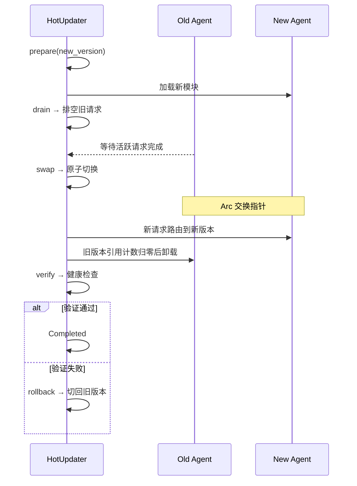
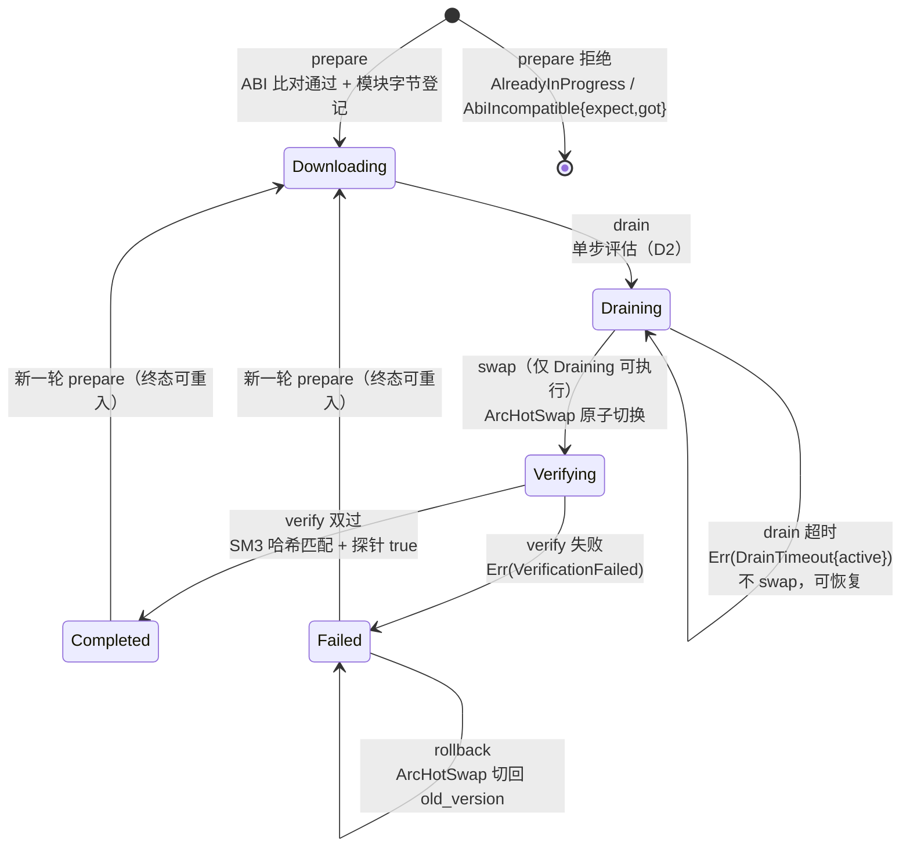

# EnerOS v0.124.0 Agent 热更新设计文档

> **版本**：v0.124.0（Phase 2 P2-K OTA 与 Recovery 第 2 版）
> **Crate**：`eneros-agent-hot-update`（`crates/agents/hot-update/`，no_std + alloc，依赖 heapless + eneros-crypto 国密）
> **蓝图**：`phase2.md` §v0.124.0
> **日期**：2026-07-22
> **关联**：上游 v0.123.0 A/B 分区升级（OTA 框架）/ v0.35.0 Agent 生命周期状态机 / v0.111.0 模型 OTA 热切换参考；下游 v0.125.0 Recovery Mode / v0.126.0 VPP 出口

---

## 1. 版本目标

电力控制 7×24 不间断运行要求 Agent 逻辑可在线迭代——停机重启不可接受（蓝图 §1）。本版交付「无感升级」能力：

- **热切换机制**（hot_swap.rs）：`ArcHotSwap<T>` 基于 `alloc::sync::Arc` + `core::sync::atomic::AtomicPtr` 的真实原子交换（D3 替换蓝图 `_phantom` stub）——读侧 `load` 无锁获取当前实例，写侧 `swap` 原子换入新实例并返回旧 `Arc`，旧实例在全部持有方释放后引用计数归零自动卸载（零中断）
- **热更新状态机**（agent_hot.rs）：七态 `HotUpdateState`（Idle/Downloading/Draining/Swapping/Verifying/Completed/Failed）+ `AgentHotUpdater` trait（prepare/drain/swap/verify/rollback/get_state）+ `AgentHotUpdaterImpl`（16 Agent 并发，heapless 定容）
- **排空与验证**：`request_started`/`request_finished` 活跃请求追踪（D7）→ drain 单步排空评估（D2）→ swap 原子切换 → verify 双重门（SM3 模块哈希常时比较 + 可注册健康探针，D4）→ 失败 rollback 一键回滚

为 v0.126.0 VPP 出口提供在线升级能力。

## 2. 前置依赖

| 依赖版本 | 提供能力 | 本版消费点 |
|---------|---------|-----------|
| v0.123.0 A/B 分区升级 | 基础 OTA 框架（整包/分区升级通道） | 热更新为其互补通道：整包走 A/B 分区，单 Agent 走本热更新；模块字节与 module_hash 由 OTA 打包管线下发 |
| v0.35.0 Agent 生命周期状态机 | Agent 注册/启停/状态管理 | `register_agent(agent_id, current)` 登记当前版本（D6）与生命周期事件对齐；热更新为运行态（Running）下的版本演进 |
| v0.111.0 模型 OTA 热切换 | `Arc` 承载实例 + swap/rollback 先例 | `ArcHotSwap` 沿袭其「Arc 引用计数即生命周期管理」惯例（model_loader.rs D9/D10），升级为 AtomicPtr 无锁原子交换 |
| v0.31.0~v0.33.0 国密 eneros-crypto | `sm3_hash` / `ct_eq` 常时比较 | verify 模块哈希校验（D4，workspace 内 path 依赖 `../../security/crypto`） |
| v0.11.0 用户堆 | alloc（Arc/Vec） | 版本实例、模块镜像缓冲动态分配 |
| v0.12.0 RTC | 系统时钟 | `now_ms` 时间注入源（D1，集成层供给 prepare/drain） |

Rust 工具链 nightly-2026-04-04（rust-toolchain.toml 锁定）；目标 aarch64-unknown-none + x86_64 主机测试。

## 3. 交付物清单

| 交付物 | 路径 | 说明 |
|--------|------|------|
| 热切换机制 | `crates/agents/hot-update/src/hot_swap.rs` | `ArcHotSwap<T>` 真实原子交换（new/load/swap/Drop 完整生命周期 + 内存安全不变式，D3） |
| 热更新状态机 | `crates/agents/hot-update/src/agent_hot.rs` | `HotUpdateState`/`AgentVersion`/`HotUpdateContext`/`HotUpdateError` + `AgentHotUpdater` trait + `AgentHotUpdaterImpl`（D1/D2/D4/D6/D7/D8） |
| crate 基座 | `crates/agents/hot-update/src/lib.rs` | 模块声明 + 重导出 + crate 文档（D1~D8 偏差表） |
| crate 清单 | `crates/agents/hot-update/Cargo.toml` | workspace 继承；依赖 heapless 0.8 + eneros-crypto（path） |
| 配置文件 | `configs/agent_hot_update.toml` | `[hot_update]`/`[verify]`/`[abi]` 三节 + 8 点中文注释 |
| 设计文档 | `docs/agents/agent-hot-update-design.md` | 本文档（11 章节 + 2 Mermaid + D1~D8 偏差表） |
| 单元测试 | src 内嵌 `#[cfg(test)]` | 15 个（SWP1~3 + HOT1~12） |
| 集成测试 | `crates/agents/hot-update/tests/hot_update_integration.rs` | 5 个（INT1~4 + PERF5，host std 环境） |
| 版本同步 | 根 `Cargo.toml` / `Makefile` / `ci.yml` / `gate.rs` | 0.123.0 → 0.124.0（Task 5） |

## 4. 详细设计

### 4.1 总体架构

两层结构，crate 零网络代码、零休眠原语：

- **切换层（ArcHotSwap）**：泛型原子指针容器。`new(arc)` 经 `Arc::into_raw` 持有当前实例一份引用；`load()` Acquire 读指针，以 `ManuallyDrop` 临时借用仅做引用计数 +1 后返回独立 `Arc`（不消费管理器持有的那份，杜绝 double-free）；`swap(new)` AcqRel 原子换入并 `from_raw` 还原旧 `Arc` 交还调用方；`Drop` 释放当前指针。内存安全不变式：**指针恒非空且恒为 `Arc::into_raw` 产物；实例引用计数恒 ≥ 1**（管理器持有的一份仅在 swap/Drop 时交还），故 load 读到的指针在读取瞬间必然有效。
- **管理层（AgentHotUpdaterImpl）**：四张 heapless 定容表（容量 16）——`contexts`（更新上下文）、`active_counts`（活跃请求计数，AtomicU32）、`slots`（版本槽，`ArcHotSwap<AgentVersion>`）、`module_images`（新模块字节，verify 哈希校验源）+ 可选健康探针 `fn(u32) -> bool`。编排流程：register_agent（D6 登记当前版本 + 初始化槽位/计数器）→ prepare（AlreadyInProgress 判定 + ABI 真实比对 + 模块字节登记 + 建上下文 Downloading）→ drain（D2 单步评估）→ swap（仅 Draining，原子切换 → Verifying）→ verify（D4 双重门）→ 失败 rollback（切回 old_version → Failed）。

### 4.2 热更新时序（蓝图 §4.3）



落地口径：① 「加载新模块」本版为模块字节登记（module_images），真实 dlopen/WASM 加载由集成层完成（蓝图 §2 外部依赖）；② 「Arc 交换指针」即 `ArcHotSwap::swap`（D3 真实实现）；③ 「健康检查」= SM3 模块哈希常时比较 + 健康探针双重门（D4，替换蓝图 `healthy = true` 简化）。

### 4.3 状态机迁移



### 4.4 drain 单步评估语义（D2）

蓝图 drain 为忙等 `loop`（内「短暂休眠（简化）」）——no_std 无休眠原语且忙等不可测试，改为单步评估：

- 每次调用先把状态置 Draining、同步活跃计数与超时参数到上下文；
- `active == 0` → 返回 `Ok(())`，可立即 swap；
- `now_ms - start_ms > timeout_ms` → 返回 `Err(DrainTimeout { active })`（超时时刻活跃数随错误上报），**不执行 swap**，状态停留 Draining——超时非永久失败，长请求完成后再次 drain 即可恢复推进（INT4 覆盖）；
- 否则返回 `Ok(())` 保持 Draining，由调用方（集成层调度器）按自持节奏重试。

### 4.5 verify 双重门（D4）

蓝图 `healthy = true` 简化不满足验收 §7.3「新版本模块哈希验证」，改为：

1. **SM3 门**：对 prepare 登记的模块字节计算 `sm3_hash`，与 `new_version.module_hash` 经 `ct_eq` 常时比较（复用 eneros-crypto，记忆 §5.5 禁止重复造轮子）；module_images 无登记记录视为不匹配；
2. **探针门**：`with_probe` 注册的健康探针 `probe(agent_id)` 返回 false 视为不健康；默认 `new()` 无探针视为恒 true（仅 SM3 单门）。

双过 → `Completed` + `Ok(true)`；任一失败 → `Failed` + `Err(VerificationFailed)`，调用方应 `rollback`（INT3 覆盖）。

## 5. 技术交底

### 5.1 Agent ABI 兼容性规范（蓝图 §7.4 文档验收）

`AgentVersion.abi_version: u16` 标识 Agent 模块与框架之间的**二进制接口版本**，覆盖：`AgentHotUpdater`/Agent 业务 trait 的 vtable 布局、跨模块消息结构体内存布局、`entry_point` 符号的调用约定语义。

- **语义约定**：`abi_version` 仅在接口发生**不兼容变更**（字段增删改序、trait 方法签名变更、调用约定变更）时 +1；新增可选能力且不改变既有布局时不 bump（由 `version` 字段区分功能演进）。
- **兼容规则（exact match）**：热更新要求新版本 `abi_version` 与 `register_agent` 登记的当前版本**完全一致**——`prepare` 时真实比对（D6 修复蓝图以合成 old_version 比对导致检查永不触发的缺陷），不一致即 `Err(AbiIncompatible { expect, got })` 拒绝（HOT5 覆盖）。不允许「向下兼容窗口」：no_std 静态链接 + 指针级热切换场景下，任何布局偏差都是未定义行为。
- **接口变更版本管理**：接口破坏性升级必须 ① 先整体升级框架（bump `abi_version`，经 v0.123.0 A/B 分区整包升级通道发布并全量重启）；② 新框架下所有 Agent 以新 ABI 重新构建；③ 之后该 ABI 内的 Agent 版本演进方可走本热更新通道。**禁止**经热更新混部新旧 ABI。

### 5.2 选型对比表（蓝图 §5.1）

| 方案 | 停机 | 兼容性 | 复杂度 | 结论 |
|------|------|--------|--------|------|
| Arc 原子交换 | 零 | ABI 稳定 | 中 | ⭐ 采用 |
| WASM 热加载 | 零 | 高 | 高 | Phase 3 |
| 进程级重启 | 短 | 高 | 低 | 有中断 |
| 容器化 | 零 | 高 | 高 | 资源足 |

选型理由：Arc 原子交换为指针级无锁切换（Acquire/AcqRel 内存序），切换延迟纳秒级（PERF5 实测，远低于蓝图 <10ms 要求），no_std 可得（`alloc::sync::Arc` + `core::sync::atomic`），且与 v0.111.0 模型 OTA 热切换惯例一脉相承；WASM 热加载留待 Phase 3 隔离性更强时引入；进程级重启存在服务中断窗口，不满足 7×24；容器化超出边缘 RTOS 资源预算。

### 5.3 关键技术（蓝图 §5.2）

- **Arc 原子交换**：指针级原子切换，读侧无锁；旧实例卸载时机由引用计数自动承载（蓝图 §5.4 难点「内存安全：旧模块卸载时机」的解法——不手动择时，全部持有方释放后归零即卸载）。
- **请求排空**：`request_started`/`request_finished` AtomicU32 精确计数（D7 公开给路由层），drain 依据计数判定；超时上报当时活跃数。
- **ABI 检查**：prepare 入口 exact-match 比对（§5.1）。
- **健康验证**：SM3 模块哈希常时比较 + 可注册健康探针双重门（§4.5）。

### 5.4 实现要点决策

- **时间戳注入（D1）**：no_std 无系统时间，`prepare`/`drain` 的 `now_ms` 参数由集成层经 v0.12.0 RTC 供给（v0.111.0 D8 同先例）。
- **重复注册语义**：`register_agent` 对已注册 Agent 为**更新**登记版本（经 ArcHotSwap 原子换入），活跃计数保持不变；容量满（16）静默忽略（heapless 定容口径）。
- **终态可重入**：Completed/Failed 后允许新一轮 prepare（INT3 覆盖回滚后重试场景）。
- **LLM 必要性证据（P1-5）**：本版为模块生命周期管理（状态机 + 指针切换 + 哈希校验），不涉及推理决策、无优化求解，LLM 推理归 v0.59.0 llm-engine 职责；Solver 无关（L1/L2 路径之外的基础服务）。

## 6. 测试计划

### 6.1 单元测试（15 个，src 内嵌 `#[cfg(test)]`）

| 组 | 编号 | 名称 | 断言要点 |
|----|------|------|---------|
| hot_swap | SWP1 | load 返回当前实例 | 字段正确 + strong_count==2（管理器 1 + load 1） |
| hot_swap | SWP2 | swap 后 load 为新实例 | 旧 Arc 字段正确 + load 路由新实例 |
| hot_swap | SWP3 | 旧实例释放语义 | 全 drop 后 strong_count 递减链正确 |
| agent_hot | HOT1~12 | 状态机/ABI/排空/验证/回滚/未注册 | 初始 None/register 查询/prepare 建上下文/AlreadyInProgress/AbiIncompatible 字段/drain 通过/drain 超时/swap 状态校验+路由/verify 双过/探针失败/rollback 恢复/AgentNotFound |

### 6.2 集成测试（5 个，tests/hot_update_integration.rs，host std）

| 编号 | 名称 | 断言要点 |
|------|------|---------|
| INT1 | ★ 完整热更新流程 | register→prepare(真实 SM3 模块字节)→请求进出×2→drain→swap→slot_load 断言 v2 全字段→verify→Completed；v1 在途 Arc strong_count==1，drop 归零（卸载语义） |
| INT2 | ★ 出口判定复演：平滑替换 | drain 期间活跃请求逐个完成（先 drain 保持 Draining → 完成至 0 → 再 drain 通过）；swap 前 load 拿 v1、swap 后 load 拿 v2；swap 前 load 的 v1 Arc 切换后仍可读取（请求不中断）；全程无 Err |
| INT3 | 验证失败回滚 | with_probe 注册恒 false 探针 → swap 后 verify → Failed + Err(VerificationFailed) → rollback → load 恢复 v1；Failed 终态可开启新一轮 |
| INT4 | 故障注入：排空超时 | request_started 后不 finished，now_ms 推进超 drain_timeout_ms → Err(DrainTimeout{active:1}) 且未 swap（load 仍 v1）；请求完成后排空恢复 |
| PERF5 | swap 切换延迟 | 10000 次均值（release 打印）；`ENEROS_PERF_GATE=1` 断言 <10ms（蓝图 §6.3/§7.2），默认仅打印不断言（v0.113.0~v0.122.0 先例口径） |

### 6.3 GPU 规则

不涉及 GPU（记忆 §4.2：状态机 + 指针交换 workload，无矩阵运算）。

## 7. 验收标准

1. `cargo test -p eneros-agent-hot-update`：20/20 全过（15 单元 + 5 集成，debug）
2. `cargo test -p eneros-agent-hot-update --release`：20/20 全过，PERF5 实测均值打印且 < 10ms
3. `cargo build -p eneros-agent-hot-update --target aarch64-unknown-none -Z build-std=core,alloc -Z build-std-features=compiler-builtins-mem`：交叉编译通过（Task 5 校验）
4. `cargo clippy -p eneros-agent-hot-update --all-targets -- -D warnings`：零警告
5. `cargo fmt -p eneros-agent-hot-update -- --check`：通过
6. 蓝图 §7.5 出口判定：Agent 平滑替换验证通过（INT2 复演——swap 前后路由切换、在途请求不中断、全程无错误）
7. 蓝图 §7.3 安全验收：新版本模块哈希验证（SM3 常时比较，INT1/HOT9 覆盖）
8. 蓝图 §7.4 文档验收：ABI 兼容性规范（本文档 §5.1）

## 8. 风险

| 风险 | 等级 | 缓解 |
|------|------|------|
| 旧模块卸载时机（蓝图 §8.1 技术风险） | 中 | 不手动择时——`ArcHotSwap` 内存安全不变式 + Arc 引用计数承载：swap 返回旧 Arc 交调用方，在途 load 持有者全部释放后归零自动卸载（SWP3/INT1 断言 strong_count 链）；长请求持有期间旧版本继续可用，无 use-after-free |
| 全局状态未迁移导致行为异常（蓝图 §8.5 已知坑点） | 中 | 规范声明：Agent 全局/静态状态（计数器、缓存、连接句柄）**不随热更新迁移**，新版本模块须自初始化并经健康探针确认；漏调 `request_finished` 导致计数不归零 → drain 必然超时（configs 注释点 3 显式警示路由层配对调用） |
| ABI 不兼容导致热更新失败/未定义行为（蓝图 §8.2） | 高 | prepare exact-match 硬门（§5.1，D6 真实比对）；接口变更必须走 v0.123.0 A/B 分区整包通道，禁止热更新混部 |
| 排空超时（长请求/计数泄漏） | 中 | `DrainTimeout{active}` 上报超时时刻活跃数供运维决策；超时非永久失败，可重试恢复（INT4）；drain_timeout_ms 应大于业务最长单请求耗时（configs 注释点 2） |
| 新旧版本同时驻留内存（蓝图 §8.3 资源风险） | 低 | 峰值 = 2× 单模块大小 + 单份模块镜像，归入 Agent Runtime ≤ 64MB 分区预算（configs 注释点 7）；verify 后模块镜像由集成层决定是否清理 |
| 篡改模块热加载 | 高 | SM3 模块哈希强制校验（D4，验收 §7.3）+ ct_eq 常时比较防时序侧信道；verify 失败必 rollback（INT3） |

## 9. 多角度要求

- **功能**：热加载（模块字节登记 + 槽位换入）+ 热替换（原子交换）+ 热卸载（引用计数归零自动释放）三能力齐备（蓝图 §9）
- **性能**：swap 切换 < 10ms——实测纳秒级（PERF5），余量 > 4 个数量级
- **安全**：SM3 模块哈希常时比较（信创全程国密，复用 eneros-crypto）；探针/哈希失败均 Failed + 回滚路径可审计
- **可靠**：排空 + 超时上报 + 失败回滚 + 终态重入；状态机七态全覆盖测试
- **可维护**：ABI 版本管理规范（§5.1）+ D1~D8 偏差表（§11）+ 配置三节中文注释
- **可观测**：`get_state` 上下文查询（state/active_requests/drain_timeout_ms/start_ms）；DrainTimeout 携带活跃数；PERF5 延迟打印（蓝图 §9「热更新进度指标」的 crate 侧承载，指标汇聚归 v0.120.0 metrics）
- **可扩展**：`ArcHotSwap<T>` 泛型容器可直接复用于其他热切换目标；WASM 热加载（Phase 3）可在 verify 门前插入加载适配层，状态机无需变更
- **信创**：SM3 国密哈希；算法自研 + 国密组件复用，零外部密码学依赖

## 10. 接口契约

```rust
// ============ crates/agents/hot-update/src/hot_swap.rs ============
pub struct ArcHotSwap<T> { /* ptr: AtomicPtr<T> 私有 */ }
impl<T> ArcHotSwap<T> {
    pub fn new(arc: Arc<T>) -> Self;            // 持有实例一份引用（into_raw）
    pub fn load(&self) -> Arc<T>;               // 无锁读当前实例，计数 +1
    pub fn swap(&self, new: Arc<T>) -> Arc<T>;  // 原子换入，返回旧 Arc（调用方释放）
}
// impl<T> Drop：释放管理器持有的当前实例引用

// ============ crates/agents/hot-update/src/agent_hot.rs ============
pub enum HotUpdateState {                       // Debug/Clone/Copy/PartialEq/Eq（七态）
    Idle, Downloading, Draining, Swapping, Verifying, Completed, Failed,
}

pub struct AgentVersion {                       // Debug/Clone/PartialEq/Eq
    pub agent_id: u32,
    pub version: HString<32>,                   // ≤ 32 字节
    pub module_hash: [u8; 32],                  // SM3，verify 校验目标
    pub entry_point: HString<64>,               // ≤ 64 字节
    pub abi_version: u16,                       // exact-match（§5.1）
}

pub struct HotUpdateContext {                   // Debug/Clone（七字段）
    pub agent_id: u32,
    pub old_version: AgentVersion,              // 登记版本快照，rollback 目标
    pub new_version: AgentVersion,
    pub state: HotUpdateState,
    pub active_requests: u32,
    pub drain_timeout_ms: u64,
    pub start_ms: u64,                          // D1：prepare now_ms 注入
}

pub enum HotUpdateError {                       // Debug/Clone/PartialEq/Eq（七变体）
    AgentNotFound,
    AbiIncompatible { expect: u16, got: u16 },
    DrainTimeout { active: u32 },
    ModuleLoadFailed,
    VerificationFailed,
    AlreadyInProgress,
    NoOldVersionToRollback,
}

pub trait AgentHotUpdater {
    fn prepare(&mut self, agent_id: u32, new_version: AgentVersion,
        module_bytes: &[u8], now_ms: u64) -> Result<(), HotUpdateError>;      // D1/D6
    fn drain(&mut self, agent_id: u32, timeout_ms: u64,
        now_ms: u64) -> Result<(), HotUpdateError>;                           // D2 单步
    fn swap(&mut self, agent_id: u32) -> Result<(), HotUpdateError>;          // 仅 Draining
    fn verify(&mut self, agent_id: u32) -> Result<bool, HotUpdateError>;      // D4 双重门
    fn rollback(&mut self, agent_id: u32) -> Result<(), HotUpdateError>;
    fn get_state(&self, agent_id: u32) -> Option<&HotUpdateContext>;
}

pub struct AgentHotUpdaterImpl { /* contexts/active_counts/slots/module_images/probe 私有 */ }
impl AgentHotUpdaterImpl {
    pub fn new() -> Self;                            // 无探针（verify 仅 SM3 单门）
    pub fn with_probe(probe: fn(u32) -> bool) -> Self;  // D4 注册健康探针
    pub fn register_agent(&mut self, agent_id: u32, current: AgentVersion);  // D6
    pub fn request_started(&self, agent_id: u32);    // D7（路由层调用，AtomicU32 +1）
    pub fn request_finished(&self, agent_id: u32);   // D7（路由层调用，AtomicU32 -1）
    pub fn slot_load(&self, agent_id: u32) -> Option<Arc<AgentVersion>>;     // D8
}
```

## 11. 偏差声明

| 编号 | 偏差 | 理由 |
|------|------|------|
| **D1** | 蓝图 `crate::current_time_ms()` 全局时间函数 → `now_ms` 参数传入（prepare/drain/start_ms） | no_std 无系统时间（v0.111.0 D8 同先例）；集成层由 v0.12.0 RTC 供给 |
| **D2** | 蓝图 drain 忙等 `loop`（内「短暂休眠（简化）」）→ 单步评估语义：活跃=0 → Ok 可 swap；`now_ms - start_ms > timeout` → `DrainTimeout{active}`；否则保持 Draining 由调用方重试 | no_std 无休眠原语且忙等不可测试；重试节奏由集成层调度器自持 |
| **D3** | 蓝图 `ArcHotSwap<T>` stub（`_phantom` + 原样返回）→ 真实 `Arc` + `AtomicPtr` 原子交换（new/load/swap/Drop 完整生命周期 + 内存安全不变式） | 蓝图占位实现不满足「热切换机制（真实原子交换，非 stub）」需求 |
| **D4** | 蓝图 verify `healthy = true` 简化 → 真实 SM3 模块哈希校验（复用 eneros-crypto `sm3_hash` + `ct_eq` 常时比较）+ 可注册健康探针 `fn(u32) -> bool`（`with_probe`，默认恒 true） | 验收 §7.3 要求模块哈希验证；记忆 §5.5 禁止重复造轮子 |
| **D5** | 蓝图 `crates/ota/src/{agent_hot,hot_swap}.rs` → `crates/agents/hot-update/`（eneros-agent-hot-update） | 记忆 §2.3.1 强制 crate 归 `crates/<subsystem>/`；与 v0.35.0 Agent 生命周期、v0.111.0 model-ota 同子系统 |
| **D6** | 蓝图 prepare 以合成 old_version（abi 复制自 new_version）比对导致 AbiIncompatible 永不触发 → 新增 `register_agent(agent_id, current)` 登记当前版本，ABI 与登记版本真实比对 | 蓝图代码缺陷修复，使 ABI 兼容检查真实生效（HOT5 覆盖） |
| **D7** | 蓝图活跃请求计数为私有 increment/decrement → 公开 `request_started`/`request_finished`（AtomicU32，Relaxed） | 路由层需在请求进出时调用，私有方法不可达 |
| **D8** | `slot_load` 由私有 → 公开（返回 `Option<Arc<AgentVersion>>`） | 路由层把新请求路由到当前版本、集成测试断言 swap 前后路由目标均须经此读取；蓝图未给出路由读取入口（Task 4 集成测试阶段发现并登记） |

---

**源码索引**：[hot_swap.rs](../../crates/agents/hot-update/src/hot_swap.rs) · [agent_hot.rs](../../crates/agents/hot-update/src/agent_hot.rs) · [lib.rs](../../crates/agents/hot-update/src/lib.rs) · [集成测试](../../crates/agents/hot-update/tests/hot_update_integration.rs) · [配置模板](../../configs/agent_hot_update.toml)
