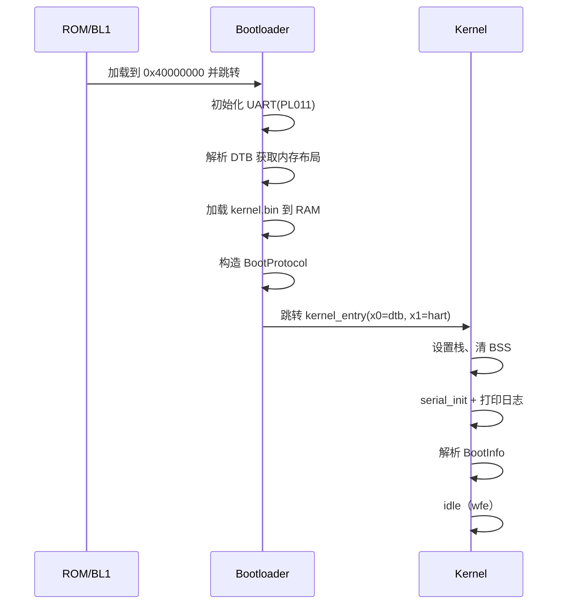

# EnerOS v0.129.0 启动协议规范（Bootloader → 内核）

> 版本：v0.129.0
> 适用范围：EnerOS 自研 Bootloader 与内核入口之间的交接契约（QEMU virt aarch64 / 真机）
> 蓝图依据：`蓝图/phase3.md` §v0.129.0（§1 版本目标 / §3 交付物 / §4.1~4.4 详细设计 / §8 风险）
> Spec：`.trae/specs/develop-v12900-bootloader-kernel-entry/spec.md`（偏差 D1~D8；D9/D10 为实施期新增）
> 配套文档：[qemu_run.md](./qemu_run.md)（QEMU 启动操作手册）

---

## 1. 版本目标与 ADR-0001 定位

**核心一句话**：实现 Bootloader 并让自研内核在 ARM64 真机/QEMU 上首次启动，串口输出启动日志——**自研内核的"第一次呼吸"**。

- **Phase 定位**：Phase 3 P3-A 收官版、★ 里程碑版本——自研内核启动验证。后续所有内核功能都建立在"能启动"之上。
- **业务价值**：证明自研内核可在真实硬件上运行，是信创认证"国产内核可启动"的最基础证据。
- **出口关联**：自研内核出口标准的"可启动"硬性指标；为 v0.130.0 内存管理提供运行环境；无法启动则阻塞全部后续 P3-B/C/D。
- **ADR-0001 定位**：依据 ADR-0001，Phase 3 主路径为 seL4 深度定制（方案 A）；本 Bootloader 属自研内核研究/fallback 线的启动基线——负责内核镜像加载前的最小硬件初始化（串口）与启动信息（DTB/RAM）采集，并通过 `BootProtocol` 契约与内核入口交接（crate 文档原样口径，见 [lib.rs](../../crates/kernel/bootloader/src/lib.rs)）。

---

## 2. 前置依赖

| 类别 | 依赖项 | 说明 |
|------|--------|------|
| 前序版本 | v0.128.0 构建系统（[../kernel/build_system.md](../kernel/build_system.md)） | 内核二进制可编译（`aarch64-unknown-none` 交叉编译、build.rs 注入链接脚本模式） |
| 外部依赖 | QEMU virt（aarch64）/ 真机开发板 | 启动验证环境 |
| 假设 | DTB 由启动环境提供 | QEMU `-kernel` 约定 `x0 = dtb_phys`；内存布局信息来源 |
| 阻塞 | 无法启动则阻塞全部后续 P3-B/C/D | — |

工具链锁定见根 [rust-toolchain.toml](../../rust-toolchain.toml)（nightly-2026-04-04）。

---

## 3. 交付物清单

**代码类**：

| 交付物 | 路径 |
|--------|------|
| Bootloader 主程序（naked `_start` + `boot_main`） | [crates/kernel/bootloader/src/main.rs](../../crates/kernel/bootloader/src/main.rs) |
| PL011 串口驱动（`SerialPort` trait + `Pl011Uart`） | [crates/kernel/bootloader/src/uart.rs](../../crates/kernel/bootloader/src/uart.rs) |
| 最小 FDT 解析器（`parse_dtb_ram`，零 unsafe） | [crates/kernel/bootloader/src/dtb.rs](../../crates/kernel/bootloader/src/dtb.rs) |
| 启动协议模型（`BootProtocol` / `BootStage`） | [crates/kernel/bootloader/src/protocol.rs](../../crates/kernel/bootloader/src/protocol.rs) |
| lib 导出（eneros-bootloader） | [crates/kernel/bootloader/src/lib.rs](../../crates/kernel/bootloader/src/lib.rs) |
| 内核入口（naked `_start` 设栈清 BSS + `rust_main`） | [crates/kernel/microkernel/src/main.rs](../../crates/kernel/microkernel/src/main.rs) |

**配置类**：

| 交付物 | 路径 |
|--------|------|
| Bootloader 链接脚本（基址 0x40080000） | [crates/kernel/bootloader/linker.ld](../../crates/kernel/bootloader/linker.ld) |
| 内核链接脚本（基址 0x49000000，64KB 栈段） | [crates/kernel/microkernel/linker.ld](../../crates/kernel/microkernel/linker.ld) |
| 链接脚本注入（TARGET=aarch64 时 `-T linker.ld`） | [crates/kernel/bootloader/build.rs](../../crates/kernel/bootloader/build.rs) |

**测试类**：

| 交付物 | 路径 |
|--------|------|
| QEMU 启动验证脚本（双关键串断言） | [tests/boot_test.sh](../../tests/boot_test.sh) |

**文档类**：

| 交付物 | 路径 |
|--------|------|
| 启动协议规范（本文档） | `docs/boot/boot_protocol.md` |
| QEMU 启动步骤 | [docs/boot/qemu_run.md](./qemu_run.md) |

> **uart.rs 实现注记**：`Pl011Uart` 以 `core::cell::RefCell<B>` 持有寄存器总线——`SerialPort::putc(&self)`/`getc(&self)`（蓝图 §3 原样签名）为共享引用语义，而 `RegIo::write32(&mut self)` 需独占引用，普通字段无法直接调和；`RefCell` 是零 unsafe 的 core 内可变性方案（Bootloader 启动期为单核单线程上下文，无运行时借用冲突）。

---

## 4. BootProtocol 启动协议

`BootProtocol`（[protocol.rs](../../crates/kernel/bootloader/src/protocol.rs)，蓝图 §3 原样字段）是 Bootloader 与内核之间的交接契约：Bootloader 在跳转内核入口前按约定填充本结构并自检，内核入口侧先 `validate()` 校验魔数与版本，再消费其余字段。

### 4.1 字段表

| 字段 | 类型 | 取值/语义 |
|------|------|-----------|
| `magic` | `u32` | 协议魔数，固定 `0xE4E5_4F53`（"ENOS"），常量 `BOOT_PROTOCOL_MAGIC` |
| `version` | `u16` | 协议版本，当前 `= 1`，常量 `BOOT_PROTOCOL_VERSION` |
| `dtb_phys` | `usize` | 设备树 DTB 物理地址 |
| `dtb_size` | `usize` | 设备树 DTB 字节长度（当前填 0，由内核侧按 FDT 头 totalsize 自解析） |
| `ram_start` | `usize` | 可用 RAM 起始物理地址 |
| `ram_size` | `usize` | 可用 RAM 字节数 |
| `hart_id` | `usize` | 启动核硬件线程 ID |
| `kernel_entry` | `usize` | 内核入口物理地址（当前 `0x4900_0000`，见 §6） |

### 4.2 `validate()` 校验语义

```rust
pub fn validate(&self) -> Result<(), BootError>
```

| 条件 | 返回 | 语义 |
|------|------|------|
| `magic != BOOT_PROTOCOL_MAGIC` | `Err(BootError::BadMagic)` | 目标内存块不是合法的 `BootProtocol`，**拒绝启动**（蓝图 §4.4：打印错误后死循环） |
| `version != BOOT_PROTOCOL_VERSION` | `Err(BootError::UnsupportedVersion)` | 协议版本不受支持（版本化扩展预留，蓝图 §9.7） |
| 均符合 | `Ok(())` | 放行进入跳转流程 |

校验失败路径由调用方（[bootloader/src/main.rs](../../crates/kernel/bootloader/src/main.rs)）执行：打印 `[boot] BAD MAGIC, halt` 后 `wfe` 死循环挂起（见 §8）。

---

## 5. 跳转寄存器约定与启动时序

### 5.1 寄存器约定（蓝图 §4.2 原样）

Bootloader → Kernel 跳转约定（ARM64）：

- `x0 = dtb_phys`
- `x1 = hart_id`
- `PC = kernel_entry`
- `SP = __stack_top`（内核自己设置）

实现口径：`jump_to_kernel()` 内联汇编按 `mov x0 / mov x1 / br entry`（noreturn）执行；内核侧 naked `_start` 首条指令即设 `sp = __stack_top`（[microkernel/linker.ld](../../crates/kernel/microkernel/linker.ld) 导出，64KB `.stack (NOLOAD)` 段、16B 对齐），随后清零 BSS 再 `bl rust_main`（x0/x1 原样透传）。Bootloader 侧自身栈由 naked `_start` 自设（`sp = __boot_start` 向下生长，偏差 D10，见 §10）。

### 5.2 启动时序（蓝图 §4.3 原样收录）



> 注：Mermaid 中"加载到 0x40000000"为 ROM 视角；QEMU virt `-kernel` 实际加载/入口为 RAM 起始偏移 0x80000 处（0x40080000，偏差 D1），"加载 kernel.bin 到 RAM"在 QEMU 场景由 `-device loader` 代劳（蓝图 §8.5 坑点），真机场景须从 Flash 真实读取。

---

## 6. 加载地址约定现状（D1 + D9 最终口径）

| 对象 | 物理地址 | 加载/来源 | 备注 |
|------|---------|-----------|------|
| RAM 全域 | `0x40000000` + 256MB | QEMU `-m 256M` | 默认 128MB 不覆盖 0x49000000，必须显式 `-m 256M` |
| Bootloader 镜像 | `0x40080000` | QEMU `-kernel bootloader.bin` | QEMU virt `-kernel` 固定加载/入口：RAM 起始偏移 0x80000（D1） |
| Bootloader 初始栈 | 栈顶 `0x40080000`（向下生长） | naked `_start` 自设（D10） | 生长空间 `0x40000000`~`0x40080000`（512KB） |
| Kernel 镜像 | `0x49000000` | QEMU `-device loader,file=kernel.bin,addr=0x49000000` | D1 让位 Bootloader + D9 避开 DTB 区后的最终口径 |
| DTB | `0x48000000`（起 1MB 区域） | QEMU 8.2 virt 自动生成并固定放置 | 与 kernel 原拟基址 0x48000000 硬冲突 → D9 |
| PL011 UART | `0x09000000` | QEMU virt 机器 MMIO | 硬编码常量 `UART_BASE`；真机基址差异见 §9 |

**D9 冲突详情**：QEMU 8.2 virt 将自动生成的 DTB 固定置于 RAM base+128MB（即 `0x48000000`）起 1MB 区域（`0x48000000`~`0x48100000`），与 spec D1 原拟的 kernel 基址 `0x48000000` 重叠，实测报 `ROM regions are overlapping`；kernel 基址上移 16MB 至 `0x49000000` 避开，bootloader 跳转目标（`KERNEL_ENTRY` 常量）与 [tests/boot_test.sh](../../tests/boot_test.sh) 的 loader addr 同步修改。三处口径（[bootloader/linker.ld](../../crates/kernel/bootloader/linker.ld) / [microkernel/linker.ld](../../crates/kernel/microkernel/linker.ld) / 脚本）已一致。

---

## 7. BootStage 启动六阶段（蓝图 §4.1）

`BootStage`（[protocol.rs](../../crates/kernel/bootloader/src/protocol.rs)）标识启动流程推进到的阶段，供启动日志与故障定位使用：

| 序号 | 枚举变体 | 语义 |
|------|---------|------|
| 1 | `BootloaderInit` | Bootloader 初始化（UART 就绪、启动日志可用） |
| 2 | `LoadKernel` | 加载内核镜像至约定加载地址 |
| 3 | `ParseDtb` | 解析 DTB，获取内存布局等设备信息 |
| 4 | `JumpToKernel` | 构造 `BootProtocol` 并跳转内核入口 |
| 5 | `KernelRustMain` | 已进入内核 `rust_main` |
| 6 | `KernelIdle` | 内核进入 idle 循环（启动流程完成） |

---

## 8. 错误处理与 fallback（蓝图 §4.4）

| 故障 | 行为 | 出处/实现 |
|------|------|-----------|
| Bootloader 加载内核失败 | 串口打印错误后死循环 | 蓝图 §4.4（真机加载路径；QEMU 场景由 `-device loader` 代劳，故障注入见 [qemu_run.md](./qemu_run.md) §6） |
| DTB 解析失败 | 使用默认内存布局 `(0x40000000, 256MB)`；bootloader 侧打印 `[boot] dtb parse failed, fallback ram`，内核侧同策略静默回退 | 蓝图 §4.4；[main.rs](../../crates/kernel/bootloader/src/main.rs) `FALLBACK_RAM` |
| BootProtocol 校验失败（坏魔数/版本） | 打印 `[boot] BAD MAGIC, halt` 后 `wfe` 死循环挂起 | 蓝图 §4.4"打印错误后死循环"口径的实现 |
| 内核 panic | `wfe` 死循环静默停转（panic 态下无可依赖的安全打印路径，串口诊断增强属后续版本） | [microkernel/src/main.rs](../../crates/kernel/microkernel/src/main.rs) `#[panic_handler]`；蓝图 §4.4"串口打印 panic 信息"为演进方向 |

DTB 解析器错误变体（[dtb.rs](../../crates/kernel/bootloader/src/dtb.rs) `FdtError`）：`BadMagic`（FDT magic != 0xD00DFEED）/ `Truncated`（访问越出 `dtb_phys + totalsize`）/ `NoMemory`（未找到 memory 节点 reg 属性）；任一错误均由调用方落入上述 fallback。

---

## 9. 已知限制与后续跟进

1. **QEMU 真实 DTB 解析当前走 fallback 分支**：实测串口输出显示 bootloader 与内核双侧均进入 fallback（见 [qemu_run.md](./qemu_run.md) §4）。此为蓝图 §4.4 设计的容忍路径，fallback `(0x40000000, 256MB)` 恰好与 QEMU `-m 256M` 实际布局一致，**功能无碍**；解析器正确性已由 host 单测覆盖（合法 blob / magic 损坏 / 无 memory 节点三例），**对 QEMU FDT 的适配列入后续版本跟进**。
2. **真机 ATF 三级跳转未覆盖**（蓝图 §8.1/§5.4）：真机启动需处理 ATF（ARM Trusted Firmware）→ Bootloader → Kernel 三级跳转，可能需 EL3 处理。
3. **飞腾/鲲鹏 UART 基址差异**（蓝图 §8.4）：当前 `UART_BASE = 0x0900_0000` 为 QEMU virt PL011 硬编码；PL011 协议本身真机兼容（蓝图 §5.2），基址适配归 v0.145/146。
4. **耗时口径**：蓝图门槛"Bootloader → 内核 idle < 100ms"为**目标机启动时间**口径；QEMU 实测中该区间瞬时完成（远低于 100ms，受 `-nographic` 串口吞吐限制无法精确计时），以 timeout 10s 内完整输出双关键串作为通过判据（见 [qemu_run.md](./qemu_run.md) §5）。
5. **BootProtocol 未跨跳转实际传递**（偏差 D5）：跳转仅携带 x0=dtb_phys、x1=hart_id（蓝图 §4.2 原样），协议结构体用于 bootloader 自检与本文档契约。

---

## 10. 蓝图偏差表（D1~D10）

> D1~D8 源自 spec"蓝图偏差"章节；D9/D10 为实施期实测新增。历史口径：v0.128.0 文档中 kernel"基址 0x40080000"由本版本起作废（spec Impact 约定：不修改历史文档，于此记录现状）。

| 编号 | 蓝图原述 | 实际实现 | 理由 |
|------|---------|---------|------|
| D1 | bootloader 链接脚本加载地址 0x40000000（Mermaid"加载到 0x40000000 并跳转"）；kernel 于 v0.128.0 链接基址 0x40080000 | bootloader 基址 **0x40080000**（QEMU virt `-kernel` 固定加载/入口：RAM 起始偏移 0x80000，蓝图 0x40000000 为 ROM 视角）；kernel 基址让位并迁移（经 D9 定为 **0x49000000**，`-device loader` 加载） | QEMU virt `-kernel` 加载约定固定；两个镜像不能同址 |
| D2 | 交付物 `bootloader/`（根 crate）；`kernel/src/boot.rs` 启动信息解析 | crate 落位 `crates/kernel/bootloader/`（eneros-bootloader，仓库规范 §2.3.1 子系统归口）；DTB 解析落位 eneros-bootloader lib，bootloader 与 kernel 双侧复用同一份解析器（microkernel bin 经 path 依赖引入；microkernel 既有 `src/boot.rs` BootInfo 保持不变） | 子系统强制归口；单一解析器避免双份实现漂移 |
| D3 | `_start` 为普通 extern "C" 函数（蓝图 §4.5 伪码），依赖进入时 SP 有效；BSS 由链接脚本 /DISCARD 外清零循环保留 | spec 阶段假设同蓝图（不加 naked 设栈，骨架零静态变量、bin 保持零 .data/.bss 设计）；**进入 SP 假设在实施期被实测推翻，由 D10 修订** | 见 D10 |
| D4 | DTB 解析直接读物理内存 | `parse_dtb_ram(dtb_phys, read: &dyn Fn(usize) -> u64)` 注入读取闭包：解析器本体零 unsafe、host 可测；target 侧闭包内为 volatile 物理内存读（unsafe 集中注释） | 可测性 + unsafe 最小化 |
| D5 | BootProtocol 作为 Bootloader→内核交接契约（隐含随跳转传递） | 协议不经寄存器传递（跳转仅 x0=dtb、x1=hart，蓝图 §4.2 原样）；结构体用于 bootloader 自检与文档契约；内核侧"拒绝启动"语义由 DTB magic 校验承担（故障注入 E2 单测覆盖 `BootProtocol::validate`） | 跳转约定仅两个参数寄存器，无法容纳多字段结构体 |
| D6 | `tests/boot_test.sh` QEMU 实测 | Windows host 无 qemu-system-aarch64：脚本交付 + host 静态契约/单测全过 + 文档记录完整操作法；WSL2（Ubuntu）可用时在 WSL 内实测并回填耗时——**已在 WSL2 QEMU 8.2.2 实测 PASS**（见 [qemu_run.md](./qemu_run.md) §5） | Windows 环境限制；WSL2 可用故实测未缺失 |
| D7 | —（版本号管理口径） | `KERNEL_VERSION` minor 128 → 129（随版本同步）；VER1/T5/BSM4 断言同步 | 版本同步规范 |
| D8 | `getc(&self) -> Option<u8>`（蓝图 §3 原样签名，轮询 RXFE bit4） | 同蓝图实现；bootloader/kernel 主流程不使用 getc（仅 trait 完整性 + mock 测试覆盖） | 启动期无串口输入需求 |
| **D9**（实施期新增） | kernel 链接基址 0x48000000（蓝图 `KERNEL_LOAD_ADDR`，spec D1 采纳） | kernel 基址 0x48000000 → **0x49000000**；bootloader 跳转目标 `KERNEL_ENTRY` 与 [tests/boot_test.sh](../../tests/boot_test.sh) loader addr 同步 | QEMU 8.2 virt 自动生成的 DTB 固定置于 RAM base+128MB（0x48000000）起 1MB 区域，与 kernel 镜像重叠（实测 `ROM regions are overlapping` 报错），上移 16MB 避开 |
| **D10**（实施期新增） | bootloader `_start` 普通 extern "C"（spec D3 假设进入 SP 有效） | 改为 **naked 入口自建栈**：`mov sp, __boot_start`（栈顶=镜像起始，向下生长于 0x40000000~0x40080000 的 512KB RAM 空间），再 `b` 入 `boot_main`（x0/x1 透传）；与 microkernel naked `_start` 口径一致 | QEMU aarch64 `-kernel` bootstub 仅置 x0=dtb_phys、x1~x3=0 后 `br` 至入口，**不初始化 SP**（CPU reset 后 SP=0，沿用即栈下溢无声死亡，实测确认） |
