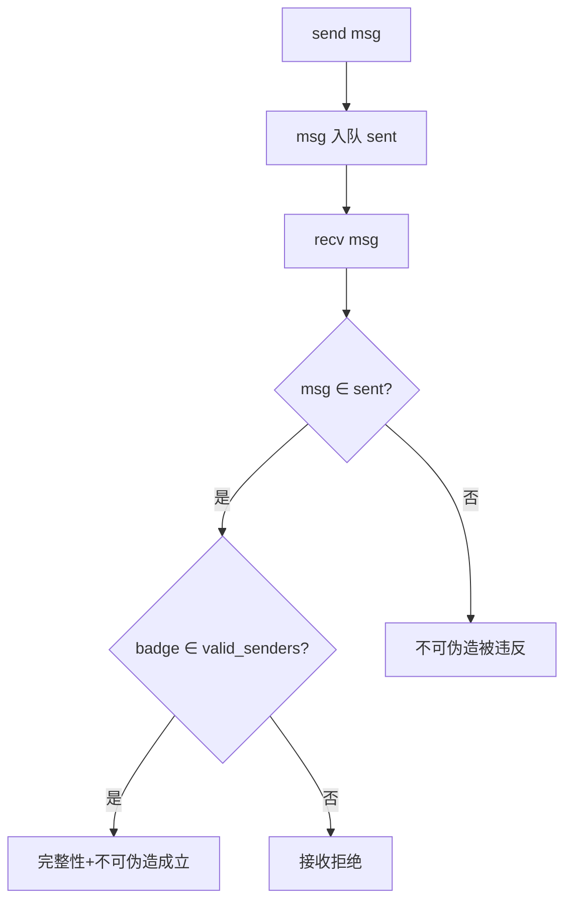

# EnerOS IPC 规范抽象设计文档（v0.153.0）

> **版本**：v0.153.0 IPC 规范抽象（IPC Specification Abstraction）
> **Phase**：Phase 3 P3-F 第 6 版本（形式化验证线）
> **依据**：`蓝图/phase3.md` §v0.153.0（L6465~L6544）+ ADR-0001 方案 A 裁剪（IPC 证明降级为 seL4 引用）
> **偏差决策**：D1~D5（详见 §7 偏差决策表）
> **前序**：v0.152.0 内存隔离形式化证明 ★（Memory_Proof.thy）
> **后续**：v0.154.0 IPC 形式化证明 ★（Ipc_Proof.thy）
> **最后更新**：2026-07-29

---

## §1 版本目标

### 1.1 蓝图定位

蓝图 §v0.153.0 §1（L6468）明确：

> **核心一句话**：定义 IPC 消息传递的形式化属性（完整性、不可伪造性）。

**Phase 定位**：P3-F 第 6 版本，为 v0.154.0 IPC 证明提供规范输入（蓝图 §v0.153.0 §1 L6470）。

**出口关联**：IPC 形式化验证规范输入（蓝图 §v0.153.0 §1 L6472）。

### 1.2 ADR-0001 裁剪说明

ADR-0001 方案 A 裁剪后，IPC 形式化证明降级为对 seL4 证明结论的引用与文档化：

| 证明项 | 范围 | 状态 |
|--------|------|------|
| ✅ 调度器证明（#1） | v0.149.0 + v0.150.0 | ✅ 完成 |
| ✅ 内存隔离证明（#2） | v0.151.0 + v0.152.0 | ✅ 完成 ★ |
| ⏳ IPC 证明 | v0.153.0（规范，本版本）+ v0.154.0（证明） | **本版本交付规范输入** |
| ❌ 能力证明 | 复用 seL4 | 不在本框架 |

### 1.3 核心口径

1. **规范抽象不交付证明**：v0.153.0 仅交付 IPC 规范抽象（`Ipc.thy` 状态机 + 不变式定义），不交付证明。
2. **Isabelle 工具链降级**：本机未安装 Isabelle2024，按 D1 降级口径——交付理论文件 + host 可测骨架验证。
3. **Surgical Changes**：仅新增 `Ipc.thy` + 修改 `ROOT` + `README.md` + 新增 host 测试 + 新增文档；不改动既有理论文件。

---

## §2 交付物清单

| 交付物 | 蓝图路径 | 实际路径 | 状态 |
|--------|---------|---------|------|
| IPC 规范理论 | `formal/Isabelle/Ipc.thy` | `formal/Isabelle/Ipc.thy` | ✅ 已交付 |
| 设计文档 | `docs/formal/ipc_spec.md` | `docs/formal/ipc_spec.md` | ✅ 已交付 |
| ROOT session 更新 | —（蓝图未提） | `formal/ROOT` 追加 `"Isabelle/Ipc"` | ✅ 已交付 |

---

## §3 数据结构设计

### 3.1 消息抽象 `msg`（蓝图 §4.5 L6509）

```isabelle
record msg =
  content :: "nat list"
  badge :: nat
```

**语义**：消息由内容（`content`，自然数列表）+ badge（发送方标识）组成。`badge` 是能力层绑定的发送方 ID，用于不可伪造性校验。

### 3.2 合法发送方集合 `valid_senders`（D2 新增）

```isabelle
consts valid_senders :: "nat set"
```

**D2 缺陷**：蓝图 `inv_no_forge` 引用 `valid_senders` 但未声明——直接落地会导致 Isabelle "Undeclared constant" 错误。

**D2 决策**：新增 `consts valid_senders :: "nat set"`（公理常量，系统配置的合法发送方集合）。

### 3.3 IPC 状态 `ipc_state`（蓝图 §4.5 L6510）

```isabelle
record ipc_state =
  sent :: "msg list"
  delivered :: "msg list"
```

**语义**：IPC 状态由已发送消息列表（`sent`）+ 已投递消息列表（`delivered`）组成。

---

## §4 不变式定义

### 4.1 完整性不变式 `inv_integrity`（蓝图 §4.5 L6513~L6514）

```isabelle
definition inv_integrity :: "ipc_state \<Rightarrow> bool" where
  "inv_integrity s \<equiv> set (delivered s) \<subseteq> set (sent s)"
```

**语义**：接收到的消息必曾发送——`delivered` 集合是 `sent` 集合的子集。

### 4.2 不可伪造不变式 `inv_no_forge`（蓝图 §4.5 L6517~L6518）

```isabelle
definition inv_no_forge :: "ipc_state \<Rightarrow> bool" where
  "inv_no_forge s \<equiv> \<forall>m\<in>set (delivered s). badge m \<in> valid_senders"
```

**语义**：已投递消息的 badge 必属合法发送方集合。

---

## §5 操作定义

### 5.1 发送操作 `ipc_send`（蓝图 §4.5 L6520~L6521）

```isabelle
inductive ipc_send :: "ipc_state \<Rightarrow> msg \<Rightarrow> ipc_state \<Rightarrow> bool" where
  send: "ipc_send s m (s\<lparr>sent := m # sent s\<rparr>)"
```

**语义**：无条件将消息 `m` 加入 `sent` 列表头部。

### 5.2 接收操作 `ipc_recv`（蓝图 §4.5 L6523~L6524 + D3 修正）

```isabelle
inductive ipc_recv :: "ipc_state \<Rightarrow> msg \<Rightarrow> ipc_state \<Rightarrow> bool" where
  recv: "\<lbrakk> m \<in> set (sent s); badge m \<in> valid_senders \<rbrakk> \<Longrightarrow>
    ipc_recv s m (s\<lparr>delivered := m # delivered s\<rparr>)"
```

**D3 修正**：蓝图原文仅含 `m ∈ set (sent s)` 前提，追加 `badge m ∈ valid_senders` 前提。

**理由**：若 recv 不校验 badge，则 `inv_no_forge` 不可归纳保持——反例：发送 `badge ∉ valid_senders` 的消息后接收，`delivered` 含非法 badge 消息。蓝图 §4.4 错误处理「加强 badge 校验」即指此修正。

---

## §6 核心算法 Mermaid 图（蓝图 §4.3）



---

## §7 偏差决策表（D1~D5）

| 偏差 | 主题 | 决策 | 理由 |
|------|------|------|------|
| D1 | Isabelle 工具链未安装 | 三层降级口径 | ADR-0001 降级先例 |
| D2 | `valid_senders` 未声明 | 新增 `consts valid_senders :: "nat set"` | 蓝图引用但未定义 |
| D3 | `ipc_recv` 缺少 badge 校验 | 追加 `badge m ∈ valid_senders` 前提 | 确保 `inv_no_forge` 可归纳保持 |
| D4 | ROOT session 更新 | theories 追加 `"Isabelle/Ipc"` | Isabelle 构建系统必需 |
| D5 | docs/formal/ipc_spec.md | 复用既有 docs/formal/ 子目录 | 沿用 v0.149.0+ 模式 |

---

## §8 测试计划

- 规范评审（蓝图 §6）。GPU：不适用。
- host 集成测试验证理论文件结构（由 v0.154.0 `ipc_proof_test.rs` 覆盖）。

---

## §9 验收标准

- 规范评审通过（蓝图 §7）。

---

## §10 风险与注意事项

- badge 伪造需能力校验保证（蓝图 §8）——D3 recv 规则 badge 校验前提即为规范层保证。
- 能力层证明（capability proof）复用 seL4，不在本框架。

---

## §11 源码链接

- [Ipc.thy](file:///e:/EnerOS/formal/Isabelle/Ipc.thy) — IPC 规范抽象主理论 ★
- [ROOT](file:///e:/EnerOS/formal/ROOT) — Isabelle session 配置
- [README.md](file:///e:/EnerOS/formal/README.md) — formal/ 目录说明
