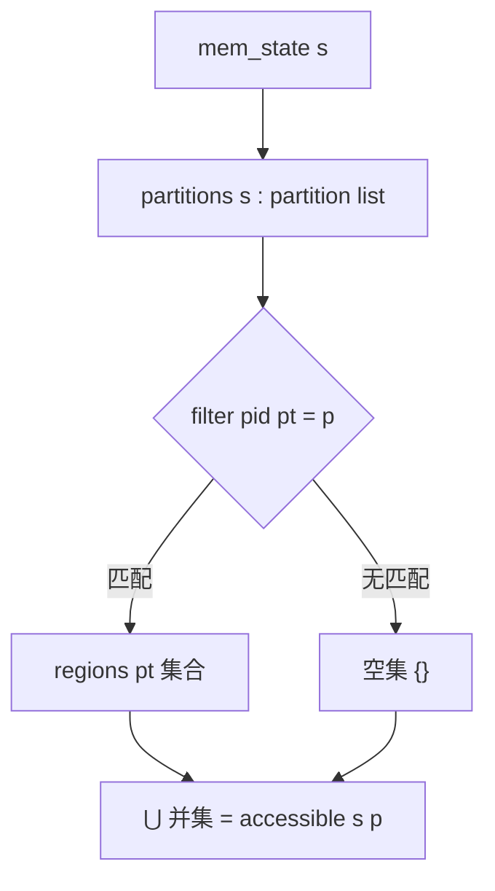
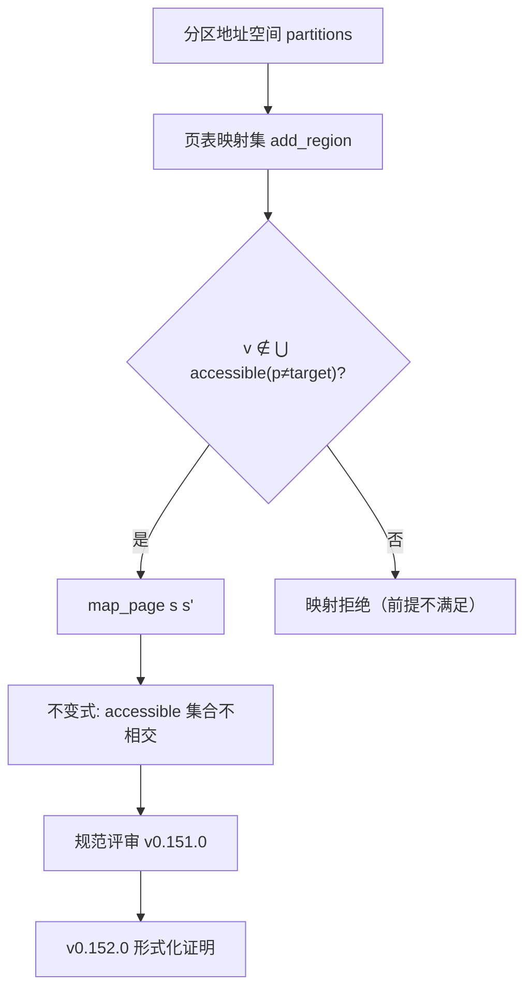

# EnerOS 内存隔离规范抽象设计文档（v0.151.0）

> **版本**：v0.151.0 内存隔离规范抽象（Memory Isolation Specification Abstraction）
> **Phase**：Phase 3 P3-F 第 4 版本（形式化验证线）
> **依据**：`蓝图/phase3.md` §v0.151.0（L6293~L6373）+ ADR-0001 方案 A 保留项 #2（内存隔离证明）
> **偏差决策**：D1~D11（详见 §8 偏差决策表）
> **前序**：v0.148.0 框架 + v0.149.0 调度器规范 + v0.150.0 调度器证明 ★（#1 调度器证明完成）
> **后续**：v0.152.0 内存隔离形式化证明 ★（补全 `map_preserves_isolation` 的 sorry）
> **最后更新**：2026-07-29

---

## §1 版本目标

### 1.1 蓝图定位

蓝图 §v0.151.0 §1（L6296）明确：

> **核心一句话**：定义内存隔离的形式化属性（跨分区不可访问不变式）。

**Phase 定位**：P3-F 第 4 版本，为 v0.152.0 内存隔离形式化证明提供规范输入（蓝图 §v0.151.0 §1 L6298）。

**出口关联**：内存隔离形式化验证的规范输入（蓝图 §v0.151.0 §1 L6300）。

### 1.2 ADR-0001 保留项 #2

ADR-0001 方案 A 裁剪后保留 2 项增量证明：

| 证明项 | 范围 | 状态 |
|--------|------|------|
| ✅ 调度器证明（#1） | v0.149.0（规范）+ v0.150.0（证明） | ✅ 安全性证明完成（v0.150.0 ★） |
| ⏳ 内存隔离证明（#2） | v0.151.0（规范，本版本）+ v0.153.0（精化证明） | **本版本交付规范输入** |
| ❌ IPC 证明 | 复用 seL4 | 不在本框架 |
| ❌ 能力证明 | 复用 seL4 | 不在本框架 |

本版本交付 #2 内存隔离证明的**规范输入**（spec input），v0.152.0 交付形式化证明（proof output）。

### 1.3 核心口径

1. **规范抽象不交付证明**：v0.151.0 仅交付内存隔离规范抽象（`Memory.thy` 状态机 + 不变式定义），不交付证明。蓝图 §7 验收标准为「规范评审通过」（L6366），证明通过属 v0.152.0 ★ 验收标准。
2. **`sorry` 占位合法**：蓝图 §4.5（L6354）`map_preserves_isolation` 定理显式 `sorry`——Isabelle 接受 `sorry` 为已承认证明（admitted proof），理论仍可检查通过。v0.152.0 补全证明。
3. **Isabelle 工具链降级**：本机未安装 Isabelle2024，按 ADR-0001 降级口径（同 v0.148.0~v0.150.0 D1）——交付理论文件 + host 可测骨架验证，实际 `isabelle build` 检查留待工具链可用时。
4. **Surgical Changes**：仅新增 `Memory.thy` + 修改 `ROOT`（一行新增）+ `README.md`（追加条目）+ 新增 host 测试 + 新增文档；**不改动** `Kernel.thy`/`Scheduler.thy`/`Scheduler_Proof.thy`/`Refinement.thy`/`Makefile`（v0.148.0~v0.150.0 交付物保持原样）。

---

## §2 交付物清单

### 2.1 蓝图 §3 交付物（L6305~L6307）

| 交付物 | 蓝图路径 | 实际路径 | 状态 | 偏差 |
|--------|---------|---------|------|------|
| 内存隔离规范理论 | `formal/Isabelle/Memory.thy` | `formal/Isabelle/Memory.thy` | ✅ 已交付 | D2~D6 蓝图缺陷修正 |
| 设计文档 | `docs/formal/memory_spec.md` | `docs/formal/memory_spec.md` | ✅ 已交付 | D9 复用既有 docs/formal/ 子目录 |
| ROOT session 更新 | —（蓝图未提） | `formal/ROOT` 追加 `"Isabelle/Memory"` | ✅ 已交付 | D8 Isabelle 构建系统必需 |
| host 集成测试 | —（蓝图未提） | `crates/kernel/microkernel/tests/memory_spec_test.rs` | ✅ 已交付（5 passed） | D1/D10 降级口径 host 可测骨架 |
| formal/README 更新 | —（蓝图未提） | `formal/README.md` 追加 Memory.thy 条目 | ✅ surgical 追加 | — |

### 2.2 降级偏差标注（D1）

蓝图 §6 测试计划要求「规范评审」（L6363），隐含 Isabelle 工具链可用，但本机未安装 Isabelle2024。按 D1 降级口径（沿用 v0.148.0~v0.150.0 D1）：

- `Memory.thy` 按蓝图 §4.5 L6329~L6357 逐字落地（+ D2~D6 修正），结构完整可供 Isabelle 检查
- `formal/Makefile`（v0.148.0 已建）`isabelle build -D .` 入口保留，工具链可用时即可运行
- `memory_spec_test.rs` host 集成测试验证理论文件结构（F1~F5 关键字 + 证明链 + Surgical Changes）

**Surgical Changes 核验**：
- `formal/Isabelle/Scheduler_Proof.thy` 零改动（v0.150.0 交付物保持原样，2771 字节基线——F5 测试断言）
- `formal/Isabelle/Scheduler.thy` 零改动（v0.149.0，2861 字节）
- `formal/Isabelle/Kernel.thy` 零改动（v0.148.0，2251 字节）
- `formal/Isabelle/Refinement.thy` 零改动（v0.148.0）
- `formal/Makefile` 零改动（v0.148.0，846 字节）

---

## §3 数据结构设计

### 3.1 虚拟地址类型 `vaddr`（D2 ★ 蓝图缺陷修正）

```isabelle
type_synonym vaddr = nat
```

**D2 缺陷**：蓝图 §4.5 `record partition = ... regions :: "vaddr set"` 使用 `vaddr` 类型，但 `vaddr` 从未定义，亦不在 `Kernel.thy` 导入范围（Kernel.thy 仅有 `thread_state`/`thread`/`kernel_state`）——直接落地会导致 Isabelle "Undeclared type" 错误。

**D2 决策**：新增 `type_synonym vaddr = nat`（虚拟地址为自然数）。

**理由**：
- 与 `pid :: nat` 风格一致（分区 ID 亦为自然数）
- Simplicity First——规范抽象阶段不绑定具体地址宽度（32/64 位），`nat` 足够表达集合运算
- 替代方案否决：① 扩展 Kernel.thy 加 `vaddr`——违反 Surgical Changes；② 使用 `word32`/`word64`——引入 `HOL-Word` 依赖，违反 Simplicity First

### 3.2 分区抽象 `partition`（蓝图 §4.5 L6334）

```isabelle
record partition =
  pid :: nat
  regions :: "vaddr set"
```

**语义**：分区由分区 ID（`pid`）+ 可访问虚拟地址集（`regions`）组成。`pid` 唯一标识一个内存分区，`regions` 描述该分区可访问的虚拟地址集合。

### 3.3 内存状态 `mem_state`（蓝图 §4.5 L6335 + D4 ★ 蓝图矛盾修正）

```isabelle
record mem_state =
  partitions :: "partition list"
```

**D4 矛盾**：蓝图 §4.1 与 §4.5 的 `mem_state` 定义冲突：
- §4.1（L6312）：`record mem_state = partitions :: "partition list" | page_tables :: "pt list"`——含 `page_tables` 字段，但 `pt` 类型未定义
- §4.5（L6335）：`record mem_state = partitions :: "partition list"`——不含 `page_tables`

**D4 决策**：以 §4.5 关键代码为准，`record mem_state = partitions :: "partition list"`，不含 `page_tables` 字段。

**理由**：
- §4.5 为权威关键代码（蓝图 §4.5 标题"关键代码（≥50 行）"）
- `page_tables` 不参与隔离不变式（`inv_isolation` 仅依赖 `accessible`，而 `accessible` 仅依赖 `partitions`）
- 引入 `pt` 类型需额外定义，违反 Simplicity First
- 页表映射的物理细节属实现层（精化映射 v0.153.0），规范抽象层不需要

### 3.4 与 `kernel_state` 的关系

蓝图 §4.1 `mem_state` 与 `Kernel.thy` 的 `kernel_state` 为独立状态类型：
- `kernel_state`（v0.148.0）：`threads :: "thread list"` + `current :: nat`——调度状态
- `mem_state`（v0.151.0）：`partitions :: "partition list"`——内存状态

两者关注点分离（调度 vs 内存隔离），独立 record 类型使证明关注点分离（同 v0.149.0 `sched_state` 与 `kernel_state` 的 D5 决策）。

---

## §4 可访问地址集 `accessible`（D5 ★ 蓝图作用域缺陷修正）

### 4.1 定义（蓝图 §4.5 L6338~L6340 + D5 修正）

```isabelle
definition accessible :: "mem_state \<Rightarrow> nat \<Rightarrow> vaddr set" where
  "accessible s p \<equiv>
     \<Union> {regions pt | pt. pt \<in> set (partitions s) \<and> pid pt = p}"
```

**语义**：分区 `p` 的可访问虚拟地址集——`mem_state s` 中所有 `pid = p` 的分区的 `regions` 集合并集。若无 `pid = p` 的分区，返回空集 `{}`。

### 4.2 D5 缺陷：`accessible` 定义作用域错误

**D5 缺陷**：蓝图 §4.5 原文：
```isabelle
"accessible s p \<equiv> (if \<exists>pt\<in>set(partitions s). pid pt = p then regions pt else {})"
```
其中 `regions pt`（then 分支）的 `pt` **不绑定**到存在量词 `∃pt` 的见证——`pt` 是自由变量，Isabelle 会报 "Extra variables on RHS" 错误（`pt` 不在 LHS `accessible s p` 中出现，亦非绑定变量）。

**D5 决策**：改写为集合并 comprehension 形式：
```isabelle
"accessible s p \<equiv> \<Union> {regions pt | pt. pt \<in> set (partitions s) \<and> pid pt = p}"
```

**理由**：
- 语义等价：若存在 `pid = p` 的分区，返回其 `regions`（并集）；若不存在，集为空，`⋃` 返回 `{}`
- Isabelle 语法合法：`pt` 在 comprehension `{... | pt. ...}` 中被绑定
- 更健壮：若存在多个 `pid = p` 的分区（畸形状态但类型允许），并集形式返回所有 regions 的并，而 if-then 形式语义不明（哪个 `pt`？）
- Simplicity First：无需引入 `find`/`case` 控制结构

### 4.3 accessible 计算 Mermaid 图



---

## §5 隔离不变式 `inv_isolation`（D6 ★ 蓝图同名冲突修正）

### 5.1 定义（蓝图 §4.5 L6343~L6345）

```isabelle
definition inv_isolation :: "mem_state \<Rightarrow> bool" where
  "inv_isolation s \<equiv> \<forall>p1 p2. p1 \<noteq> p2 \<longrightarrow>
     accessible s p1 \<inter> accessible s p2 = {}"
```

**语义**：隔离不变式——任意两个不同分区（`p1 ≠ p2`）的可访问地址集不相交（交集为空集 `{}`）。即：不存在一个虚拟地址同时被两个不同分区访问——这是内存隔离的核心安全约束。

### 5.2 D6 缺陷：`inv_isolation` 与 Kernel.thy 占位同名

**D6 缺陷**：`Kernel.thy`（v0.148.0）已定义 `inv_isolation :: "kernel_state ⇒ bool"` 作为蓝图 §3 接口占位（`"inv_isolation s ≡ True"`）。`Memory.thy` `imports Kernel` 后再定义 `inv_isolation :: "mem_state ⇒ bool"`——Isabelle 不支持基于类型的重载（plain `definition`），导致重复常量声明错误。

**D6 决策**：在 `Memory.thy` 顶部新增 `hide_const (open) inv_isolation`，遮蔽 Kernel.thy 的占位后重定义。

```isabelle
theory Memory
  imports Kernel
begin

(* D6：遮蔽 Kernel.thy 的 inv_isolation 占位（≡ True），允许本理论定义真实隔离不变式 *)
hide_const (open) inv_isolation
```

**理由**：
- Isabelle 惯用法：`hide_const (open)` 移除非限定名绑定，保留限定名 `Kernel.inv_isolation` 可访问，允许重定义同名常量
- Surgical Changes——不修改 `Kernel.thy`（v0.148.0 交付物零改动），仅在 `Memory.thy` 内遮蔽
- 蓝图 §3 占位注释（"后续版本补全真实定义"）的意图即由 `Memory.thy` 提供真实定义
- 替代方案否决：① 重命名为 `inv_mem_isolation`——偏离蓝图关键字；② 不 `imports Kernel`——破坏证明链（Memory 不再依赖 Kernel）

### 5.3 隔离不变式语义解析

| 状态 | `inv_isolation s` | 说明 |
|------|-------------------|------|
| 两分区 regions 不相交 | `True` | 隔离保持 |
| 两分区 regions 相交 | `False`（`∩ ≠ {}`） | 隔离破坏 |
| 单分区 | `True`（无 p1≠p2 对） | 平凡保持 |
| 空分区列表 | `True`（∀ 空真） | 平凡保持 |

**证明目标**：`map_preserves_isolation`（映射操作保持隔离不变式）——⏳ `sorry` 占位，v0.152.0 补全（详见 §6）。

---

## §6 映射操作 `map_page` 与 `add_region`（D3/D7）

### 6.1 `add_region` 辅助函数（D3 ★ 蓝图未定义修正）

```isabelle
definition add_region :: "mem_state \<Rightarrow> nat \<Rightarrow> vaddr \<Rightarrow> partition list" where
  "add_region s target v \<equiv>
     map (\<lambda>p. if pid p = target then p\<lparr>regions := insert v (regions p)\<rparr> else p)
         (partitions s)"
```

**D3 缺陷**：蓝图 §4.5 `map` 规则使用 `add_region s target v`，但 `add_region` 函数从未声明——直接落地会导致 Isabelle "Undeclared constant" 错误。

**D3 决策**：新增 `definition add_region`，实现为 `map` 遍历 `partitions` 列表，对 `pid = target` 的分区将 `v` `insert` 到其 `regions`，其余分区不变。

**理由**：
- `map` 规则的必要依赖——`map_page s (s\<lparr>partitions := add_region s target v\<rparr>)` 需 `add_region` 计算新分区列表
- 语义清晰：`insert v (regions p)` 将地址 `v` 加入分区 `p` 的可访问集
- Simplicity First：`map` + `if` + `insert` 三步组合，无需递归

### 6.2 `inductive map_page`（蓝图 §4.5 L6348~L6350）

```isabelle
inductive map_page :: "mem_state \<Rightarrow> mem_state \<Rightarrow> bool" where
  map: "v \<notin> \<Union> {accessible s p | p. p \<noteq> target} \<Longrightarrow>
    map_page s (s\<lparr>partitions := add_region s target v\<rparr>)"
```

**规则解析**：

| 规则 | 语义 | 蓝图依据 |
|------|------|---------|
| `map` | 映射操作——将地址 `v` 映射到 `target` 分区。前提：`v` 不被任何非 `target` 分区访问（`v ∉ ⋃ {accessible s p | p. p ≠ target}`），确保映射不创建重叠 | §4.5 L6349~L6350 |

**前提语义**：`⋃ {accessible s p | p. p ≠ target}` 是所有非 `target` 分区的可访问集并集。`v ∉ ...` 确保 `v` 当前不被任何其他分区访问——映射 `v` 到 `target` 不会与其他分区的 regions 冲突。

### 6.3 `map_preserves_isolation`（蓝图 §4.5 L6352~L6354 + D7）

```isabelle
theorem map_preserves_isolation:
  "\<lbrakk> inv_isolation s; map_page s s' \<rbrakk> \<Longrightarrow> inv_isolation s'"
  sorry (* 占位，v0.152.0 补全 *)
```

**语义**：映射操作保持隔离不变式——若状态 `s` 满足 `inv_isolation` 且 `map_page s s'`，则后继状态 `s'` 仍满足 `inv_isolation`。

**D7 决策**：保持 `sorry` 占位，v0.152.0 补全证明。

**理由**：
- 规范抽象版本不交付证明（同 v0.149.0 `step_preserves_priority` sorry 模式）
- Isabelle 接受 `sorry` 为已承认证明（admitted proof），理论检查仍通过
- v0.152.0 将通过归纳 `map_page` 规则证明：`map` 前提（`v` 不被非 target 分区访问）+ `add_region` 仅修改 target 分区 → 非 target 分区可访问集不变 → `inv_isolation` 保持

### 6.4 映射操作 Mermaid 图（蓝图 §4.3 L6318~L6323）



---

## §7 DMA 例外与 SMMU 证明（蓝图 §5/§8 难点）

### 7.1 蓝图难点（§5 L6359 + §8 L6369）

蓝图 §v0.151.0 §5（L6359）明确：

> **难点**：不变式：集合不相交。难点：DMA 例外。

蓝图 §v0.151.0 §8（L6369）明确：

> **风险与注意事项**：DMA 可能破坏隔离，需 SMMU 证明。

### 7.2 DMA 例外解析

| 难点 | 说明 | 本版本处理 |
|------|------|-----------|
| DMA 绕过 MMU | 外设 DMA 直接访问物理内存，绕过 CPU 页表隔离 | 规范抽象层不建模 DMA，留待 SMMU 证明版本 |
| SMMU 隔离 | 系统 MMU（SMMU/IOMMU）为 DMA 提供地址翻译与隔离 | v0.153.0+ 精化证明或独立 SMMU 证明版本 |
| 设备分配 | 设备归属分区后，其 DMA 应被 SMMU 约束在分区 regions 内 | 需扩展 `partition` record 加 `devices` 字段 |

### 7.3 后续 SMMU 证明路线

| 版本 | 交付物 | SMMU 关系 |
|------|--------|-----------|
| v0.151.0（本版本） | 内存隔离规范抽象（CPU 视角） | 不建模 DMA |
| v0.152.0 | 内存隔离形式化证明（`map_preserves_isolation`） | 证明 CPU 映射保持隔离 |
| v0.153.0 | 内存精化证明（`refinement_holds`） | 精化映射层补全 |
| 后续 | SMMU 证明（独立版本或集成） | 扩展 `partition` 加 `devices`，证明 DMA 经 SMMU 隔离 |

**与 seL4 的关系**：seL4 proof 体系已证明其内存隔离（含 DMA 经 SMMU 的隔离保证）。ADR-0001 方案 A 复用 seL4 内存隔离证明，EnerOS 自研部分聚焦国产 CPU（飞腾/鲲鹏）SMMU 适配层的增量验证。

---

## §8 偏差决策表（D1~D11）

| 偏差 | 主题 | 蓝图问题 | 决策 | 理由 |
|------|------|---------|------|------|
| D1 | Isabelle 工具链未安装 | 蓝图 §6 要求"规范评审" | 三层降级口径（理论文件 + Makefile + host 测试） | ADR-0001 降级先例（v0.148.0~v0.150.0） |
| D2 | `vaddr` 类型未定义 | §4.5 使用 `vaddr` 但未声明 | 新增 `type_synonym vaddr = nat` | 与 `pid :: nat` 风格一致；Simplicity First |
| D3 | `add_region` 函数未定义 | §4.5 `map` 规则使用但未声明 | 新增 `definition add_region` | `map` 规则必要依赖；`map` + `insert` 实现 |
| D4 | §4.1 与 §4.5 record 冲突 | §4.1 含 `page_tables`（`pt` 未定义），§4.5 不含 | 以 §4.5 为准，不含 `page_tables` | §4.5 为权威关键代码；Simplicity First |
| D5 | `accessible` 作用域缺陷 | `regions pt` 中 `pt` 不绑定存在量词见证 | 改写为集合并 comprehension | 语义等价 + Isabelle 语法合法 + 更健壮 |
| D6 | `inv_isolation` 与 Kernel 同名 | Kernel.thy 占位 `inv_isolation` 导致重复声明 | `hide_const (open) inv_isolation` 遮蔽后重定义 | Isabelle 惯用法；Surgical Changes 不改 Kernel.thy |
| D7 | `map_preserves_isolation` sorry | 蓝图显式 `sorry` | 保持 sorry，延后 v0.152.0 | 规范抽象不交付证明（同 v0.149.0 模式） |
| D8 | ROOT session 更新 | 蓝图未提 | theories 列表追加 `"Isabelle/Memory"` | Isabelle 构建系统必需 |
| D9 | docs/formal/memory_spec.md | 蓝图路径 | 复用既有 docs/formal/ 子目录 | D9 v0.149.0 沿用 |
| D10 | host 集成测试 F1~F5 | 蓝图未提 | 降级口径 host 可测骨架 | 同 v0.148.0~v0.150.0 模式 |
| D11 | ADR-0001 保留项 #2 | 蓝图 §1 | 内存隔离证明为 2 项保留增量证明之一 | ADR-0001 方案 A 裁剪 |

---

## §9 测试矩阵

### 9.1 host 集成测试（D1/D10 降级口径 host 可测骨架）

`crates/kernel/microkernel/tests/memory_spec_test.rs` 五项验证：

| 测试 | 验证内容 | 判据 | 状态 |
|------|---------|------|------|
| F1 `f1_memory_thy_keywords` | Memory.thy 14 关键字完整性 | theory Memory / imports Kernel / hide_const / type_synonym vaddr / record partition / record mem_state / definition accessible / definition inv_isolation / definition add_region / inductive map_page / theorem map_preserves_isolation / sorry / end + accessible_def_marker（集合并）+ inv_isolation_def_marker（不相交） | ✅ 5 passed |
| F2 `f2_root_session_has_memory` | ROOT session 配置含 Memory theory | 含 `session` + `Isabelle/Kernel` + `Isabelle/Refinement` + `Isabelle/Scheduler` + `Isabelle/Scheduler_Proof` + `Isabelle/Memory` 六关键字 | ✅ 5 passed |
| F3 `f3_adr0001_scope_verification` | ADR-0001 范围核验 | Memory.thy 含 `inv_isolation` + `map_page` 内存规范关键字 + 不含 `theory Ipc` / `theory Capability` | ✅ 5 passed |
| F4 `f4_proof_chain_existence` | 证明链存在性 | `imports Kernel` @Memory.thy + `imports Main` @Kernel.thy | ✅ 5 passed |
| F5 `f5_v1500_scheduler_proof_thy_unchanged` | Surgical Changes 核验 | Scheduler_Proof.thy 大小 == 2771 字节 + 含 `scheduler_safety`/`sched_step.induct` 关键字 | ✅ 5 passed |

**执行命令**：`cargo test -p eneros-microkernel --test memory_spec_test` → 5 passed EXIT=0（0.00s）

### 9.2 零回归核验

| 测试套件 | 版本 | 结果 |
|---------|------|------|
| `memory_spec_test` | v0.151.0（本版本） | ✅ 5 passed |
| `scheduler_proof_test` | v0.150.0（前置版本） | ✅ 5 passed（零回归） |
| `scheduler_spec_test` | v0.149.0（前置版本） | ✅ 5 passed（零回归） |
| `formal_framework_test` | v0.148.0（前置版本） | ✅ 6 passed（零回归） |

**总测试数**：21 passed / 0 failed。

### 9.3 不做的测试（降级说明）

| 测试项 | 蓝图要求 | 降级原因 | 偏差 |
|--------|---------|---------|------|
| `isabelle build` 证明检查 | 蓝图 §6「规范评审」 | Isabelle 未安装（D1） | D1 降级 |
| CI 运行 isabelle build | —（蓝图未要求 CI） | Isabelle 为重依赖 | 沿用 v0.148.0 |
| DMA/SMMU 隔离验证 | 蓝图 §8 风险 | 属后续 SMMU 证明版本 | §7 路线 |

---

## §10 ADR-0001 范围

### 10.1 内存隔离证明为保留项 #2

ADR-0001 方案 A 裁剪后保留 2 项增量证明，本版本交付 #2 内存隔离证明的规范输入：

| 证明项 | EnerOS 范围 | seL4 复用 | 状态 |
|--------|------------|----------|------|
| 调度器（#1） | v0.149.0 规范 + v0.150.0 证明 | — | ✅ 安全性证明完成 |
| 内存隔离（#2） | v0.151.0 规范（本版本）+ v0.153.0 精化证明 | — | ✅ 规范已交付 |
| IPC | ❌ 不自研 | ✅ 复用 seL4 IPC proof | — |
| 能力 | ❌ 不自研 | ✅ 复用 seL4 capability proof | — |

### 10.2 与 seL4 proof 体系关系

ADR-0001 方案 A 采用 seL4 深度定制，形式化验证与 seL4 proof 体系关系：

- **复用**：seL4 的 IPC proof + capability proof + 内存隔离基础证明（数学证明已由 seL4 项目完成）
- **自研**：调度器 proof（v0.149.0~v0.150.0 已完成）+ 内存隔离 proof（v0.151.0~v0.153.0）——EnerOS 特有调度策略与国产 CPU 内存分区，需自研证明
- **增量**：国产 CPU（飞腾 D2000 / 鲲鹏 920）SMMU 适配层的隔离验证——seL4 proof 未覆盖国产 CPU SMMU，需增量验证（后续版本）

### 10.3 内存规范在 P3-F 线中的位置

P3-F 形式化验证线共 8 个版本（v0.148.0~v0.155.0），本版本为第 4 版本：

```
v0.148.0 框架 ──→ v0.149.0 调度规范 ──→ ★ v0.150.0 调度证明（#1 完成）
                                              │
v0.151.0 内存规范（本版本）──→ v0.152.0 内存证明 ★ ──→ v0.153.0 内存精化
                                              │
                              v0.154.0 集成 ──→ v0.155.0 终版本
```

---

## §11 后续路线与源码链接

### 11.1 P3-F 形式化验证线后续版本

| 版本 | 交付物 | 状态 |
|------|--------|------|
| v0.148.0 | 形式化规范框架（Isabelle/HOL） | ✅ 已完成 |
| v0.149.0 | 调度器规范抽象（Scheduler.thy） | ✅ 已完成 |
| v0.150.0 | 调度器形式化证明（Scheduler_Proof.thy）★ | ✅ 已完成（#1） |
| v0.151.0 | 内存隔离规范抽象（Memory.thy） | ✅ 本版本完成 |
| v0.152.0 | 内存隔离形式化证明 ★（补全 `map_preserves_isolation`） | ⏳ 待启动 |
| v0.153.0 | 内存精化证明（补全 `refinement_holds`） | ⏳ |
| v0.154.0 | 形式化验证集成（Isabelle 工具链集成 + CI） | ⏳ |
| v0.155.0 | P3-F 终版本 | ⏳ |

### 11.2 源码链接

#### formal/ 框架文件（本版本新增/修改）

- [Memory.thy](file:///e:/EnerOS/formal/Isabelle/Memory.thy) — 内存隔离规范抽象主理论 ★
- [ROOT](file:///e:/EnerOS/formal/ROOT) — Isabelle session 配置（一行新增 Memory）
- [README.md](file:///e:/EnerOS/formal/README.md) — formal/ 目录说明（surgical 追加条目）

#### 既有理论文件（零改动，Surgical Changes 核验）

- [Kernel.thy](file:///e:/EnerOS/formal/Isabelle/Kernel.thy) — 抽象规范层（v0.148.0，2251 字节，零改动）
- [Scheduler.thy](file:///e:/EnerOS/formal/Isabelle/Scheduler.thy) — 调度器规范抽象（v0.149.0，2861 字节，零改动）
- [Scheduler_Proof.thy](file:///e:/EnerOS/formal/Isabelle/Scheduler_Proof.thy) — 调度器形式化证明（v0.150.0，2771 字节，零改动）
- [Refinement.thy](file:///e:/EnerOS/formal/Isabelle/Refinement.thy) — 精化映射层（v0.148.0，零改动）
- [Makefile](file:///e:/EnerOS/formal/Makefile) — 证明检查入口（v0.148.0，846 字节，零改动）

#### host 集成测试

- [memory_spec_test.rs](file:///e:/EnerOS/crates/kernel/microkernel/tests/memory_spec_test.rs) — F1~F5 host 集成测试（5 passed）
- [scheduler_proof_test.rs](file:///e:/EnerOS/crates/kernel/microkernel/tests/scheduler_proof_test.rs) — v0.150.0 前置测试（5 passed，零回归）
- [scheduler_spec_test.rs](file:///e:/EnerOS/crates/kernel/microkernel/tests/scheduler_spec_test.rs) — v0.149.0 前置测试（5 passed，零回归）
- [formal_framework_test.rs](file:///e:/EnerOS/crates/kernel/microkernel/tests/formal_framework_test.rs) — v0.148.0 前置测试（6 passed，零回归）

#### 蓝图依据与规格文档

- `蓝图/phase3.md` §v0.151.0（L6293~L6373）— 蓝图版本规格
- `.trae/specs/develop-v15100-memory-isolation-spec/spec.md` — 本版本规格文档（D1~D11 偏差决策表）
- `.trae/specs/develop-v15100-memory-isolation-spec/tasks.md` — 任务分解（T1~T5）
- `.trae/specs/develop-v15100-memory-isolation-spec/checklist.md` — 验收清单

#### 相关文档

- [framework.md](file:///e:/EnerOS/docs/formal/framework.md) — 形式化验证框架设计文档（v0.148.0，12 章）
- [scheduler_spec.md](file:///e:/EnerOS/docs/formal/scheduler_spec.md) — 调度器规范抽象设计文档（v0.149.0，11 章）
- [scheduler_proof.md](file:///e:/EnerOS/docs/formal/scheduler_proof.md) — 调度器形式化证明设计文档（v0.150.0，11 章）
