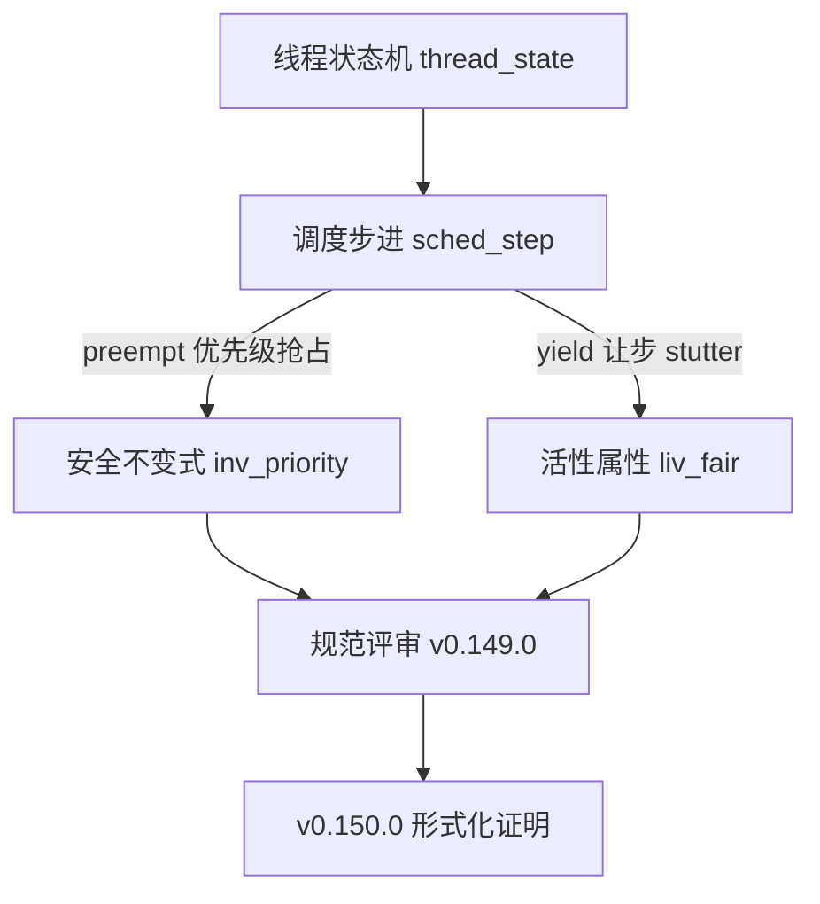

# EnerOS 调度器规范抽象设计文档（v0.149.0）

> **版本**：v0.149.0 调度器规范抽象（Scheduler Specification Abstraction）
> **Phase**：Phase 3 P3-F 第 2 版本（形式化验证线）
> **依据**：`蓝图/phase3.md` §v0.149.0（L6101~L6185）+ ADR-0001 方案 A 保留项
> **偏差决策**：D1~D10（详见 §9 偏差决策表）
> **前序**：v0.148.0 形式化规范框架（formal/ + Kernel.thy + Refinement.thy 就绪）
> **后续**：v0.150.0 调度器形式化证明（补全 step_preserves_priority 的 sorry）
> **最后更新**：2026-07-29

---

## §1 版本目标

### 1.1 蓝图定位

蓝图 §v0.149.0 §1（L6104）明确：

> **核心一句话**：建立调度器的形式化抽象模型，定义安全/活性不变式。

**Phase 定位**：P3-F 第 2 版本，为 v0.150.0 调度器形式化证明提供规范输入（蓝图 §v0.149.0 §1 L6106）。

**出口关联**：调度器形式化验证的规范输入（蓝图 §v0.149.0 §1 L6108）。

**ADR-0001 保留项之一**：调度器为 ADR-0001 方案 A 裁剪后保留的 2 项增量证明之一（调度器 + 内存），IPC/能力直接复用 seL4 已有数学证明。本版本交付调度器规范抽象（spec input），v0.150.0 交付调度器形式化证明（proof output）。

### 1.2 核心口径

1. **规范抽象不交付证明**：v0.149.0 仅交付调度器规范抽象（`Scheduler.thy` 状态机 + 不变式定义），不交付证明。蓝图 §7 验收标准为「规范评审通过」（L6178），证明通过属 v0.150.0 ★ 验收标准。
2. **`sorry` 占位合法**：蓝图 §4.5（L6163~L6165）`step_preserves_priority` 定理显式 `sorry`——Isabelle 接受 `sorry` 为已承认证明（admitted proof），理论仍可检查通过。v0.150.0 补全证明。
3. **Isabelle 工具链降级**：本机未安装 Isabelle2024，按 ADR-0001 降级口径（同 v0.148.0 D1 / v0.145.0/v0.146.0 硬件验证降级先例）——交付理论文件 + host 可测骨架验证，实际 `isabelle build` 检查留待工具链可用时。

---

## §2 交付物清单

### 2.1 蓝图 §3 交付物（L6113~L6116）

| 交付物 | 蓝图路径 | 实际路径 | 状态 | 偏差 |
|--------|---------|---------|------|------|
| 调度器规范理论 | `formal/Isabelle/Scheduler.thy` | `formal/Isabelle/Scheduler.thy` | ✅ 已交付 | D2/D3 蓝图矛盾修正 |
| 调度状态机+不变式定义 | 接口：调度状态机 + 不变式定义 | `Scheduler.thy` 内 `sched_state` + `sched_step` + `inv_priority` + `liv_fair` | ✅ 已交付 | D4 成员归属未约束（spec abstraction） |
| 设计文档 | `docs/formal/scheduler_spec.md` | `docs/formal/scheduler_spec.md` | ✅ 已交付 | D9 复用既有 docs/formal/ 子目录 |
| ROOT session 更新 | —（蓝图未提） | `formal/ROOT` 追加 `"Isabelle/Scheduler"` | ✅ 已交付 | D7 Isabelle 构建系统必需 |
| host 集成测试 | —（蓝图未提） | `crates/kernel/microkernel/tests/scheduler_spec_test.rs` | ✅ 已交付 | D1/D6 降级口径 host 可测骨架 |

### 2.2 降级偏差标注（D1）

蓝图 §6 测试计划要求「规范评审」（L6175），隐含 Isabelle 工具链可用，但本机未安装 Isabelle2024。按 D1 降级口径（沿用 v0.148.0 D1）：

- `Scheduler.thy` 按蓝图 §4.5 逐字落地（+ D2/D3 修正），结构完整可供 Isabelle 检查
- `formal/Makefile`（v0.148.0 已建）`isabelle build -D .` 入口保留，工具链可用时即可运行
- `scheduler_spec_test.rs` host 集成测试验证理论文件结构（F1~F5 关键字 + 三层映射 + Surgical Changes）

**Surgical Changes 核验**：`formal/Isabelle/Kernel.thy` 零改动（v0.148.0 交付物保持原样，2251 字节基线——F5 测试断言）、`formal/Isabelle/Refinement.thy` 零改动、`formal/Makefile` 零改动（自动拾取 ROOT 中所有 theories）。

---

## §3 数据结构设计

### 3.1 调度状态机 `sched_state`（蓝图 §4.1 L6121）

```isabelle
record sched_state =
  threads :: "thread list"
  current :: nat
```

**语义**：调度状态机由线程列表（`threads`）+ 当前运行线程 TID（`current`）组成。`thread` 类型继承自 v0.148.0 `Kernel.thy`（`tid :: nat` + `state :: thread_state` + `partition :: nat`）。

### 3.2 优先级函数 `prio`（D2 ★ 蓝图矛盾修正）

```isabelle
consts prio :: "thread \<Rightarrow> nat"
```

**D2 矛盾**：蓝图 §4.5 `preempt` 规则与 `inv_priority` 定义使用 `prio t2 > prio t1`，但 v0.148.0 `Kernel.thy` 的 `thread` record 为 `tid :: nat, state :: thread_state, partition :: nat`——**无 `prio` 字段**。直接落地会导致 `prio` 未绑定，Isabelle 类型检查失败。

**D2 决策**：在 `Scheduler.thy` 顶部新增 `consts prio :: "thread ⇒ nat"`（uninterpreted 常量）。

**理由**：
- 不修改 `Kernel.thy`（Surgical Changes——v0.148.0 交付物零改动）
- `consts` 声明 uninterpreted 函数，规范抽象阶段不绑定具体优先级值，v0.150.0 证明时可按需 `overloading` 或保持抽象
- 替代方案否决：① 扩展 `thread` record 加 `prio` 字段——需改 `Kernel.thy`，违反 Surgical Changes；② 新建 `sched_thread` record——引入类型转换复杂度，违反 Simplicity First

### 3.3 与 `kernel_state` 的关系（D5 字段重复但独立关注点）

蓝图 §4.1 `sched_state` 与 `Kernel.thy` 的 `kernel_state` 字段完全相同（`threads :: "thread list"` + `current :: nat`）。

**D5 决策**：保持蓝图 `record sched_state` 定义，不替换为 `type_synonym`。

**理由**：
- 蓝图逐字落地
- `Scheduler` 是独立理论关注点（优先级调度 vs 基础状态转换），独立 record 类型使证明关注点分离
- Isabelle record 重复字段不引入语义问题

---

## §4 调度步进关系

### 4.1 `inductive sched_step`（蓝图 §4.5 L6147~L6152 + D3 修正）

```isabelle
inductive sched_step :: "sched_state \<Rightarrow> sched_state \<Rightarrow> bool" where
  preempt: "\<lbrakk> prio t2 > prio t1; state t1 = Running \<rbrakk> \<Longrightarrow>
    sched_step s (s\<lparr>current := tid t2\<rparr>)" |
  yield: "state t = Running \<Longrightarrow>
    sched_step s s"
```

**规则解析**：

| 规则 | 语义 | 蓝图依据 |
|------|------|---------|
| `preempt` | 优先级抢占——高优先级线程 `t2` 抢占当前运行线程 `t1`，`current` 更新为 `t2` 的 TID | §4.5 L6148~L6149 |
| `yield` | 让步——运行线程让步（D3 修正：stutter step `s → s`，抽象规范层不指定后续状态转换细节） | §4.5 L6150~L6151 + D3 |

### 4.2 调度状态机 Mermaid 图（蓝图 §4.3 L6128~L6135）



### 4.3 D3 修正：`yield` 规则 `s'` 未绑定（★ 蓝图语法缺陷修正）

**D3 矛盾**：蓝图 §4.5 `yield: "state t = Running ⟹ sched_step s s'"`——`s'` 在结论右侧自由出现，Isabelle `inductive` 定义要求结论中的状态由前提构造，自由变量 `s'` 导致规则语义平凡化（任意 `s'` 均可）或语法非法。

**D3 决策**：修正为 `yield: "state t = Running ⟹ sched_step s s"`（stutter step——运行线程让步，抽象规范层不指定后续状态转换细节）。

**理由**：
- 最小有效修正——`s → s` 是合法 Isabelle inductive 规则
- 规范抽象阶段不 over-commit 让步后的状态（哪个线程接管由 `preempt` 规则建模）
- v0.150.0 证明时可按需强化为具体让步转换
- 替代方案否决：① 建模为「运行线程→Ready + 最高优先级 Ready→Running」——引入 `map`/`filter`/`arg_max` 复杂度，违反 Simplicity First；② 删除 `yield` 规则——违反蓝图 §4.5 逐字落地原则

### 4.4 D4：`preempt` 规则成员归属未约束（spec abstraction 口径）

**D4 观察**：蓝图 `preempt: "⟦ prio t2 > prio t1; state t1 = Running ⟧ ⟹ sched_step s (s⦇current := tid t2⦄)"`——`t1`/`t2` 未约束为 `threads s` 成员。

**D4 决策**：保持蓝图原样，不新增 `t1 ∈ set (threads s)` 前提。

**理由**：规范抽象阶段定义关系 shape，成员归属前提属证明阶段（v0.150.0）强化项；Isabelle 接受自由变量（隐式全称量化），语法合法。

---

## §5 安全不变式

### 5.1 `inv_priority`（蓝图 §4.5 L6154~L6156）

```isabelle
definition inv_priority :: "sched_state \<Rightarrow> bool" where
  "inv_priority s \<equiv> \<forall>t1\<in>set (threads s). \<forall>t2\<in>set (threads s).
     state t1 = Running \<and> state t2 = Ready \<and> prio t2 > prio t1 \<longrightarrow> False"
```

**语义**：优先级单调——高优先级线程就绪时低优先级线程不运行。即：不存在「`t1` 运行 + `t2` 就绪 + `prio t2 > prio t1`」的状态，否则触发 `False` 矛盾。

**证明目标**：`step_preserves_priority`（调度步进保持优先级不变式）——⏳ `sorry` 占位，v0.150.0 补全（详见 §7）。

### 5.2 D4：t1/t2 成员归属观察

`inv_priority` 定义中 `t1`/`t2` 显式约束为 `set (threads s)` 成员（`\<forall>t1\<in>set (threads s). \<forall>t2\<in>set (threads s).`）——与 `preempt` 规则的 D4 未约束形成对比。

**D4 在不变式层的体现**：不变式定义本身已含成员归属约束（蓝图原样保留），`preempt` 规则的成员归属未约束是 spec abstraction 的 shape 定义。规范抽象阶段保持蓝图原样，证明阶段（v0.150.0）将强化 `preempt` 规则的成员归属前提以完成 `step_preserves_priority` 证明。

---

## §6 活性属性

### 6.1 `liv_fair`（蓝图 §4.5 L6159~L6161）

```isabelle
definition liv_fair :: "sched_state \<Rightarrow> bool" where
  "liv_fair s \<equiv> \<forall>t\<in>set (threads s). state t = Ready \<longrightarrow>
     (\<exists>s'. sched_step\<^sup>*\<^sup>* s s' \<and> state t = Running)"
```

**语义**：无饥饿/公平调度——每个就绪（`Ready`）线程最终被调度（经 `sched_step` 的自反传递闭包 `\<^sup>*\<^sup>*` 即 `rtranclp` 到达某状态 `s'`，使该线程变为 `Running`）。

### 6.2 时序逻辑难点（蓝图 §5 技术交底 L6171~L6172）

蓝图 §v0.149.0 §5（L6172）明确：

> **难点**：活性的时序逻辑表达。

**难点解析**：

| 难点 | 说明 | 本版本处理 |
|------|------|-----------|
| 时序算子选择 | Isabelle/HOL 无内建 LTL/CTL 算子，需用 `rtranclp`（自反传递闭包）表达「最终到达」 | 采用 `sched_step\<^sup>*\<^sup>* s s'` 表达「经若干步到达 `s'`」 |
| 公平性强度 | 强公平（infinitely often enabled ⇒ infinitely often taken）vs 弱公平（continuously enabled ⇒ eventually taken） | 本版本采用弱公平口径（`\<exists>s'. sched_step\<^sup>*\<^sup>* s s' \<and> state t = Running`） |
| 与 `preempt` 规则的交互 | `yield` 为 stutter step（D3），公平性证明需确保 stutter 不无限延续 | v0.150.0 证明时强化 `yield` 规则或引入测量函数（measure function） |

**选型依据**（蓝图 §5 L6171）：状态机+不变式，借鉴 seL4。seL4 proof 体系同样采用 `rtranclp` 表达活性，EnerOS 与 seL4 选型对齐便于复用其证明模式。

---

## §7 占位定理与 v0.150.0 证明路线

### 7.1 `step_preserves_priority`（蓝图 §4.5 L6163~L6165）

```isabelle
theorem step_preserves_priority:
  "\<lbrakk> inv_priority s; sched_step s s' \<rbrakk> \<Longrightarrow> inv_priority s'"
  sorry (* 占位，v0.150.0 补全 *)
```

**语义**：调度步进保持优先级不变式——若状态 `s` 满足 `inv_priority` 且 `sched_step s s'`，则后继状态 `s'` 仍满足 `inv_priority`。

**证明状态**：⏳ `sorry` 占位。Isabelle 接受 `sorry` 为已承认证明（admitted proof），理论检查仍通过（`isabelle build` 不报错，仅 warning）。

### 7.2 v0.150.0 证明路线（蓝图 §v0.150.0 §4.3）

| 步骤 | 方法 | 说明 |
|------|------|------|
| 1 | 对 `sched_step` 规则归纳（`induct rule: sched_step.induct`） | `sched_step` 有 `preempt` + `yield` 两规则，分两子目标 |
| 2 | `preempt` 子目标：展开 `inv_priority` 定义 + 优先级传递性 | 利用 `prio t2 > prio t1` 的传递性，结合 `current` 更新证明新状态满足不变式 |
| 3 | `yield` 子目标：stutter step 保持状态 | `yield` 为 `s → s`（D3），状态未变，`inv_priority s' = inv_priority s` 自动成立 |
| 4 | 自动化：Sledgehammer 辅助 | 蓝图 §v0.150.0 §4.3——Sledgehammer 搜索 AFP 库已有引理，降低人工证明负担 |

### 7.3 ADR-0001 保留证明 #1

本定理为 ADR-0001 方案 A 裁剪后保留的 2 项增量证明之一（调度器证明 #1 / 内存隔离证明 #2）。详见 §10 ADR-0001 范围。

---

## §8 测试矩阵

### 8.1 host 集成测试（D1/D6 降级口径 host 可测骨架）

`crates/kernel/microkernel/tests/scheduler_spec_test.rs` 五项验证：

| 测试 | 验证内容 | 判据 | 状态 |
|------|---------|------|------|
| F1 `f1_scheduler_thy_keywords` | Scheduler.thy 11 关键字完整性 | `theory Scheduler` / `imports Kernel` / `consts prio` / `record sched_state` / `inductive sched_step` / `preempt` / `yield` / `definition inv_priority` / `definition liv_fair` / `theorem step_preserves_priority` / `sorry` | ✅ 5 passed |
| F2 `f2_root_session_has_scheduler` | ROOT session 配置 | 含 `session` + `Isabelle/Kernel` + `Isabelle/Refinement` + `Isabelle/Scheduler` 四项 | ✅ 5 passed |
| F3 `f3_adr0001_scope_verification` | ADR-0001 范围核验 | 含 `inv_priority` + `sched_step` 调度模型关键字；不含 `theory Ipc` / `theory Capability` | ✅ 5 passed |
| F4 `f4_three_tier_mapping_existence` | 三层映射存在性 | Scheduler.thy（抽象规范）+ Refinement.thy（精化映射）+ `crates/kernel/microkernel/src/sched/`（实现层） | ✅ 5 passed |
| F5 `f5_v1480_kernel_thy_unchanged` | Surgical Changes 核验 | Kernel.thy 文件大小仍为 2251 字节（v0.148.0 基线）+ 含 `inv_unique_running` 关键字 | ✅ 5 passed |

**执行命令**：`cargo test -p eneros-microkernel --test scheduler_spec_test` → 5 passed EXIT=0

### 8.2 降级说明（D1 + D8）

**D1 降级**：本机未安装 Isabelle2024，按 D1 降级口径（同 v0.148.0 D1）——`Scheduler.thy` 按蓝图 §4.5 逐字落地（+ D2/D3 修正），语法正确性由人工审查 + 关键字完整性测试（F1）保证，实际 `isabelle build` 检查留待工具链可用时。host 集成测试采用 `std::fs::read_to_string` + `env!("CARGO_MANIFEST_DIR")` 定位 `formal/` 目录，与 v0.148.0 `formal_framework_test.rs` 同口径。

**D8 CI 不运行 isabelle build**：CI 保持既有基线，不安装 Isabelle 重依赖。`isabelle build` 仅在本地工具链可用时手动运行。

### 8.3 不做的测试

| 测试项 | 蓝图要求 | 降级原因 | 偏差 |
|--------|---------|---------|------|
| `isabelle build` 证明检查 | 蓝图 §6「规范评审」（L6175） | Isabelle 未安装 | D1 降级 |
| CI 运行 isabelle build | —（蓝图未要求 CI） | Isabelle 为重依赖，不在 CI 安装 | D8 |
| `step_preserves_priority` 证明 | —（属 v0.150.0 ★ 验收） | v0.149.0 交付规范抽象，不交付证明 | D8 |

---

## §9 偏差决策表（D1~D10）

> 偏差决策遵循 Karpathy「显式化假设与矛盾」口径——蓝图矛盾与降级口径逐项记录，确保 v0.150.0 证明版本可追溯。

| 偏差 | 主题 | 矛盾 | 决策 | 理由 |
|------|------|------|------|------|
| D1 | Isabelle 工具链未安装 | 蓝图 §6「规范评审」隐含工具链可用，本机未安装 Isabelle2024 | 三层降级口径（理论文件 + Makefile + host 测试） | ADR-0001 降级先例（v0.145.0/v0.146.0/v0.148.0） |
| D2 | `prio` 未定义（★ 蓝图矛盾修正） | 蓝图 §4.5 用 `prio t2 > prio t1`，但 `Kernel.thy` 的 `thread` record 无 `prio` 字段 | 新增 `consts prio :: "thread ⇒ nat"`（uninterpreted 常量） | Surgical Changes（不改 Kernel.thy）+ Simplicity First（不新建 sched_thread record） |
| D3 | `yield` 规则 `s'` 未绑定（★ 蓝图语法缺陷修正） | 蓝图 §4.5 `yield` 结论右侧 `s'` 自由出现，Isabelle inductive 语法非法 | 修正为 `sched_step s s`（stutter step） | 最小有效修正；规范抽象不 over-commit 让步后状态 |
| D4 | `preempt` 规则成员归属未约束 | `t1`/`t2` 未约束为 `threads s` 成员 | 保持蓝图原样（spec abstraction 口径） | 规范抽象定义 shape，成员归属属证明阶段强化项 |
| D5 | `sched_state` 与 `kernel_state` 字段重复 | 两 record 字段完全相同（threads + current） | 保持蓝图 `record sched_state`，不替换为 `type_synonym` | 独立关注点（优先级调度 vs 基础状态转换）；Isabelle record 重复字段无语义问题 |
| D6 | host 集成测试降级口径 | 蓝图 §6「规范评审」隐含工具链验证 | 新增 `scheduler_spec_test.rs`（F1~F5 关键字+结构验证） | 同 v0.148.0 D7 host 可测骨架模式 |
| D7 | ROOT session 新增 Scheduler theory | 蓝图未提 ROOT 修改 | `formal/ROOT` theories 列表追加 `"Isabelle/Scheduler"`（一行） | Isabelle `build -D .` 按 ROOT 拾取 theories；不更新则 Scheduler.thy 不被构建检查 |
| D8 | `sorry` 占位保留 | 蓝图 §4.5 `step_preserves_priority` 显式 `sorry` | 原样保留 + 注释 `(* 占位，v0.150.0 补全 *)` | 蓝图显式标注 v0.150.0 补全；v0.149.0 验收为「规范评审通过」，非「证明通过」 |
| D9 | 文档新增位置 | `docs/formal/` 已存在（v0.148.0 D6 创建） | 在 `docs/formal/` 下新增 `scheduler_spec.md`（不新建目录） | 规则 §2.3.3——优先放入已存在的对应方向子目录 |
| D10 | ADR-0001 范围 | 调度器为 2 项保留增量证明之一 | v0.149.0 交付调度器规范（spec input），v0.150.0 交付证明（proof output） | ADR-0001——原 4 项全量证明裁剪为 2 项增量证明，IPC/能力复用 seL4 |

---

## §10 ADR-0001 范围

### 10.1 4 证明 → 2 证明裁剪表

| 证明项 | 原设计（4 项全量证明） | ADR-0001 裁剪后 | 范围 | 复用 |
|--------|----------------------|----------------|------|------|
| **调度器证明** | 4 项全量证明之一 | ✅ 保留（2 项增量证明之一） | v0.149.0 规范 + v0.150.0 证明 | — |
| 内存隔离证明 | 4 项全量证明之一 | ✅ 保留（2 项增量证明之一） | v0.151.0 规范 + v0.153.0 精化证明 | — |
| IPC 证明 | 4 项全量证明之一 | ❌ 裁剪 | 复用 seL4 | seL4 IPC proof |
| 能力证明 | 4 项全量证明之一 | ❌ 裁剪 | 复用 seL4 | seL4 capability proof |

### 10.2 裁剪理由（蓝图 §v0.148.0 §1 L5971 + ADR-0001）

> 原 4 项全量证明（调度/内存/IPC/能力）聚焦为 2 项增量证明（调度 + 内存），IPC/能力直接复用 seL4 已有数学证明，无需重建框架。

### 10.3 与 seL4 proof 体系关系

ADR-0001 方案 A 采用 seL4 深度定制，形式化验证与 seL4 proof 体系关系：

| 证明项 | EnerOS 范围 | seL4 复用 |
|--------|------------|----------|
| 调度器 | ✅ v0.149.0 规范 + v0.150.0 自研证明 | — |
| 内存隔离 | ✅ v0.151.0 规范 + v0.153.0 自研证明 | — |
| IPC | ❌ 不自研 | ✅ 复用 seL4 IPC proof |
| 能力 | ❌ 不自研 | ✅ 复用 seL4 capability proof |

### 10.4 v0.149.0 / v0.150.0 分工

| 版本 | 交付物 | 性质 |
|------|--------|------|
| **v0.149.0（本版本）** | `Scheduler.thy` 规范抽象（`sched_step` + `inv_priority` + `liv_fair` + `sorry` 占位） | spec input（规范输入） |
| v0.150.0 | `step_preserves_priority` 证明补全（`sorry` → `by ...`） | proof output（证明输出） |

**ADR-0001 保留证明 #1**：调度器证明 = v0.149.0 规范 + v0.150.0 证明，为 ADR-0001 裁剪后保留的 2 项增量证明之一（#1 调度器 / #2 内存隔离）。

---

## §11 源码链接

### 11.1 formal/ 框架文件

- [Scheduler.thy](file:///e:/EnerOS/formal/Isabelle/Scheduler.thy) — 调度器规范抽象主理论（v0.149.0 交付，50 行）
- [ROOT](file:///e:/EnerOS/formal/ROOT) — Isabelle session 配置（v0.149.0 追加 `"Isabelle/Scheduler"`）
- [Kernel.thy](file:///e:/EnerOS/formal/Isabelle/Kernel.thy) — 抽象规范层主理论（v0.148.0，零改动，Surgical Changes）
- [Refinement.thy](file:///e:/EnerOS/formal/Isabelle/Refinement.thy) — 精化映射层（v0.148.0，零改动）
- [Makefile](file:///e:/EnerOS/formal/Makefile) — 证明检查入口（v0.148.0，零改动）
- [README.md](file:///e:/EnerOS/formal/README.md) — 快速开始指南（v0.149.0 追加 Scheduler.thy 条目）

### 11.2 host 集成测试

- [scheduler_spec_test.rs](file:///e:/EnerOS/crates/kernel/microkernel/tests/scheduler_spec_test.rs) — F1~F5 调度器规范结构验证（193 行）

### 11.3 版本同步点（Task 5）

- [state.rs](file:///e:/EnerOS/crates/kernel/microkernel/src/state.rs) — VER1 版本断言（minor 同步至 149）
- [build_smoke.rs](file:///e:/EnerOS/crates/kernel/microkernel/tests/build_smoke.rs) — BSM4 内核版本集成断言
- [api_compile.rs](file:///e:/EnerOS/crates/kernel/microkernel/tests/api_compile.rs) — T5 版本字段断言

### 11.4 蓝图依据

- `蓝图/phase3.md` §v0.149.0（L6101~L6185）— 版本规格
- `蓝图/phase3.md` §v0.149.0 §4.5（L6141~L6168）— Scheduler.thy 关键代码
- `蓝图/phase3.md` §v0.149.0 §4.3（L6128~L6135）— 调度状态机 Mermaid 图
- `蓝图/phase3.md` §v0.150.0 §1（L6192）— ADR-0001 调度器保留证明标注

### 11.5 规格文档

- [spec.md](file:///e:/EnerOS/.trae/specs/develop-v14900-scheduler-spec-abstraction/spec.md) — D1~D10 偏差决策表
- [tasks.md](file:///e:/EnerOS/.trae/specs/develop-v14900-scheduler-spec-abstraction/tasks.md) — SubTask 任务清单
- [checklist.md](file:///e:/EnerOS/.trae/specs/develop-v14900-scheduler-spec-abstraction/checklist.md) — 校验清单
