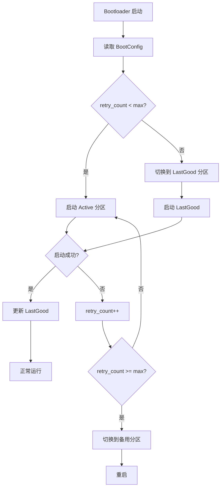

# A/B 分区设计文档

> **版本**：v0.163.0  
> **蓝图章节**：Phase 3 §4.1 A/B 分区布局  
> **最后更新**：2026-07-30

## 1. 概述

EnerOS 采用 A/B 双分区方案实现内核 OTA 零停机升级。该方案是业界标准（Android A/B OTA、ChromeOS），具有高可靠性。

### 1.1 设计目标

- **零停机升级**：支持重启切换与热迁移两种模式
- **失败自动回滚**：启动失败超过重试次数自动切换到 LastGood 分区
- **断电安全**：BootConfig 原子写入 + CRC32 校验
- **国密合规**：SM2 签名 + SM3 哈希验证

## 2. 分区布局

```
eMMC 存储布局（8GB 示例）：
┌─────────────────────────────────────────────────────────────────────┐
│ Bootloader │ BootConfig │   A 分区    │   B 分区    │  Shared Data  │
│   (1MB)    │   (64B)    │  (128MB)    │  (128MB)    │   (256MB)     │
└─────────────────────────────────────────────────────────────────────┘
0x0        0x100000    0x200000      0x8200000     0x10200000
```

### 2.1 分区说明

| 分区 | 偏移 | 大小 | 用途 |
|------|------|------|------|
| Bootloader | 0x0 | 1MB | 启动加载器 |
| BootConfig | 0x100000 | 64B | 启动配置（持久化） |
| A 分区 | 0x200000 | 128MB | 内核镜像 + 设备树 |
| B 分区 | 0x8200000 | 128MB | 内核镜像 + 设备树 |
| Shared Data | 0x10200000 | 256MB | 配置/模型/日志 |

## 3. BootConfig 结构

```rust
pub struct BootConfig {
    pub active: Partition,    // 当前活动分区
    pub last_good: Partition, // 上次成功启动分区
    pub retry_count: u8,      // 当前分区重试次数
    pub max_retries: u8,      // 最大重试次数（默认 3）
}
```

### 3.1 序列化格式

```
偏移  大小  字段
0     4B    魔数 "EBCF"
4     1B    active (0=A, 1=B)
5     1B    last_good (0=A, 1=B)
6     1B    retry_count
7     1B    max_retries
8     4B    CRC32 (覆盖 0-7 字节)
```

## 4. 启动流程



## 5. OTA 升级流程

### 5.1 重启切换模式（推荐）

```
1. 验证新内核签名（SM2/SM3）
2. 写入备用分区
3. 校验（回读 + 哈希比对）
4. 标记可启动
5. 设置下次启动分区
6. 持久化 BootConfig
7. 重启
8. Bootloader 读取 BootConfig 切换分区
```

### 5.2 热迁移模式（零停机）

```
1. 验证新内核签名
2. 加载新内核到内存
3. 暂停线程，保存快照
4. 迁移内存映射
5. 迁移设备状态
6. 切换执行流到新内核
7. 恢复线程
8. 标记新分区为活动
```

## 6. 错误处理

| 错误 | 处理 |
|------|------|
| PartitionFull | 备用分区空间不足，拒绝升级 |
| VerifyFailed | 新内核验签失败，拒绝写入 |
| BootFailed | 新内核启动失败，自动回滚 |
| MigrateFailed | 热迁移失败，回退到旧内核 |
| BootConfigCorrupted | CRC 校验失败，使用默认配置（A 分区） |

## 7. 安全机制

- **签名验证**：新内核镜像必须通过 SM2 验签后才写入
- **哈希校验**：写入后回读计算 SM3 哈希比对
- **原子写入**：BootConfig 使用 CRC32 保护，断电不损坏
- **自动回滚**：启动失败超过 3 次自动切换到 LastGood

## 8. 配置示例

参见 `configs/ab_partition.toml`。

## 9. 相关代码

- `crates/security/ota-ab/src/kernel_ota.rs`：内核 OTA 主逻辑
- `crates/security/ota-ab/src/hot_migrate.rs`：热迁移实现
- `crates/kernel/bootloader/src/ab_boot.rs`：A/B 启动选择
- `crates/security/ota-ab/src/ab_partition.rs`：A/B 分区管理
- `crates/security/ota-ab/src/rollback.rs`：回滚机制
