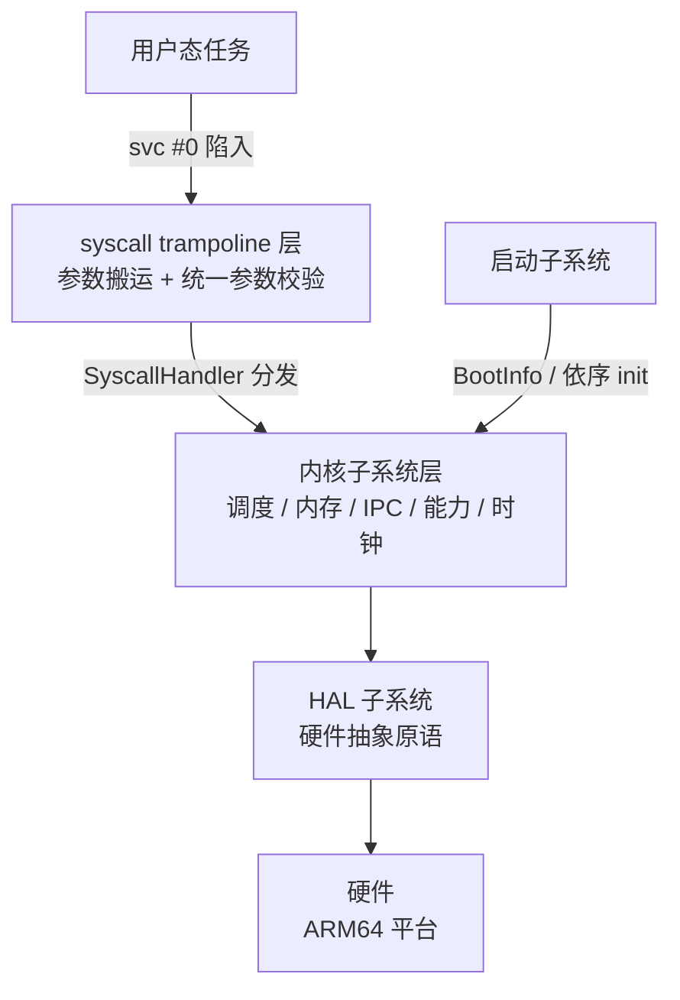
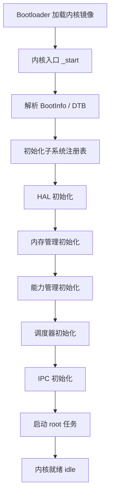

# EnerOS 自研微内核顶层架构设计（v0.127.0）

> **版本**：v0.127.0（Phase 3 首版）
> **crate**：`eneros-microkernel`（[`crates/kernel/microkernel/`](../../crates/kernel/microkernel/src/lib.rs)）
> **蓝图依据**：`蓝图/phase3.md` §v0.127.0
> **架构决策**：ADR-0001（Phase 3 采用 seL4 深度定制，方案 A）
> **最后更新**：2026-07-22

---

## 1. 版本目标与 ADR-0001 定位

本版本完成自研 Rust 微内核的顶层架构设计与 syscall 接口规范，是 Phase 3 整个自研内核设计线的"宪法"——后续所有 Phase 3 版本均遵循此处定义的子系统划分与接口契约。

**ADR-0001 定位**：依据 ADR-0001，Phase 3 主路径采用 seL4 深度定制（方案 A）。原自研内核工作（语言重写、全量形式化验证、5 平台 BSP）已裁剪或合并。本 crate 的三重定位：

1. **seL4 深度定制路径的架构设计输入**：子系统划分、能力模型、syscall 契约与 seL4 差异最小化，为 seL4 配置裁剪提供设计基线；
2. **fallback 参考**：若 seL4 路径在信创认证或深度定制验证中受阻，本架构设计可作为自研微内核的启动基线；
3. **信创认证架构文档输入**：信创认证需提交内核架构设计文档，本 crate 为其代码化输入。

本版本为**接口骨架版本**：仅包含 trait 与类型定义，不包含任何实现主体。

---

## 2. 前置依赖

| 类别 | 依赖项 | 说明 |
|------|--------|------|
| 前序版本 | Phase 0-2 全部 | seL4 实践经验、HAL 设计、RTOS 分区验证 |
| 外部依赖 | Rust nightly + no_std 生态 | 自研内核需 nightly 特性（inline asm、naked_function） |
| 假设 | seL4 API 语义已被充分验证 | Phase 1-2 已证明 seL4 模型可行 |
| 阻塞 | 架构评审未通过则阻塞 v0.128.0 | 评审委员会含内核/安全/电力三方 |

---

## 3. 交付物清单

| 类别 | 交付物 | 实际落位 |
|------|--------|---------|
| 代码类 | 内核 crate 骨架（仅 trait 与类型定义，无实现） | [`crates/kernel/microkernel/src/lib.rs`](../../crates/kernel/microkernel/src/lib.rs) |
| 代码类 | 错误码模型（8 变体，repr(u16)） | [`crates/kernel/microkernel/src/error.rs`](../../crates/kernel/microkernel/src/error.rs) |
| 代码类 | 启动信息模型 `BootInfo` | [`crates/kernel/microkernel/src/boot.rs`](../../crates/kernel/microkernel/src/boot.rs) |
| 代码类 | 内核状态模型 `KernelState`（七句柄占位）/ 版本模型 `KernelVersion` / `KERNEL_VERSION`（0.127.0） | [`crates/kernel/microkernel/src/state.rs`](../../crates/kernel/microkernel/src/state.rs) |
| 接口类 | syscall 编号表 `SyscallNum`（16 编号）与入口签名 `SyscallHandler` | [`crates/kernel/microkernel/src/syscall.rs`](../../crates/kernel/microkernel/src/syscall.rs) |
| 接口类 | 子系统统一接口 `KernelSubsystem` 与注册表 `SubsystemRegistry`（8 槽位） | [`crates/kernel/microkernel/src/registry.rs`](../../crates/kernel/microkernel/src/registry.rs) |
| 文档类 | 架构设计文档（本文档） | `docs/kernel/architecture.md` |
| 文档类 | syscall 接口规范 | [syscall_spec.md](./syscall_spec.md) |
| 文档类 | seL4 兼容性分析 | [sel4_compat.md](./sel4_compat.md) |
| 测试类 | host 侧单元测试（错误码/版本/状态/syscall 编号/注册表次序与短路） | 各模块内 `#[cfg(test)]` |
| 测试类 | 架构评审报告（人工评审记录） | 见本文档 §11（自检记录；正式三方评审为 v0.128.0 入口闸门） |
| 配置类 | workspace 成员注册 | 根 `Cargo.toml` `members` 含 `crates/kernel/microkernel` |

> **偏差 D1**：蓝图原交付物落位为 `kernel/` 根目录，实际按仓库规范 §2.3.1 强制子系统归口落位于 `crates/kernel/microkernel/`，包名 `eneros-microkernel`（`eneros-kernel` 已被 Phase 0 占位 crate 占用）。

---

## 4. 子系统划分

内核按子系统划分功能，覆盖**调度 / 内存 / IPC / 能力 / HAL / 时钟 / 启动**共 7 类（蓝图 §9.1）。所有子系统实现统一接口 [`KernelSubsystem`](../../crates/kernel/microkernel/src/registry.rs)：

```rust
pub trait KernelSubsystem {
    fn name(&self) -> &'static str;
    fn init(&mut self, boot_info: &BootInfo) -> Result<(), KernelError>;
    fn shutdown(&self) -> Result<(), KernelError> { Ok(()) }
}
```

本版本中七类子系统的句柄均为单元结构体占位（偏差 D6），聚合于 [`KernelState`](../../crates/kernel/microkernel/src/state.rs)；具体实现属 v0.130.0 及后续版本。

### 4.1 调度子系统

- **职责**：线程（TCB）生命周期管理、就绪队列维护、调度决策、优先级与核亲和性配置；保留 ARINC 653 分区时间片配置接口。
- **对应接口**：实现 `KernelSubsystem`；对外经 `Yield` / `Schedule` / `ThreadCreate` / `ThreadDelete` / `TcbConfigure` syscall 暴露。
- **句柄占位**：`KernelState::scheduler: SchedulerHandle`。
- **后续版本归属**：v0.130.0+（调度器实现版本）。

### 4.2 内存子系统

- **职责**：物理页管理、页表操作、VSpace（地址空间）管理、映射权限控制。
- **对应接口**：实现 `KernelSubsystem`；对外经 `MapPages` / `UnmapPages` / `VSpaceMap` syscall 暴露。
- **句柄占位**：`KernelState::memory: MemoryHandle`。
- **后续版本归属**：v0.130.0+。

### 4.3 IPC 子系统

- **职责**：endpoint 消息传递、单次往返调用（Call）、同步/阻塞语义实现。
- **对应接口**：实现 `KernelSubsystem`；对外经 `IpcSend` / `IpcRecv` / `IpcCall` syscall 暴露。
- **句柄占位**：`KernelState::ipc: IpcHandle`。
- **后续版本归属**：v0.130.0+。

### 4.4 能力子系统

- **职责**：CSpace 能力槽管理、能力派生与权限位校验、通知（notification）对象管理。
- **对应接口**：实现 `KernelSubsystem`；对外经 `CapInsert` / `CapDelete` / `CapMove` / `Notify` / `WaitFor` syscall 暴露。
- **句柄占位**：`KernelState::caps: CapabilityHandle`。
- **后续版本归属**：v0.130.0+。

### 4.5 HAL 子系统

- **职责**：硬件抽象（CPU 特权级切换、页表基址、串口诊断输出），复用 Phase 2 HAL 接口并适配自研内核初始化流程；预留飞腾/鲲鹏特性扩展点。
- **对应接口**：实现 `KernelSubsystem`；不直接对应 syscall，为其余子系统提供硬件原语。
- **句柄占位**：`KernelState::hal: HalHandle`。
- **后续版本归属**：v0.130.0+。

### 4.6 时钟子系统

- **职责**：内核时基、调度滴答、阻塞调用超时计时（`Timeout` 错误码的时间源）。
- **对应接口**：实现 `KernelSubsystem`；为调度器与 IPC 阻塞路径提供计时服务。
- **句柄占位**：`KernelState::time: TimeHandle`。
- **后续版本归属**：v0.130.0+。

### 4.7 启动子系统

- **职责**：解析 `BootInfo` / DTB、按序初始化子系统注册表、启动 root 任务后进入 idle。
- **对应接口**：实现 `KernelSubsystem`；自身作为首个初始化的子系统编排其余子系统。
- **句柄占位**：`KernelState::bootstrap: BootstrapHandle`。
- **后续版本归属**：v0.129.0（Bootloader 版本）起。

---

## 5. 分层图



- **用户态**：经架构相关指令陷入内核（ARM64 为 `svc #0`），不直接触达任何子系统。
- **trampoline 层**：各 arch 实现，完成寄存器参数搬运与统一参数校验（蓝图 §9.3）。
- **子系统层**：经 `SyscallHandler` 签名分发到具体 handler，子系统间经内核内部接口协作。
- **HAL / 硬件**：子系统经 HAL 访问硬件，保证架构相关代码收敛于一层。

---

## 6. 启动流程

蓝图 §4.3 启动流程原样收录：



注册表语义（[`SubsystemRegistry`](../../crates/kernel/microkernel/src/registry.rs)）与该流程对应：8 个槽位固定，按槽位升序依序调用 `init`，空槽位跳过；任一子系统 `init` 失败立即短路返回其错误码（偏差 D4，替代蓝图的 panic 路径，详见 §8）。

---

## 7. 数据流说明（一次 IpcCall 的完整路径）

以 `IpcCall`（编号 5，同步发送并等待回复）为例说明一次 syscall 的完整数据流：

1. **用户态发起**：调用方将 syscall 编号 5 放入 `x8`，参数放入 `x0`~`x5`（`x0` = 目标 endpoint 能力槽 `cap`，`x1` 起为消息寄存器 word，最多 8 个），执行 `svc #0` 陷入内核态。
2. **trampoline 参数校验**：trampoline 从寄存器搬运参数为 `&[usize]`，完成 ABI 层统一参数校验；非法参数直接返回 `KernelError::InvalidArgument`，不进入子系统（蓝图 §9.3）。
3. **SyscallHandler 分发**：按编号分发到 IPC 子系统 handler。
4. **IPC 子系统处理**：校验 `cap` 指向的 endpoint 能力（无效则 `InvalidCapability`，无调用权限则 `PermissionDenied`），将消息投递到 endpoint。
5. **调度器阻塞**：当前线程置为阻塞态，调度器切换至就绪队列下一线程；当前线程阻塞直到对端 `recv` 并完成回复（带超时变体在时限内未获回复则返回 `Timeout`）。
6. **对端 recv**：对端线程经 `IpcRecv` 取走消息、处理并回复，唤醒调用线程。
7. **返回**：回复经消息寄存器回传，`x0` 写入返回值 `Ok(n)`（`recv` 到的字节数），trampoline 恢复现场返回用户态。

---

## 8. 错误处理路径

统一错误码模型为 [`KernelError`](../../crates/kernel/microkernel/src/error.rs)（8 变体，repr(u16)，判别值 1~8 为稳定 ABI）。本版本错误处理遵循偏差 D4——**短路错误传播替代 panic**：

- **子系统 init 失败**：`SubsystemRegistry::init_all` 在任一子系统 `init` 返回 `Err` 时立即短路返回该错误码，后续槽位不再初始化；故障注入测试验证短路语义而非 panic。
- **syscall trampoline 统一参数校验**：非法参数在 trampoline 层一律返回 `KernelError::InvalidArgument`，不进入具体 handler；handler 仅做语义层校验。
- **运行期错误**：非致命错误经 `Result<T, KernelError>` 传播至调用方，用户态 trampoline 按 `u16` 判别值映射错误。

> 蓝图 §4.4 原案"关键子系统 init 失败则 panic"已被 D4 取代：仓库禁 panic! 规则下，启动期失败同样以错误码短路传播，由启动子系统决定降级或停机策略。

---

## 9. panic_handler 归属说明（偏差 D2）

蓝图 §4.5/§8.5 要求"panic handler 必须在内核 crate 根定义"。本版本**不定义**全局 `#[panic_handler]`，理由：

- 本 crate 为 lib crate（接口骨架）；lib crate 中定义全局 `#[panic_handler]` 会与 host 侧 `cargo test` 链接的测试运行时冲突，也会与 workspace 内其他二进制 crate 的 panic handler 冲突。
- 蓝图 §8.5 的要求针对的是**最终内核二进制产物**，而非接口骨架。

**归属约定**：`#[panic_handler]` 将在最终内核二进制产物（bin crate）中定义，属后续版本（v0.129.0 Bootloader / 内核二进制集成版本）范畴；语义保持蓝图原意——启动期允许，运行期视为致命，输出到串口后死循环。

---

## 10. nightly feature 与 `_start` 预留说明（偏差 D6）

- **不启用 nightly feature gate**：蓝图 §4.5 的 `#![feature(inline_asm, naked_functions)]` 未启用。`asm!` 已稳定，骨架版本无需 feature gate；后续实现版本若需 `naked_functions`，在该版本的 crate 内按需启用。
- **`_start` / trampoline 预留**：内核入口 `_start` 与各 arch trampoline 无实现主体，属 v0.129.0 Bootloader 版本范畴。预留接口约定：`_start` 为 `extern "C" fn() -> !`，由 Bootloader 跳转进入，接收 `BootInfo` 后进入启动子系统编排流程；trampoline 实现 [`SyscallHandler`](../../crates/kernel/microkernel/src/syscall.rs) 签名 `fn(SyscallNum, &[usize]) -> Result<usize, KernelError>`。
- **句柄占位**：`KernelState` 七句柄本版本以单元结构体占位，构造为 `const fn`，允许以静态变量形式驻留。

---

## 11. 架构评审记录

> 本表为 v0.127.0 自检评审记录（设计版本自评）。**正式三方评审（内核/安全/电力）为 v0.128.0 入口闸门**，未通过则阻塞 v0.128.0（蓝图 §2）。

| 评审项 | 评审内容 | 评审结论 |
|--------|---------|---------|
| 子系统覆盖度 | 子系统划分覆盖调度/内存/IPC/能力/HAL/时钟/启动 7 类（蓝图 §9.1），各有 `KernelState` 句柄占位 | 通过（自检） |
| syscall ABI 稳定性 | 编号以 `u16` 暴露（repr(u16)），16 个编号 0~15，预留扩展至 `0x00FF`，禁插入/重排（蓝图 §9.2） | 通过（自检） |
| no_std 合规 | crate 根部 `#![no_std]`，无 `std::` 依赖；测试经 `extern crate std` 隔离 | 通过（自检） |
| 安全参数校验点 | 所有 syscall 入口参数校验统一在 trampoline 层完成，非法参数返回 `InvalidArgument`，不进入子系统（蓝图 §9.3） | 通过（自检） |
| 零 unsafe | 全 crate 零 `unsafe`；注册表以 `&'static mut dyn KernelSubsystem` 消除蓝图原案 const→mut 强转的 UB 风险（D3） | 通过（自检） |
| 与 seL4 差异最小化 | syscall 语义与 seL4 API 建立 16 项迁移映射，差异集中于线程创建/删除聚合语义（见 [sel4_compat.md](./sel4_compat.md)） | 通过（自检） |

---

## 12. 蓝图偏差表（D1~D7）

以下偏差声明原文照抄自 [`lib.rs`](../../crates/kernel/microkernel/src/lib.rs) 文档注释：

| 编号 | 偏差声明（原文） |
|------|----------------|
| D1 | crate 落位 `kernel/` 根目录 → `crates/kernel/microkernel/`，包名 eneros-microkernel（仓库规范 §2.3.1 强制子系统归口；`eneros-kernel` 已被 Phase 0 占位 crate 占用） |
| D2 | lib.rs 内定义 `#[panic_handler]` → 不定义（lib crate 全局 panic_handler 与 host `cargo test` 及 workspace 其他二进制链接冲突；蓝图 §8.5 针对最终内核二进制产物，本版本为接口骨架，归属说明写入 architecture.md） |
| D3 | `SubsystemRegistry` 存储 `&'static dyn` + unsafe const→mut cast（UB 风险）→ 存储 `&'static mut dyn KernelSubsystem`（启动期单线程注册语义安全，零 unsafe） |
| D4 | `assert!(idx < 8)` panic / init 失败 panic → 统一返回 `Result<(), KernelError>`（仓库禁 panic! 规则；蓝图 §4.4 panic 路径语义改为短路错误传播，故障注入测试验证短路而非 panic） |
| D5 | `env!("GIT_HASH")`/`env!("BUILD_TIME")` 需 build.rs 注入 → `option_env!` + "unknown" 回退（骨架 crate 免构建脚本依赖；构建信息注入属 v0.128.0 构建系统版本范畴） |
| D6 | `#![feature(inline_asm, naked_functions)]` + naked `_start` 桩 → 不启用 nightly feature gate（asm! 已稳定；`_start`/trampoline 无实现主体属 v0.129.0 Bootloader 版本范畴，于 architecture.md 预留接口说明）；`KernelState` 七句柄以单元结构体占位 |
| D7 | 蓝图 syscall ABI 述及"ARM64 用 `svc #0`，x86 用 `syscall`"（§5.2）与"用户态通过 `ecall` 陷入"（§4.2）表述矛盾 → 以 §5.2 为准（ecall 为 RISC-V 指令，x86_64 仅留接口占位属 ADR-0001 裁剪项），于 syscall_spec.md 澄清 |

---

## 13. 源码索引

| 文件 | 内容 |
|------|------|
| [`crates/kernel/microkernel/src/lib.rs`](../../crates/kernel/microkernel/src/lib.rs) | crate 根：模块声明、公开导出、D1~D7 偏差声明 |
| [`crates/kernel/microkernel/src/error.rs`](../../crates/kernel/microkernel/src/error.rs) | `KernelError` 八变体错误码模型（repr(u16)，判别值 1~8） |
| [`crates/kernel/microkernel/src/boot.rs`](../../crates/kernel/microkernel/src/boot.rs) | `BootInfo` 启动信息模型 |
| [`crates/kernel/microkernel/src/state.rs`](../../crates/kernel/microkernel/src/state.rs) | `KernelState`（七句柄占位）、`KernelVersion`、`KERNEL_VERSION`（0.127.0） |
| [`crates/kernel/microkernel/src/syscall.rs`](../../crates/kernel/microkernel/src/syscall.rs) | `SyscallNum`（16 编号）、`SyscallHandler` 入口签名 |
| [`crates/kernel/microkernel/src/registry.rs`](../../crates/kernel/microkernel/src/registry.rs) | `KernelSubsystem` trait、`SubsystemRegistry`（8 槽位，零 unsafe，短路错误传播） |
