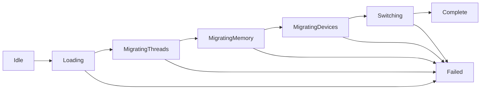

# 内核热迁移设计文档

> **版本**：v0.163.0  
> **蓝图章节**：Phase 3 §4.3 内核热迁移  
> **最后更新**：2026-07-30

## 1. 概述

内核热迁移（Kernel Hot Migration）实现零停机内核升级，在系统运行期间将执行流从旧内核切换到新内核，无需重启。

### 1.1 设计目标

- **零停机**：升级期间系统持续运行，控制任务不中断
- **状态保持**：线程、内存映射、设备状态完整迁移
- **失败回退**：迁移失败自动回退到旧内核
- **平台无关**：通过平台抽象层（PAL）适配不同硬件

### 1.2 适用场景

| 场景 | 推荐模式 | 说明 |
|------|---------|------|
| 电力系统终端 | 热迁移 | 7×24 运行，零停机要求 |
| 工业控制器 | 重启切换 | 可容忍短暂停机 |
| 开发/测试 | 重启切换 | 简单可靠 |

## 2. 状态机



### 2.1 状态说明

| 状态 | 说明 |
|------|------|
| Idle | 空闲，未开始迁移 |
| Loading | 正在加载新内核到内存 |
| MigratingThreads | 正在迁移线程状态 |
| MigratingMemory | 正在迁移内存映射 |
| MigratingDevices | 正在迁移设备状态 |
| Switching | 正在切换执行流 |
| Complete | 迁移完成 |
| Failed | 迁移失败 |

## 3. 核心数据结构

### 3.1 线程快照

```rust
pub struct ThreadSnapshot {
    pub thread_id: u32,      // 线程 ID
    pub pc: u64,             // 程序计数器
    pub sp: u64,             // 栈指针
    pub regs: [u64; 31],     // 通用寄存器 x0-x30
    pub priority: u8,        // 优先级
    pub state: u8,           // 状态（0=就绪, 1=运行, 2=阻塞, 3=挂起）
}
```

### 3.2 内存映射快照

```rust
pub struct MemoryMapSnapshot {
    pub vaddr_start: u64,    // 虚拟地址起始
    pub paddr_start: u64,    // 物理地址起始
    pub size: u64,           // 映射大小
    pub attributes: u64,     // 页表属性（MAIR + 权限）
}
```

### 3.3 设备状态快照

```rust
pub struct DeviceSnapshot {
    pub device_id: u32,      // 设备 ID
    pub device_type: u8,     // 类型（UART/GPIO/TIMER/DMA/NET）
    pub registers: Vec<u32>, // 寄存器快照
    pub irq: u32,            // 中断号
    pub initialized: bool,   // 是否已初始化
}
```

## 4. 平台抽象层（PAL）

```rust
pub trait PlatformAbstraction {
    fn suspend_threads(&mut self) -> Result<Vec<ThreadSnapshot>, MigrateError>;
    fn resume_threads(&mut self, snapshots: &[ThreadSnapshot]) -> Result<(), MigrateError>;
    fn get_memory_map(&mut self) -> Result<Vec<MemoryMapSnapshot>, MigrateError>;
    fn apply_memory_map(&mut self, maps: &[MemoryMapSnapshot]) -> Result<(), MigrateError>;
    fn get_device_states(&mut self) -> Result<Vec<DeviceSnapshot>, MigrateError>;
    fn restore_devices(&mut self, devices: &[DeviceSnapshot]) -> Result<(), MigrateError>;
    fn load_kernel(&mut self, image: &[u8], load_addr: u64) -> Result<(), MigrateError>;
    fn switch_execution(&mut self, entry_addr: u64) -> Result<(), MigrateError>;
}
```

### 4.1 实现要求

| 平台 | 实现要点 |
|------|---------|
| QEMU virt | 模拟实现，用于测试 |
| 飞腾 D2000 | ARM64 真实硬件操作 |
| 鲲鹏 920 | ARM64 真实硬件操作 |

## 5. 迁移流程

### 5.1 详细步骤

```
1. 加载新内核
   - 验证签名（SM2/SM3）
   - 加载到指定内存地址
   - 校验完整性

2. 迁移线程
   - 暂停所有线程
   - 保存线程上下文（PC/SP/寄存器）
   - 记录线程优先级和状态

3. 迁移内存
   - 获取当前页表映射
   - 建立新内核映射
   - 保持用户空间映射不变

4. 迁移设备
   - 保存设备寄存器状态
   - 保存中断配置
   - 准备恢复列表

5. 切换执行流
   - 设置新内核入口
   - 跳转执行
   - 恢复线程

6. 完成
   - 标记新分区为活动
   - 持久化 BootConfig
   - 记录迁移耗时
```

### 5.2 时序要求

| 阶段 | 最大耗时 | 说明 |
|------|---------|------|
| 加载内核 | < 1s | 取决于镜像大小 |
| 暂停线程 | < 10ms | 需快速响应 |
| 迁移内存 | < 100ms | 页表操作 |
| 迁移设备 | < 50ms | 寄存器保存 |
| 切换执行 | < 1ms | 原子操作 |
| **总计** | **< 5s** | 蓝图要求 |

## 6. 错误处理

### 6.1 错误类型

```rust
pub enum MigrateError {
    ThreadMigrationFailed,   // 线程迁移失败
    MemoryMigrationFailed,   // 内存迁移失败
    DeviceMigrationFailed,   // 设备迁移失败
    SwitchFailed,            // 执行流切换失败
    LoadFailed,              // 内核加载失败
}
```

### 6.2 回退策略

- **加载失败**：直接返回错误，系统继续运行旧内核
- **线程迁移失败**：恢复已暂停线程，回退
- **内存迁移失败**：恢复原页表，回退
- **设备迁移失败**：恢复设备状态，回退
- **切换失败**：最严重，需硬件看门狗复位

## 7. 测试策略

### 7.1 单元测试

- 状态机转换测试
- 快照序列化/反序列化
- NullPlatform 完整流程

### 7.2 集成测试

- 模拟迁移完整流程
- 失败注入测试
- 性能基准测试

### 7.3 故障注入

| 故障 | 预期行为 |
|------|---------|
| 线程暂停失败 | 返回错误，系统正常 |
| 内存映射失败 | 回退旧内核 |
| 设备保存失败 | 回退旧内核 |
| 切换失败 | 看门狗复位 |

## 8. 配置

参见 `configs/ab_partition.toml` 的 `[hot_migrate]` 节。

## 9. 相关代码

- `crates/security/ota-ab/src/hot_migrate.rs`：热迁移实现
- `crates/security/ota-ab/src/kernel_ota.rs`：内核 OTA 主逻辑
- `docs/kernel/ab_partition.md`：A/B 分区设计
