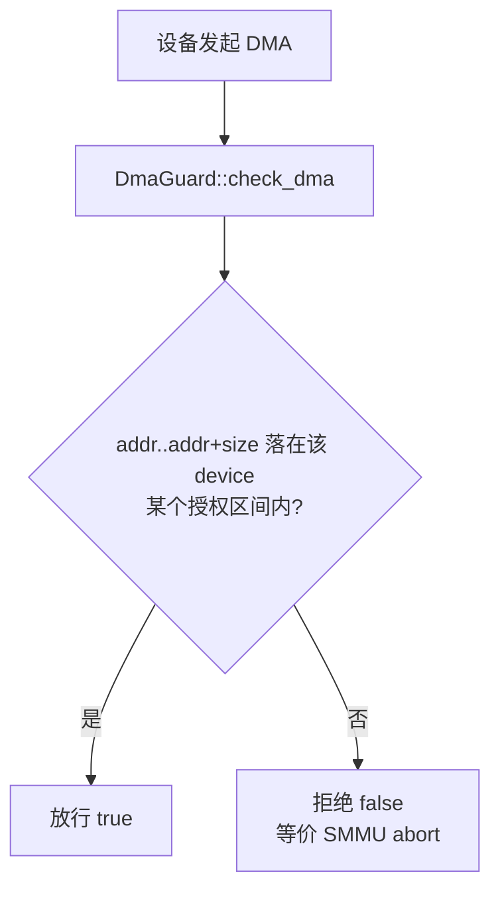

# EnerOS v0.132.0 分区内存隔离设计（独立根页表 + ASID + 配额 + DMA 保护）

> 版本：v0.132.0
> 适用范围：EnerOS 自研内核分区内存隔离（分区地址空间隔离 / 内存配额 / 越权访问判定 / 设备 DMA 保护；QEMU virt aarch64 目标机 / host 测试）
> 蓝图依据：`蓝图/phase3.md` §v0.132.0（§3 交付物 / §4 详细设计 / §6 测试计划 / §7 验收标准 / §8 风险与注意事项）
> 配套文档：[pmm_design.md](./pmm_design.md)（v0.130.0 物理内存管理，根页表帧/数据帧来源）、[vmm_design.md](./vmm_design.md)（v0.131.0 四级页表与 VMM，分区根页表的映射机制）、[../boot/qemu_run.md](../boot/qemu_run.md) §11（v0.132.0 QEMU 实测记录）

---

## 1. 概述

**核心一句话**：基于虚拟内存实现分区地址空间隔离，确保分区 A 无法访问分区 B 的内存，含 DMA 保护（蓝图 §1 原样口径）。

- **Phase 定位**：P3-B 内存线**收官版本**（v0.130.0 物理内存 → v0.131.0 虚拟内存 → v0.132.0 分区隔离）；为 v0.133.0 中断管理提供安全隔离环境（蓝图 §1）。
- **业务价值**：混合关键性架构（RTOS vs Agent）的安全根基——电力控制分区与 AI 分区互不污染（蓝图 §1）。
- **出口关联**：自研内核"内存隔离"功能完整性证据，对应 v0.152.0 形式化证明目标（蓝图 §1）。
- **ADR-0001 口径**：依据 ADR-0001，Phase 3 主路径为 seL4 深度定制（方案 A），seL4 的分区隔离已有数学证明，方案 A 下复用 seL4 隔离机制，仅验证国产 CPU SMMU/DMA 保护适配；本实现属自研内核研究/fallback 线的功能完整性证据，非生产路径。
- **依赖关系**：根页表帧与数据帧全部来自 v0.130.0 `BuddyAllocator`；各区间的页映射经 v0.131.0 `page_table::map_page`/`translate`/`unmap_page` 自由函数在分区独立根页表上建立；内存属性编码复用 v0.131.0 `MemAttrs`/`attrs_to_bits`。

**隔离目标**（双层防护）：

1. **地址空间隔离**：每分区独立根页表 + 独立 ASID——分区 A 建立的映射在分区 B 的根页表中不存在，分区 B 即使使用相同虚拟地址也翻译到不同物理帧（PART4/ISO1 实测）；
2. **越权访问判定**：`check_access` 按蓝图区间包含算法校验访问区间是否完整落在分区授权区域内（syscall 用户指针校验路径，蓝图 §4.2）；
3. **DMA 保护**：`DmaGuard` 登记设备授权 DMA 区间，设备发起 DMA 前软件校验区间合法性，防止设备 DMA 绕过 MMU（蓝图 §5.2，QEMU 软件模型口径见 §7）。

交付物落位（仓库规范 §2.3.1 子系统归口，偏差 D2）：

| 交付物 | 路径 |
|--------|------|
| mem 模块导出（v0.132.0 re-export 口径） | [crates/kernel/microkernel/src/mem/mod.rs](../../crates/kernel/microkernel/src/mem/mod.rs) |
| 分区内存管理（PartitionId/MemRegion/Partition/PartitionTable/PartitionMem trait/PartitionManager + PART1~PART5 单测） | [crates/kernel/microkernel/src/mem/partition.rs](../../crates/kernel/microkernel/src/mem/partition.rs) |
| DMA 保护区（DeviceId/DmaGuard + DMA1~DMA3 单测） | [crates/kernel/microkernel/src/mem/dma_guard.rs](../../crates/kernel/microkernel/src/mem/dma_guard.rs) |
| 内核启动期接入（§3.6 分区隔离冒烟段） | [crates/kernel/microkernel/src/main.rs](../../crates/kernel/microkernel/src/main.rs) |
| host 集成测试（ISO1~ISO7） | [crates/kernel/microkernel/tests/isolation_test.rs](../../crates/kernel/microkernel/tests/isolation_test.rs) |
| 设计文档（蓝图 §3 文档类 / §7.4 验收） | [docs/kernel/partition_isolation.md](./partition_isolation.md)（本文档） |

> **配置类口径**：蓝图 §3 配置类「分区配额配置（RTOS 64MB, Agent 128MB）」落 [partition.rs](../../crates/kernel/microkernel/src/mem/partition.rs) 常量 `RTOS_PARTITION_QUOTA = 64 * 1024 * 1024` / `AGENT_PARTITION_QUOTA = 128 * 1024 * 1024`（见 §5）。

---

## 2. 隔离模型

### 2.1 独立根页表 + 每分区 ASID

```
分区 A（pid=0）                分区 B（pid=1）
┌──────────────────┐          ┌──────────────────┐
│ root_table = 帧X │          │ root_table = 帧Y │  ← create 时各自经 PMM
│ asid = 0         │          │ asid = 1         │    分配 1 帧并整帧清零
│ allowed_regions  │          │ allowed_regions  │
└────────┬─────────┘          └────────┬─────────┘
         │ map_page 建映射              │ map_page 建映射
         ▼                             ▼
   VA 0x7000_0000 → 帧P1         VA 0x7000_0000 → 帧P2（P1 ≠ P2）
```

- **独立根页表**：`create_partition` 经 `pmm.alloc_page(0)` 为每个分区分配一帧作独立根页表（PGD），`write_bytes` 整帧清零（全零 = 全部项无效）；各分区的 `map_partition_mem` 仅在自己的根页表上建映射——分区 A 的映射在分区 B 根页表中物理性不存在（PART4：A 根表无 B 的映射，translate → None）。
- **ASID 每分区**：`asid = AddressSpaceId(pid.0 as u16)`（蓝图 §4.5 原样）——TLB 项按 ASID 区分，多分区共存时切换地址空间无需全表 TLB 失效；真实 TTBR0 切换集成属后续版本（见偏差 D8）。
- **同 VA 不同物理帧**：ISO1 实测双分区对同一 VA（4MB 处）各自映射成功，两棵根页表翻译命中的物理帧互异。

### 2.2 PartitionTable 16 槽注册表

- 分区槽位为定长数组 `[Option<Partition>; 16]`（`MAX_PARTITIONS = 16`，no_std 无堆口径），**下标即 `PartitionId`**；`find_free_slot` 取首个空槽，槽满 → `OutOfMemory`；
- 槽位生命周期：`create_partition` 占用 → `destroy_partition` `take` 释放 → 再次 `create` 复用同一槽（PART5/ISO4）。

### 2.3 active_pid 哨兵（偏差 D6）

蓝图 §4.1 声明了 `active_pid: PartitionId` 字段但未定义其初值与销毁语义。实现定义：

- 无活跃分区哨兵 `NO_ACTIVE_PARTITION = usize::MAX`（模块私有常量）；
- `PartitionTable::new()` 初态 `active_pid = PartitionId(usize::MAX)`；
- `destroy_partition` 销毁的若为活跃分区（`active_pid == pid`），复位为该哨兵。

> 本版本尚无 TTBR 切换路径消费 `active_pid`（分区根页表为独立页表，QEMU 冒烟段不切换 TTBR，仅软件层验证映射登记与越权拒绝）；字段按蓝图落位，供后续集成层使用。

---

## 3. 数据结构

### 3.1 Partition（六字段，[partition.rs](../../crates/kernel/microkernel/src/mem/partition.rs)）

| 字段 | 类型 | 语义 |
|------|------|------|
| `id` | `PartitionId` | 分区标识符（`pub struct PartitionId(pub usize)`，取值即槽位下标） |
| `asid` | `AddressSpaceId` | 地址空间标识符 = `id.0 as u16`（蓝图 §4.5 原样） |
| `root_table` | `PhysFrameNum` | 独立根页表物理帧号（create 时 PMM 分配并整帧清零） |
| `mem_quota` | `usize` | 内存配额（字节）；可映射页数上限 = `mem_quota / PAGE_SIZE` |
| `used_pages` | `usize` | 已映射 4KB 页数（map 成功 +1 / 回滚复原 / destroy 归零） |
| `allowed_regions` | `[Option<MemRegion>; MAX_REGIONS_PER_PARTITION]` | 授权访问区间登记表（定长 16 槽，`None` = 空槽；偏差 D1：蓝图 `Vec<MemRegion>` → 定长数组） |

### 3.2 MemRegion（三字段，蓝图 §3 接口类原样）

| 字段 | 类型 | 语义 |
|------|------|------|
| `start` | `VirtAddr` | 区域起始虚拟地址 |
| `size` | `usize` | 区域尺寸（字节） |
| `attrs` | `MemAttrs` | 区域内存属性（v0.131.0 六布尔字段结构体） |

### 3.3 PartitionTable（两字段，蓝图 §4.1 原样）

| 字段 | 类型 | 语义 |
|------|------|------|
| `partitions` | `[Option<Partition>; MAX_PARTITIONS]` | 分区槽位（定长 16 槽；下标即 `PartitionId`；`None` = 空槽） |
| `active_pid` | `PartitionId` | 当前活跃分区（初态/销毁复位为无活跃哨兵 `PartitionId(usize::MAX)`，见 §2.3） |

### 3.4 DmaGuard（两字段 + DeviceId，[dma_guard.rs](../../crates/kernel/microkernel/src/mem/dma_guard.rs)）

| 字段 | 类型 | 语义 |
|------|------|------|
| `regions` | `[Option<(DeviceId, MemRegion)>; MAX_DMA_REGIONS]` | 授权 DMA 区间槽位（定长 8 槽，`None` = 空槽；同一设备可占多槽；蓝图字段名 `allowed_dma_regions` → 实现名 `regions`，语义一致） |
| `smmu_enabled` | `bool` | SMMU 硬件是否接管 DMA 校验（本版本恒 `false`，真机路径预留，见 §7） |

设备标识符 `pub struct DeviceId(pub u32)`（蓝图 §3 接口类原样 u32 newtype）。

### 3.5 PartitionManager

```rust
pub struct PartitionManager<'a> {
    pmm: &'a mut BuddyAllocator,   // 物理页帧分配器（v0.130.0 buddy）
    table: PartitionTable,         // 分区注册表
    dma: DmaGuard,                 // DMA 保护区
}
```

- 持有物理页帧分配器（根页表帧/数据帧唯一来源）、分区注册表与 DMA 保护区；构造 `PartitionManager::new(pmm: &'a mut BuddyAllocator)` 时注册表与 DMA 登记表均为空；
- 蓝图伪代码 `&'static mut` 句柄 → 生命周期参数 `<'a>`（host 可测，语义一致，偏差 D3）；
- 附赠只读接口 `free_pages_count(&self) -> usize` 穿透至底层 PMM（帧回收核算用，PART1/PART5/ISO6 断言依据）；
- 私有助手 `find_free_slot(&self) -> Result<PartitionId, KernelError>`：首个空槽下标，满 → `OutOfMemory`（蓝图 §4.5 原样语义）。

---

## 4. 接口表（PartitionMem trait，五方法蓝图 §3 原样签名）

| 方法 | 签名 | 语义 | 错误码 |
|------|------|------|--------|
| `create_partition` | `fn create_partition(&mut self, quota: usize) -> Result<PartitionId, KernelError>` | 占首个空槽；`pmm.alloc_page(0)` 分配根页表帧并 `write_bytes` 按 `PageTable` 尺寸（4096B）清零；配发 `asid = pid.0 as u16`；`used_pages = 0`、授权区间全空 | `OutOfMemory`：16 槽满（find_free_slot）或 PMM 无帧 |
| `map_partition_mem` | `fn map_partition_mem(&mut self, pid: PartitionId, vaddr: VirtAddr, size: usize, attrs: MemAttrs) -> Result<(), KernelError>` | 在分区独立根页表上自 `vaddr` 起逐页映射 `size.div_ceil(PAGE_SIZE)` 页（先校验后分配，零副作用三口径见 §5）；全部成功后登记授权区间到预找空槽 | `InvalidArgument`：pid 无效（空槽/越界）；`OutOfMemory`：配额超限 / region 登记表满 / PMM 无帧；`BadState`：重复映射（承 page_table 口径，触发回滚） |
| `destroy_partition` | `fn destroy_partition(&mut self, pid: PartitionId) -> Result<(), KernelError>` | `take` 槽位；遍历授权区间逐页 `translate` 命中即归还数据帧；归还根页表帧；活跃分区销毁时复位 `active_pid` 哨兵（回收口径见 §8） | `InvalidArgument`：pid 无效（空槽/越界/重复销毁） |
| `check_access` | `fn check_access(&self, pid: PartitionId, vaddr: VirtAddr, size: usize) -> bool` | 蓝图区间包含算法：`[vaddr, vaddr+size)` 完整落在该分区某个授权区间内 → `true`；pid 无效 → `false`（算法见 §6） | —（bool 返回，不报错；越权判定由调用方升级为 `PermissionDenied`，蓝图 §4.4 口径属 syscall 集成层） |
| `configure_dma` | `fn configure_dma(&mut self, pid: PartitionId, device: DeviceId, region: MemRegion) -> Result<(), KernelError>` | pid 校验（无效 → `InvalidArgument`）后委托 `DmaGuard::configure` 登记设备 DMA 授权区（见 §7） | `InvalidArgument`：pid 无效 / 同设备区间重叠；`OutOfMemory`：DMA 8 槽满 |

---

## 5. 配额管理

### 5.1 配额常量（蓝图 §3 配置类交付物）

```rust
/// RTOS 分区默认内存配额（64MB）
pub const RTOS_PARTITION_QUOTA: usize = 64 * 1024 * 1024;
/// Agent 分区默认内存配额（128MB）
pub const AGENT_PARTITION_QUOTA: usize = 128 * 1024 * 1024;
```

- 可映射页数上限 = `mem_quota / PAGE_SIZE`（64MB → 16384 页 / 128MB → 32768 页）；
- 配额语义：防分区耗尽全局内存（蓝图 §5.2）；`create_partition(quota)` 按参登记，ISO3 断言常量值并以 1 页配额分区验证超限路径。

### 5.2 先校验后分配：map 零副作用三口径（偏差 D5）

蓝图 §4.5 伪代码为逐页提交语义（中途失败已映射页残留）。实现增强为**失败零副作用**，杜绝半映射泄漏：

1. **口径一：配额先校验**——`used_pages + pages > mem_quota / PAGE_SIZE` → 直接 `OutOfMemory`，不触碰 PMM 与页表（PART2：拒绝后 `used_pages` 不变、原映射不破坏、被拒区间未登记）；
2. **口径二：region 空槽预找**——映射前先 `position(Option::is_none)` 预找授权区间登记表空槽，满 → `OutOfMemory`；避免映射完成后才发现登记表满导致帧泄漏（PART2：登记 16 个 region 后第 17 次 map 先校验拒绝，`used_pages` 保持 16）；
3. **口径三：中途失败回滚**——逐页循环中 PMM OOM 或 `map_page` 失败（如重复映射 `BadState`）时：
   - map 失败的数据帧未入页表，直接 `free_page` 归还 PMM；
   - 回滚本次调用已映射页：`translate` → `unmap_page` → `free_page(addr_to_frame(pa))`，`used_pages` 复原；
   - 返回首个错误，分区状态与调用前一致。

### 5.3 create 路径零副作用

`create_partition` 槽满拒绝发生在任何 PMM 分配之前（PART1：16 槽满后再 create → `OutOfMemory`，PMM 空闲帧计数不变）。

---

## 6. check_access 算法

### 6.1 区间包含判定（蓝图 §4.5 原样语义）

```rust
fn check_access(&self, pid: PartitionId, vaddr: VirtAddr, size: usize) -> bool {
    let part = match self.table.partitions.get(pid.0).and_then(Option::as_ref) {
        Some(p) => p,
        None => return false,                 // pid 无效（空槽/越界）→ false，不 panic（D7）
    };
    for region in part.allowed_regions.iter().flatten() {
        let end = region.start.0 + region.size;
        if vaddr.0 >= region.start.0 && vaddr.0 + size <= end {
            return true;                      // 请求区间完整落在某个授权区间内
        }
    }
    false
}
```

- **判定语义**：请求区间 `[vaddr, vaddr+size)` 完整落在授权区间 `[start, start+size)` 内才放行——起址越前 1 字节、尾越界 1 字节、`end` 起址（右端点开区间语义）、中部跨界均 `false`（PART3 边界全覆盖）；
- **复杂度**：`O(MAX_REGIONS_PER_PARTITION)` = **O(16)**——定长数组线性扫描，无堆分配、无锁， worst case 16 次区间比较；
- **pid 越界防护（偏差 D7）**：蓝图伪代码 `self.table.partitions[pid.0]` 直索引在 pid 越界（如 `PartitionId(99)` / `PartitionId(usize::MAX)`）时会 panic；实现改 `.get(pid.0)`，越界与空槽统一安全返回 `false`（PART3 覆盖，不 panic）。

### 6.2 蓝图调用场景（§4.2）

内核在 syscall 中调用 `check_access` 校验用户态指针：命中授权区间允许访问，未命中返回越权（蓝图 §4.3 Mermaid A~F 分支）；本版本交付判定原语本身，syscall 接入（`PermissionDenied` + 审计日志，蓝图 §4.4）属后续集成层。

---

## 7. DMA 保护机制

### 7.1 软件登记表模型（偏差 D4）

**QEMU virt 平台无 SMMU**——本版本以 `DmaGuard` 软件登记表实现等价 SMMU abort 语义的判定模型（蓝图 §4.3 Mermaid G~K 分支）：



- 内核在设备发起 DMA 前经 `check_dma` 软件校验区间合法性；硬件 fault 路径（SMMU abort → 内核异常处理）不在本版本验证范围（蓝图 §8.1「SMMU 驱动在真机才完整验证（QEMU 无 SMMU）」）；
- `smmu_enabled` 字段为真机硬件接管路径预留，本版本恒 `false`（DMA1 断言初态）。

### 7.2 DmaGuard 三方法

| 方法 | 语义 | 错误码 |
|------|------|--------|
| `configure(&mut self, device: DeviceId, region: MemRegion) -> Result<(), KernelError>` | 登记 device 的授权 DMA 区间（占首个空槽）；**同设备**已有重叠区间 → 拒绝；**不同设备**区间允许重叠——隔离语义按 device 各自独立判定 | `InvalidArgument`：同 device 重叠（`regions_overlap`：`a.start < b_end && b.start < a_end`）；`OutOfMemory`：8 槽满 |
| `check_dma(&self, device: DeviceId, addr: usize, size: usize) -> bool` | `[addr, addr+size)` 完整落在该 device 某个授权区间内 → `true`（与 `check_access` 同口径区间包含判定）；未授权设备即使地址落在他人授权区内亦 `false` | —（bool 返回） |
| `remove(&mut self, device: DeviceId) -> Result<(), KernelError>` | 移除 device 的全部授权区间（设备下线/分区销毁路径）；其他 device 授权不受影响 | `InvalidArgument`：该 device 无任何已登记授权（含重复 remove） |

### 7.3 真机 SMMUv3 适配钩子（v0.145/146）

飞腾/鲲鹏 SMMUv3 驱动适配属 **v0.145/146**（蓝图 §5.4 难点 / §5.6 国产化）。预留口径：真机 SMMU 驱动就绪后 `smmu_enabled` 置 `true`，DMA 校验由硬件接管（`check_dma` 可旁路为硬件判定结果），登记表语义与授权配置流程（`configure_dma`）保持不变。

---

## 8. destroy 回收

`destroy_partition` 回收序列（[partition.rs](../../crates/kernel/microkernel/src/mem/partition.rs)）：

1. **槽位 take**：`get_mut(pid.0).and_then(Option::take)`，无效 pid（空槽/越界/重复销毁）→ `InvalidArgument`；
2. **数据帧回收**：遍历 `allowed_regions` 全部已登记区间，逐页 `page_table::translate(root, va)` 命中即 `pmm.free_page(addr_to_frame(pa), 0)` 归还 PMM（蓝图 §4.5 `reclaim_partition_pages` 语义；free 错误按蓝图 `.ok()` 口径忽略）；
3. **根页表帧回收**：`pmm.free_page(part.root_table, 0)`；
4. **活跃哨兵复位**：销毁的若为活跃分区（`active_pid == pid`），复位 `active_pid = PartitionId(usize::MAX)`（D6）。

**中间层页表帧不回收的口径说明**：L1/L2/L3 中间层页表帧在 destroy 中**保持已分配态不回收**——承 [page_table.rs](../../crates/kernel/microkernel/src/mem/page_table.rs) unmap 同口径简化决策（v0.131.0 偏差 D12：不回收全空的中间层页表，留待后续版本反向回收）。该口径不影响映射正确性与**数据帧回收完整性**（PART5：destroy 后 PMM 空闲帧精确回升「数据帧 2 + 根帧 1」；ISO6：回收量 ≥ 数据帧数）。蓝图 §8.5 坑点「页表回收遗漏导致内存泄漏」按此口径显式声明，反向回收属后续版本。

**槽位复用**：销毁后槽位释放，`find_free_slot` 首个空槽语义保证再次 `create` 复用同一槽（PART5/ISO4）；复用分区授权区间全空，前分区 region 不残留（PART5：复用后 `check_access` 对旧 VA → `false`）。

---

## 9. 测试矩阵

host 侧执行 `cargo test -p eneros-microkernel`（lib 内嵌单测 + tests/ 集成测试；host 上可使用 std，伪 RAM 为测试进程堆内 `Vec<u8>` 4MB 对齐缓冲，页表帧直访与 kernel 真实物理内存语义一致，承 v0.130.0/v0.131.0 夹具口径）。构造分配器的用例统一经 `run_big_stack` 在 32MB 大栈线程运行（`BuddyAllocator` 内联 ≈2.1MB 超 host 测试线程默认栈）。

### 9.1 单元测试（src/mem 内嵌，PART1~5 / DMA1~3）

| 编号 | 用例 | 验证点 | 结果 |
|------|------|--------|------|
| PART1 | `part1_create_asid_root_frame_valid` | 初态无活跃分区哨兵；create 占槽 0、ASID = `pid.0 as u16`、根帧已清零（空表翻译 None）、双分区根帧互异、各占 PMM 1 页；configure_dma 无效 pid（空槽 15/越界 99）→ `InvalidArgument`、有效 pid 委托成功；16 槽满 → `OutOfMemory` 且零副作用 | PASS |
| PART2 | `part2_map_quota_exceeded_state_intact` | 配额 2 页分区：页内 map 成功、超 1 页 → `OutOfMemory` 且 used_pages/映射/region 均不破坏；无效 pid → `InvalidArgument`；region 登记满 16 后第 17 次 map 先校验拒绝（登记表满分支，非配额分支） | PASS |
| PART3 | `part3_check_access_boundaries` | check_access 边界：start-1 越前 false / 首页·次页·整区间精确·末字节 true / 尾越界 1 字节 false / end 起址 false / 无效 pid（空槽 15、`usize::MAX`）false 不 panic | PASS |
| PART4 | `part4_dual_partition_isolation` | 双分区 check_access 互不可见对方 region；同 VA 双分区映射不同物理帧；A 根表无 B 的映射、B 根表无 A 的映射 | PASS |
| PART5 | `part5_destroy_reclaims_and_slot_reusable` | destroy 后 PMM 空闲帧精确回升（数据帧 2 + 根帧 1，中间层页表帧不回收属声明口径）；槽位释放可复用、复用后前分区 region 不残留；重复 destroy / 无效 pid → `InvalidArgument` | PASS |
| DMA1 | `dma1_authorized_region_hit` | `smmu_enabled` 初态 false（D4）；授权整区间/子区间/末字节命中；同设备不相交第二区间允许；未授权设备地址落在他人授权区内亦拒绝 | PASS |
| DMA2 | `dma2_out_of_bounds_rejected` | 起址越前/尾越 1 字节/完全界外均 false；同 device 重叠登记（部分相交/完全重叠）→ `InvalidArgument`；不同 device 可重叠；remove 后授权失效、重复 remove → `InvalidArgument`、他 device 不受影响 | PASS |
| DMA3 | `dma3_full_table_out_of_memory` | 8 槽满 → `OutOfMemory`；remove 腾槽后可再登记并命中 | PASS |

### 9.2 集成测试（tests/isolation_test.rs，ISO1~7，仅以公开 API 端到端验证）

| 编号 | 用例 | 验证点 | 结果 |
|------|------|--------|------|
| ISO1 | `iso1_dual_partition_same_va_isolation` | 双分区同 VA（4MB 处 1 页）各自映射成功，两棵独立根页表均翻译命中但物理帧互异（页对齐且落在测试 zone 内）；双方各自 check_access 可见 | PASS |
| ISO2 | `iso2_cross_partition_check_access_denied` | 跨分区拒绝：B 对 A 的区间整区间/子区间/单字节均 false，反向同；自身区间各粒度 true；空槽 15 false | PASS |
| ISO3 | `iso3_quota_constants_and_exceeded_zero_side_effect` | 配额常量断言（`RTOS_PARTITION_QUOTA == 64*1024*1024` / `AGENT_PARTITION_QUOTA == 128*1024*1024`）；1 页配额分区 map 2 页 → `OutOfMemory` 且不登记、帧计数不变；配额用尽再 map 拒绝、原映射不破坏 | PASS |
| ISO4 | `iso4_destroy_slot_reuse` | destroy A 释放槽 0 → 再次 create 复用同槽；重复 destroy / destroy 未创建 pid → `InvalidArgument`；他分区（B）不受影响可正常 destroy | PASS |
| ISO5 | `iso5_dma_out_of_bounds_rejected` | 管理器路径：合法 pid 登记成功、未创建 pid → `InvalidArgument`；公开 `DmaGuard` 同口径三分支：命中（整区间/子区间/末字节）/ 越界（起址越前/尾越 1 字节/完全界外）/ 他设备拒绝 | PASS |
| ISO6 | `iso6_destroy_reclaims_data_frames` | destroy 回收量 ≥ 数据帧数（实际回收 = 数据帧 + 根页表帧；中间层页表帧不回收属声明口径）；destroy 后该区间 check_access false | PASS |
| ISO7 | `iso7_check_access_perf_smoke` | 10000 次 check_access 循环逐次命中断言；实测均值 **2 ns/op** 经 eprintln 输出（`[partition perf smoke] ...`；**host 口径，非目标机代表性**——蓝图 <100ns 为裸机目标值，本用例不对耗时阈值断言失败，仅拦截意外算法退化，承 v0.131.0 D7 口径） | PASS |

### 9.3 QEMU 冒烟（main.rs §3.6 段 + [qemu_run.md](../boot/qemu_run.md) §11）

冒烟流程：VMM rw 自检通过后进入 §3.6 分区隔离冒烟段——PMM 移交 `PartitionManager` 持有 → `create_partition(RTOS_PARTITION_QUOTA)` → `map_partition_mem(pid, 0x5000_0000, 4096, KERNEL_RW_X)` 映射 1 页至分区私有 VA → `check_access` 双判定（本分区 pid 授权通过 `true` 且无关分区 `PartitionId(15)` 越权被拒 `false`）→ 打印 `[part] iso ok`。失败分支：`[part] err create 0x...` / `[part] err map 0x...` / `[part] err access`（实测未触发）。

串口输出关键行（原样收录，WSL2 QEMU 8.2.2）：

```text
[kernel] EnerOS kernel booting
[pmm] alloc ok frame=0x000000000004FC00
[vmm] mmu on
[vmm] rw ok
[part] iso ok
```

| 实测项 | 值 |
|--------|-----|
| 结果 | **PASS**（boot_test.sh 五关键串断言：`[boot]` 横幅 / `[kernel] booting` / `[pmm] alloc ok` / `[vmm] mmu on` / `[part] iso ok`；v0.132.0 起追加第五条断言），首轮一次通过，无排障记录 |
| kernel release ELF | 82,568 B ≈ 80.6 KB（远低于 512KB 预算；分区页表帧为运行时 PMM 分配，不计入镜像文件尺寸） |
| 端到端总耗时 | 14s（构建 3.49s + QEMU timeout 10s 守护窗口） |

蓝图 §6 其余条目对照：

| 蓝图条目 | 覆盖情况 |
|---------|---------|
| §6.2 集成测试「分区 A 访问分区 B 地址 → fault」 | 软件判定层等价覆盖：ISO2 跨分区 check_access 全 false；硬件 page fault 路径需 TTBR 切换 + 异常处理集成，属后续版本 |
| §6.2 集成测试「DMA 越界 → SMMU fault」 | 软件登记表等价判定覆盖：DMA2/ISO5 越界全 false（D4：QEMU 无 SMMU，硬件 fault 属真机验证） |
| §6.3 性能基准「check_access < 100ns」 | ISO7 host 实测 2 ns/op（host 口径非目标机代表性；目标机性能测定属后续版本） |
| §6.4 回归「v0.130/131 功能不受影响」 | QEMU 冒烟 `[pmm] alloc ok` / `[vmm] mmu on` / `[vmm] rw ok` 在 `[part] iso ok` 前均通过；host 全部用例基于 v0.130.0 PMM + v0.131.0 page_table 构建 |
| §6.5 故障注入「故意跨分区访问」 | ISO2（双分区互访拒绝）+ QEMU 冒烟 `PartitionId(15)` 越权判定 |
| §6.6 GPU 规则 | 不适用（内存隔离，蓝图原样口径） |

---

## 10. 蓝图偏差表（D1~D9）

| 编号 | 内容 | 理由 | 影响 |
|------|------|------|------|
| D1 | 蓝图 §3 `allowed_regions: Vec<MemRegion>` → 定长数组 `[Option<MemRegion>; MAX_REGIONS_PER_PARTITION]`（16 槽，`None` = 空槽）；同理 `PartitionTable.partitions` / `DmaGuard.regions` 均为定长数组 | no_std 无堆（仓库规范 §4.3 硬性要求），`Vec` 不可用；容量编译期确定 | 单分区授权区间上限 16（登记满 map → `OutOfMemory`，PART2 覆盖）；分区上限 16、DMA 授权上限 8；语义与蓝图一致 |
| D2 | 蓝图交付物 `kernel/src/mem/{partition,dma_guard}.rs`、测试 `kernel/tests/isolation_test.rs`、文档 `docs/kernel/partition_isolation.md` → 落位 `crates/kernel/microkernel/src/mem/` 与 `crates/kernel/microkernel/tests/`；文档路径同蓝图 | 仓库规范 §2.3.1 强制子系统归口（`crates/<subsystem>/`），禁止根目录 crate | 仅路径差异，交付物一一对应 |
| D3 | 蓝图 §4.5 伪代码 `pmm.alloc(0, 0)` / `vmm.map_page_in(...)` / `vmm.translate_in(...)` / `pmm.free(0, frame, 0)` → 适配 v0.130/131 既有真实 API：`pmm.alloc_page(0)` / `page_table::map_page` / `page_table::translate` / `pmm.free_page(frame, 0)`；`PartitionManager` 伪代码 `pmm: &'static mut` / `vmm: &'static mut PageTable` 双句柄 → 生命周期参数 `<'a>` 单 `pmm` 借用（页表经 `frame_to_addr` + 自由函数访问，无独立 vmm 句柄） | 伪代码 API 与 v0.130/131 落地签名不一致；`&'static mut` host 不可测且违反别名规则，生命周期参数语义一致且 host 可测；根页表经 mem 模块级可解引用不变式直访（各 unsafe 附 SAFETY 注释） | 接口形态与伪代码不同，语义等价；host 单测/集成测试完整覆盖 |
| D4 | 蓝图 §4.2「configure_dma 通过 SMMU 限制设备」/ §4.4「DMA 越界触发 SMMU fault」→ QEMU virt 无 SMMU，实现为 `DmaGuard` 软件登记表（8 槽登记 + `check_dma` 软件校验，等价 SMMU abort 判定语义）；`smmu_enabled` 字段预留硬件接管路径，本版本恒 `false` | QEMU virt 平台无 SMMU 硬件（蓝图 §8.1 自认）；软件模型先行交付判定语义 | 硬件 fault 路径不在本版本验证范围；真机 SMMUv3（飞腾/鲲鹏）驱动适配属 v0.145/146（蓝图 §5.4/§5.6） |
| D5 | 蓝图 §4.5 map 伪代码逐页提交（中途失败已映射页残留、region 在循环后 push）→ 零副作用三口径增强：① 配额先校验直接拒绝；② region 空槽映射前预找（满 → `OutOfMemory`）；③ 逐页映射中途失败回滚本次已映射页（translate → unmap_page → free_page）并归还数据帧、`used_pages` 复原 | 伪代码路径中途失败造成半映射泄漏（数据帧已分配但无 region 登记，destroy 无法回收）；蓝图 §8.5「页表回收遗漏导致内存泄漏」坑点的正向防护 | 较蓝图语义增强；PART2/ISO3 断言拒绝路径状态不破坏、帧计数不变 |
| D6 | 蓝图 §4.1 声明 `active_pid: PartitionId` 但未定义初值/销毁语义 → 定义无活跃哨兵 `NO_ACTIVE_PARTITION = usize::MAX`：`PartitionTable::new()` 初态为该哨兵；`destroy_partition` 销毁活跃分区时复位哨兵 | 蓝图未定义，实现须自洽；`usize::MAX` 为不可能槽位下标（上限 16），天然无冲突 | 本版本无 TTBR 切换路径消费 `active_pid`（QEMU 冒烟段不切换 TTBR）；字段按蓝图落位供后续集成层使用 |
| D7 | 蓝图伪代码 `self.table.partitions[pid.0]` 直索引 → 全部改 `.get(pid.0)` 防护：check_access 越界 pid → `false`，map/destroy/configure_dma 越界 pid → `InvalidArgument`，均不 panic | 直索引对 `PartitionId(99)` / `PartitionId(usize::MAX)` 等越界下标会 panic，违反蓝图 §9.4 系「显式错误不 panic」口径 | 越界与空槽统一显式拒绝；PART1/PART2/PART3/PART5 覆盖越界 pid（99、15、`usize::MAX`） |
| D8 | 观察项：ASID 取 `pid.0 as u16`（蓝图 §4.5 原样）时 **pid 0 → ASID 0**，与 v0.131.0 vmm.rs「ASID 0 = 未切换」哨兵口径存在潜在冲突 | 蓝图口径与本仓 vmm.rs 哨兵口径的差异；本版本不做 TTBR 切换，无实际暴露 | 留后续集成层在 TTBR0 切换时处理（重映射或哨兵调整），本版本不做重映射（partition.rs 模块头注声明） |
| D9 | 蓝图未细化分区映射的 MemAttrs 取值 → 复用 v0.131.0 `MemAttrs::KERNEL_RW_X`（EL1 RW 可执行，Normal WB）；vmm.rs 尚无 RW 非执行（NX）常量 | v0.131.0 仅落地 `KERNEL_RW_X` / `DEVICE_RW` 两个关联常量；分区映射属性非本版本验收点（QEMU 冒烟段头注声明） | 分区数据页暂为可执行属性；RW-NX 常量与 EL0 用户态属性组合属后续版本（attrs_to_bits 编码位已具备 UXN/PXN 能力） |

---

## 11. 源码链接

| 模块 | 路径 |
|------|------|
| mem 模块导出（pub use 口径） | [crates/kernel/microkernel/src/mem/mod.rs](../../crates/kernel/microkernel/src/mem/mod.rs) |
| 分区内存管理（PartitionId/MemRegion/Partition/PartitionTable/PartitionMem/PartitionManager/配额常量 + PART1~5 单测） | [crates/kernel/microkernel/src/mem/partition.rs](../../crates/kernel/microkernel/src/mem/partition.rs) |
| DMA 保护区（DeviceId/DmaGuard/regions_overlap + DMA1~3 单测） | [crates/kernel/microkernel/src/mem/dma_guard.rs](../../crates/kernel/microkernel/src/mem/dma_guard.rs) |
| 四级页表自由函数（map_page/unmap_page/translate，分区映射机制） | [crates/kernel/microkernel/src/mem/page_table.rs](../../crates/kernel/microkernel/src/mem/page_table.rs) |
| 虚拟内存管理器（VirtAddr/MemAttrs/attrs_to_bits/AddressSpaceId） | [crates/kernel/microkernel/src/mem/vmm.rs](../../crates/kernel/microkernel/src/mem/vmm.rs) |
| 页帧分配器（根页表帧/数据帧来源，v0.130.0） | [crates/kernel/microkernel/src/mem/buddy.rs](../../crates/kernel/microkernel/src/mem/buddy.rs)、[crates/kernel/microkernel/src/mem/pmm.rs](../../crates/kernel/microkernel/src/mem/pmm.rs) |
| 内核启动期接入（§3.6 分区隔离冒烟段） | [crates/kernel/microkernel/src/main.rs](../../crates/kernel/microkernel/src/main.rs) |
| 内核统一错误码 KernelError | [crates/kernel/microkernel/src/error.rs](../../crates/kernel/microkernel/src/error.rs) |
| host 集成测试 ISO1~ISO7 | [crates/kernel/microkernel/tests/isolation_test.rs](../../crates/kernel/microkernel/tests/isolation_test.rs) |
| QEMU 实测记录（v0.132.0 串口全文/ELF/耗时） | [docs/boot/qemu_run.md](../boot/qemu_run.md) §11 |
| PMM 设计文档（v0.130.0，帧分配器设计） | [docs/kernel/pmm_design.md](./pmm_design.md) |
| VMM 设计文档（v0.131.0，页表机制设计） | [docs/kernel/vmm_design.md](./vmm_design.md) |

---

## 12. 验收对照（蓝图 §7 逐条）

| 蓝图 §7 验收标准 | 实现证据 | 结论 |
|-----------------|---------|------|
| §7.1 功能：隔离性测试通过 | PART4（双分区 region 互不可见、同 VA 不同物理帧）+ ISO1（独立根页表同 VA 隔离）+ ISO2（跨分区 check_access 全 false）全 PASS；QEMU 实测 `[part] iso ok` | ✅ |
| §7.2 性能量化：check_access < 100ns | ISO7 实测均值 **2 ns/op**（10000 次循环，host 用户态口径）——远低于 100ns 阈值；**声明**：host 口径非目标机代表性，蓝图阈值为裸机目标值，目标机性能测定属后续版本（承 v0.131.0 D7 口径） | ✅（host 口径） |
| §7.3 安全：跨分区访问被拒 | ISO2 整区间/子区间/单字节三粒度跨分区均 false；PART3 边界全覆盖；QEMU 冒烟 `PartitionId(15)` 对授权 VA 越权判定 false | ✅ |
| §7.3 安全：DMA 越界被拒 | DMA2（起址越前/尾越 1 字节/完全界外/同设备重叠登记拒绝）+ ISO5（管理器路径 + 公开 DmaGuard 三分支）；QEMU 无 SMMU 属 D4 声明口径，真机硬件路径 v0.145/146 | ✅（软件模型口径） |
| §7.4 文档：partition_isolation.md | 本文档（[docs/kernel/partition_isolation.md](./partition_isolation.md)） | ✅ |
| §7.5 出口判定：隔离性测试通过 → P3-C 可启动 | host 15 用例全绿（PART1~5 + DMA1~3 + ISO1~7）+ QEMU 五关键串断言 PASS，P3-B 内存线（v0.130.0~v0.132.0）收官 | ✅ |
