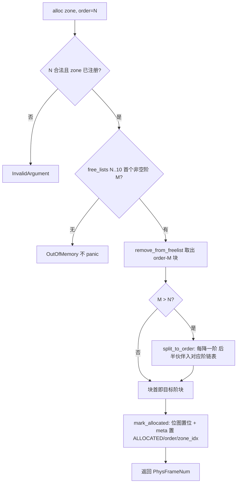

# EnerOS v0.130.0 物理内存管理设计（PMM buddy system）

> 版本：v0.130.0
> 适用范围：EnerOS 自研内核物理页帧分配器（QEMU virt aarch64 目标机 / host 测试）
> 蓝图依据：`蓝图/phase3.md` §v0.130.0（§3 交付物 / §4 详细设计 / §6 测试计划 / §7 验收标准 / §9 多角度要求）
> 配套文档：[../boot/qemu_run.md](../boot/qemu_run.md) §9（v0.130.0 QEMU 实测记录与排障）、[../boot/boot_protocol.md](../boot/boot_protocol.md)（启动协议）

---

## 1. 概述

**核心一句话**：实现物理内存页帧分配器（buddy system），支持页级分配/释放与内存区域（Zone）划分（蓝图 §1 原样口径）。

- **Phase 定位**：P3-B 内存线**首版本**；v0.131.0 虚拟内存（ARM64 四级页表）与 v0.132.0 分区内存隔离均依赖本分配器提供物理页帧。
- **出口关联**：自研内核"内存管理"功能完整性证据（蓝图 §1）。
- **ADR-0001 定位**：依据 ADR-0001，Phase 3 主路径为 seL4 深度定制（方案 A），seL4 已具备物理内存管理（Untyped 模型），方案 A 下复用 seL4 内存管理；本实现属自研内核研究/fallback 线的功能完整性证据，非生产路径（见偏差 D4）。
- **算法一句话**：经典 buddy system——物理页帧按 2 的幂阶（order 0..=10，1 页~4MB）组织成 11 条空闲链表，分配时向上找块、向下对半拆分，释放时按"伙伴帧号 = 帧号 XOR 2^阶"向上合并。

交付物落位（仓库规范 §2.3.1 子系统归口，偏差 D1）：

| 交付物 | 路径 |
|--------|------|
| mem 模块导出 | [crates/kernel/microkernel/src/mem/mod.rs](../../crates/kernel/microkernel/src/mem/mod.rs) |
| 常量配置（PAGE_SIZE/MAX_ORDER/MAX_ZONES/MAX_FRAMES_PER_ZONE） | [crates/kernel/microkernel/src/mem/config.rs](../../crates/kernel/microkernel/src/mem/config.rs) |
| 页帧抽象与 `PhysMemManager` trait | [crates/kernel/microkernel/src/mem/pmm.rs](../../crates/kernel/microkernel/src/mem/pmm.rs) |
| Zone 数据结构（空闲链表 + 位图 + 元数据） | [crates/kernel/microkernel/src/mem/zone.rs](../../crates/kernel/microkernel/src/mem/zone.rs) |
| buddy 分配算法与多 Zone 路由 | [crates/kernel/microkernel/src/mem/buddy.rs](../../crates/kernel/microkernel/src/mem/buddy.rs) |
| 内核启动期接入（main.rs PMM 段） | [crates/kernel/microkernel/src/main.rs](../../crates/kernel/microkernel/src/main.rs) |
| host 集成测试（T01~T08） | [crates/kernel/microkernel/tests/pmm_test.rs](../../crates/kernel/microkernel/tests/pmm_test.rs) |

---

## 2. buddy 算法

### 2.1 伙伴帧号

order 阶块的伙伴块首帧号按异或计算（[buddy.rs](../../crates/kernel/microkernel/src/mem/buddy.rs) `buddy_of`）：

```
buddy(frame, order) = frame XOR (1 << order)
```

异或互逆：buddy 的 buddy 即自身（单测 BUDDY4 覆盖）。块首帧**绝对对齐** 2^order 时（空闲链表不变量），XOR 等价于 ±2^order——拆分出的后半伙伴即 `块首 + 2^(降后阶)`。

### 2.2 分配：向上找块 + split_to_order 拆分

1. 参数校验：`zone_idx < MAX_ZONES` 且槽位已注册、`order < max_order`（= 11），任一不满足返回 `InvalidArgument`；
2. 从目标阶 `order` 开始**向上**找首个非空空闲链表（`cur_order < max_order`，杜绝索引 `free_lists[11]` 越界，偏差 D8）；
3. 取块（`remove_from_freelist`）后若块大于需求，经 `split_to_order` **逐降一阶**拆分：每降一阶，后半伙伴块入对应阶空闲链表，块首保持前半继续拆，直到目标阶；
4. `mark_allocated` 置位图 + 写块首元数据（ALLOCATED/order/zone_idx），返回起始帧号；
5. 各阶链表均无可满足块时返回 `OutOfMemory`（**不 panic**，蓝图 §9.4）。

### 2.3 释放：校验 + 位图/元数据判 free + 向上合并

1. `Zone::mark_free` 先做 double-free / 阶匹配检测（块首元数据无 ALLOCATED 或 `meta.order != order` → `InvalidArgument`，**先校验后变更，错误路径无副作用**），通过后清位图、清 ALLOCATED；
2. 向上合并循环（`cur_order + 1 < max_order`，最大合并到 order 10）：计算伙伴帧号，`Zone::is_free` 判定伙伴为"同阶空闲整块"（界内 && 无 ALLOCATED && `meta.order == order` && 相对 `start_frame` 对齐 2^order）才合并——将伙伴从链表摘除，合并块首取两者较小帧号，升一阶继续判定；
3. 合并终止后最终块经 `add_to_freelist` 头插入对应阶链表。

### 2.4 算法流程图（仿蓝图 §4.3，按实现修正 off-by-one 后收录）



### 2.5 复杂度

- 找块最多扫描 `MAX_ORDER - order` 条链表头（≤ 11 次）；
- 拆分/合并最多 10 轮，每轮为链表头插/摘除 O(1)（摘除非头节点需遍历该阶链表）；
- 整体满足蓝图 §9.2 "O(1) 到 O(log)" 口径；性能 smoke 见 §7 T08。

---

## 3. Zone 区域划分

### 3.1 ZoneType 四变体（蓝图 §3 原样，[pmm.rs](../../crates/kernel/microkernel/src/mem/pmm.rs)）

| 变体 | 语义 | 当前使用 |
|------|------|---------|
| `Normal` | 普通内存 | ✅ 内核接入唯一投入使用（见 §8，偏差 D6） |
| `Device` | 设备内存（MMIO） | 预留（v0.131/v0.132 细化） |
| `Reserved` | 保留内存 | 预留（测试覆盖构造路径） |
| `Dma` | DMA 内存（< 4GB，供设备用） | 预留（多 Zone 路由测试覆盖） |

### 3.2 Zone 字段表（[zone.rs](../../crates/kernel/microkernel/src/mem/zone.rs)）

| 字段 | 类型 | 语义 |
|------|------|------|
| `zone_type` | `ZoneType` | 区域类型 |
| `base` | `usize` | 区域起始物理地址（FreeBlock 节点读写基址；必须按 PAGE_SIZE 对齐；kernel 中为真实物理内存直映地址，host 测试中为存活 `Vec<u8>` 伪 RAM 内地址；规格字段之外的实现补充，见偏差 D13） |
| `start_frame` | `PhysFrameNum` | 区域起始帧号（与 base 对应：base = start_frame × PAGE_SIZE） |
| `frame_count` | `usize` | 区域页帧总数（合法范围 1..=MAX_FRAMES_PER_ZONE） |
| `free_lists` | `[Option<PhysFrameNum>; 11]` | 各阶空闲块链表头，下标即阶（合法阶 0..=10，**禁止索引 [11]**，偏差 D8） |
| `free_count` | `[usize; 11]` | 各阶空闲块数量（空闲页统计 = Σ free_count[o] × 2^o） |
| `bitmap` | `[u64; 1024]` | 分配位图，每页 1 bit（1 = 已分配），容量对齐 MAX_FRAMES_PER_ZONE（65536 bit = 8KB）；double-free/状态审计通道（偏差 D15） |
| `meta` | `[PageMetadata; 65536]` | 每页元数据（flags/refcount/order/zone_idx，8B/页 × 65536 = 512KB） |
| `zone_idx` | `u8` | 本 Zone 下标（写入页元数据 `zone_idx` 用；规格字段之外的实现补充，见偏差 D13） |

Zone 管理一段连续物理页帧 `[start_frame, start_frame + frame_count)`。单 Zone 尺寸实测 `size_of::<Zone>() = 532,776 B`（元数据 + 位图 ≈ 520KB 加小字段）。

**空闲块链表节点线程化**（偏差 D2）：`FreeBlock { next: Option<PhysFrameNum>, order: u32 }`（16B）存放在**空闲页帧自身内存的页首**，零额外堆分配；分配时页首字节被分配语义覆盖，释放时重新写入节点。`add_to_freelist`/`remove_from_freelist` 的 raw pointer 读写附逐行 SAFETY 注释（界内性、空闲态借用、对齐、kernel 直映/host 伪 RAM 生命周期四类论证）。

**初始切分**：`Zone::init` 将区域从高阶到低阶**贪心切分**为绝对对齐（`帧号 % 2^order == 0`）的空闲块——每步取满足"2^o ≤ remaining 且当前帧按 2^o 绝对对齐"的最大阶 o，逐块头插入对应阶链表并写块首元数据。

**对齐说明**（zone.rs 头注口径）：伙伴按绝对帧号 XOR 计算，`is_free` 按相对 `start_frame` 对齐判定；当 `base` 按最大块（2^10 页 = 4MB）对齐时两种对齐完全等价、合并效率最高；未按 4MB 对齐时仅顶层合并减少，**不影响正确性**。host 测试夹具（FakeRam）一律 4MB 对齐；内核安全区按 2MB 对齐（order ≤ 9 合并全效，见 §8）。

### 3.3 多 Zone：最多 4 槽位 + init_zone 就地初始化

- `BuddyAllocator` 持有 `zones: [Option<Zone>; MAX_ZONES]`（MAX_ZONES = 4，None = 槽位未注册），下标即 zone 下标；
- **注册路径一 `add_zone(idx, zone)`**：按值接管已构造的 Zone——Zone ≈ 520KB，返回值搬运需大栈，仅供 host 测试与小栈充裕场景；
- **注册路径二 `init_zone(idx, zone_type, base, start_frame, frame_count)`（内核态 BSS 驻留路径）**：先将 `Zone::empty()` 常量模板（全零值，编译为 memset，**无栈中间值、无 .rodata 模板**）直接写入目标槽位，再对槽内 Zone 调 `Zone::init` 完成初始化——单 Zone ≈ 520KB **严禁栈上构造搬运**（内核栈仅 64KB，linker.ld `.stack` 段）；BSS 清零后 `max_order = 0`（占位），本方法注册 Zone 时将其置位为 MAX_ORDER（幂等）。

---

## 4. 页帧状态机

```mermaid
stateDiagram-v2
    [*] --> Free : Zone::init 贪心切分（初始全部空闲）
    Free --> Listed : add_to_freelist 头插入对应阶链表
    Listed --> Allocated : alloc = remove_from_freelist + split_to_order + mark_allocated
    Allocated --> Free : free = mark_free 校验通过 + 伙伴合并 + add_to_freelist
    Allocated --> Allocated : double-free / 阶不匹配 → InvalidArgument（状态不变）
```

| 状态 | 判定依据 | 说明 |
|------|---------|------|
| Free（在链表） | 位图对应位 = 0 且块首 meta 无 ALLOCATED，`meta.order` = 块阶 | 帧在某阶空闲链表中（经 `add_to_freelist` 头插），页首 16B 存有 `FreeBlock` 节点 |
| Allocated | 位图对应位 = 1 且块首 meta 含 ALLOCATED，`meta.order` = 分配阶 | alloc 路径经 `mark_allocated` 置位（位图置位 + meta 置 ALLOCATED/order/zone_idx） |
| Allocated → Free | `free` 路径：`mark_free` + 向上伙伴合并 | 伙伴经 `is_free` 判定为同阶空闲整块才合并 |
| 非法释放拒绝 | double-free（块首无 ALLOCATED）/ 阶不匹配（`meta.order != order`） | `mark_free` **先校验后变更**：返回 `InvalidArgument`，位图/元数据/链表均不被破坏（T03 覆盖错误路径后分配器功能完好） |

---

## 5. 接口表

### 5.1 `PhysMemManager` trait 六方法（蓝图 §3 原样签名，[pmm.rs](../../crates/kernel/microkernel/src/mem/pmm.rs)）

```rust
pub trait PhysMemManager {
    /// 分配 2^order 个连续页，返回起始帧号。
    fn alloc_page(&mut self, order: u32) -> Result<PhysFrameNum, KernelError>;
    /// 释放以 frame 起始的 2^order 个连续页（含伙伴合并）。
    fn free_page(&mut self, frame: PhysFrameNum, order: u32) -> Result<(), KernelError>;
    /// 分配至少 count 个连续页（向上取整到 2 的幂阶）。
    fn alloc_pages(&mut self, count: usize) -> Result<PhysFrameNum, KernelError>;
    /// 释放 alloc_pages 分配的 count 页块。
    fn free_pages(&mut self, frame: PhysFrameNum, count: usize) -> Result<(), KernelError>;
    /// 总页数（所有 Zone 页帧数之和）。
    fn total_pages(&self) -> usize;
    /// 当前空闲页数（所有 Zone 各阶空闲块折算页数之和）。
    fn free_pages_count(&self) -> usize;
}
```

> **zone 路由约定**（偏差 D7）：蓝图 trait 无 zone 参数，`BuddyAllocator` 实现将 trait 方法**路由到 zone 0**（默认 Normal zone；zone 0 未注册时返回 `InvalidArgument`）；`alloc_pages`/`free_pages` 经 `ceil_log2` 向上取整换算阶后委托 `alloc_page`/`free_page`，`count = 0` 返回 `InvalidArgument`。

### 5.2 `BuddyAllocator` inherent 方法（[buddy.rs](../../crates/kernel/microkernel/src/mem/buddy.rs)）

| 方法 | 签名 | 语义 |
|------|------|------|
| 构造 | `pub const fn new() -> Self` | 空分配器（4 槽位全 None，`max_order = MAX_ORDER`）；另有 `Default` impl 委托 `new()` |
| 注册 Zone | `pub fn add_zone(&mut self, idx: usize, zone: Zone) -> Result<(), KernelError>` | 按值接管 Zone 到指定槽位（重复注册覆盖旧 Zone）；`idx >= MAX_ZONES` → `InvalidArgument` |
| 就地注册初始化 | `pub fn init_zone(&mut self, idx: usize, zone_type: ZoneType, base: usize, start_frame: PhysFrameNum, frame_count: usize) -> Result<(), KernelError>` | 内核 BSS 驻留路径（见 §3.3）；`idx >= MAX_ZONES` 或 Zone 参数非法 → `InvalidArgument`（此时槽位残留 empty Zone，frame_count = 0，不参与分配） |
| 分配 | `pub fn alloc(&mut self, zone_idx: usize, order: u32) -> Result<PhysFrameNum, KernelError>` | 指定 Zone 分配 2^order 页（见 §2.2） |
| 释放 | `pub fn free(&mut self, zone_idx: usize, frame: PhysFrameNum, order: u32) -> Result<(), KernelError>` | 指定 Zone 释放并向上合并（见 §2.3） |
| 多 Zone 分配入口 | `pub fn alloc_in_zone(&mut self, zone_idx: usize, order: u32) -> Result<PhysFrameNum, KernelError>` | 等价于 `alloc`（多 Zone 路由用） |
| 多 Zone 释放入口 | `pub fn free_in_zone(&mut self, zone_idx: usize, frame: PhysFrameNum, order: u32) -> Result<(), KernelError>` | 等价于 `free`（多 Zone 路由用） |

辅助公开项（[pmm.rs](../../crates/kernel/microkernel/src/mem/pmm.rs)）：`PhysFrameNum(pub usize)`（帧号 newtype，Ord 全序）、`frame_to_addr` / `addr_to_frame`（const fn，非对齐地址向下取整到页）、`PageFlags`（手写 u8 newtype：`EMPTY = 0` / `ALLOCATED = 0x01` / `RESERVED = 0x02` / `DMA = 0x04`，`contains`/`insert`/`remove`，偏差 D12）、`PageMetadata { flags, refcount: u16, order: u32, zone_idx: u8 }`（8B/页，`refcount` 本版本预留固定 0）。

### 5.3 配置常量表（[config.rs](../../crates/kernel/microkernel/src/mem/config.rs)）

| 常量 | 值 | 语义 |
|------|-----|------|
| `PAGE_SIZE` | `4096` | 页大小：ARM64 标准 4KB 页（x86 64KB 大页差异属后续平台化配置项，蓝图 §8.4） |
| `MAX_ORDER` | `11` | **阶级别数**（`free_lists` 数组长度）：合法 order 范围 0..=10，最大块 2^10 页 = 4MB（蓝图"最大阶 = 11"为 off-by-one 口径，偏差 D8） |
| `MAX_ZONES` | `4` | 最大 Zone 数：Normal / Device / Reserved / Dma 各一槽位 |
| `MAX_FRAMES_PER_ZONE` | `65536` | 单 Zone 最大页帧数：65536 页 × 4KB = 256MB，对齐 QEMU virt 默认 RAM 规模 |

---

## 6. 错误处理

统一返回 `Result<_, KernelError>`（[error.rs](../../crates/kernel/microkernel/src/error.rs)，`#[repr(u16)]` 稳定 ABI）；本模块仅使用两个变体，**全模块无 panic 路径**（蓝图 §9.4 "内存耗尽返回错误而非 panic"）：

| 错误 | 触发条件 | 行为保证 |
|------|---------|---------|
| `OutOfMemory` | alloc：目标 Zone 从 order 到 10 各阶空闲链表均无可满足块 | 返回错误**不 panic**；分配器状态不变，释放后可恢复（T04/BUDDY5 覆盖） |
| `InvalidArgument` | order 越界：`order >= MAX_ORDER`（≥ 11） | 参数校验先于一切状态变更 |
| `InvalidArgument` | zone 下标越界（`>= MAX_ZONES`）或槽位未注册（None） | 同上 |
| `InvalidArgument` | **double-free**：块首元数据无 ALLOCATED | `mark_free` 先校验后变更，错误路径无副作用（位图/元数据/链表不被破坏，T03 覆盖） |
| `InvalidArgument` | **阶不匹配**：`meta.order != order` | 同上 |
| `InvalidArgument` | frame/整块越出 Zone 界（`frame < start_frame` 或 `[frame, frame + 2^order)` 超出 frame_count） | `Zone::frame_index` 统一校验 |
| `InvalidArgument` | `alloc_pages`/`free_pages` 的 `count == 0` | trait 层校验（T06 覆盖） |
| `InvalidArgument` | `Zone::init`/`new`：`frame_count == 0` 或 > 65536，或 `base` 未按页对齐 | 参数校验先于一切状态变更（ZONE3 覆盖） |
| （非错误）位图越界 | `bitmap_set`/`bitmap_clear`/`bitmap_test` 下标 ≥ 65536 | 静默忽略 / 返回 false，保证 pub 接口无 panic 路径（ZONE1 覆盖） |

> **double-free 检测通道**（偏差 D15）：蓝图 §4.4 记"通过 bitmap 检查"，实现以**块首元数据**（ALLOCATED 标志 + order）为判定依据；位图由 `mark_allocated`/`mark_free` 同步置位/清位，作为并行状态审计与测试断言通道（`bitmap_test` 仅测试读取）。理由：阶不匹配检测需要 `meta.order`，1 bit 位图无法承载阶信息。

---

## 7. 测试矩阵

host 侧执行 `cargo test -p eneros-microkernel`（lib 内嵌单测 + tests/ 集成测试；host 上可使用 std，伪 RAM 为测试进程堆内 `Vec<u8>` 4MB 对齐缓冲，FreeBlock 节点读写落在伪 RAM 页首，与 kernel 真实物理内存直映语义一致）。

### 7.1 单元测试（src/mem 内嵌，PMM1-3 / ZONE1-4 / BUDDY1-6）

| 编号 | 用例 | 覆盖点 |
|------|------|--------|
| PMM1 | `pmm1_frame_addr_roundtrip` | 帧号 ↔ 地址换算往返一致；非对齐地址向下取整 |
| PMM2 | `pmm2_frame_num_ordering` | PhysFrameNum 全序关系（Ord）可排序 |
| PMM3 | `pmm3_page_flags_bitops` | PageFlags contains/insert/remove 位操作语义（含组合标志、幂等 remove） |
| ZONE1 | `zone1_bitmap_set_clear_test` | 位图 set/clear/test + 跨 u64 字边界 + 容量末位 + 越界防护（不 panic） |
| ZONE2 | `zone2_freelist_head_insert_and_remove` | 头插顺序 + 头/中/尾摘除 + 摘除不存在节点/空链表 → InvalidArgument |
| ZONE3 | `zone3_new_initial_free_stats` | new() 初始切分统计（256 帧 4MB 对齐 → 单 order-8 块）+ 初始元数据 + 非法参数（frame_count 越界/为 0/base 未对齐） |
| ZONE4 | `zone4_mark_free_double_free_rejected` | mark_free double-free 与阶不匹配均 InvalidArgument；错误路径后正确阶仍可释放 |
| BUDDY1 | `buddy1_alloc_free_count_changes` | alloc order-0 后 free，空闲页计数先减一后复原；分配不改变总页数 |
| BUDDY2 | `buddy2_split_leaves_buddy_fragments` | 拆分：单 order-3 块 alloc order-0，剩余伙伴碎片分入 order-2/1/0 链表；归还恢复整块 |
| BUDDY3 | `buddy3_merge_after_reverse_order_free` | 合并：两相邻 order-0 逆序释放后可分配 order-1 且块首为较小帧号 |
| BUDDY4 | `buddy4_buddy_of_xor` | buddy_of = 帧号 XOR 2^order；互逆性 |
| BUDDY5 | `buddy5_oom_and_recovery` | OOM 返回 OutOfMemory 不 panic，释放后恢复；order 越界/zone 未注册/下标越界 → InvalidArgument |
| BUDDY6 | `buddy6_multi_zone_routing` | 多 Zone 路由：Normal(zone0) + Dma(zone1) 帧号各落界内；槽位越界拒绝；trait 路由 zone0；合计统计 |

> **大栈脚手架**（偏差 D9）：`BuddyAllocator` 内联 4 × Zone ≈ 2.1MB，超 host 测试线程默认栈（2MB）；构造分配器的用例（BUDDY1/2/3/5/6 与全部集成用例）统一经 `run_big_stack` 在 **32MB** 大栈线程中运行。单 Zone 用例（ZONE1-4，≈520KB）与纯计算用例（PMM1-3、BUDDY4）在默认栈运行。

### 7.2 集成测试（tests/pmm_test.rs，T01~T08，仅以公开 API 端到端验证）

| 编号 | 用例 | 覆盖点 | 蓝图测试计划对照 |
|------|------|--------|----------------|
| T01 | `t01_roundtrip_1000_mixed_orders_no_leak` | 1000 次混合阶（0..=3）确定性 xorshift64 伪随机分配/释放往返，过程恒等式"空闲+存活=总页数"，终态无泄漏 | §6.1 往返 1000 次 / §7.1 无泄漏 |
| T02 | `t02_merge_correctness_via_trait` | 合并正确性（trait 口径）：order-0 占满 256 页后尽数释放，恢复完整 order-8 整块且块首为 Zone 起始帧 | §6.1 合并正确性 |
| T03 | `t03_double_free_rejected_state_intact` | double-free 与阶不匹配均 InvalidArgument；统计不变；错误路径后分配器功能完好、终态无泄漏 | §7.3 double-free 被检测并拒绝 / §6.5 释放错误 order |
| T04 | `t04_oom_recovery` | 满载后任意阶分配与 alloc_pages 均 OutOfMemory 不 panic；释放后分配能力恢复 | §6.5 内存耗尽 / §9.4 |
| T05 | `t05_fragmentation_small_blocks_then_recover` | 碎片场景：order-0 占满后 order-4 必 OOM；全部释放合并复原后 order-4 成功 | §6 碎片测试（交付物口径） |
| T06 | `t06_alloc_pages_non_power_of_two` | alloc_pages 非 2 幂向上取整（3 → 4 页、5 → 8 页）；count=0 分配/释放两侧均 InvalidArgument | §3 alloc_pages 接口语义 |
| T07 | `t07_statistics_consistency_multi_zone` | 统计一致性：total_pages 恒定；多 Zone（Normal+Dma）合计；未注册槽位 alloc/free 均 InvalidArgument | §9.6 total/free 统计可观测 |
| T08 | `t08_alloc_free_perf_smoke` | 性能 smoke：1000 对 order-0 alloc+free 均值 < 1μs | §6.3 / §7.2 性能量化（口径修正见下） |

> **T08 口径声明**（偏差 D5）：本测试为 **host 侧（Windows/Linux 用户态）smoke 口径**，不代表目标机（ARM64 裸机）性能；用途仅为拦截意外算法退化（如把 O(1) 头插误实现为全盘扫描）。断言 `avg_ns < 1_000`（1000 对 alloc+free 平均耗时），实测输出 `[pmm perf smoke] ...（host 口径，非目标机代表性）`。

---

## 8. 内核集成与实测

### 8.1 main.rs 接入段（v0.130.0 Task 6，[main.rs](../../crates/kernel/microkernel/src/main.rs)）

`rust_main` 在 DTB ram 打印与 BootInfo 构造之间插入 PMM 接入验证段（surgical）：

1. **安全区计算**：取链接脚本导出符号 `__kernel_end` 上取整 2MB 为安全区基址 `base = (img_end + 0x1F_FFFF) & !0x1F_FFFF`，区域上界 `ram_end = ram_region.0 + ram_region.1`；避开 bootloader（0x40080000）/kernel（0x49000000）映像与 BSS，QEMU DTB 固定区 0x48000000~0x48100000 远在下方不冲突（linker.ld 头注）；`base >= ram_end` 时打印 `[pmm] err no room` 跳过；
2. **注册 zone 0**：`frame_count = (ram_end - base) / 4096` 封顶 `MAX_FRAMES_PER_ZONE`（65536 帧），经 `init_zone(0, ZoneType::Normal, base, PhysFrameNum(base / 4096), frame_count)` 注册唯一 Normal zone（接入范围见偏差 D6）；
3. **一次 alloc/free 验证**：`alloc_page(0)` 成功则打印 `[pmm] alloc ok frame=0x...`（验收关键串），随后 `free_page(f, 0)` 归还；错误分支打印 `[pmm] init/alloc/free err 0x...`。

**PmmCell 驻留模式**（偏差 D11）：

```rust
struct PmmCell(core::cell::UnsafeCell<core::mem::MaybeUninit<BuddyAllocator>>);
unsafe impl Sync for PmmCell {}
static PMM: PmmCell = PmmCell(core::cell::UnsafeCell::new(core::mem::MaybeUninit::zeroed()));
```

`BuddyAllocator` 内联 4×Zone ≈ 2.1MB，严禁栈上构造（内核栈仅 64KB）；经 `UnsafeCell + MaybeUninit::zeroed()` static 驻留 BSS（零初始化段，不占镜像体积），规避 edition 2024 `static_mut_refs` deny；`unsafe impl Sync` 的 SAFETY 论证：PMM 仅在**单核启动期**（调度器未接管、无并发、无中断处理介入）经 `assume_init_mut()` 独占访问，全程序无第二处别名；多核/调度器接管后的同步方案属后续版本。

### 8.2 QEMU 实测（WSL2 QEMU 8.2.2，详见 [../boot/qemu_run.md](../boot/qemu_run.md) §9）

串口输出关键行（原样收录）：

```
[kernel] ram = 0000000040000000 + 0000000010000000
[pmm] alloc ok frame=0x000000000004FC00
```

`[pmm]` 行注解：帧号 `0x4FC00` 对应物理地址 `0x4FC00000`，落在 256MB RAM（0x40000000~0x50000000）界内、zone 0 安全区范围内；初始切分后小块位于区域尾部，首次 order-0 分配取自尾部低阶块。

| 实测项 | 值 |
|--------|-----|
| 结果 | **PASS**（boot_test.sh 三关键串断言：`[boot]` 横幅 / `[kernel] booting` / `[pmm] alloc ok`） |
| kernel release ELF | **78,472 B ≈ 76.6 KB**（远低于 512KB 预算；BuddyAllocator ≈ 2.1MB 经 `MaybeUninit::zeroed()` 驻留 BSS，不计入镜像文件尺寸） |
| 端到端总耗时 | 12s（构建 2.42s + QEMU timeout 10s 守护窗口） |

**排障记录**（偏差 D10）：首轮实测 `[kernel] ram = ...` 后静默挂死——复位后 `CPACR_EL1.FPEN = 0b00`，LLVM 将 16B `FreeBlock` 节点拷贝自动向量化 NEON `ldr/str q0`，EL1 执行 FP/SIMD 指令即陷入 Undefined Instruction，且 VBAR_EL1 = 0 异常跳 0x200 死循环无任何输出。修复：`_start` 在 BSS 清零前增补 `CPACR_EL1.FPEN = 0b11` + `isb`（裸机内核标准做法）。完整诊断手法（`-d int,guest_errors` + 反汇编定位 ELR）见 [../boot/qemu_run.md](../boot/qemu_run.md) §9.1；**VBAR 异常向量表安装列为后续版本跟进项**。

---

## 9. 蓝图偏差表（D1~D15）

> D1~D11 为 spec/实施期既定偏差，本文档按代码核实后落笔；D12~D15 为本次文档化核对中增补记录的实现差异。

| 编号 | 蓝图原述 | 实际实现 | 理由 |
|------|---------|---------|------|
| D1 | 交付物 `kernel/src/mem/{pmm,buddy,zone}.rs`、测试 `kernel/tests/pmm_test.rs` | 落位 `crates/kernel/microkernel/src/mem/`（+ `mod.rs`/`config.rs`）与 `crates/kernel/microkernel/tests/pmm_test.rs` | 仓库规范 §2.3.1 强制子系统归口（`crates/<subsystem>/`），禁止根目录 crate |
| D2 | （蓝图未规定空闲链表节点存储方式） | `FreeBlock`（16B）线程化存放在**空闲页帧自身内存页首**，零额外堆分配；raw pointer 读写附逐行 SAFETY 论证（界内/空闲态借用/对齐/kernel 直映）；host 测试以存活 `Vec<u8>` 伪 RAM 背书（4MB 对齐，生命周期覆盖 Zone 使用期） | 经典 buddy 做法；内核无堆可用（v0.130.0 无内核堆依赖） |
| D3 | §3 配置类 `PAGE_SIZE=4096, MAX_ORDER=11`；§8.1 位图内存开销每页 1 bit | 位图/元数据**静态化**：增补 `MAX_ZONES=4`、`MAX_FRAMES_PER_ZONE=65536`，`bitmap: [u64; 1024]` + `meta: [PageMetadata; 65536]` 内联于 Zone；`size_of::<BuddyAllocator>() = 2,131,112 B ≈ 2.1MB`（编译期实测）经 `MaybeUninit::zeroed()` 驻留 BSS 不占镜像，release ELF 78,472 B ≈ 76.6KB < 512KB 预算 | 内核无堆，容量须编译期确定；零初始化 static 规避 .data 占用。**注**：qemu_run.md §9 记"BSS ≈3.2MB"与 size_of 算术及代码注释（≈2.1MB）不一致，本文以编译期实测 2,131,112 B 为准，qemu_run.md 数值列入跟进核对 |
| D4 | §1 ADR-0001 裁剪：方案 A 复用 seL4 内存管理（Untyped 模型），仅做国产 CPU 适配 | 本实现为**自研内核"内存管理"功能完整性证据**（蓝图 §1 出口关联口径），属研究/fallback 线，非生产路径 | ADR-0001 已签署：Phase 3 主路径 seL4 深度定制；自研线保留功能证据 |
| D5 | §6.3/§7.2 单次 alloc/free < 1μs | T08 为 **host 用户态 smoke 口径**：1000 对 order-0 alloc+free 均值 < 1μs，用途仅为拦截算法退化，非目标机代表性 | Windows/host 无法测目标机裸机性能；目标机性能测定属后续版本 |
| D6 | §9.1 支持多 zone；§9.7 支持 DMA/设备内存 zone | 内核接入范围：**单 Normal zone**（安全区 `__kernel_end` 上取整 2MB 起 → RAM 尾，封顶 65536 帧），不接管全部 RAM、不做 Reserved/Device 细化 | v0.130.0 验收仅需启动期分配证据；Reserved/Device/Dma 细化留 v0.131/v0.132（多 Zone 路由能力已由 BUDDY6/T07 host 覆盖） |
| D7 | §3 trait `PhysMemManager` 六方法**无 zone 参数** | trait 方法按约定**路由 zone 0**（默认 Normal zone；未注册返回 InvalidArgument）；带 zone 下标的分配/释放经 inherent `alloc_in_zone`/`free_in_zone` | 蓝图 trait 签名原样保留；多 Zone 路由属实现细节（buddy.rs/pmm.rs 文档注释双口径一致） |
| D8 | §3 `max_order = 11` 注释"最大阶（如 11，即 4MB）"；§4.5 伪代码 `order > max_order` 拒绝、`while cur_order <= max_order` 找块、`while cur_order < max_order` 合并 | **off-by-one 修正**：`MAX_ORDER = 11` 取"阶级别数"语义——`free_lists` 长度 11，合法 order 0..=10，最大块 2^10 页 = 4MB；实现 `order >= MAX_ORDER` 拒绝、alloc `cur_order < max_order`、free `cur_order + 1 < max_order`（最大合并到 order 10） | 蓝图伪代码会索引 `free_lists[11]` 越界（数组长度 11）；且 2^11 页 = 8MB ≠ 注释的 4MB，蓝图自身口径矛盾（config.rs 注释原样记录本偏差） |
| D9 | （蓝图未涉及 host 测试脚手架） | host 测试大栈线程脚手架 `run_big_stack`（32MB）：`BuddyAllocator` ≈ 2.1MB 超默认测试线程栈（2MB），构造分配器的用例统一经大栈线程运行 | host 测试环境口径；kernel 中分配器实例经 static 置于 BSS 不占栈（buddy.rs/pmm_test.rs 注释口径一致） |
| D10 | （蓝图 §4.5 启动伪码未涉及 FP/SIMD 使能） | `_start` 在 BSS 清零前增补 **CPACR_EL1.FPEN = 0b11 + isb**：LLVM 将 16B FreeBlock 拷贝向量化为 `ldr/str q0`，复位后 FPEN=00 时 FP/SIMD 陷入曾致静默挂死（VBAR 未装跳 0x200）；VBAR 异常向量表安装列为后续版本跟进项 | 实测排障结论（qemu_run.md §9.1）；裸机内核惯例在任何 Rust 代码前使能 FP/SIMD |
| D11 | （蓝图未规定分配器实例驻留方式） | PMM 经 `PmmCell(UnsafeCell<MaybeUninit<BuddyAllocator>>)` + `unsafe impl Sync` 驻留 BSS：任何 const 构造的 BuddyAllocator 均含非零字节（`max_order = 11`；`Option<Zone>` None 经 niche 编码含 0x02 标签字节），会把 ≈2.1MB 初始化数据拖入 .data（实测 2.2MB，突破 512KB 预算）；`MaybeUninit::zeroed()` 全零初始化落 BSS 不占镜像；单核启动期独占访问论证见 main.rs SAFETY 注释 | 规避 edition 2024 `static_mut_refs` deny；镜像体积预算硬性约束 |
| **D12**（文档化增补） | §4.1 `bitflags! { pub struct PageFlags: u8 { ALLOCATED = 1; RESERVED = 2; DMA = 4 } }` | **手写 u8 newtype** `PageFlags(pub u8)`：`EMPTY = 0`（增补）/ `ALLOCATED = 0x01` / `RESERVED = 0x02` / `DMA = 0x04` + `contains`/`insert`/`remove` | 任务约束不引入 bitflags 外部依赖（pmm.rs 头注口径）；位值语义与蓝图一致，纯 Rust 无外部依赖（蓝图 §5.6 国产化口径） |
| **D13**（文档化增补） | §4.1 Zone 字段：`zone_type/start_frame/frame_count/free_lists/free_count/bitmap`（无 base/meta/zone_idx）；§3 `BuddyAllocator { zones: [Zone; 4] }` | Zone 增补 `base`（FreeBlock 节点读写基址，"线程化存空闲帧自身"所必需）、`meta` 数组（蓝图"页帧元数据每页一个放在数组中"的落点）、`zone_idx`（写页元数据用，规格字段之外的实现补充）；`BuddyAllocator.zones` 为 `[Option<Zone>; MAX_ZONES]`（与蓝图 §4.5 伪代码一致，None = 槽位未注册） | D2 线程化节点需要基址换算；元数据数组需要容器；槽位空态需要 Option |
| **D14**（文档化增补） | §4.5 伪代码 `add_zone(&mut self, idx, zone)` 无返回值直接 `self.zones[idx] = Some(zone)`；无 init_zone | `add_zone` 返回 `Result<(), KernelError>`（`idx >= MAX_ZONES` → InvalidArgument，参数校验先于 Zone 接管）；另新增 `init_zone` 就地初始化路径（Task 6，见 §3.3） | 仓库禁 panic 规则（直接索引越界即 panic）；内核 BSS 驻留需要无栈搬运注册路径 |
| **D15**（文档化增补） | §4.4 "double-free 检测：通过 bitmap 检查"；§9.3 "分配位图防止 double-free" | double-free/阶不匹配判定依据为**块首元数据**（ALLOCATED 标志 + `meta.order`）；位图由 mark_allocated/mark_free 同步维护，作状态审计与测试断言通道（`bitmap_test` 仅测试读取） | 阶不匹配检测需要 `meta.order`，1 bit 位图无法承载阶信息；双通道一致性由同一函数内同步置位/清位保证（ZONE4/T03 覆盖） |

---

## 10. 源码链接

| 模块 | 路径 |
|------|------|
| mem 模块导出（pub use 口径） | [crates/kernel/microkernel/src/mem/mod.rs](../../crates/kernel/microkernel/src/mem/mod.rs) |
| 常量配置 | [crates/kernel/microkernel/src/mem/config.rs](../../crates/kernel/microkernel/src/mem/config.rs) |
| 页帧抽象 / ZoneType / PageFlags / PageMetadata / PhysMemManager trait | [crates/kernel/microkernel/src/mem/pmm.rs](../../crates/kernel/microkernel/src/mem/pmm.rs) |
| Zone / FreeBlock（位图 + 元数据 + 链表） | [crates/kernel/microkernel/src/mem/zone.rs](../../crates/kernel/microkernel/src/mem/zone.rs) |
| BuddyAllocator（拆分/合并/多 Zone 路由） | [crates/kernel/microkernel/src/mem/buddy.rs](../../crates/kernel/microkernel/src/mem/buddy.rs) |
| 内核启动期接入（PmmCell/安全区/_start FPEN） | [crates/kernel/microkernel/src/main.rs](../../crates/kernel/microkernel/src/main.rs) |
| 内核统一错误码 KernelError | [crates/kernel/microkernel/src/error.rs](../../crates/kernel/microkernel/src/error.rs) |
| host 集成测试 T01~T08 | [crates/kernel/microkernel/tests/pmm_test.rs](../../crates/kernel/microkernel/tests/pmm_test.rs) |
| 内核链接脚本（BSS/栈段布局） | [crates/kernel/microkernel/linker.ld](../../crates/kernel/microkernel/linker.ld) |
| QEMU 实测记录与 CPACR_EL1.FPEN 排障 | [docs/boot/qemu_run.md](../boot/qemu_run.md) §9 |
