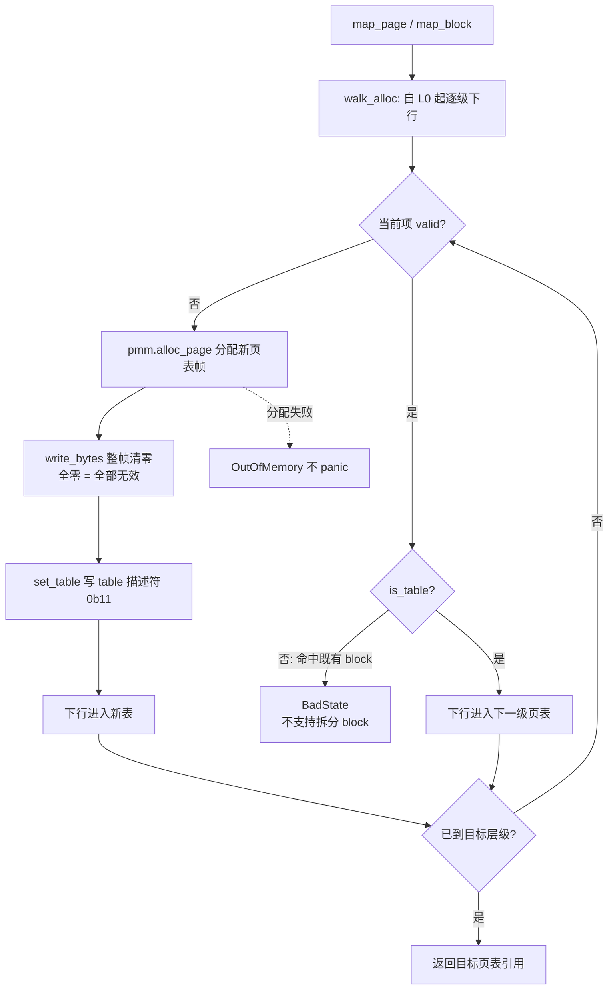

# EnerOS v0.131.0 虚拟内存设计（ARM64 四级页表 + VMM）

> 版本：v0.131.0
> 适用范围：EnerOS 自研内核虚拟内存（ARM64 四级页表 / MMU 启用 / 多地址空间；QEMU virt aarch64 目标机 / host 测试）
> 蓝图依据：`蓝图/phase3.md` §v0.131.0（§3 交付物 / §4 详细设计 / §6 测试计划 / §7 验收标准 / §8 风险与注意事项 / §9 多角度要求）
> 配套文档：[pmm_design.md](./pmm_design.md)（v0.130.0 物理内存管理，页表帧来源）、[../boot/qemu_run.md](../boot/qemu_run.md) §10（v0.131.0 QEMU 实测记录）、[../boot/boot_protocol.md](../boot/boot_protocol.md)（启动协议）

---

## 1. 概述

**核心一句话**：自研 ARM64 四级页表（PGD/PUD/PMD/PTE），实现虚拟地址映射/取消映射/翻译，启用 MMU（蓝图 §1 原样口径）。

- **Phase 定位**：P3-B 内存线**第二版本**；依赖 v0.130.0 buddy 物理页分配器提供全部页表帧；是 v0.132.0 分区内存隔离的前提，并为 v0.134.0 线程提供独立地址空间（蓝图 §1）。
- **出口关联**：自研内核"虚拟内存"功能完整性证据（蓝图 §1）。
- **ADR-0001 口径**：依据 ADR-0001，Phase 3 主路径为 seL4 深度定制（方案 A），seL4 已具备 ARM64 页表管理，方案 A 下复用 seL4 VSpace，仅做国产 CPU 页表特性适配；本实现属自研内核研究/fallback 线的功能完整性证据，非生产路径（见偏差 D8）。
- **ARM64 四级页表一句话**：4KB 页、48bit VA、40bit PA（蓝图 §2 假设）；每级 512 项 × 8B = 4KB 独占一页，VA 按 9bit × 4 级索引（L0/L1/L2/L3），支持 L3 4KB 页映射与 L2 2MB block 映射，L1 1GB block 本版本不创建但 translate 兼容翻译（蓝图 §5.2）。

交付物落位（仓库规范 §2.3.1 子系统归口，偏差 D1）：

| 交付物 | 路径 |
|--------|------|
| mem 模块导出（v0.131.0 re-export 口径） | [crates/kernel/microkernel/src/mem/mod.rs](../../crates/kernel/microkernel/src/mem/mod.rs) |
| 四级页表（map/unmap/translate/map_block + PT1~PT6 单测） | [crates/kernel/microkernel/src/mem/page_table.rs](../../crates/kernel/microkernel/src/mem/page_table.rs) |
| 虚拟内存管理器（MemAttrs/attrs_to_bits/VirtMemManager trait/Vmm + VMM1~VMM5 单测） | [crates/kernel/microkernel/src/mem/vmm.rs](../../crates/kernel/microkernel/src/mem/vmm.rs) |
| MMU/TLB 控制汇编（aarch64 门控，host 为空模块） | [crates/kernel/microkernel/src/mem/asm/mod.rs](../../crates/kernel/microkernel/src/mem/asm/mod.rs)、[crates/kernel/microkernel/src/mem/asm/aarch64.rs](../../crates/kernel/microkernel/src/mem/asm/aarch64.rs) |
| 内核启动期接入（identity map + MMU 启用 + 自检段） | [crates/kernel/microkernel/src/main.rs](../../crates/kernel/microkernel/src/main.rs) |
| host 集成测试（T01~T07） | [crates/kernel/microkernel/tests/page_table_test.rs](../../crates/kernel/microkernel/tests/page_table_test.rs) |
| 设计文档（蓝图 §3 文档类 / §7.4 验收） | [docs/kernel/vmm_design.md](./vmm_design.md)（本文档） |

> **配置类口径**：蓝图 §3 配置类 `PAGE_SIZE=4096, VA_BITS=48, PA_BITS=40`——`PAGE_SIZE` 落 [config.rs](../../crates/kernel/microkernel/src/mem/config.rs) 常量；VA/PA 位宽未落常量，为结构与文档口径（偏差 D15）。

---

## 2. ARM64 页表格式

### 2.1 页表项（描述符）位图

`PageTableEntry(pub u64)`（[page_table.rs](../../crates/kernel/microkernel/src/mem/page_table.rs)），ARM64 stage-1 描述符，4KB granule 口径：

| 位段 | 名称 | 语义 |
|------|------|------|
| `[1:0]` | 类型 | `0b11` = table 描述符（L0~L2，指向下一级页表）/ 4KB 页描述符（L3，无 table/block 之分，bit1=1 即页）；`0b01` = block 描述符（L1/L2）；bit0=0 = 无效 |
| `[4:2]` | AttrIndx | MAIR_EL1 属性索引：0 = Device-nGnRnE / 1 = Normal Write-Back / 2 = Normal Non-Cacheable（与 MAIR 配置一一对应，见 §6） |
| `[7:6]` | AP[2:1] | AP[1]（bit6）= EL0（用户态）可访问；AP[2]（bit7）= 只读（置位禁写） |
| `[9:8]` | SH | 共享属性：`0b10` = Outer Shareable（Device 口径）；`0b11` = Inner Shareable（Normal 口径） |
| `10` | AF | Access Flag，恒置（免首轮访问触发 Access Flag fault） |
| `[47:12]` | 输出地址 | 下一级页表帧号 / 物理页帧号 / 块物理基址（36bit 帧号 → 48bit PA 空间，兼容 40bit PA 假设） |
| `53` | PXN | Privileged eXecute-Never：EL1 不可执行 |
| `54` | UXN | Unprivileged eXecute-Never：EL0 不可执行 |

判定与构造助手（均为 `const fn` 或简单封装）：`is_valid`（bit0）、`is_table`（bit1）、`is_block`（bit1==0，须先判 valid）、`phys_addr`（`(self.0 >> 12) & 0xF_FFFF_FFFF`，36bit 帧号）、`set_table`（`frame << 12 | attrs_bits | 0b11`）、`set_block`（`frame << 12 | attrs_bits | 0b01`）。

### 2.2 四级索引

每级索引取 VA 的 9bit（[page_table.rs](../../crates/kernel/microkernel/src/mem/page_table.rs) `index`）：

```
shift = 12 + (3 - level) × 9
index(level, vaddr) = (vaddr >> shift) & 0x1FF
```

48bit 以上位（含符号扩展位）经 9bit 掩码天然剔除，不泄漏进索引（PT1 覆盖）。

### 2.3 L0~L3 覆盖粒度表

| 级别 | 别名 | VA 位段 | shift | 单项覆盖 | 映射形态 |
|------|------|---------|-------|---------|---------|
| L0 | PGD | `[47:39]` | 39 | 512GB | 仅 table 描述符（L0 无 block 编码，translate 命中按未映射处理） |
| L1 | PUD | `[38:30]` | 30 | 1GB | table 或 1GB block（本版本不创建，translate 兼容翻译，蓝图 §5.2） |
| L2 | PMD | `[29:21]` | 21 | 2MB | table 或 2MB block（identity map 主用形态，见 §7） |
| L3 | PTE | `[20:12]` | 12 | 4KB | 4KB 页描述符（`0b11`） |

页表数据结构：`#[repr(align(4096))] pub struct PageTable { entries: [PageTableEntry; 512] }`——每表独占一帧（4KB 对齐），页表帧全部来自 v0.130.0 `BuddyAllocator` 分配（模块级可解引用不变式：帧号 × PAGE_SIZE 恒为可直访地址，kernel 下 MMU 关闭/identity 映射时物理直访，host 测试由 4MB 对齐伪 RAM 夹具背书）。

---

## 3. 四级遍历与 map/unmap/translate

### 3.1 缺层分配 + 清零遍历（walk_alloc）

`walk_alloc(root, vaddr, levels, pmm)` 自根表起下行 `levels` 级并返回目标层级页表（[page_table.rs](../../crates/kernel/microkernel/src/mem/page_table.rs)）：

- `levels = 3`：下行至 L2 表（供 `map_page` 写 L3 项）；
- `levels = 2`：下行至 L1 表（供 `map_block` 写 L2 项）。



要点：

- **缺层分配**：仅当 entry 无效时分配一帧作新页表并清零（全零即全部项无效），随后写 table 描述符；分配失败返回 `OutOfMemory`（蓝图 §9.4 口径，不 panic）；
- **命中 block 不拆分**：中间层命中既有 block 描述符时报 `BadState`（拆分属后续版本能力，page_table.rs 头注简化决策）；
- 各 unsafe 解引用均附逐行 SAFETY 注释（帧来源不变式 + 借用不共存论证）。

### 3.2 map_page（4KB 页）

1. `walk_alloc(root, vaddr, 3, pmm)` 下行至 L2 表；
2. 取 L3 项，**已有效 → `BadState`**（重复 map 拒绝，D2 口径：不新增蓝图 §4.4 文字版的 `AlreadyMapped` 变体）；
3. 写 L3 页描述符：`entry = (paddr << 12) | attrs_bits | 0b11`（页内偏移忽略，按页对齐映射）。

### 3.3 map_block（L2 2MB block）

1. 对齐校验：`vaddr` 与 `paddr` 均须 2MB（512 页）对齐，否则 `InvalidArgument`；
2. `walk_alloc(root, vaddr, 2, pmm)` 下行至 L1 表；
3. L2 目标项已有效 → `BadState`（重复映射或命中既有映射）；否则 `set_block` 写 block 描述符（`0b01`）。

### 3.4 unmap_page（清 L3 项）

1. 自 L0 只读下行 3 级至 L2 表：中间层无效 → `BadState`（未映射）；命中 block 描述符 → `BadState`（block 内子页不支持单独解除，T06 覆盖）；
2. L3 项无效 → `BadState`（未映射/重复 unmap）；
3. 否则 `entry.0 = 0` 清零。同 VA 可随后重新映射（PT5 覆盖）。

**简化决策（D12）**：本版本不回收全空的中间层页表（其帧保持已分配态），留待后续版本实现反向回收；不影响映射正确性。

### 3.5 translate（四级翻译）

只读遍历，任一级无效即返回 `None`；命中后的物理地址计算（D10 修正后口径）：

| 命中级别 | 形态 | 物理地址计算 |
|---------|------|-------------|
| L1 | 1GB block | `(entry & 0x0000_FFFF_C000_0000) \| (vaddr & 0x3FFF_FFFF)`（块基址 bits[47:30] \| 30bit 块内偏移） |
| L2 | 2MB block | `(entry & 0x0000_FFFF_FFE0_0000) \| (vaddr & 0x1F_FFFF)`（块基址 bits[47:21] \| 21bit 块内偏移） |
| L3 | 4KB 页 | `phys_addr() × PAGE_SIZE + (vaddr & 0xFFF)`（页基址 + 12bit 页内偏移） |
| L0 | — | 架构上无 block 描述符编码，命中 block 判定返回 `None`（视为未映射） |

> **D10（蓝图伪代码 bug 修正）**：蓝图 §4.5 伪代码对 block 项按 `paddr × PAGE_SIZE + 4KB 页内偏移` 计算，丢失块内偏移（2MB 块内地址全部错到块首 4KB 内）；正确语义为「块物理基址 \| 块内偏移」。PT6/T06 覆盖块首/块内中部/块内末尾（+0x1F_FFFF）多偏移翻译。

---

## 4. MemAttrs 编码表

### 4.1 六布尔字段 → 位组合（attrs_to_bits）

`MemAttrs`（蓝图 §3 接口类原样六字段）经 `pub const fn attrs_to_bits(attrs: &MemAttrs) -> u64` 编码（[vmm.rs](../../crates/kernel/microkernel/src/mem/vmm.rs)）；编码**不含 bits[1:0]**（valid/table 由页表层 `set_table`/`set_block`/`map_page` 自行或入，VMM1 断言属性位不触碰 bits[1:0]）：

| 字段 | ARM64 编码 |
|------|-----------|
| `readable` | **不参与编码**——ARM64 stage-1 描述符无独立编码位（AP 仅 RW/RO 区分，无 write-only 组合），保留供跨架构语义完整性（VMM1 断言 `readable=false` 不改变编码） |
| `writable = false` | AP[2]=1（bit7，只读） |
| `executable = false` | PXN（bit53）+ UXN（bit54）置位 |
| `user_accessible = true` | AP[1]=1（bit6，EL0 可访问） |
| `device = true` | AttrIndx=0（Device-nGnRnE）+ SH=Outer（bits[9:8]=`0b10`） |
| `device = false` 且 `cacheable = true` | AttrIndx=1（Normal WB）+ SH=Inner（`0b11`） |
| `device = false` 且 `cacheable = false` | AttrIndx=2（Normal NC）+ SH=Inner（`0b11`） |
| （恒置） | AF（bit10），device 亦不例外 |

### 4.2 典型组合示例值

| 组合 | 字段值 | 编码值（u64，bits[1:0]=0） |
|------|--------|---------------------------|
| `MemAttrs::KERNEL_RW_X`（内核恒等映射：映像/PMM zone 等 EL1 数据与代码页） | R+W+X，EL1-only，Normal WB | `0x0000_0000_0000_0704`（AF + AttrIndx1 + SH=Inner） |
| `MemAttrs::DEVICE_RW`（UART 等 MMIO 恒等映射，蓝图 §8.5 设备内存口径） | R+W，NX，EL1-only，Device-nGnRnE | `0x0060_0000_0000_0600`（AF + SH=Outer + PXN + UXN） |
| 内核只读（RO + X） | R+X，EL1-only，Normal WB | `0x0000_0000_0000_0784`（+ AP[2]） |
| 用户只读可执行 | R+X，EL0 可访问，Normal WB | `0x0000_0000_0000_07C4`（+ AP[2] + AP[1]） |
| Normal NC（非 device 非 cacheable） | R+W+X，EL1-only，Normal NC | `0x0000_0000_0000_0708`（AF + AttrIndx2 + SH=Inner） |

`KERNEL_RW_X` / `DEVICE_RW` 作为 `MemAttrs` 关联常量归位 lib（vmm.rs），经 mem/mod.rs re-export 供内核与测试共用（偏差 D11）。

---

## 5. TLB 管理与 ASID

### 5.1 TLB 失效原语（[asm/aarch64.rs](../../crates/kernel/microkernel/src/mem/asm/aarch64.rs)，aarch64 门控）

| 原语 | 汇编 | 语义与时机 |
|------|------|-----------|
| `tlbi_va(va)` | `tlbi vae1, {va>>12}` + `dsb ish` + `isb` | 单 VA 的 TLB 失效（映射变更后的一致性维护，蓝图 §5.3 实现路径口径）；`tlbi vae1` 操作数 Xt[43:0] = VA[55:12]，故右移 12 位传入；**失效时机（先改页表、后失效）由调用方保证**（偏差 D16：map/unmap 路径不内嵌调用） |
| `enable_mmu` 内全失效 | `tlbi vmalle1` | 启用 MMU 前一次性失效 EL1&0 stage-1 全部条目（D3：替代蓝图伪代码 `tlbi alle1`，vmalle1 在 EL1 恒可执行，ALLE1 在 EL2 使能配置下受限） |
| `switch_address_space` 内 | `tlbi aside1, {asid<<48}` | 按 ASID 失效（aarch64 形态，见 §5.3） |

### 5.2 ASID 配发

- `AddressSpaceId(pub u16)`；**0 保留**作「未切换」哨兵（`Vmm` 初态 `current = 0`，此时 map/unmap 返回 `BadState`、translate 返回 `None`，VMM4 覆盖）；
- `new_address_space` 自 **1 起递增**配发（`next_asid` 经 `checked_add` 防溢出，溢出 → `OutOfMemory`）；新建不隐含切换（配发后 `current` 仍保持哨兵，VMM2 覆盖）；
- 每地址空间登记 `AddressSpace { root_paddr, asid, page_count }`（蓝图 §4.1 原样三字段）：根页表帧 + ASID + 已映射 4KB 页计数（map 成功 +1 / unmap 成功 `saturating_sub` 1）。

### 5.3 switch_address_space 双形态（D6）

| 形态 | 行为 |
|------|------|
| `target_arch = "aarch64"` | 写 `TTBR0_EL1 = root_pa \| (ASID << 48)`（BADDR 位段 4KB 对齐天然满足，ASID 置 bits[63:48]）→ `tlbi aside1, {ASID<<48}` → `dsb ish` → `isb`；`options(nostack)`，内存 clobber 默认开启保证既有页表写不被重排到切换之后 |
| host（非 aarch64） | 仅更新内部 `current` 态（供测试断言映射语义随 current 走），不执行系统寄存器指令 |

未知 ASID 切换：保持当前态返回（简化决策——不静默改变映射目标，VMM5 覆盖）。真实切换使用场景属 v0.132.0 分区隔离。

---

## 6. MMU 启用序列

### 6.1 MAIR_EL1 / TCR_EL1 常量（D3 增补）

蓝图 §4.5 `enable_mmu` 伪代码仅设 TTBR0 + SCTLR.M——MAIR_EL1/TCR_EL1 复位值架构未定义，不配置即启用 MMU 属未定义行为，本实现补齐两寄存器配置（蓝图 §8.5「设备内存须标 Device-nGnRnE」的编码前提即 MAIR）：

`MAIR_EL1_VALUE = 0x00 | (0xFF << 8) | (0x44 << 16) = 0x0000_0000_0044_FF00`：

| AttrIndx | 值 | 语义（与 attrs_to_bits 编码一一对应） |
|----------|-----|--------------------------------------|
| 0 | `0x00` | Device-nGnRnE |
| 1 | `0xFF` | Normal，Inner/Outer Write-Back，RA WA |
| 2 | `0x44` | Normal，Inner/Outer Non-Cacheable |

`TCR_EL1_VALUE = 16 | (0b01 << 8) | (0b01 << 10) | (0b11 << 12) = 0x3510`（TTBR0 低半 VA，identity map 口径）：

| 字段 | 位段 | 值 | 语义 |
|------|------|-----|------|
| T0SZ | `[5:0]` | 16 | 48bit VA |
| IRGN0 | `[9:8]` | `0b01` | Normal WB RA WA（Inner） |
| ORGN0 | `[11:10]` | `0b01` | Normal WB RA WA（Outer） |
| SH0 | `[13:12]` | `0b11` | Inner Shareable |
| TG0 | `[15:14]` | `0b00` | 4KB granule |
| 其余位 | — | 0 | TBI 禁用、A1=0（用 TTBR0 的 ASID）、IPS 取默认——v0.131 40bit PA 假设下 QEMU virt 全部可用地址 < 4GB，IPS 扩展属后续版本 |

### 6.2 enable_mmu 汇编逐条注释

```text
msr mair_el1, {mair}      // D3 增补：MAIR 复位值架构未定义，启用前须先配置
msr tcr_el1,  {tcr}       // D3 增补：TCR 同理（T0SZ/TG0/IRGN0/ORGN0/SH0）
msr ttbr0_el1, {ttbr}     // 根页表物理基址（4KB 对齐）
tlbi vmalle1              // D3：伪代码 alle1 → vmalle1（EL1 恒可执行，
                          //     精确覆盖 EL1&0 stage-1 全部条目）
dsb ish                   // 数据同步屏障：页表写与寄存器配置全局可见
isb                       // 指令同步屏障
mrs {tmp}, sctlr_el1      // 读 SCTLR（D3：命名寄存器约束 out(reg) 替代伪代码
                          //     硬编码 x8，clobber 对编译器可见）
orr {tmp}, {tmp}, #1      // SCTLR_EL1.M = 1；D4：C/I 保持 0
msr sctlr_el1, {tmp}      // 写回，MMU 启用
isb                       // 启用后立即同步指令流
```

**D4（缓存策略）**：仅置 `M=1`，`C`（数据 cache）/`I`（指令 cache）保持 0——规避 MMU on 前后 cache 清理/失效复杂度（蓝图 §8.5 坑点）；代价为 MMU on 后性能非最优，开启 cache 属后续版本优化。

**Safety 前置条件**（`unsafe fn enable_mmu(ttbr0)` 文档口径）：`ttbr0` 必须为指向有效四级根页表的物理基址（4KB 对齐），且调用点 PC/SP 与即将访问的全部内核地址已被该页表 identity 覆盖（蓝图 §8.1「MMU 启用瞬间 PC 必须在 identity map 区」）；须在 EL1 执行（QEMU virt `-kernel` 启动态满足）；调用后所有 `MemAttrs::device` 区域按 Device-nGnRnE 语义访问（蓝图 §8.5）。

---

## 7. 内核集成与实测

### 7.1 main.rs 接入段（v0.131.0 Task 5，[main.rs](../../crates/kernel/microkernel/src/main.rs)）

`rust_main` 在 PMM alloc/free 验证成功分支末尾追加 VMM 接入验证段（surgical，既有流程与打印零改动；PMM 失败分支打印 `[vmm] err pmm` 跳过本段）：

1. **分配根页表帧**：复用 v0.130.0 PmmCell BSS 驻留实例 `pmm.alloc_page(0)`，按帧界 4096B 清零（失败打印 `[vmm] err root 0x...`）；
2. **RAM 恒等映射**：`kattr = attrs_to_bits(&MemAttrs::KERNEL_RW_X)`，自 `ram_region.0`（0x40000000，2MB 对齐）起按 **2MB block** 逐块映射至 `ram_end`（0x50000000，共 128 块）；尾部不足 2MB 的零头以 4KB `map_page` 补足（QEMU 256MB 恰为整数块，零头逻辑防御性存在）；任一块失败打印 `[vmm] err map 0x...` 并中止；
3. **UART 设备恒等映射**：`0x09000000`（= 2MB×72 天然对齐）建 1 个 2MB **Device block**（`MemAttrs::DEVICE_RW`，Device-nGnRnE）——MMU on 后串口打印依赖此映射（蓝图 §8.5）；
4. **启用 MMU**：`asm::aarch64::enable_mmu(root_pa)`，随后打印 `[vmm] mmu on`（验收关键串）；
5. **自检 ①（translate）**：`translate(0x4900_0000) == Some(0x4900_0000)`——内核装载址经四级页表原样往返（identity 成立），失败打印 `[vmm] err trans`；
6. **自检 ②（MMU on 后 PMM 路径）**：`pmm.alloc_page(0)` 分配 scratch 帧，`write_volatile` 写入 `0xDEAD_BEEF` 后 `read_volatile` 读回一致，打印 `[vmm] rw ok`，随后 `free_page` 归还（失败打印 `[vmm] err rw`）。

**identity map 布局与帧开销（D5）**：RAM 段 VA 落 L0[0]→L1[1]→单张 L2 表（128 个 2MB block 覆盖 256MB）；UART 落 L0[0]→L1[0]→第二张 L2 表（L2[72] 单个 Device block）；DTB 固定区 0x48000000~0x48100000 随 RAM 段覆盖，无单独映射。**帧开销 = root 1 + L1 1 + L2 2 ≈ 4 帧**（运行时 PMM 分配，不计入镜像文件尺寸）。MMU on 瞬间 PC/SP/内核映像/BSS/PMM zone/UART 均已被恒等映射覆盖，串口打印不中断；MMU on 后 PMM 分配、UART 打印、BootInfo 构造、wfe idle 路径**零改动继续可用**（D9）。

**最小实现口径（D14）**：本段直接调 `page_table::map_block`/`map_page` + 全局 PMM 构建 identity map，**不经 `Vmm` 实例**——identity map 为单地址空间一次性构建，多地址空间管理属 v0.132.0 范畴；`Vmm`/`VirtMemManager` 能力由 host 单测（VMM1~5）与集成测试（T01~T07）完整覆盖。

### 7.2 QEMU 实测（WSL2 QEMU 8.2.2，详见 [../boot/qemu_run.md](../boot/qemu_run.md) §10）

串口输出关键行（原样收录）：

```
[pmm] alloc ok frame=0x000000000004FC00
[vmm] mmu on
[vmm] rw ok
```

| 实测项 | 值 |
|--------|-----|
| 结果 | **PASS**（boot_test.sh 四关键串断言：`[boot]` 横幅 / `[kernel] booting` / `[pmm] alloc ok` / `[vmm] mmu on`；v0.131.0 起追加第四条断言），首轮一次通过，无排障记录 |
| kernel release ELF | **78,472 B ≈ 76.6 KB**（远低于 512KB 预算；identity map 页表帧为运行时 PMM 分配，不计入镜像文件尺寸） |
| 端到端总耗时 | 14s（构建 3.11s + QEMU timeout 10s 守护窗口） |

---

## 8. 测试矩阵

host 侧执行 `cargo test -p eneros-microkernel`（lib 内嵌单测 + tests/ 集成测试；host 上可使用 std，伪 RAM 为测试进程堆内 `Vec<u8>` 4MB 对齐缓冲，页表帧直访与 kernel 真实物理内存语义一致）。构造分配器的用例统一经 `run_big_stack` 在 32MB 大栈线程运行（`BuddyAllocator` 内联 ≈2.1MB 超 host 测试线程默认栈，承 v0.130.0 偏差 D9 口径）。

### 8.1 单元测试（src/mem 内嵌，PT1~6 / VMM1~5）

| 编号 | 用例 | 覆盖点 | 蓝图测试计划对照 |
|------|------|--------|----------------|
| PT1 | `pt1_index_boundaries` | 四级索引边界值、页内偏移不进入索引、9bit 全 1、48bit 以上符号扩展位剔除、组合地址逐级分解 | §4.5 index 公式 |
| PT2 | `pt2_pte_bitops` | PTE 位操作：valid/table/block 判定、帧号往返（含 36bit 最大帧号不截断）、属性位透传 | §4.1 PTE 位定义 |
| PT3 | `pt3_map_translate_roundtrip_multi_pages` | map → translate 往返：多页 + 页内偏移透传 + 跨 L2 项复用 L1 表；相邻未映射页 → None | §6.1 map/translate/unmap 往返 |
| PT4 | `pt4_duplicate_map_rejected_original_intact` | 重复 map → BadState 且原映射不破坏（含换属性位重复 map，D2） | §4.4 错误处理 |
| PT5 | `pt5_unmap_then_translate_none` | unmap 后 translate → None；未映射（中间层无效/L3 项无效）/重复 unmap → BadState；同 VA 重映射 | §6.1 往返 |
| PT6 | `pt6_map_block_2mb_translate` | 2MB block 翻译（块首/中部/末尾偏移，D10）；VA/PA 未对齐 → InvalidArgument；重复块映射 → BadState | §5.2 / §9.7 大页 |
| VMM1 | `vmm1_attrs_to_bits_bitwise` | attrs_to_bits 逐位断言：AF 恒置、AttrIndx 0/1/2、AP[2:1]、SH Inner/Outer、PXN/UXN、readable 不参与编码、bits[1:0] 不触碰 | §9.3 安全标记 / §9.5 属性结构体封装 |
| VMM2 | `vmm2_new_address_space_asid_increments` | ASID 自 1 递增、根帧互异、page_count 归零、current 初态哨兵 0（new 不隐含 switch） | §5.2 ASID |
| VMM3 | `vmm3_dual_address_space_isolation` | 双地址空间 translate 隔离：AS-A 映射在 AS-B 不可见，切回可见 | §7.3 安全（不同地址空间隔离） |
| VMM4 | `vmm4_current_space_map_unmap_delegation` | 未切换（current=0）时 map/unmap → BadState、translate → None；切换后 map → translate（含页内偏移）→ unmap → None 全链路 | §4.2 接口语义 |
| VMM5 | `vmm5_host_switch_internal_state_only` | host 形态 switch 仅切内部态：未知 ASID 无跳变；合法切换后 map 作用于新空间（D6） | §4.2 switch 语义 |

### 8.2 集成测试（tests/page_table_test.rs，T01~T07，仅以公开 API 端到端验证）

| 编号 | 用例 | 覆盖点 | 蓝图测试计划对照 |
|------|------|--------|----------------|
| T01 | `t01_map_translate_unmap_roundtrip_multi_pages` | map → translate → unmap 多页往返：页内偏移不改变帧号、unmap 中间页不影响前后、同 VA 重映射 | §6.1 往返 |
| T02 | `t02_far_apart_va_multi_level_creation_frame_accounting` | 远距双 VA（分属 L0[0]/L0[256]）各自新建 L1/L2/L3 三层页表（帧数核算 3+3）；同 L3 表近邻映射零新分配 | §6.1 多级页表创建 |
| T03 | `t03_duplicate_map_rejected_original_intact` | 重复 map → BadState 且原映射不破坏（含换属性重 map） | §4.4 |
| T04 | `t04_unmap_unmapped_badstate` | unmap 未映射两形态 → BadState（中间层无效/L3 项无效），相邻既有映射不破坏；重复 unmap → BadState | §4.4 / §6.5 等价语义 |
| T05 | `t05_dual_address_space_translate_isolation` | 双空间同 VA 各映射不同帧互不干扰；A 中解除不影响 B 中映射 | §7.3 安全（访问失败） |
| T06 | `t06_map_block_2mb_translate_via_public_api` | 公开 API 2MB block 块内多偏移翻译；块内 4KB 页不可单独 unmap → BadState；块外相邻 2MB 未映射 → None | §9.7 大页 |
| T07 | `t07_map_perf_smoke` | 1000 次 map 均值经 eprintln 输出（`[vmm perf smoke] ...（host 口径，非目标机代表性）`）；首/末映射功能抽查，**不对阈值断言失败** | §6.3 map < 5μs（D7 口径修正） |

蓝图 §6 其余条目对照：

| 蓝图条目 | 覆盖情况 |
|---------|---------|
| §6.2 集成测试「启用 MMU 后访问虚拟地址」 | 目标机 QEMU 实测覆盖（§7 自检① translate + 自检② 读写回，`[vmm] mmu on` / `[vmm] rw ok`） |
| §6.3 性能「TLB miss 后 translate < 1μs」 | 未测定（host 无 TLB 概念；目标机性能测定属后续版本，见 D7） |
| §6.4 回归「物理内存分配不受影响」 | QEMU 自检②（MMU on 后 PMM alloc/rw/free 继续工作，`[vmm] rw ok`）；host 全部用例基于 v0.130.0 PMM 构建 |
| §6.5 故障注入「访问未映射地址触发 page fault」 | 蓝图自标 v0.133.0 处理；本版本以 translate 未映射 → None / unmap 未映射 → BadState 覆盖等价查询语义（PT5/T04） |
| §6.6 GPU 规则 | 不适用（页表管理，蓝图原样口径） |

---

## 9. 蓝图偏差表（D1~D17）

> D1~D14 为 spec/实施期既定偏差，本文档按代码核实后落笔；D15~D17 为本次文档化核对中增补记录的实现差异。

| 编号 | 内容 | 理由 | 影响 |
|------|------|------|------|
| D1 | 蓝图交付物 `kernel/src/mem/{vmm,page_table}.rs`、`kernel/src/mem/asm/aarch64.rs`、测试 `kernel/tests/page_table_test.rs` → 落位 `crates/kernel/microkernel/src/mem/`（asm 为 mem 子模块 `mem/asm/`）与 `crates/kernel/microkernel/tests/page_table_test.rs` | 仓库规范 §2.3.1 强制子系统归口（`crates/<subsystem>/`），禁止根目录 crate | 仅路径差异，交付物一一对应；asm 归 mem 子模块（host 侧为空模块，行为不变） |
| D2 | 蓝图 §4.4 文字「重复 map 返回 `AlreadyMapped`」 vs §4.5 伪代码 `Err(KernelError::BadState)`（蓝图内部矛盾）→ 采伪代码口径，复用 `BadState`，不新增变体 | error.rs 判别值 1~8 为稳定 ABI（用户态 trampoline 按数值映射，新增须追加、禁止插入/重排）；`BadState` 语义（对象当前状态不允许该操作）覆盖重复映射；承 v0.127.0 起一贯口径（page_table.rs/vmm.rs 头注） | 无 `AlreadyMapped` 变体；PT4/T03 断言 BadState |
| D3 | 蓝图 §4.5 enable_mmu 伪代码仅设 TTBR0+SCTLR.M → 增补 MAIR_EL1（`0x44FF00`）/TCR_EL1（`0x3510`）配置；`tlbi alle1` → `tlbi vmalle1`；硬编码 `x8` → 命名寄存器约束（`out(reg) _`） | MAIR/TCR 复位值架构未定义，不配置即启用 MMU 属未定义行为；蓝图 §8.5 Device-nGnRnE 口径的编码前提即 MAIR；vmalle1 在 EL1 恒可执行（ALLE1 在 EL2 使能配置下受限）且精确覆盖 EL1&0 stage-1；命名约束避免活跃值被 x8 静默破坏 | 架构必需增补，不改变蓝图意图；QEMU 实测首轮 PASS |
| D4 | 蓝图 §8.5「cache 清理在 MMU 启用前后都要做」 → enable_mmu 仅置 `SCTLR.M=1`，`C/I` 保持 0，不做 cache 清理 | C=0 时数据访问不经 cache，规避 MMU on 前后 cache 清理/失效复杂度 | MMU on 后性能非最优；开启 cache 与清理序列属后续版本优化 |
| D5 | 蓝图 §5.4「identity map 内核段」（未给布局）→ RAM 全段 L2 2MB block（128 块覆盖 0x40000000~0x50000000，L1[1] 单张 L2 表）+ 尾部 4KB 零头兜底 + UART 0x09000000 独立 2MB Device block（L1[0] 第二张 L2 表）；DTB 区随 RAM 段覆盖 | 2MB block 减少页表帧开销（帧开销 4：root 1 + L1 1 + L2 2）；内核映像/BSS/栈/PMM zone 均在 RAM 区间内，整段覆盖保证 MMU on 瞬间 PC/SP 连续；UART 需 Device-nGnRnE（蓝图 §8.5） | 帧开销 4（运行时 PMM 分配，不占镜像）；零头逻辑防御性存在（QEMU 256MB 恰为整数块） |
| D6 | 蓝图 §4.2「switch_address_space：设置 TTBR0 + TLBI ASID」 → 双形态：aarch64 写 TTBR0_EL1（BADDR\|ASID<<48）+ `tlbi aside1` + dsb/isb；host 仅更新内部 current 态供测试断言 | host 测试无法执行系统寄存器指令；cfg 门控保证 host `cargo test`/`clippy --workspace` 行为不变 | 真实切换使用场景属 v0.132.0 分区隔离；未知 ASID 切换保持当前态（VMM5 覆盖） |
| D7 | 蓝图 §6.3/§7.2「单次 map < 5μs、TLB miss 后 translate < 1μs」 → T07 为 **host 用户态 smoke 口径**：1000 次 map 均值经 eprintln 输出供人审阅，不断言阈值；translate 性能未测定 | Windows/host 无法测目标机裸机性能且无 TLB 概念；smoke 用途仅拦截意外算法退化 | 蓝图阈值不作为本版本验收失败判据；目标机性能测定属后续版本 |
| D8 | 蓝图 §1 ADR-0001 裁剪：方案 A 复用 seL4 VSpace，仅做国产 CPU 页表特性适配 → 本实现为**自研内核「虚拟内存」功能完整性证据**（蓝图 §1 出口关联口径），属研究/fallback 线，非生产路径 | ADR-0001 已签署：Phase 3 主路径 seL4 深度定制；自研线保留功能证据 | 无功能影响；定位声明 |
| D9 | （蓝图未明确映射范围）→ 仅 identity map（TTBR0 低半），无高半核映射（TTBR1 未用）；MMU on 后 PMM 分配/UART 打印/BootInfo/wfe idle 路径零改动继续可用 | 最小实现；高半核布局属后续版本 | 内核地址即物理地址的直访口径延续（mem 模块级不变式）；未来引入高半映射须同步调整 PMM/页表直访口径 |
| D10 | 蓝图 §4.5 translate 伪代码对 block 项按 `paddr×PAGE_SIZE + 4KB 页内偏移` 计算（丢失块内偏移）→ 修正为「块物理基址 \| 块内偏移」：L2 2MB `(entry & 0x0000_FFFF_FFE0_0000) \| (vaddr & 0x1F_FFFF)`（偏移 21bit）；L1 1GB `(entry & 0x0000_FFFF_C000_0000) \| (vaddr & 0x3FFF_FFFF)`（偏移 30bit）；L0 无 block 编码 → None | 伪代码对 block 翻译错误（块内地址全部错到块首 4KB 内）；蓝图 §5.2 明示 L1/L2 block 支持 | PT6/T06 覆盖块首/中部/末尾偏移；本版本不创建 L1 block，translate 兼容翻译（蓝图 §9.7 可扩展口径） |
| D11 | 蓝图 §4.1 伪代码 `set_table(paddr, attrs: MemAttrs)` 内部调 `attrs_to_bits(attrs)`（按值）→ 实现 `pub const fn attrs_to_bits(attrs: &MemAttrs) -> u64`（引用传参）；`set_table`/`set_block` 改收 `attrs_bits: u64`（table 描述符传 0）；`KERNEL_RW_X`/`DEVICE_RW` 关联常量归位 lib（vmm.rs，开发期曾临时置于 main.rs，已归位），main.rs 仅经 mem re-export 引用 | const fn 允许常量上下文预计算属性位；table 描述符架构上不使用低属性位，传 0 避免误导；属性编码归 lib 供内核与测试共用 | 接口签名与蓝图伪代码不同，语义等价；VMM1 逐位断言编码 |
| D12 | （蓝图未规定 unmap 资源回收）→ `unmap_page` 仅清 L3 项，**不回收全空的中间层页表**（帧保持已分配态） | 简化决策；反向回收需逐级判空，留待后续版本（unmap_page 文档注释声明） | 反复 map/unmap 不同 VA 会累积页表帧占用；不影响映射正确性 |
| D13 | （蓝图未规定 Vmm 与 PMM 的持有关系）→ `Vmm::new(pmm: BuddyAllocator)` **按值接管**分配器所有权（非 `&'static mut`、非裸指针持有分配器）；页表帧访问经 `frame_to_addr(root_paddr)` 裸指针解引用，逐行 SAFETY：mem 模块级可解引用不变式（帧号×PAGE_SIZE 恒可直访）+ `&mut self` 独占无别名、派生引用不逸出作用域 | no_std 单所有权最简；根页表帧由 `new_address_space` 经 PMM 分配并清零，满足不变式 | main.rs 当前未构造 Vmm（见 D14）；Vmm 形态经 host 单测/集成测试完整验证 |
| D14 | 蓝图 §4.2 接口经 `VirtMemManager` trait → main.rs VMM 段**不经 Vmm 实例**，直接调 `page_table::map_block`/`map_page` + 全局 PMM 构建 identity map | Karpathy 最小实现：identity map 为单地址空间一次性构建，多地址空间管理属 v0.132.0；Vmm 能力已由 host 测试覆盖 | 内核态暂不消费 VirtMemManager trait；v0.132.0 接入分区时再切换 |
| **D15**（文档化增补） | 蓝图 §3 配置类「PAGE_SIZE=4096, VA_BITS=48, PA_BITS=40」 → `PAGE_SIZE` 落 config.rs 常量；**VA_BITS/PA_BITS 未落常量**——48bit VA 由 `index()` 9bit 掩码天然剔除高位 + `TCR_EL1.T0SZ=16` 落实；40bit PA 为文档口径（`phys_addr` 36bit 帧号 → 48bit PA 空间兼容） | index 公式 shift 常量表达式已固化 48bit 四级结构，单独常量无消费点；PA 假设仅影响 TCR.IPS（取默认，QEMU virt 地址 < 4GB 全可用） | 纯口径差异，无功能影响；跨平台位宽配置属 v0.144.0（蓝图 §8.4） |
| **D16**（文档化增补） | 蓝图 §4.3 mermaid map 流程末尾「TLBI 该页」 → `map_page`/`unmap_page` 路径**不内嵌 TLB 失效**；asm 模块提供独立 `tlbi_va` 助手（`tlbi vae1` + dsb/isb），失效时机（先改页表后失效）归调用方保证 | 新建映射无对应 TLB 脏条目无需失效；v0.131.0 使用场景为 MMU 启用前建表（启用时 `vmalle1` 一次全覆盖）与 host 测试（无 TLB），无失效需求；运行时映射变更属 v0.132.0+ | unmap 后旧条目理论残留至下次失效——当前无运行时 unmap 消费者，无实际暴露；`tlbi_va` 备而待用（aarch64 门控，host 不参与编译） |
| **D17**（文档化增补） | （蓝图未规定地址空间容量/ASID 耗尽）→ `MAX_ADDRESS_SPACES = 16` 定长注册表（no_std 无堆口径）；槽满 → `OutOfMemory`；ASID u16 `checked_add` 溢出 → `OutOfMemory` | 容量编译期确定；满槽/溢出显式错误不 panic（蓝图 §9.4 口径延伸） | 16 空间上限满足 v0.132.0 分区规模；扩容/ASID 回收属后续版本 |

---

## 10. 源码链接

| 模块 | 路径 |
|------|------|
| mem 模块导出（pub use 口径） | [crates/kernel/microkernel/src/mem/mod.rs](../../crates/kernel/microkernel/src/mem/mod.rs) |
| 四级页表（PageTableEntry/PageTable/index/walk_alloc/map_page/unmap_page/translate/map_block） | [crates/kernel/microkernel/src/mem/page_table.rs](../../crates/kernel/microkernel/src/mem/page_table.rs) |
| 虚拟内存管理器（VirtAddr/PageTableLevel/MemAttrs/attrs_to_bits/AddressSpaceId/AddressSpace/VirtMemManager/Vmm） | [crates/kernel/microkernel/src/mem/vmm.rs](../../crates/kernel/microkernel/src/mem/vmm.rs) |
| MMU/TLB 控制汇编（MAIR/TCR 常量、enable_mmu、tlbi_va；aarch64 门控） | [crates/kernel/microkernel/src/mem/asm/aarch64.rs](../../crates/kernel/microkernel/src/mem/asm/aarch64.rs)、[crates/kernel/microkernel/src/mem/asm/mod.rs](../../crates/kernel/microkernel/src/mem/asm/mod.rs) |
| 常量配置（PAGE_SIZE 等） | [crates/kernel/microkernel/src/mem/config.rs](../../crates/kernel/microkernel/src/mem/config.rs) |
| 页帧分配器（页表帧来源，v0.130.0） | [crates/kernel/microkernel/src/mem/buddy.rs](../../crates/kernel/microkernel/src/mem/buddy.rs)、[crates/kernel/microkernel/src/mem/pmm.rs](../../crates/kernel/microkernel/src/mem/pmm.rs) |
| 内核启动期接入（identity map + enable_mmu + 自检段） | [crates/kernel/microkernel/src/main.rs](../../crates/kernel/microkernel/src/main.rs) |
| 内核统一错误码 KernelError | [crates/kernel/microkernel/src/error.rs](../../crates/kernel/microkernel/src/error.rs) |
| host 集成测试 T01~T07 | [crates/kernel/microkernel/tests/page_table_test.rs](../../crates/kernel/microkernel/tests/page_table_test.rs) |
| QEMU 实测记录（v0.131.0 串口全文/ELF/耗时） | [docs/boot/qemu_run.md](../boot/qemu_run.md) §10 |
| PMM 设计文档（v0.130.0，页表帧分配器设计） | [docs/kernel/pmm_design.md](./pmm_design.md) |
