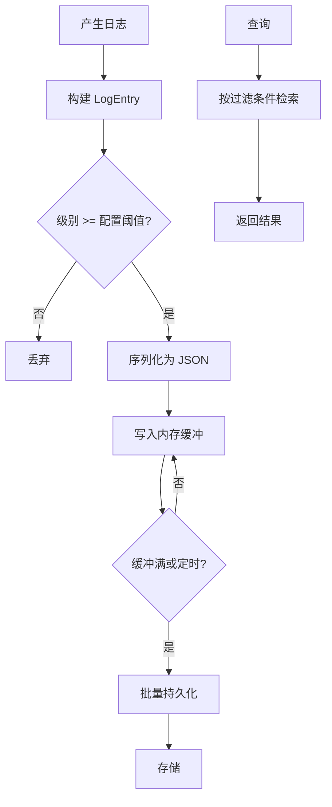

# EnerOS v0.121.0 结构化日志 设计文档

> 蓝图：`蓝图/phase2.md` §v0.121.0（P2-J 可观测性第 2 版）。
> 实现：[`crates/observability/logging/`](../../crates/observability/logging/src/lib.rs)（`eneros-logging`，no_std + alloc，依赖仅 heapless）。
> 上游：v0.120.0 指标采集（agent_id 维度关联）、v0.117.0 行为审计（区分业务审计与运行日志）、v0.11.0 用户堆（alloc 基座）；下游：v0.122.0 分布式追踪（trace_id 关联）、v0.25.0 时序数据存储引擎（持久化后端预留）。

---

## 1. 版本目标

**核心**：实现 JSON 格式的结构化日志系统，支持五级分级（DEBUG/INFO/WARN/ERROR/FATAL）、内存缓冲批量持久化与按字段查询检索，与 v0.120.0 指标关联（蓝图 §1）。
**业务价值**：为故障诊断、问题定位提供可检索的日志数据，满足等保审计要求；统一的字段规范与查询语法避免各 Agent 日志格式各自为政。
**Phase 定位**：P2-J 可观测性第 2 版，与 v0.120.0（指标）、v0.122.0（追踪）构成可观测性三支柱的中间件。
**出口关联**：为 v0.122.0 分布式追踪提供 trace_id 日志关联；「分级记录→JSON 序列化→刷入→组合检索」端到端链路为出口判定复演路径（INT3）。

记录路径：`LogBuilder` 构建 `LogEntry` → `log` 按 `min_level` 分级过滤（低于阈值静默丢弃）→ 写入 128 条内存缓冲（写满丢弃最旧）→ `flush_to` 逐条 `to_json` 序列化并批量刷入 `LogStorage`；查询经 `LogFilter` 七条件 AND 匹配返回子集。

## 2. 前置依赖

- **前序**：v0.120.0 Metrics 指标采集（指标关联回归 INT2，agent_id 标签维度沿用）；v0.25.0 时序数据存储（持久化后端预留，本版本不落地适配器）；v0.117.0 行为审计（职责区分：审计管业务合规事件哈希链，本 crate 管运行诊断日志）；v0.11.0 用户堆（`alloc` 可用，query/to_json 返回 `alloc` 类型，D1）。
- **外部依赖**：heapless 0.8（定容字符串 `String<N>` 与定容向量 `Vec<T, N>`），无其他新增依赖（记忆 §5.5 禁重复造轮子）。
- **被依赖零改动**：eneros-metrics 零源码改动（仅作 dev-dependency 参与 INT2 集成验证，D4）；对既有全部 crate 零改动。
- **假设**：集成层提供单调毫秒时间戳源（RTC，v0.12.0）并以 `now_ms` 参数传入（D2）；日志写入经单写者队列串行（本 crate 不含锁，no_std 最小职责，与 v0.120.0 同口径）。
- **阻塞**：无（纯内存实现即可满足本版本验收；持久化后端经 `LogStorage` trait 预留）。

## 3. 交付物清单

| 类型 | 路径 | 说明 |
|------|------|------|
| 代码 | [`crates/observability/logging/src/lib.rs`](../../crates/observability/logging/src/lib.rs) | crate 入口：`#![cfg_attr(not(test), no_std)]` + `extern crate alloc`；重导出全部公共 API；D1~D4 + 实现期补充偏差声明 |
| 代码 | [`crates/observability/logging/src/logging.rs`](../../crates/observability/logging/src/logging.rs) | `LogLevel`（#[repr(u8)] Debug=0..Fatal=4，PartialOrd）/ `LogEntry`（target≤64B、message≤256B、fields≤8×(32B,128B)、trace_id/span_id/agent_id）/ `LogError`（4 变体）+ `to_json` + `LogBuilder` + `StructuredLogger` trait + `StructuredLoggerImpl`（128 条缓冲 + 批量刷入）+ `LogStorage` trait |
| 代码 | [`crates/observability/logging/src/log_filter.rs`](../../crates/observability/logging/src/log_filter.rs) | `LogFilter<'a>`（七条件全 Option + Default）+ `matches`（AND 语义） |
| 代码 | [`crates/observability/logging/src/log_query.rs`](../../crates/observability/logging/src/log_query.rs) | `MemoryLogStorage`（VecDeque 环形、容量可配、写满 pop_front 轮转、len/is_empty/json_of 访问器） |
| 测试 | src 内嵌 `#[cfg(test)]` | 20 个：LVL1~2 + JSON3~5 + BLD6~7 + FLT8~10 + LOG11~16 + STO17~20 |
| 测试 | [`crates/observability/logging/tests/logging_integration.rs`](../../crates/observability/logging/tests/logging_integration.rs) | 4 个：INT1（多 Agent 并发）+ INT2（★ 指标关联回归）+ INT3（★ 出口判定复演）+ PERF4（性能基准，host std 环境） |
| 配置 | [`configs/logging.toml`](../../configs/logging.toml) | `[logger]` / `[storage]` / `[fields]` 三节模板 + 中文注释 |
| 文档 | `docs/observability/logging-design.md`（本文） | 10 章节 + 1 Mermaid |

## 4. 详细设计

### 4.1 数据结构

```rust
#[repr(u8)]
pub enum LogLevel { Debug = 0, Info = 1, Warn = 2, Error = 3, Fatal = 4 } // 偏序与 repr 序一致
pub struct LogEntry {
    pub timestamp_ms: u64,                                // 毫秒时间戳（D2 参数注入）
    pub level: LogLevel,
    pub target: HString<64>,                              // 模块路径 ≤ 64B
    pub message: HString<256>,                            // 消息 ≤ 256B
    pub fields: heapless::Vec<(HString<32>, HString<128>), 8>, // 结构化字段 ≤ 8 个
    pub trace_id: u64,                                    // 追踪 ID（关联 v0.122.0）
    pub span_id: u64,                                     // Span ID
    pub agent_id: u32,                                    // Agent ID
}
pub enum LogError { SerializeFailed, StorageFull, FilterInvalid, FieldLimitExceeded } // 全流程错误
```

### 4.2 接口定义

```rust
pub trait StructuredLogger {
    fn log(&mut self, entry: LogEntry) -> Result<(), LogError>;      // 低于 min_level 静默丢弃
    fn set_level(&mut self, level: LogLevel);                        // 动态调整级别
    fn query(&self, filter: &LogFilter) -> Result<Vec<LogEntry>, LogError>; // D1：alloc Vec
}
pub trait LogStorage {
    fn append(&mut self, entry: &LogEntry, json: &[u8]) -> Result<(), LogError>; // D3：双参
    fn query(&self, filter: &LogFilter) -> Result<Vec<LogEntry>, LogError>;
}
impl StructuredLoggerImpl {
    pub fn new(min_level: LogLevel) -> Self;
    pub fn flush_count(&self) -> usize;                              // 累计刷入次数
    pub fn buffered(&self) -> usize;                                 // 缓冲当前条数
    pub fn flush_to<S: LogStorage>(&mut self, store: &mut S) -> Result<usize, LogError>;
}
impl LogBuilder {
    pub fn new(level: LogLevel, target: &str, message: &str, now_ms: u64) -> Self; // D2：now_ms
    pub fn field(self, key: &str, value: &str) -> Self;              // 超 8 个截断
    pub fn trace(self, trace_id: u64) -> Self;
    pub fn span(self, span_id: u64) -> Self;
    pub fn agent(self, agent_id: u32) -> Self;
    pub fn build(self) -> LogEntry;
}
pub fn to_json(entry: &LogEntry) -> String;                          // D1：alloc String
impl MemoryLogStorage {
    pub fn new(capacity: usize) -> Self;
    pub fn len(&self) -> usize;
    pub fn is_empty(&self) -> bool;
    pub fn json_of(&self, index: usize) -> Option<&str>;             // 读回 JSON 文本
}
```

### 4.3 日志流程（蓝图 §4.3 对齐）



记录路径（[`logging.rs`](../../crates/observability/logging/src/logging.rs) `log`）：级别判定（`entry.level < min_level` → 静默丢弃返回 Ok）→ 缓冲满 128 丢弃最旧一条（`remove(0)`，对应蓝图 §6.5 故障注入）→ 入缓冲。序列化路径（`to_json`）：固定字段 ts/level/target/msg/fields/trace_id/span_id/agent_id 按序拼接，level 输出五级字符串，target/message/field 键值经 `"`/`\`/控制字符转义（实现期补充，防注入破坏 JSON 结构）。刷入路径（`flush_to`）：heapless 无 `drain`，按索引逐条 `to_json` + `store.append(entry, json)` 后 `clear`，返回刷入条数并累加 `flush_count`。存储路径（[`log_query.rs`](../../crates/observability/logging/src/log_query.rs)）：`VecDeque<(LogEntry, String)>` 按插入顺序保存（条目 + JSON），写满 `pop_front` 轮转；查询按 `LogFilter` 七条件 AND 匹配，按插入顺序返回克隆子集。

### 4.4 错误处理

- 低于 `min_level` 的条目 → `Ok(())` 静默丢弃：非错误，缓冲无变化（LOG11）。
- 缓冲满 128 → 不报错，丢弃最旧一条（蓝图 §6.5 故障口径，LOG14）。
- `MemoryLogStorage` 写满 → `pop_front` 轮转覆盖，不返回 `StorageFull`（STO18）。
- `append` 收到非 UTF-8 的 `json` 字节 → `SerializeFailed`：防御性校验，本 crate `to_json` 产出必为合法 UTF-8，正常路径不可达。
- `FilterInvalid` / `FieldLimitExceeded` / `StorageFull` 为防御性变体：过滤条件当前全部合法（全 Option）、字段超限为截断（蓝图 §4.1 口径）、存储为环形覆盖，正常路径均不可达（错误模型不虚构，与 v0.120.0 同口径）。

## 5. 技术交底

### 5.1 日志字段规范

**固定字段表**（`to_json` 输出键名与约束；蓝图 §4.1 + 实现期补充 span_id）：

| JSON 键 | 类型 | 来源字段 | 约束 |
|---------|------|---------|------|
| `ts` | u64 数值 | `timestamp_ms` | 毫秒时间戳，集成层 RTC 经 `now_ms` 注入（D2），单调 |
| `level` | 字符串 | `level` | 仅 `DEBUG`/`INFO`/`WARN`/`ERROR`/`FATAL` 五值 |
| `target` | 字符串 | `target` | 模块路径 ≤ 64 字节，推荐 `子系统.模块` 点分形式（如 `agent.protection`），超长截断 |
| `msg` | 字符串 | `message` | 消息 ≤ 256 字节，超长截断；`"`/`\`/控制字符自动转义 |
| `fields` | 子对象 | `fields` | 自定义键值对 ≤ 8 个，key ≤ 32 字节、value ≤ 128 字节，超出截断丢弃 |
| `trace_id` | u64 数值 | `trace_id` | 追踪 ID，关联 v0.122.0 分布式追踪；无追踪语境置 0 |
| `span_id` | u64 数值 | `span_id` | Span ID（实现期补充，蓝图 JSON 示例遗漏）；无追踪语境置 0 |
| `agent_id` | u32 数值 | `agent_id` | Agent 实例标识；与 v0.120.0 指标 `agent_id` 标签字符串形式一致（INT2 口径） |

**自定义字段约束**：单条 ≤ 8 个（`configs/logging.toml [fields] max_custom_fields`）；key 推荐全小写 + 下划线低基数命名（`seq`/`code`/`phase`），**禁止**把请求体大文本、时间戳等高基数值塞入字段。

**敏感字段禁写（蓝图 §7.3 安全验收「日志不含明文密钥」+ 等保审计要求）**：`password` / `secret` / `key` / `token` / `plaintext` 等口令、密钥、凭证、明文敏感数据**严禁写入日志任何字段**（含 `msg` 与 `fields` 键值）。字段命名审查在代码评审与 CI 检查中执行（`configs/logging.toml [fields]` ⑨ 注释登记）；必须记录敏感上下文时仅可写字段名、数据长度、SM3 哈希指纹等脱敏形式。蓝图 §8.5 已知坑点「敏感信息泄露到日志」即以本规范规避。

### 5.2 查询语法

`LogFilter` 七个可选条件全部 AND 语义（任一不满足即不匹配），`LogFilter::default()` 全 None 匹配一切：

| 条件 | 类型 | 语义 |
|------|------|------|
| `level_min` | `Option<LogLevel>` | 最低级别（含）：`entry.level >= level_min` |
| `target_contains` | `Option<&str>` | target 包含子串 |
| `message_contains` | `Option<&str>` | message 包含子串 |
| `trace_id` | `Option<u64>` | 追踪 ID 精确匹配 |
| `agent_id` | `Option<u32>` | Agent ID 精确匹配 |
| `start_ms` | `Option<u64>` | 时间窗下界（含）：`ts >= start_ms` |
| `end_ms` | `Option<u64>` | 时间窗上界（含）：`ts <= end_ms` |

**组合示例**（对 `StructuredLoggerImpl::query`（查缓冲）与 `LogStorage::query`（查存储）均适用）：

```rust
// ① 查 agent 7 的 ERROR 及以上日志（INT2 关联口径）
LogFilter { level_min: Some(LogLevel::Error), agent_id: Some(7), ..LogFilter::default() }
// ② 查 trace 2 的 WARN 及以上链路日志（INT3 复演口径）
LogFilter { level_min: Some(LogLevel::Warn), trace_id: Some(2), ..LogFilter::default() }
// ③ 查 [1000, 2000] 时间窗内含 "越限" 的保护模块日志
LogFilter { target_contains: Some("protection"), message_contains: Some("越限"),
            start_ms: Some(1000), end_ms: Some(2000), ..LogFilter::default() }
```

### 5.3 实现路径

1. 数据模型与 JSON 序列化（`logging.rs` 类型 + `to_json`，LVL1~2/JSON3~5）→ 2. 过滤器（`log_filter.rs`，FLT8~10）→ 3. 日志器缓冲与批量刷入（`StructuredLoggerImpl`，LOG11~16）→ 4. 存储抽象与内存实现（`log_query.rs`，STO17~20）→ 5. 集成与性能（INT1~INT3 + PERF4）→ 6. 配置与文档（本版本交付物闭环）。
难点：① JSON 序列化性能——手工拼接替代 serde（no_std + 零依赖），单条 log+to_json 实测亚微秒级（§7）；② 字段基数控制——fields 定容 8 个硬上限 + 命名规范（§5.1）；③ 指标关联——`increment` 基于 store 最新值累加，集成层须「increment 后尽快刷入」保证连续累加（INT2 口径，与 v0.120.0 §8 坑点一致）。

### 5.4 交互与国产化

- 上游：各 Agent（日志来源）、v0.120.0 指标采集（agent_id 维度关联回归 INT2）、v0.12.0 RTC（`now_ms` 时间戳源）、v0.11.0 用户堆（alloc）；下游：v0.122.0 分布式追踪（trace_id 日志关联）、v0.25.0 TSDB（`LogStorage` 持久化后端预留对接）。
- 国产化：纯 Rust 零 unsafe 零 FFI，无外部 C 依赖，信创平台（飞腾/鲲鹏 aarch64）交叉编译通过（`aarch64-unknown-none`）。

## 6. 测试计划（24 个）

| 编号 | 名称 | 断言要点 | 结果 |
|------|------|---------|------|
| LVL1 | 级别排序 | Error > Info，偏序与 repr 序一致 | ✅ |
| LVL2 | builder 默认值 | 级别/trace/span/agent 默认正确 | ✅ |
| JSON3 | 固定字段齐全 | ts/level/target/msg/fields/trace_id/span_id/agent_id 值全对 | ✅ |
| JSON4 | fields 子对象 | 键值与条目一致 | ✅ |
| JSON5 | 转义 | 引号/反斜杠转义不破坏 JSON 结构 | ✅ |
| BLD6 | 链式构建 | field/trace/span/agent 链式正确 | ✅ |
| BLD7 | 字段截断 | field 超 8 个截断丢弃 | ✅ |
| FLT8 | 单条件过滤 | level_min 命中/不命中；默认过滤器匹配一切 | ✅ |
| FLT9 | 组合 AND | level_min + agent_id + target_contains | ✅ |
| FLT10 | 时间窗 | start≤ts≤end 含边界 | ✅ |
| LOG11 | 级别丢弃 | 低于 min_level 返回 Ok 且缓冲无新增 | ✅ |
| LOG12 | 入缓冲 | 达到级别入缓冲 | ✅ |
| LOG13 | 动态级别 | set_level 即时生效 | ✅ |
| LOG14 | 缓冲满丢最旧 | 130 条 → 保留最新 128 条 | ✅ |
| LOG15 | 批量刷入 | 返回条数、缓冲清空、store 可见 | ✅ |
| LOG16 | 刷入计数 | flush_count 累加 | ✅ |
| STO17 | 存后可查 | append 后 query 命中，json_of 读回 | ✅ |
| STO18 | 轮转丢最旧 | 容量 4 写 6 条 → 保留最新 4 条 | ✅ |
| STO19 | 存储组合过滤 | level_min + agent_id 恰好命中 | ✅ |
| STO20 | 空存储查询 | 返回空 | ✅ |
| INT1 | 多 Agent 并发 | 4 线程 48 条交错 → 按 agent_id 各 12 条、级别构成、trace_id 集合、字段完整性全对 | ✅ |
| INT2 | ★ 指标关联回归 | 同 agent 5 ERROR 日志计数 == metrics agent.error_count 最新值 5；标签 agent_id="7" 保留 | ✅ |
| INT3 | ★ 出口判定复演 | 15 条五级日志端到端：JSON 可解析、level_min+trace_id 组合检索 3/2/15/0 全对 | ✅ |
| PERF4 | 性能基准 | log+to_json 均值 + 查询 1000 条耗时打印；ENEROS_PERF_GATE=1 启用 <20µs / <10ms 断言 | ✅ |

GPU 规则（记忆 user rules）：不涉及 GPU（纯日志记录，无模型训练/推理）。故障注入（蓝图 §6.5）：LOG14 缓冲满丢最旧 + STO18 存储轮转丢最旧全覆盖。并发复演：INT1 以 4 线程 `Arc<Mutex<>>` 模拟多 Agent 来源交错写。回归（蓝图 §6.4）：INT2 验证 v0.120.0 指标关联正常。

## 7. 验收标准

- **功能（蓝图 §7.1）**：日志可分级记录（LOG11~13）、JSON 序列化（JSON3~5）、按字段查询（FLT8~10/STO19）；缓冲满 128 丢弃最旧（LOG14）；flush_to 批量刷入（LOG15）；MemoryLogStorage 容量轮转（STO18）；LogBuilder 字段超 8 截断（BLD7）；指标关联回归（INT2）；端到端出口判定复演通过（INT3）。
- **性能量化（蓝图 §6.3/§7.2「单条 < 20μs、查询 1000 条 < 10ms」）**：默认仅打印耗时；`ENEROS_PERF_GATE=1`（`var(...).as_deref() == Ok("1")`，v0.113.0~v0.120.0 口径）时启用断言门禁。实测大幅优于目标（见下），主机即可达标。
- **安全（蓝图 §7.3）**：日志不含明文密钥——§5.1 字段规范禁止写入口令/密钥/凭证明文，`configs/logging.toml [fields]` ⑨ 登记审查口径；JSON 转义防注入破坏结构（JSON5）。
- **no_std（蓝图 §43.1）**：`#![cfg_attr(not(test), no_std)]` + `extern crate alloc`；非测试代码无 `std::*`/`panic!`/`todo!`/`unimplemented!`/`unwrap()`；时间戳经 `now_ms` 参数注入（D2）；`aarch64-unknown-none` 交叉编译由 Task 5 全量校验覆盖。
- **文档（蓝图 §7.4）**：本文档 10 章节 + 1 Mermaid；§5.1 即日志字段规范，§5.2 即查询语法。
- **出口判定（蓝图 §7.5）**：日志检索功能验证通过——分级记录、序列化、刷入、组合检索全通（24 测试全过）。

> **性能实测**（2026-07-22，主机 x86_64，`cargo test -p eneros-logging [--release]`）：
> - **release**：单条 log+to_json 均值 ≈ **362ns**（10112 次总 3.66ms），LogFilter 查询 1000 条 ≈ **69.1µs**；
> - **debug**：单条 log+to_json 均值 ≈ **385ns**（10112 次总 3.90ms），LogFilter 查询 1000 条 ≈ **46µs**。
> 两项均远优于蓝图目标（< 20µs / < 10ms），主机与目标硬件均可直接达标；`ENEROS_PERF_GATE=1` 门禁仍保留，面向性能 CI 回归防退化。log+to_json 测纯热路径口径：每批 128 条批间刷入不计时（缓冲保持非满），与生产「周期刷入」的稳态一致。

## 8. 风险与注意事项

- **技术**：JSON 手工序列化为零依赖取舍（no_std），字段格式变更须手工同步（蓝图 §8.4 兼容性风险）——固定字段表已冻结（§5.1），新增字段仅可追加可选键；缓冲丢数据 silent（满 128 丢最旧不报错），监控侧可通过 `flush_count` 与 `flush_to` 返回条数比对发现。
- **依赖**：无外部服务依赖；heapless 定容上限（target 64B/msg 256B/fields 8 个/缓冲 128 条）为硬约束，超限行为已定义（截断/覆盖），集成层须按 §5.1 规范控制规模。
- **资源**：内存占用 = 缓冲（128 条 ≈ 205 KB，heapless 定容）+ store（capacity × ≈1.6 KB，含 JSON 文本另计）；默认 capacity 4096 ≈ 6.5 MB，在 Agent Runtime ≤ 64 MB 预算内（记忆 §5.6），须按 `configs/logging.toml` ③ 公式核算并必要时下调 capacity（蓝图 §8.3 资源风险 → 轮转已由 drop_oldest 覆盖）。
- **兼容**：JSON 字段表（§5.1）为跨版本存证口径，v0.122.0 追踪关联依赖 `trace_id`/`span_id` 键名不变；与 v0.120.0 指标关联依赖 `agent_id` 语义一致（u32 数值 ↔ 标签字符串形式）。
- **坑点**：① 敏感信息泄露到日志（蓝图 §8.5）——§5.1 禁写规范 + 命名审查规避；② 指标关联时 `increment` 未刷入不连续累加（v0.120.0 §8 坑点）——INT2 按「increment → maybe_flush」口径验证，集成层沿用；③ `MemoryLogStorage` 为易失实现，断电丢历史，等保审计要求的历史留存由后续版本经 `LogStorage` trait 对接持久化后端（`configs/logging.toml [storage]` ⑦ 预留）；④ `to_json` 手工拼接无 schema 校验，消费侧解析失败须按 §5.1 字段表核对。

## 9. 多角度要求

- **功能**：JSON 结构化日志 + 五级分级 + 七条件组合查询（`StructuredLogger` + `LogStorage` 双 trait + 默认实现）。
- **性能**：单条 log+to_json < 20µs、查询 1000 条 < 10ms（§7 实测 ns/µs 级大幅达标；ENEROS_PERF_GATE 门禁口径）。
- **安全**：日志脱敏（§5.1 禁写明文密钥/口令，等保审计）；JSON 转义防注入；无密钥无网络面。
- **可靠**：缓冲/存储写满丢弃最旧不 panic；`flush_to` 批量刷入 + `flush_count` 可观测；`LogStorage` trait 抽象支持持久化后端替换。
- **可维护**：字段规范（§5.1）+ 查询语法（§5.2）+ 配置模板（`configs/logging.toml` 三节）+ 容量规划公式。
- **可观测**：日志本身可观测——`buffered()`/`flush_count()` 运行态探针 + JSON 自描述格式 + 与指标/追踪双支柱关联（agent_id/trace_id）。
- **可扩展**：自定义字段 8 个（§5.1）；`LogStorage` trait 预留 TSDB/文件系统持久化对接；`LogFilter` 七条件可按 AND 语义追加可选条件。

## 10. 实现偏差（D1~D4 + 实现期补充，相对蓝图 §3/§4）

| 编号 | 偏差 | 理由 |
|------|------|------|
| **D1** | 蓝图 `to_json`/`query` 返回 std 的 `String`/`Vec` → `alloc::string::String` / `alloc::vec::Vec` | no_std 合规（蓝图 §43.1 全项目硬性要求）：`alloc` 版类型功能等价，host 测试与目标编译行为一致 |
| **D2** | 蓝图 `LogBuilder::new(level, target, message)` 内部调用 `crate::current_time_ms()` 取系统时钟 → 增加 `now_ms: u64` 参数传入 | no_std 无系统时钟；时间戳源由集成层 RTC（v0.12.0）提供，可测试性更强（确定性时间）；与 v0.119.0/v0.120.0 口径一致 |
| **D3** | 蓝图 `LogStorage::append(&[u8])` → `append(entry: &LogEntry, json: &[u8])` 双参 | 蓝图签名仅存字节无法支撑 `query` 返回 `LogEntry`（字节反解需 JSON 解析器，引入依赖且违背零依赖取舍）；双参同时保留条目（供查询）与 JSON 文本（供读回/落盘），语义完整 |
| **D4** | 与 v0.120.0 指标关联在集成测试层验证（dev-dependency eneros-metrics），库本体不依赖 metrics crate | 单一职责、避免耦合：logging 不感知指标语义；关联为集成层编排职责（INT2 以「日志计数 == agent.error_count」回归验证） |

**实现期补充偏差（规格允许，非蓝图偏差）**：① JSON 输出补充 `span_id` 字段——蓝图 §4.1 数据结构含 `span_id` 但 §4.5 序列化示例遗漏，补齐以支撑 v0.122.0 追踪关联（§5.1 字段表已登记）；② 对 target/message/field 键值中的 `"`、`\` 与控制字符（< 0x20）做转义——蓝图未处理，含引号消息会产生非法 JSON（注入风险），JSON5 验证转义后结构完整；③ `flush_to` 不用 `drain` 改为按索引逐条 `append` 后 `clear`——heapless::Vec 无 `drain` 方法，语义等价（中途 append 失败时已刷条目保留，错误显式传播）；④ 定容字符串超长按字符边界截断不 panic——`HString::try_from` 失败时逐字符 push 至满，避免 `Into` 静默截断语义含混与 panic 风险。

---

> 源码索引：[`lib.rs`](../../crates/observability/logging/src/lib.rs) / [`logging.rs`](../../crates/observability/logging/src/logging.rs) / [`log_filter.rs`](../../crates/observability/logging/src/log_filter.rs) / [`log_query.rs`](../../crates/observability/logging/src/log_query.rs) / [集成测试](../../crates/observability/logging/tests/logging_integration.rs) / [配置模板](../../configs/logging.toml)
