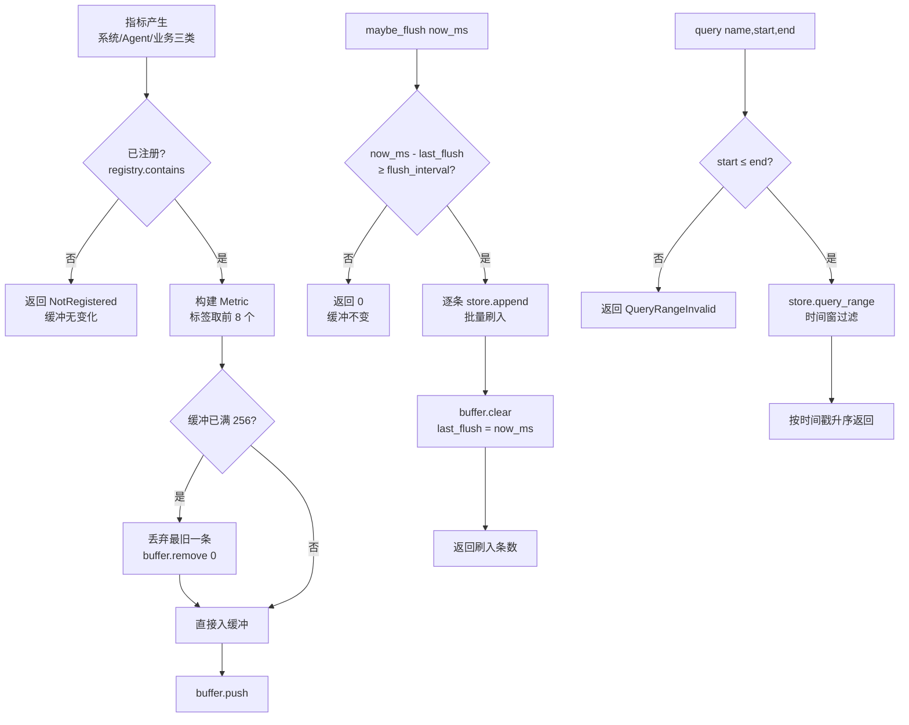

# EnerOS v0.120.0 Metrics 指标采集 设计文档

> 蓝图：`蓝图/phase2.md` §v0.120.0（P2-J 可观测性第 1 版）。
> 实现：[`crates/observability/metrics/`](../../crates/observability/metrics/src/lib.rs)（`eneros-metrics`，no_std + alloc，依赖仅 heapless）。
> 上游：v0.11.0 用户堆（alloc 基座）；下游：v0.121.0 结构化日志、v0.122.0 分布式追踪、v0.25.0 时序数据存储引擎（TSDB 持久化后端，D3 预留对接）。

---

## 1. 版本目标

**核心**：建立统一 Metrics 指标采集框架，覆盖系统层（CPU/内存/温度）、Agent 层（活跃数/延迟/错误率）、业务层（控制次数/优化调用数）三类指标，提供「注册 → 采集 → 缓冲 → 批量刷入 → 范围查询」全链路能力（蓝图 §1）。
**业务价值**：为运维监控、性能调优、容量规划提供量化数据基础；统一的指标模型与命名规范避免各 Agent 各自为政的数据孤岛。
**Phase 定位**：P2-J 可观测性第 1 版，为 v0.121.0（结构化日志）、v0.122.0（分布式追踪）与 Phase 2 出口可观测性提供指标支撑。
**出口关联**：三类默认指标经 `register_defaults` 一键注册，端到端「注册→记录→刷入→范围查询」为出口判定复演路径（INT2）。

采集路径：`record` 写入 256 条内存环形缓冲（写满丢弃最旧），`maybe_flush(now_ms)` 距上次刷入达到 `flush_interval_ms` 时批量写入 `MetricsStore`；查询经 `query(name, start_ms, end_ms)` 按时间窗过滤、按时间戳升序返回。

## 2. 前置依赖

- **前序**：v0.11.0 用户堆（`alloc` 可用，查询返回 `alloc::vec::Vec`）；v0.119.0 行为审计（同为 `now_ms` 参数注入时间戳口径，D2 沿用）。
- **外部依赖**：heapless 0.8（定容字符串 `String<N>` 与定容向量 `Vec<T, N>`），无其他新增依赖（记忆 §5.5 禁重复造轮子）。
- **被依赖零改动**：eneros-agent / eneros-tsdb 零源码改动；TSDB 对接经 `MetricsStore` trait 预留（D3）。
- **假设**：集成层提供单调毫秒时间戳源（RTC，v0.12.0）并以 `now_ms` 参数传入；采集调用经单写者队列串行（本 crate 不含锁，no_std 最小职责，与 v0.117.0 审计同口径）。
- **阻塞**：无（纯内存实现，不依赖持久化后端）。

## 3. 交付物清单

| 类型 | 路径 | 说明 |
|------|------|------|
| 代码 | [`crates/observability/metrics/src/lib.rs`](../../crates/observability/metrics/src/lib.rs) | crate 入口：`#![cfg_attr(not(test), no_std)]` + `extern crate alloc`；重导出全部公共 API；D1~D3 偏差声明 |
| 代码 | [`crates/observability/metrics/src/metrics.rs`](../../crates/observability/metrics/src/metrics.rs) | `MetricType`（4 变体）/ `MetricValue`（3 变体）/ `Label` / `Metric` / `MetricDef` / `MetricsError`（5 变体）+ `MetricsCollector` trait + `MetricsCollectorImpl<S>`（256 条环形缓冲 + 定时批量刷入 + `register_defaults` 8 项默认指标） |
| 代码 | [`crates/observability/metrics/src/registry.rs`](../../crates/observability/metrics/src/registry.rs) | `MetricRegistry`（容量 64，拒绝重复注册，`contains`/`get_type` 查询） |
| 代码 | [`crates/observability/metrics/src/store.rs`](../../crates/observability/metrics/src/store.rs) | `MetricsStore` trait（append/get_latest/query_range）+ `MemoryMetricsStore`（按名分桶环形缓冲，写满丢弃最旧，查询升序） |
| 测试 | src 内嵌 `#[cfg(test)]` | 15 个：REG1~REG4 + COL5~COL12 + STORE1~STORE3 |
| 测试 | [`crates/observability/metrics/tests/metrics_integration.rs`](../../crates/observability/metrics/tests/metrics_integration.rs) | 3 个：INT1（多来源并发）+ INT2（★ 出口判定复演）+ PERF3（性能基准，host std 环境） |
| 配置 | [`configs/metrics.toml`](../../configs/metrics.toml) | `[collector]` / `[store]` / `[defaults]` 三节模板 + 中文注释 |
| 文档 | `docs/observability/metrics-design.md`（本文） | 10 章节 + 1 Mermaid |

## 4. 详细设计

### 4.1 数据结构

```rust
pub enum MetricType { Counter, Gauge, Histogram, Summary }   // 指标类型
pub enum MetricValue { U64(u64), F64(f64), I64(i64) }        // 指标值
pub struct Label { pub key: HString<32>,                     // 标签键 ≤ 32B
                   pub value: HString<64> }                  // 标签值 ≤ 64B
pub struct Metric { pub name: HString<64>,                   // 指标名 ≤ 64B
                    pub metric_type: MetricType,
                    pub value: MetricValue,
                    pub labels: heapless::Vec<Label, 8>,     // 标签 ≤ 8 个（超出截断）
                    pub timestamp_ms: u64 }                  // 毫秒时间戳（D2 参数注入）
pub struct MetricDef { pub name: HString<64>,                // 注册项：名 + 类型
                       pub metric_type: MetricType,
                       pub help: HString<128>,               // 帮助说明 ≤ 128B
                       pub unit: HString<16> }               // 单位 ≤ 16B
pub enum MetricsError { NotRegistered, InvalidValue, LabelLimitExceeded,
                        StorageFull, QueryRangeInvalid }     // 采集全流程错误
```

### 4.2 接口定义

```rust
pub trait MetricsCollector {
    fn register(&mut self, def: MetricDef) -> Result<(), MetricsError>;
    fn record(&mut self, name: &str, value: MetricValue, labels: &[Label],
              now_ms: u64) -> Result<(), MetricsError>;       // D2：now_ms 参数
    fn increment(&mut self, name: &str, delta: u64, labels: &[Label],
                 now_ms: u64) -> Result<(), MetricsError>;    // 基于 store 最新值累加
    fn query(&self, name: &str, start_ms: u64, end_ms: u64)
             -> Result<Vec<Metric>, MetricsError>;            // D1：alloc::vec::Vec
}
impl<S: MetricsStore> MetricsCollectorImpl<S> {
    pub fn new(store: S, flush_interval_ms: u64) -> Self;
    pub fn register_defaults(&mut self);                      // 蓝图 §4.5 八项默认指标
    pub fn maybe_flush(&mut self, now_ms: u64) -> Result<usize, MetricsError>;
}
pub trait MetricsStore {
    fn append(&mut self, m: &Metric) -> Result<(), MetricsError>;
    fn get_latest(&self, name: &str) -> Option<u64>;
    fn query_range(&self, name: &str, start_ms: u64, end_ms: u64)
                   -> Result<Vec<Metric>, MetricsError>;
}
```

### 4.3 采集流程（蓝图 §4.3 对齐）



采集路径（[`metrics.rs`](../../crates/observability/metrics/src/metrics.rs) `record`）：注册检查（未注册 → `NotRegistered`，缓冲无变化）→ 构建 `Metric`（标签超 8 截断、指标名定容转换失败 → `InvalidValue`）→ 缓冲满 256 丢弃最旧一条 → 入缓冲。刷入路径（`maybe_flush`）：间隔判定（`saturating_sub` 防时钟回拨）→ 按索引逐条 `store.append`（heapless 无 `drain`）→ 清空缓冲并更新 `last_flush_ms`。存储路径（[`store.rs`](../../crates/observability/metrics/src/store.rs)）：按指标名分桶（`BTreeMap<String, VecDeque<Metric>>`），桶满 `pop_front` 丢弃最旧；查询按 `[start_ms, end_ms]` 闭区间过滤后按时间戳升序排序返回。

### 4.4 错误处理

- 未注册指标 `record`/`increment` → `NotRegistered`：缓冲无变化，先检查后写入（COL5）。
- 指标名超 64 字节定容转换失败 → `InvalidValue`：显式报错不截断。
- 缓冲满 256 → 不报错，丢弃最旧一条（蓝图 §6.5 故障口径，COL7）。
- `maybe_flush` 未到间隔 → `Ok(0)`：非错误，缓冲保留（COL8）。
- `query` 范围 `start_ms > end_ms` → `QueryRangeInvalid`（COL11）。
- `LabelLimitExceeded` / `StorageFull` 为防御性变体：标签超限当前实现为截断（蓝图 §4.1 口径）、存储为环形覆盖，正常路径均不可达（错误模型不虚构，与 v0.117.0 同口径）。

## 5. 技术交底

### 5.1 指标命名规范

- **命名风格**：Prometheus 风格 `namespace_subsystem_name`（全小写 + 下划线）。crate 内逻辑名按蓝图 §4.5 冻结为点分形式（`system.cpu_usage` 等 8 项默认指标），对接 Prometheus / 外部监控系统导出时映射为下划线形式（`system_cpu_usage`）；新增自定义指标注册时**直接采用下划线命名**（如 `business_demand_response_events`），避免二次映射。
- **命名空间**：`system`（系统层，RTOS/硬件资源）/ `agent`（Agent 运行层）/ `business`（业务层，能源控制与优化）；新增命名空间须在设计文档登记。
- **标签维度**：推荐 `agent_id`（Agent 实例标识）/ `phase`（运行阶段，如 `control`/`optimize`）/ `result`（结果，如 `ok`/`fail`/`timeout`）；标签键 ≤ 32 字节、值 ≤ 64 字节（定容上限）。
- **标签基数限制**：单指标标签数 ≤ 8（`heapless::Vec<Label, 8>` 硬上限，超出截断）；标签取值基数须低维（`agent_id` 取值数 ≈ Agent 实例数，`phase`/`result` 为枚举值），**禁止**把请求 ID、时间戳等高基数值放入标签（防维度爆炸撑爆分桶存储）。

### 5.2 采集频率说明

- **刷入间隔**：默认 `flush_interval_ms = 1000`（`configs/metrics.toml [collector]`），即缓冲数据最长滞留 1 秒；高频采集场景可调小（200ms），低频运维场景可调大（5000ms）。`maybe_flush` 由集成层在主循环/定时器中周期性调用。
- **缓冲容量**：256 条环形缓冲（写满丢弃最旧）。容量核算：缓冲可承载 `256 / 指标数` 轮全量采集——8 项默认指标场景下约 32 轮，1Hz 采集可缓冲 32 秒，远大于 1 秒刷入间隔，突发丢数据风险极低。
- **存储容量**：默认 `per_metric_capacity = 1024`（每桶），1 秒采集周期 ≈ 17 分钟历史，10 秒周期 ≈ 2.8 小时。内存预算：单条 `Metric` ≈ 1 KB，64 项指标满配 ≈ 64 MB 量级，贴近 Agent Runtime 分区 ≤ 64 MB 预算上限（记忆 §5.6）——集成层须按「指标数 × per_metric_capacity × 1 KB」核算，超限则下调容量或关闭业务类指标（`configs/metrics.toml [defaults]`）。
- **采集开销**：单条 `record` 实测纳秒级（见 §7），1Hz×8 指标场景 CPU 占用可忽略；瓶颈在刷入时的批量 `append`（每条一次 BTreeMap 查找 + 克隆），1024 条/秒以内无压力。

### 5.3 实现路径

1. 数据模型与注册表（`metrics.rs` 类型 + `registry.rs`，REG1~REG4）→ 2. 存储抽象与内存实现（`store.rs`，STORE1~STORE3）→ 3. 采集器（缓冲/刷入/increment/query，COL5~COL12）→ 4. 集成与性能（INT1~INT2 + PERF3）→ 5. 配置与文档（本版本交付物闭环）。
难点：`increment` 的累加语义基于 store 最新值，未刷入的缓冲数据不参与累加——跨刷入场景先 `maybe_flush` 再 `increment` 才能保证连续累加（COL10/INT2 口径）；多来源并发由集成层单写者队列或互斥锁串行（INT1 以 `Arc<Mutex<>>` 复演）。

### 5.4 交互与国产化

- 上游：v0.12.0 RTC（`now_ms` 时间戳源）、v0.11.0 用户堆（alloc）；下游：v0.121.0 结构化日志（共享 `now_ms` 口径与 agent_id 标签维度）、v0.122.0 分布式追踪（指标-追踪关联标签）、v0.25.0 TSDB（`MetricsStore` 持久化后端，D3）。
- 国产化：纯 Rust 零 unsafe 零 FFI，无外部 C 依赖，信创平台（飞腾/鲲鹏 aarch64）交叉编译通过（`aarch64-unknown-none`）。

## 6. 测试计划（18 个）

| 编号 | 名称 | 断言要点 | 结果 |
|------|------|---------|------|
| REG1 | 注册成功 | register 后 contains==true | ✅ |
| REG2 | 重复注册拒绝 | 第二次 Err，注册表内容不变 | ✅ |
| REG3 | 容量上限 64 | 第 65 项注册被拒，表长保持 64 | ✅ |
| REG4 | 查询接口 | get_type/contains 命中与未命中 | ✅ |
| COL5 | 未注册拒绝 | record → NotRegistered | ✅ |
| COL6 | 记录刷入链路 | record 入缓冲，flush 后 store 可见 | ✅ |
| COL7 | 缓冲满丢最旧 | 300 条 → 缓冲 256，首条为第 44 条 | ✅ |
| COL8 | 未到间隔不刷 | maybe_flush 返回 0，store 无数据 | ✅ |
| COL9 | 到间隔批量刷入 | 5 条全刷、缓冲清空、last_flush 更新 | ✅ |
| COL10 | increment 累加 | 5+3=8（跨刷入基于 store 最新值） | ✅ |
| COL11 | 查询范围非法 | start>end → QueryRangeInvalid | ✅ |
| COL12 | 默认指标注册 | 8 项默认指标名与类型全对 | ✅ |
| STORE1 | 分桶隔离 | 两指标互不影响，get_latest 正确 | ✅ |
| STORE2 | 时间窗过滤升序 | [300,600] 恰好 4 点升序 | ✅ |
| STORE3 | 桶满丢最旧 | 容量 3 写 5 条 → 保留最新 3 条 | ✅ |
| INT1 | 多来源并发记录 | 4 线程 80 条交错 → 条数 40/20/20、标签保留、升序 | ✅ |
| INT2 | ★ 出口判定复演 | 三类指标端到端：时间窗过滤、条数、值、increment 跨刷入累加全对 | ✅ |
| PERF3 | 性能基准 | record 均值 + query 1000 点耗时打印；ENEROS_PERF_GATE=1 启用 <10µs / <5ms 断言 | ✅ |

GPU 规则（记忆 user rules）：不涉及 GPU（纯数据采集，无模型训练/推理）。故障注入（蓝图 §6.5）：COL7 缓冲满丢最旧 + STORE3 桶满丢最旧全覆盖。并发复演：INT1 以 4 线程 `Arc<Mutex<>>` 模拟多 Agent 来源交错写。

## 7. 验收标准

- **功能（蓝图 §7.1）**：指标可注册（重复拒绝，REG2）、可记录（COL6）、可查询（STORE2）；8 项默认指标经 `register_defaults` 自动注册（COL12）；record 未注册返回 `NotRegistered`（COL5）；缓冲满 256 丢弃最旧（COL7）；`maybe_flush` 按间隔批量刷入（COL8/COL9）；increment 基于最新值累加（COL10）；query 范围非法返回 `QueryRangeInvalid`（COL11）；MemoryMetricsStore 分桶/时间窗/升序（STORE1~3）；端到端出口判定复演通过（INT2）。
- **性能量化（蓝图 §7.2「record < 10µs、query 1000 点 < 5ms」）**：默认仅打印耗时；`ENEROS_PERF_GATE=1`（`var(...).as_deref() == Ok("1")`，v0.113.0~v0.119.0 口径）时启用断言门禁。实测大幅优于目标（见下），主机即可达标。
- **no_std（蓝图 §7.3）**：`#![cfg_attr(not(test), no_std)]` + `extern crate alloc`；非测试代码无 `std::*`/`panic!`/`todo!`/`unimplemented!`/`unwrap()`；时间戳经 `now_ms` 参数注入（D2）；`aarch64-unknown-none` 交叉编译通过。
- **文档（蓝图 §7.4）**：本文档 10 章节 + 1 Mermaid；§5.1 即指标命名规范，§5.2 即采集频率说明。
- **出口判定（蓝图 §7.5）**：三类指标采集链路正常——注册、记录、刷入、范围查询全通（18 测试全过）。

> **性能实测**（2026-07-21，主机 x86_64，`cargo test -p eneros-metrics [--release]`）：
> - **release**：单条 record 均值 ≈ **3ns**（10240 次总 38.9µs），query_range 1000 数据点 ≈ **193.3µs**；
> - **debug**：单条 record 均值 ≈ **43ns**（10240 次总 448.7µs），query_range 1000 数据点 ≈ **286.7µs**。
> 两项均远优于蓝图 §7.2 目标（< 10µs / < 5ms），主机与目标硬件均可直接达标；`ENEROS_PERF_GATE=1` 门禁仍保留，面向性能 CI 回归防退化。record 测纯热路径口径：每 256 条批间刷入不计时（缓冲保持非满），与生产「1 秒刷入一次」的稳态一致。

## 8. 风险与注意事项

- **技术**：`increment` 基于 store 最新值累加，未刷入的缓冲增量不可见——连续多次 `increment` 后一次刷入会丢失中间累加（仅最后一次基于旧基线）。规避：计数器场景每次 `increment` 后尽快刷入，或改用集成层本地累加后 `record` 总值（INT2 已按「刷入→increment→刷入」口径验证）。
- **依赖**：无外部服务依赖；heapless 定容上限（名 64B/标签 8 个/注册表 64 项/缓冲 256 条）为硬约束，超限行为已定义（截断/拒绝/覆盖），集成层须按 §5.1 命名规范控制规模。
- **资源**：内存占用 = 缓冲（256 条 ≈ 256 KB）+ store（指标数 × per_metric_capacity × ≈1 KB）；64 项指标满配贴近 Agent Runtime ≤ 64 MB 预算（记忆 §5.6），须按 §5.2 公式核算并必要时下调 `per_metric_capacity` 或关闭部分默认指标。
- **兼容**：指标模型（`Metric` 字段与定容上限）为跨版本存证口径，新增字段须向后兼容（可选追加），命名空间扩展须在本文档 §5.1 登记。
- **坑点**：① 时钟回拨——`maybe_flush` 用 `saturating_sub` 判定间隔，回拨时退化为「未到间隔」不刷入，不会重复刷或panic；② 标签基数爆炸（把请求 ID 放入标签）会撑爆分桶存储，§5.1 已禁止；③ `MemoryMetricsStore` 为易失实现，断电丢历史，生产持久化由后续版本经 `MetricsStore` trait 对接 TSDB（D3）；④ 缓冲丢数据 silent（满 256 丢最旧不报错），监控侧可通过 `maybe_flush` 返回条数与预期比对发现。

## 9. 多角度要求

- **功能**：三类指标注册/采集/缓冲/刷入/范围查询全链路（`MetricsCollector` + `MetricsStore` 双 trait + 默认实现）。
- **性能**：record < 10µs、query 1000 点 < 5ms（§7 实测 ns/µs 级大幅达标；ENEROS_PERF_GATE 门禁口径）。
- **安全**：无密钥无网络面；未注册指标显式拒绝，错误模型不虚构。
- **可靠**：环形缓冲/分桶写满丢弃最旧不 panic；时钟回拨 `saturating_sub` 防护；store trait 抽象支持持久化后端替换（D3）。
- **可维护**：配置模板（`configs/metrics.toml` 三节）+ 命名规范（§5.1）+ 容量规划公式（§5.2）。
- **可观测**：本 crate 即可观测性基座——三类默认指标 + 标签维度 + 范围查询，支撑运维监控与容量规划。
- **可扩展**：`MetricsStore` trait 预留 TSDB 对接；注册表支持自定义指标（64 项容量）；命名空间可登记扩展。

## 10. 实现偏差（D1~D3，相对蓝图 §3/§4）

| 编号 | 偏差 | 理由 |
|------|------|------|
| **D1** | 蓝图 `query` 返回 `Vec<Metric>`（std）→ `alloc::vec::Vec<Metric>` | no_std 合规（蓝图 §43.1 全项目硬性要求）：`alloc` 版 `Vec` 功能等价，host 测试与目标编译行为一致 |
| **D2** | 蓝图 `record`/`increment` 内部调用 `crate::current_time_ms()` 取系统时钟 → 增加 `now_ms: u64` 参数传入 | no_std 无系统时钟；时间戳源由集成层 RTC（v0.12.0）提供，可测试性更强（确定性时间）；与 v0.119.0 行为审计口径一致 |
| **D3** | 存储后端默认 `MemoryMetricsStore` 环形缓冲；蓝图 TSDB（v0.25.0）持久化 → 经 `MetricsStore` trait 预留对接，本版本不落地适配器 | 内存实现满足本版本验收；trait 抽象（append/get_latest/query_range）已冻结持久化对接面，后续版本新增 `TsdbMetricsStore` 零侵入；避免与 v0.25.0 引擎形成循环依赖 |

**实现期补充偏差（规格允许，非蓝图偏差）**：① `maybe_flush` 不用 `drain` 改为按索引逐条 `append` 后 `clear`——heapless::Vec 无 `drain` 方法，语义等价（中途 append 失败时已刷条目保留，错误显式传播）；② 间隔判定用 `now_ms.saturating_sub(last_flush_ms)`——防时钟回拨导致减法溢出 panic（§8 坑点①）；③ 定容字符串构造统一 `HString::try_from` 替代 `into`——`TryFrom<&str>` 返回 `Result` 可显式处理超长失败，避免 `Into` 静默截断语义含混；④ `register_defaults` 对重复调用幂等（注册冲突静默跳过）——集成层可安全重复调用。

---

> 源码索引：[`lib.rs`](../../crates/observability/metrics/src/lib.rs) / [`metrics.rs`](../../crates/observability/metrics/src/metrics.rs) / [`registry.rs`](../../crates/observability/metrics/src/registry.rs) / [`store.rs`](../../crates/observability/metrics/src/store.rs) / [集成测试](../../crates/observability/metrics/tests/metrics_integration.rs) / [配置模板](../../configs/metrics.toml)
