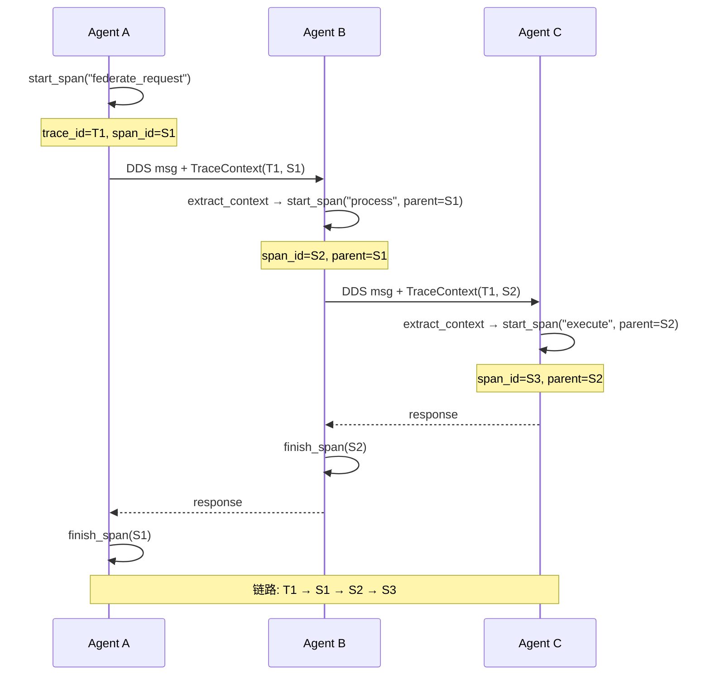

# EnerOS v0.122.0 分布式追踪 设计文档

> 蓝图：`蓝图/phase2.md` §v0.122.0（P2-J 可观测性第 3 版·收官版）。
> 实现：[`crates/observability/tracing/`](../../crates/observability/tracing/src/lib.rs)（`eneros-tracing`，no_std + alloc，依赖仅 heapless）。
> 上游：v0.121.0 结构化日志（trace_id 关联回归 INT2）、v0.75.0 DDS 消息总线（26B 头部传播载体）、v0.12.0 RTC（now_ms 时间戳源）、v0.11.0 用户堆（alloc 基座）；下游：Phase 2 出口（运维可观测性）、OpenTelemetry 兼容后端（导出预留）。

---

## 1. 版本目标

**核心**：实现跨 Agent 请求的分布式追踪系统，为每个联邦请求生成全局唯一 Trace ID，记录 Span 调用链，支持全链路可视化（蓝图 §1）。
**业务价值**：在多机联邦场景下快速定位跨 Agent 调用瓶颈与故障点，将故障定位时间从"小时级"降至"分钟级"。
**Phase 定位**：P2-J 可观测性第 3 版（收官版），与 v0.120.0（指标）、v0.121.0（日志）共同补齐"指标 + 日志 + 追踪"三支柱。
**出口关联**：为 Phase 2 出口运维可观测性提供全链路追踪能力；「跨 Agent A→B→C 链路 → 26B 头部传播 → 汇聚重建 → 文本树可视化」为出口判定复演路径（INT1/INT3）。

追踪路径：`start_span` 开启 Span（无父上下文时判定采样并生成 trace_id；有父上下文时继承 trace_id/sampled、以父 span_id 为 parent_span_id）→ 采样 span 入 512 条定容存储（写满丢弃最旧）→ `inject_context` + `encode_trace_context` 编码 26B 头部随跨 Agent 消息传播 → 下游 `decode_trace_context` + `extract_context` 后以之为 parent 开启子 Span → 响应回传时 `finish_span` 逐级更新 end_ms/status → `get_trace`/`render_trace`/`incomplete_spans` 支撑链路查询、文本树可视化与崩溃不完整检测。

## 2. 前置依赖

- **前序**：v0.121.0 结构化日志（trace_id 关联回归 INT2，LogEntry.trace_id/span_id 字段为关联落点）；v0.120.0 Metrics（延迟指标关联，本版本不直接调用）；v0.75.0 DDS 消息总线（跨 Agent 通信，26B 头部传播载体，D5 以模拟消息验证）；v0.79.0 时间同步（跨机时序前提，蓝图 §5.4）；v0.12.0 RTC（`now_ms` 时间戳源，D1）；v0.11.0 用户堆（`alloc` 可用，get_trace/render_trace 返回 `alloc` 类型，D2）。
- **外部依赖**：heapless 0.8（定容字符串 `String<N>` 与定容向量 `Vec<T, N>`），无其他新增依赖（记忆 §5.5 禁重复造轮子）。
- **被依赖零改动**：eneros-logging 零源码改动（仅作 dev-dependency 参与 INT2 集成验证）；对既有全部 crate 零改动。
- **假设**：集成层提供单调毫秒时间戳源并以 `now_ms` 参数传入（D1）；跨 Agent 消息可携带 26 字节自定义头部（蓝图 §2 假设前提）；跨 Agent 链路汇聚由运维侧收集各 Agent 本地 span 后重建（INT1 口径）。
- **阻塞**：DDS 消息不支持自定义头部则无法传递 trace_id（蓝图 §2 阻塞条件，本版本以 26B 编解码格式交付规避，D5）。

## 3. 交付物清单

| 类型 | 路径 | 说明 |
|------|------|------|
| 代码 | [`crates/observability/tracing/src/lib.rs`](../../crates/observability/tracing/src/lib.rs) | crate 入口：`#![cfg_attr(not(test), no_std)]` + `extern crate alloc`；重导出全部公共 API；D1~D7 偏差声明 |
| 代码 | [`crates/observability/tracing/src/span.rs`](../../crates/observability/tracing/src/span.rs) | `TraceId`([u8;16]) / `SpanId`([u8;8]) / `SpanStatus`（Active/Finished/Error）/ `TraceError`（4 变体）/ `Span`（operation≤64B、tags≤8×(32B,64B)、agent_id≤32B D6、sampled D4）+ `SpanBuilder`（tag 超 8 截断、字符串超长截断不 panic） |
| 代码 | [`crates/observability/tracing/src/trace_context.rs`](../../crates/observability/tracing/src/trace_context.rs) | `TraceContext`（trace_id/span_id/sampled）+ `encode_trace_context`/`decode_trace_context`（26B：16B+8B+1B+1B 保留，互为逆运算，D5） |
| 代码 | [`crates/observability/tracing/src/tracing.rs`](../../crates/observability/tracing/src/tracing.rs) | `Tracer` trait + `TracerImpl`（spans 512 满丢最旧、采样 trace 创建时判定 D4、trace_id=8B now_ms+8B 计数器）+ `render_trace`（父子缩进文本树，D7 成环防护）+ `incomplete_spans`（Active 检出） |
| 测试 | src 内嵌 `#[cfg(test)]` | 16 个：SPN1~3 + CTX4~6 + TRC7~14 + SMP15~16 |
| 测试 | [`crates/observability/tracing/tests/tracing_integration.rs`](../../crates/observability/tracing/tests/tracing_integration.rs) | 5 个：INT1（★ 跨 Agent A→B→C 链路）+ INT2（★ 日志关联回归）+ INT3（★ 出口判定复演）+ INT4（故障注入）+ PERF5（性能基准，host std 环境） |
| 配置 | [`configs/tracing.toml`](../../configs/tracing.toml) | `[tracer]` / `[retention]` / `[propagation]` 三节模板 + 中文注释 |
| 文档 | `docs/observability/tracing-design.md`（本文） | 10 章节 + 1 Mermaid |

## 4. 详细设计

### 4.1 数据结构

```rust
pub struct TraceId(pub [u8; 16]);                               // 128 位 Trace ID
pub struct SpanId(pub [u8; 8]);                                 // 64 位 Span ID
pub enum SpanStatus { Active, Finished, Error }                 // 进行中/正常结束/异常结束
pub struct Span {
    pub trace_id: TraceId,
    pub span_id: SpanId,
    pub parent_span_id: Option<SpanId>,                         // 父 Span（跨 Agent 父不在本地亦为 Some）
    pub operation_name: HString<64>,                            // 操作名 ≤ 64B
    pub start_ms: u64,                                          // 开始时间（D1 参数注入）
    pub end_ms: u64,                                            // 结束时间（未完成为 0）
    pub status: SpanStatus,
    pub tags: heapless::Vec<(HString<32>, HString<64>), 8>,     // 标签 ≤ 8 个
    pub agent_id: HString<32>,                                  // 所属 Agent（D6 字符串）
    pub sampled: bool,                                          // 是否采样（D4）
}
pub struct TraceContext { trace_id: TraceId, span_id: SpanId, sampled: bool } // 跨 Agent 传播
pub enum TraceError { SpanNotFound, ContextInvalid, BufferFull, TraceNotFound } // 全流程错误
```

### 4.2 接口定义

```rust
pub trait Tracer {
    fn start_span(&mut self, operation: &str, parent: Option<&TraceContext>, now_ms: u64) -> Span; // D3/D1
    fn finish_span(&mut self, span: &mut Span, now_ms: u64);              // 同步存储中的 end/status
    fn inject_context(&self, span: &Span) -> TraceContext;                // sampled 与 span 一致（D4）
    fn extract_context(&self, ctx: &TraceContext) -> Option<TraceContext>; // 校验 trace_id 非全零（D3）
    fn get_trace(&self, trace_id: &TraceId) -> Vec<Span>;                 // D2：alloc Vec，保入库序
}
impl TracerImpl {
    pub fn new(sampling_rate: f32) -> Self;                               // 超界截断到 [0,1]
    pub fn stored(&self) -> usize;                                        // 当前入库条数
    pub fn incomplete_spans(&self, trace_id: &TraceId) -> Vec<Span>;      // Active 检出
}
pub fn render_trace(spans: &[Span]) -> String;                            // 父子缩进文本树（D7 防护）
pub fn encode_trace_context(ctx: &TraceContext) -> [u8; 26];              // 16B+8B+1B+1B（D5）
pub fn decode_trace_context(buf: &[u8; 26]) -> TraceContext;              // 与 encode 互逆
impl SpanBuilder {
    pub fn new(operation: &str, trace_id: TraceId, span_id: SpanId, now_ms: u64) -> Self; // D1
    pub fn parent(self, parent: SpanId) -> Self;
    pub fn tag(self, key: &str, value: &str) -> Self;                     // 超 8 个截断
    pub fn agent(self, agent_id: &str) -> Self;                           // 超长截断（D6）
    pub fn sampled(self, sampled: bool) -> Self;
    pub fn build(self) -> Span;
}
```

### 4.3 跨 Agent 调用链（蓝图 §4.3 对齐）



传播路径（INT1 复演口径）：A `start_span` 得 S1 → `inject_context(S1)` 得 TraceContext(T1,S1) → `encode_trace_context` 编码 26B 随消息发出 → B `decode_trace_context` 还原、`extract_context` 校验 trace_id 非全零后返回父引用 → B 以该 ctx 为 parent `start_span("forward")` 得 S2（继承 T1/sampled，parent_span_id=S1；父 Span 不在 B 本地存储亦正确，D3 核心）→ 同样到 C 得 S3 → 响应回传时 finish 顺序 C→B→A → 运维侧汇聚三个 Agent 本地 span 按 T1 过滤重建 S1←S2←S3。`render_trace` 按 parent 链（而非时间戳）组织缩进树，对跨机时钟偏移不敏感（蓝图 §5.4 难点规避，`configs/tracing.toml` ⑨）。

### 4.4 错误处理

- `extract_context` 收到全零 trace_id → 返回 `None`（非法上下文拒绝开启子 Span，TRC8）。
- spans 满 512 → 不报错，`remove(0)` 丢弃最旧一条（蓝图 §4.5 口径，TRC10）。
- `finish_span` 对未采样/未入库 span → 仅更新句柄，存储查找落空静默跳过（D4 未采样句柄语义，SMP16）。
- 字符串超长（operation>64B/key>32B/value>64B/agent>32B）→ 按字符边界截断不 panic（SPN1~3）。
- `SpanNotFound`/`ContextInvalid`/`BufferFull`/`TraceNotFound` 为防御性变体：当前实现路径（定容覆盖、句柄直改、过滤查询返回空集）均不可达（错误模型不虚构，与 v0.120.0/v0.121.0 同口径）。

## 5. 技术交底

### 5.1 追踪数据模型（OpenTelemetry 对齐说明）

**TraceId / SpanId / TraceContext 字段表**：

| 类型 | 字段 | 字节 | 语义 | OpenTelemetry 对齐 |
|------|------|------|------|--------------------|
| `TraceId` | `[u8; 16]` | 16B | 全局唯一 Trace 标识；前 8B = trace 创建时刻 now_ms 大端，后 8B = 创建方计数器大端 | 对应 OTel `TraceId`（128 位）；W3C Trace Context `trace-id` |
| `SpanId` | `[u8; 8]` | 8B | Span 标识；创建方计数器大端自增 | 对应 OTel `SpanId`（64 位）；W3C `parent-id` |
| `TraceContext` | `trace_id` | 16B | 传播用 Trace 标识 | OTel `SpanContext::trace_id` |
| `TraceContext` | `span_id` | 8B | 当前 Span 标识（下游以其为 parent） | OTel `SpanContext::span_id` |
| `TraceContext` | `sampled` | 1B（编码后） | 采样标记，trace 创建时判定随上下文传播（D4） | W3C `traceparent` flags 的 sampled 位 |

**Span 字段表**（蓝图 §4.1 + D4/D6 偏差）：

| 字段 | 类型 | 约束 | 语义 | OpenTelemetry 对齐 |
|------|------|------|------|--------------------|
| `trace_id` | `TraceId` | 16B | 所属 Trace | OTel Span `trace_id` |
| `span_id` | `SpanId` | 8B | 本 Span 标识 | OTel Span `span_id` |
| `parent_span_id` | `Option<SpanId>` | 8B | 父 Span（根为 None；跨 Agent 父不在本地存储亦为 Some，D3） | OTel Span `parent_span_id` |
| `operation_name` | `HString<64>` | ≤64B | 操作名（如 `federate_request`） | OTel Span `name` |
| `start_ms`/`end_ms` | `u64` | 毫秒 | 起止时间戳（集成层 RTC 注入，D1；未完成为 0） | OTel `start_time`/`end_time` |
| `status` | `SpanStatus` | 3 值 | Active/Finished/Error | OTel `StatusCode`（Active 对应 Unset 进行中） |
| `tags` | `Vec<(HString<32>, HString<64>), 8>` | ≤8 对 | 自定义键值标签（超 8 截断） | OTel Span `attributes` |
| `agent_id` | `HString<32>` | ≤32B | 所属 Agent 字符串标识（D6，蓝图原为 u32） | OTel Resource `service.name` 语义近似 |
| `sampled` | `bool` | — | 采样标记（D4 补充，蓝图 Span 模型遗漏但 TraceContext 有） | W3C sampled 位的 Span 侧落点 |

**26 字节传播格式**（[`trace_context.rs`](../../crates/observability/tracing/src/trace_context.rs)，D5）：`[0..16)` trace_id 原样 16B + `[16..24)` span_id 原样 8B + `[24]` sampled（0/非 0）+ `[25]` 保留（固定 0，供后续扩展 flags）。encode/decode 互为逆运算（CTX4~6）；与 W3C `traceparent` 头部（00-32hex-16hex-2hex）语义等价、二进制定长更适配 DDS 消息头部。

### 5.2 Span 关系图说明（链路可视化）

`render_trace(&[Span])` 将一组 span 渲染为按父子关系缩进的**文本调用树**：根 = `parent_span_id` 为 None 或父不在集合中；每层缩进 2 空格递进；每行格式 `{缩进}{operation} [{agent_id}] {耗时ms|-} {状态}`——耗时 = `end_ms - start_ms`（Active 未完成显示 `-`），状态标记 `OK`（Finished）/`ERR`（Error）/`未完成`（Active）。

**文本树示例**（INT1 跨 Agent A→B→C 链路实测输出）：

```text
federate_request [agent-A] 50ms OK
  forward [agent-B] 30ms OK
    execute [agent-C] 10ms OK
```

**parent 链说明**：跨 Agent 场景下 span 分散在各 Agent 本地存储，汇聚后按 `parent_span_id` 重建——S1(parent=None) 为根；S2.parent=S1.span_id ⇒ S2 为 S1 子节点；S3.parent=S2.span_id ⇒ S3 为 S2 子节点，形成 S1←S2←S3 链。渲染按 parent 链而非时间戳排序，对跨机时钟偏移不敏感（蓝图 §5.4/§8.5 坑点规避）。实现用显式栈迭代（避免深层递归占用 no_std 栈），子节点逆序入栈保证输出顺序与入参一致。

**成环防护（D7）**：蓝图 span_id 计数器按 Tracer 实例独立自增，跨 Agent 汇聚时不同 Agent 的 span_id 可能冲突（如均为计数器首值），父链匹配产生自指成环导致渲染死循环；`render_trace` 以已渲染索引集合跳过重复索引（INT1 暴露后最小修复）。运维汇聚侧宜以 (trace_id, agent_id) 维度二次消歧。

**不完整标记示例**（INT4 故障注入：Agent B 崩溃 S2 未 finish）：

```text
federate_request [agent-A] 999ms OK
  forward [agent-B] - 未完成
```

### 5.3 采样策略

采样判定**仅在 trace 创建时**（start_span 无父上下文）进行：rate=1.0 全采、0.0 全不采、中间值按确定性计数器取模判定（`next_span_counter % 100`），结果记录于 `span.sampled` 并随 TraceContext 传播，保证同一 trace 全链一致（D4——蓝图 `inject_context` 每次重掷采样会导致同链不一致）。未采样 span 不入库但正常返回句柄（finish_span 仅更新句柄），`sampled=false` 随上下文传播给下游使全链跳过存储（SMP15/16）。配置见 `configs/tracing.toml [tracer] sampling_rate`；蓝图 §8.5 坑点「采样率过低导致关键链路丢失」由配置注释登记（故障排查期调回 1.0）。

### 5.4 实现路径

1. 数据模型与构建器（`span.rs` 类型 + `SpanBuilder`，SPN1~3）→ 2. 上下文编解码（`trace_context.rs` 26B 互逆，CTX4~6）→ 3. 追踪器与链路查询/渲染/检测（`tracing.rs` TracerImpl + get_trace/render_trace/incomplete_spans，TRC7~14 + SMP15~16）→ 4. 集成与性能（INT1~INT4 + PERF5）→ 5. 配置与文档（本版本交付物闭环）。
难点：① 跨 Agent 父链——父 Span 不在本地存储时继承父上下文而非本地查找（D3 签名调整，TRC8/INT1）；② 采样一致性——创建时判定随上下文传播（D4）；③ 渲染死循环防护——span_id 跨实例冲突成环（D7，INT1 暴露最小修复）；④ 零依赖文本树——显式栈迭代替代递归（no_std 栈约束）。

### 5.5 交互与国产化

- 上游：各 Agent（span 来源）、v0.121.0 日志（trace_id 关联回归 INT2：trace_id 前 8B 大端 u64 ↔ LogEntry.trace_id、span_id 大端 u64 ↔ LogEntry.span_id）、v0.75.0 DDS（26B 头部传播载体，D5 模拟验证）、v0.12.0 RTC（now_ms 源）、v0.11.0 用户堆（alloc）；下游：Phase 2 出口（运维可观测性）、OpenTelemetry 兼容后端 Jaeger/Zipkin（蓝图 §5.1 后端可选，`configs/tracing.toml` ⑦ 导出预留）。
- 国产化：纯 Rust 零 unsafe 零 FFI，数据模型兼容 OpenTelemetry（§5.1），算法自研，信创平台（飞腾/鲲鹏 aarch64）交叉编译通过（`aarch64-unknown-none`）。

## 6. 测试计划（21 个）

| 编号 | 名称 | 断言要点 | 结果 |
|------|------|---------|------|
| SPN1 | builder 字段齐全 | trace/span/operation/start/end/status/parent/tags/sampled 默认值 + operation 超长截断 | ✅ |
| SPN2 | parent/tag 截断 | parent 设置正确；tag 超 8 截断；key/value 超长截断 | ✅ |
| SPN3 | agent/sampled | agent/sampled 设置；agent_id 超长截断 | ✅ |
| CTX4 | encode 布局 | 26B 逐字节偏移正确（16B+8B+sampled+保留） | ✅ |
| CTX5 | decode 还原 | 字段还原；sampled 非 0 即 true | ✅ |
| CTX6 | 编解码往返 | encode→decode 逐字段相等 | ✅ |
| TRC7 | start 无父 | 新 trace 非零 ID、Active、parent=None、入库 | ✅ |
| TRC8 | 带父继承 | 继承 trace_id、parent 正确（跨 Agent 无本地父亦正确，D3）；全零 ctx 拒绝 | ✅ |
| TRC9 | finish 更新 | 存储中 end_ms/status 同步 | ✅ |
| TRC10 | 满 512 丢最旧 | 513 条后最旧被弃、最新在库 | ✅ |
| TRC11 | inject 一致 | ctx trace/span/sampled 与 span 一致 | ✅ |
| TRC12 | get_trace 过滤 | 只返回目标 trace、保序；未知 trace 空 | ✅ |
| TRC13 | incomplete 检出 | Active 检出（模拟崩溃未 finish） | ✅ |
| TRC14 | render 缩进树 | 三 span 缩进、耗时、未完成标记 | ✅ |
| SMP15 | rate=1.0 | 全入库 sampled=true；超界截断 | ✅ |
| SMP16 | rate=0.0 | 全不入库、inject sampled=false 传播 | ✅ |
| INT1 | ★ 跨 Agent 链路 | A→B→C 经 26B 传播、finish C→B→A、汇聚重建 S1←S2←S3（同 trace/parent/sampled/耗时）、干扰 trace 被过滤、render 树正确 | ✅ |
| INT2 | ★ 日志关联回归 | trace_id 前 8B 大端 u64 写日志 → flush → LogFilter 按 trace_id 命中 3 条、逐条 span_id/operation 与链路对应、干扰 trace 不混淆 | ✅ |
| INT3 | ★ 出口判定复演 | render_trace 文本树结构：根无缩进/子 2 空格/孙 4 空格、每行含 operation/agent/耗时/状态 | ✅ |
| INT4 | 故障注入 | B 崩溃 S2 未 finish → incomplete_spans 检出 S2、render 标记 `- 未完成` | ✅ |
| PERF5 | 性能基准 | span 创建均值（10240 次）+ 26B 编解码均值（100000 次）打印；ENEROS_PERF_GATE=1 启用 <5µs / <1µs 断言 | ✅ |

GPU 规则（记忆 user rules）：不涉及 GPU（纯追踪记录，无模型训练/推理）。故障注入（蓝图 §6.5）：INT4 Agent B 崩溃链路不完整 + TRC10 存储满丢最旧全覆盖。回归（蓝图 §6.4）：INT2 验证 v0.121.0 日志 trace_id 关联正常。

## 7. 验收标准

- **功能（蓝图 §7.1）**：跨 Agent 请求可追踪完整链路（INT1：A→B→C 26B 传播 + 汇聚重建 S1←S2←S3）；trace_id 在消息头部正确传播（CTX4~6 编解码互逆 + INT1 模拟消息验证，D5）；采样一致性（SMP15/16）；链路查询/不完整检测（TRC12/13、INT4）；Span 创建字段齐全（SPN1、TRC7）。
- **性能量化（蓝图 §6.3/§7.2「Span 创建 < 5μs、上下文编解码 < 1μs」）**：默认仅打印耗时；`ENEROS_PERF_GATE=1`（`var(...).as_deref() == Ok("1")`，v0.113.0~v0.121.0 口径）时启用断言门禁。实测大幅优于目标（见下），主机即可达标。
- **安全（蓝图 §7.3）**：trace_id 由时间戳 + 计数器生成，不含敏感信息（无 Agent 身份/业务数据/密钥）；Span tags 内容经集成层字段审查（沿用 v0.121.0 日志字段规范口径）；无密钥无网络面。
- **no_std（蓝图 §43.1）**：`#![cfg_attr(not(test), no_std)]` + `extern crate alloc`；非测试代码无 `std::*`/`panic!`/`todo!`/`unimplemented!`/`unwrap()`；时间戳经 `now_ms` 参数注入（D1）；`aarch64-unknown-none` 交叉编译由 Task 5 全量校验覆盖。
- **文档（蓝图 §7.4）**：本文档 10 章节 + 1 Mermaid；§5.1 即追踪数据模型（OpenTelemetry 对齐），§5.2 即 Span 关系图说明。
- **出口判定（蓝图 §7.5）**：链路可视化验证通过——跨 Agent 链路汇聚重建 + render_trace 文本树结构正确（INT1/INT3，21 测试全过）。

> **性能实测**（2026-07-22，主机 x86_64，`cargo test -p eneros-tracing [--release]`）：
> - **release**：span 创建均值 ≈ **34ns**（10240 次总 349.2µs），26B 编解码均值 ≈ **1ns**（100000 次往返总 143.1µs）；
> - **debug**：span 创建均值 ≈ **69ns**（10240 次总 712.9µs），26B 编解码均值 ≈ **5ns**（100000 次往返总 556.1µs）。
> 两项均远优于蓝图目标（< 5µs / < 1µs），主机与目标硬件均可直接达标；`ENEROS_PERF_GATE=1` 门禁仍保留，面向性能 CI 回归防退化。span 创建测纯热路径口径：每批 512 个批间重建 TracerImpl 不计时（避免满库 remove(0) 丢最旧的搬移成本干扰），与生产「定容存储未满」稳态一致；编解码为 encode+decode 往返整体计时。

## 8. 风险与注意事项

- **技术**：① DDS 头部扩展可能不被支持（蓝图 §8.1）——以 26B 定长编解码格式交付（D5），集成层按 `configs/tracing.toml [propagation]` 布局注入/提取；② span_id 跨 Tracer 实例冲突（D7 新发现）——渲染已加成环防护，运维汇聚侧宜以 (trace_id, agent_id) 二次消歧，后续版本可考虑 span_id 混入 Agent 维度熵源。
- **依赖**：v0.79.0 时间同步影响跨机时序（蓝图 §8.2）——render_trace 按 parent 链排序对时钟偏移不敏感；heapless 定容上限（operation 64B/tags 8 个/agent 32B/存储 512 条）为硬约束，超限行为已定义（截断/覆盖）。
- **资源**：单条 Span ≈ 1.3 KB，512 条定容存储 ≈ 650 KB（heapless，栈/静态段），在 Agent Runtime ≤ 64 MB 预算内（记忆 §5.6）；host 侧多实例场景建议堆分配（集成测试 `boxed_tracer` 口径：3 实例栈放即溢出 2MB 默认栈）；渲染输出 alloc String 按链路规模另计（蓝图 §8.3 资源风险 → 采样 + 满丢最旧覆盖）。
- **兼容**：26B 头部布局（§5.1）为跨版本存证口径，第 25 字节保留供 flags 扩展；与 v0.121.0 日志关联依赖 trace_id 派生口径（前 8B 大端 u64）与 span_id 大端 u64 不变（INT2）；数据模型对齐 OpenTelemetry（蓝图 §8.4 兼容性风险 → 后端导出预留）。
- **坑点**：① 采样率过低导致关键链路丢失（蓝图 §8.5）——配置注释登记，故障排查期调回 1.0；② 时钟偏移导致调用顺序错误（蓝图 §8.5）——parent 链排序规避；③ 汇聚场景渲染成环（D7）——已防护；④ Span 存储易失，断电丢链路历史，持久化由后续版本经导出适配器对接后端（`configs/tracing.toml` ⑦ 预留）。

## 9. 多角度要求

- **功能**：分布式追踪 + 链路可视化（`Tracer` trait + `TracerImpl` + `render_trace` 文本树 + `incomplete_spans` 检测）。
- **性能**：Span 创建 < 5µs、编解码 < 1µs（§7 实测 ns 级大幅达标；ENEROS_PERF_GATE 门禁口径）。
- **安全**：trace_id 脱敏（时间戳 + 计数器，无敏感信息）；无密钥无网络面。
- **可靠**：链路不完整检测（崩溃 Agent Active span 可检出 + 渲染标记未完成）；存储满丢最旧不 panic；渲染成环防护（D7）。
- **可维护**：采样率可配置（`configs/tracing.toml` 三节模板）+ 数据模型/关系图文档（§5.1/§5.2）+ 容量规划公式。
- **可观测**：追踪本身可观测——`stored()` 运行态探针 + 与日志支柱 trace_id 关联（INT2）。
- **可扩展**：兼容 OpenTelemetry 后端（§5.1 对齐 + 导出预留）；tags 8 个自定义维度；26B 头部第 25 字节保留 flags 扩展位。

## 10. 实现偏差（D1~D7，相对蓝图 §3/§4）

| 编号 | 偏差 | 理由 |
|------|------|------|
| **D1** | 蓝图 `crate::current_time_ms()` 系统时钟调用 → `now_ms: u64` 参数传入（start_span/finish_span/SpanBuilder::new/generate_trace_id） | no_std 无系统时钟；时间戳源由集成层 RTC（v0.12.0）提供，可测试性更强（确定性时间）；与 v0.119.0~v0.121.0 口径一致 |
| **D2** | 蓝图 `get_trace` 返回 std `Vec<Span>` → `alloc::vec::Vec<Span>` | no_std 合规（蓝图 §43.1 全项目硬性要求）：`alloc` 版类型功能等价，host 测试与目标编译行为一致 |
| **D3** | 蓝图 `start_span(parent: Option<SpanId>)` 按 SpanId 本地查找父 Span → `Option<&TraceContext>`；`extract_context` 语义相应调整为"校验上下文格式并返回父引用" | 跨 Agent 父 Span 不在本地存储，蓝图按 SpanId 本地查找落空会错误生成新 trace_id（断链）；携带父上下文时直接继承其 trace_id、以父 span_id 为 parent_span_id（TRC8/INT1 验证） |
| **D4** | Span 增加 `sampled: bool` 字段；采样判定在 trace 创建时（无父上下文）确定并随 TraceContext 传播；未采样 span 不入库但正常返回句柄 | 蓝图 `inject_context` 每次重掷采样，同一 trace 内上下游采样不一致（链路断裂）；创建时判定 + 传播保证全链一致（SMP15/16） |
| **D5** | DDS 头部传播以 26 字节编解码格式交付；DDS 栈消息传播在集成测试层以模拟消息验证（不依赖 eneros-agent-bus-dds） | 单一职责、避免耦合：tracing 不感知 DDS 语义；编解码互逆（CTX4~6）+ INT1 模拟消息验证即覆盖传播正确性 |
| **D6** | 蓝图 `Span.agent_id: u32` → `heapless::String<32>` | 跨 Agent 场景以字符串标识更可读（渲染树 `[agent-A]` 直观可辨），且与 v0.121.0 日志 target 字符串口径一致 |
| **D7** | `render_trace` 增加已渲染索引防护（实现期新发现，INT1 暴露） | 蓝图 span_id 计数器按 Tracer 实例独立自增，跨 Agent 汇聚时 span_id 冲突成环（自指父链）导致渲染死循环（Vec 无限增长至 OOM）；跳过重复索引最小修复，运维汇聚侧宜以 (trace_id, agent_id) 二次消歧 |

---

> 源码索引：[`lib.rs`](../../crates/observability/tracing/src/lib.rs) / [`span.rs`](../../crates/observability/tracing/src/span.rs) / [`trace_context.rs`](../../crates/observability/tracing/src/trace_context.rs) / [`tracing.rs`](../../crates/observability/tracing/src/tracing.rs) / [集成测试](../../crates/observability/tracing/tests/tracing_integration.rs) / [配置模板](../../configs/tracing.toml)
