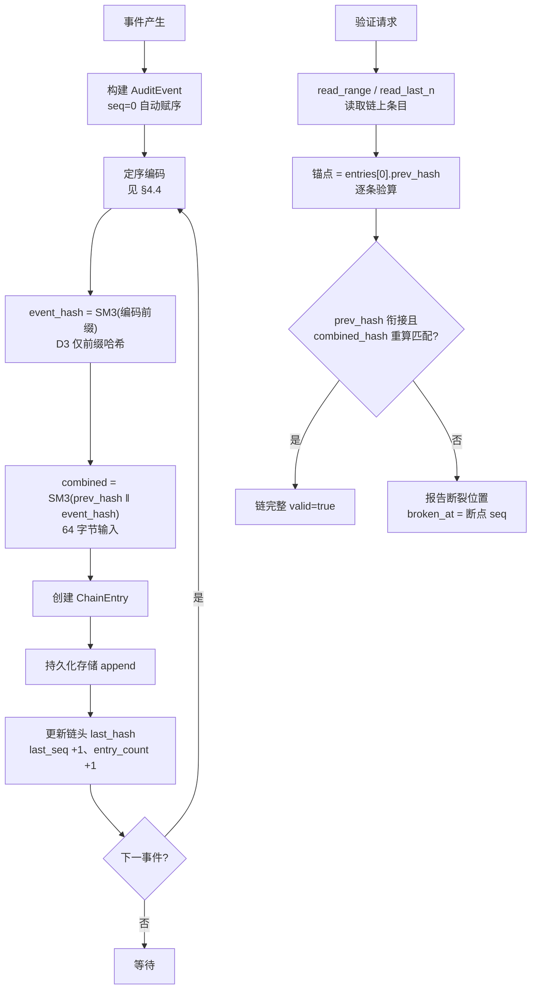

# EnerOS v0.117.0 审计日志与哈希链 设计文档

> 蓝图：`蓝图/phase2.md` §v0.117.0（P2-I 安全体系第 5 版）。
> 实现：[`crates/security/audit/`](../../crates/security/audit/src/lib.rs)（`eneros-audit`，no_std + alloc，依赖仅 eneros-crypto 与 heapless）。
> 上游：v0.116.0 模型签名与白名单（模型加载审计事件来源）、v0.115.0 mTLS（认证审计事件来源）、v0.31.0 国密（SM3）；下游：v0.118.0 行为审计（日志分析数据源）、v0.119.0 渗透测试（链完整性验证项）。

---

## 1. 版本目标

**核心**：为关键操作（登录、配置变更、控制下发、模型加载、密钥使用）建立防篡改审计日志链，基于哈希链（Hash Chain）实现日志完整性可验证（蓝图 §1）。
**业务价值**：满足电力行业等保 2.0 三级「安全审计」要求，确保任何日志篡改、删除、插入均可在事后检测，为事故追责提供不可抵赖的证据链。
**Phase 定位**：P2-I 第 5 版，在 mTLS、模型签名的基础上补齐「事后审计追溯」能力，形成「事前认证 + 事中授权 + 事后审计」闭环。
**出口关联**：为 v0.119.0 渗透测试提供审计日志完整性验证项（蓝图 §1）。

每条审计事件经定序编码后计算事件哈希，再与前一条链上哈希串联计算组合哈希（`SM3(prev ‖ event)`），形成单向递进的哈希链；链状态可经 `AuditLoggerImpl::recover` 从存储中恢复，支持断电重启后续链。

## 2. 前置依赖

- **前序**：v0.78.0 消息序列化与签名（SM3 哈希原语）；v0.31.0 国密（eneros-crypto SM3 实现）；v0.25.0 时序数据存储引擎（持久化后端场景）；v0.116.0 模型签名与白名单（审计事件来源之一）。
- **密码学基座**：eneros-crypto（`sm3_hash`，纯 Rust 实现，GM/T 0004），path 依赖 `../crypto`，零源码改动（记忆 §5.5 禁重复造轮子，D2）。
- **外部依赖**：无新增外部依赖，复用已有 SM3 哈希；heapless 0.8（定容字符串）。
- **假设**：日志存储区域有独立的访问控制，仅审计进程可写（蓝图 §2，`configs/audit.toml [store]`）。
- **阻塞**：若 SM3 实现未通过国标测试向量，则哈希链不可信（蓝图 §2；eneros-crypto KAT 已在 v0.31.0 验收）。

## 3. 交付物清单

| 类型 | 路径 | 说明 |
|------|------|------|
| 代码 | [`crates/security/audit/src/lib.rs`](../../crates/security/audit/src/lib.rs) | crate 入口：`AuditError`（7 变体）/ `VerifyReport`；重导出全部公共 API |
| 代码 | [`crates/security/audit/src/events.rs`](../../crates/security/audit/src/events.rs) | `AuditEventType`（11 变体）/ `AuditEvent`（+ `new` 便捷构造）/ `ChainEntry` / `HashChain` |
| 代码 | [`crates/security/audit/src/chain.rs`](../../crates/security/audit/src/chain.rs) | `compute_event_hash` / `compute_combined_hash` / `AuditLogger` / `AuditLoggerImpl`（new/recover/log/log_batch/chain_state/store）/ `ChainVerifier` / `ChainVerifierImpl` |
| 代码 | [`crates/security/audit/src/store.rs`](../../crates/security/audit/src/store.rs) | `AuditStore` trait（append/read_range/read_last_n/count）/ `MemStore`（内存实现，D4） |
| 测试 | src 内嵌 `#[cfg(test)]` | 17 个：EVT×2 + STO×3 + CHN×5 + VER×5 + REC×2 |
| 测试 | [`crates/security/audit/tests/audit_chain.rs`](../../crates/security/audit/tests/audit_chain.rs) | 4 个：INT18~INT20 + PERF21（host std 环境） |
| 配置 | [`configs/audit.toml`](../../configs/audit.toml) | `[chain]` / `[retention]` / `[store]` 三节模板（占位符） |
| 文档 | `docs/security/audit-chain-design.md`（本文，D5） | 12 章节 + 1 Mermaid |

## 4. 详细设计

### 4.1 数据结构

```rust
pub enum AuditEventType {           // 11 类，判别值 1~11 连续
    AuthLogin = 1, AuthLogout, ConfigChange, ControlCommand, ModelLoad, KeyUse,
    AgentStart, AgentStop, FederateJoin, FederateLeave, SecurityAlert = 11,
}
pub struct AuditEvent { pub seq: u64,               // 链内严格递增；0 = 日志器自动赋序
                        pub timestamp_ms: u64,      // 毫秒时间戳（调用方注入，no_std 无时钟）
                        pub event_type: AuditEventType,
                        pub actor: heapless::String<64>,    // 操作主体（≤ 64B 定容）
                        pub target: heapless::String<128>,  // 操作对象（≤ 128B）
                        pub detail: heapless::String<256>,  // 详情（≤ 256B）
                        pub severity: u8,           // 严重级别 0~255
                        pub source_ip: [u8; 4] }    // 来源 IPv4
pub struct ChainEntry { pub seq: u64,               // 与事件序号一致
                        pub prev_hash: [u8; 32],    // 前条组合哈希（首条为创世哈希）
                        pub event_hash: [u8; 32],   // SM3(事件编码前缀)
                        pub combined_hash: [u8; 32],// SM3(prev_hash ‖ event_hash)
                        pub timestamp_ms: u64 }     // 冗余自事件，便于按时间检索
pub struct HashChain { pub last_hash: [u8; 32],     // 链尾组合哈希（空链 = genesis）
                       pub last_seq: u64,           // 链尾序号（空链 = 0）
                       pub entry_count: u64,        // 已追加条目总数
                       pub genesis_hash: [u8; 32] } // 创世哈希（链起点锚，固定不变）
```

### 4.2 接口定义

```rust
impl<S: AuditStore> AuditLoggerImpl<S> {
    pub fn new(store: S, genesis: [u8; 32]) -> Self;              // 空链冷启动
    pub fn recover(store: S, genesis: [u8; 32]) -> Result<Self, AuditError>;  // 断电恢复续链
    pub fn store(&self) -> &S;                                    // 只读存储（测试/校验）
}
impl<S: AuditStore> AuditLogger for AuditLoggerImpl<S> {
    fn log(&mut self, event: AuditEvent) -> Result<ChainEntry, AuditError>;   // seq=0 自动赋序
    fn log_batch(&mut self, events: &[AuditEvent]) -> Result<Vec<ChainEntry>, AuditError>;
    fn chain_state(&self) -> &HashChain;
}
impl ChainVerifier for ChainVerifierImpl {
    fn verify_chain(&self, entries: &[ChainEntry]) -> Result<VerifyReport, AuditError>;
    fn verify_link(&self, entry: &ChainEntry, prev_hash: &[u8; 32]) -> bool;
}
pub trait AuditStore {                                            // 持久化抽象（追加只增不改）
    fn append(&mut self, entry: &ChainEntry) -> Result<(), AuditError>;
    fn read_range(&self, start_seq: u64, end_seq: u64) -> Result<Vec<ChainEntry>, AuditError>;
    fn read_last_n(&self, n: usize) -> Result<Vec<ChainEntry>, AuditError>;
    fn count(&self) -> Result<u64, AuditError>;
}
// 自由函数（pub）：compute_event_hash(&AuditEvent) -> [u8; 32]
//                   compute_combined_hash(&prev, &event_hash) -> [u8; 32]
```

### 4.3 核心流程（蓝图 §4.3 对齐）



追加路径（[`chain.rs`](../../crates/security/audit/src/chain.rs) `log`）：序号检查（`seq != 0 && seq != last_seq + 1` → `SeqOutOfOrder`，链状态与存储不变）→ 赋序编码 → 事件哈希 → 组合哈希 → **先落盘再推进链头**（落盘失败则链状态不变，显式传播 `StorageWriteFailed`）。验证路径（`verify_chain`）：锚点取首条 `prev_hash`（创世锚比对由调用方另行核对 `genesis_hash`），逐条检查「prev_hash 衔接 + combined_hash 重算自洽」，首个不一致处即断点。

### 4.4 审计日志编码格式规范

事件哈希输入为**定序编码**（[`chain.rs`](../../crates/security/audit/src/chain.rs) `compute_event_hash`），字段顺序与字节序固定，编码缓冲 512 字节有界安全（最大编码 472 字节）：

| 顺序 | 字段 | 字节序/编码 | 长度 | 说明 |
|------|------|------------|------|------|
| 1 | `seq` | 大端（BE） | 8 B | 事件序号（赋序后定值） |
| 2 | `timestamp_ms` | 大端（BE） | 8 B | 毫秒时间戳 |
| 3 | `event_type` | 判别值 | 1 B | `AuditEventType as u8`（1~11） |
| 4 | `severity` | 原始值 | 1 B | 严重级别 |
| 5 | `source_ip` | 原始字节 | 4 B | IPv4 四段 |
| 6 | `actor_len` | 原始值 | 1 B | actor 实际长度（容量 64 ≤ 255 安全） |
| 7 | `actor` | UTF-8 原始字节 | actor_len B | 操作主体 |
| 8 | `target_len` | 原始值 | 1 B | target 实际长度（容量 128 ≤ 255 安全） |
| 9 | `target` | UTF-8 原始字节 | target_len B | 操作对象 |
| 10 | `detail` | UTF-8 原始字节 | 尾部全部 | 详情（无长度前缀，至编码末尾） |

**哈希口径（偏差 D3）**：`event_hash = SM3(buf[..pos])`，仅对已编码前缀计算，尾部零字节不参与——蓝图为 512 字节定长缓冲整体哈希，本实现改为前缀哈希，避免尾部零字节参与哈希导致语义含混；组合哈希 `combined = SM3(prev_hash ‖ event_hash)` 输入恰好 64 字节定长。最大编码 = 8+8+1+1+4+1+64+1+128+256 = **472 B** < 512 B 缓冲，天然无溢出（`BufferFull` 为防御性变体，正常路径不可达）。

### 4.5 错误处理

- 序号乱序（非零 `seq != last_seq + 1`）→ `SeqOutOfOrder { expect, got }`：链状态与存储**均不变**（先检查后写入，CHN9 覆盖）。
- 存储追加失败 → `StorageWriteFailed`：先落盘后推进链头，失败时链头不变，重试安全。
- 存储读取失败（恢复时 `count > 0` 但末条缺失）→ `StorageReadFailed`：内部不一致显式报错，不虚构链头。
- 链断裂检出 → 不返回 `Err`，而是 `VerifyReport { valid: false, broken_at: Some(seq) }`：断点为**事实报告**而非运行错误，调用方按报告定位取证。
- `HashComputeFailed` / `BufferFull` / `InvalidGenesis` 为防御性变体：纯 Rust SM3 无失败分支、编码长度有界、genesis 由集成层保证，正常路径均不可达（错误模型不虚构，与 v0.116.0 `InternalError` 同口径）。

## 5. 技术交底

### 5.1 选型对比表（蓝图 §5.1）

| 方案 | 防篡改 | 追溯 | 性能 | 结论 |
|------|--------|------|------|------|
| 哈希链（SM3） | 高 | 强 | 高 | ⭐ 采用（单向递进链接，篡改/删除/插入均破坏后续链接关系，验证 O(n) 轻量） |
| Merkle 树 | 高 | 强 | 中 | 复杂度高（存在性证明面向检索场景，审计追加写为主，链式更贴合） |
| 区块链 | 极高 | 极强 | 低 | 资源开销大（共识机制超出单机审计需求，ADR-0002 已将区块链后置研究附录） |
| 普通日志 | 无 | 弱 | 极高 | 不满足等保（明文可改，事后无法取证） |

### 5.2 关键技术

- SM3 哈希链（GM/T 0004）：每条日志的组合哈希依赖前一条，形成单向递进链式结构；纯 Rust 实现零 unsafe 零 FFI（D2）。
- 创世哈希：链起点信任根，生产环境从 TPM PCR（v0.114.0）读取或安全固化配置下发（蓝图 §5.2，`configs/audit.toml [chain]` 占位）；丢失则整链不可信，需多副本保存（蓝图 §8.5）。
- 断链检测：验证时逐条重算，篡改事件哈希 → 组合哈希自洽检查失败（断于该条）；删除中间条目 → 后继 prev_hash 衔接失败（断于后一条）；删除尾部 → 存储尾条 seq 与期望链尾 last_seq 差值检出（INT20 三场景）。
- 重启恢复：`recover` 从存储读末条恢复 `last_hash/last_seq/entry_count` 三字段，续写无缝衔接（INT19 跨重启接缝 prev_hash == 前条 combined_hash）。
- 可观测：`chain_state()` 链头四字段（条目数、链尾哈希、链尾序号、创世哈希，蓝图 §9）。

### 5.3 实现路径

1. 事件类型与数据结构（`events.rs`，EVT1~EVT2）→ 2. 存储抽象与内存实现（`store.rs`，STO3~STO5）→ 3. 哈希链核心（`chain.rs`，CHN6~CHN10）→ 4. 链校验器（VER11~VER15）→ 5. 重启恢复（REC16~REC17）→ 6. 集成与性能（INT18~INT20 + PERF21）。
难点（蓝图 §5.4）：序列号单调性——重启后经 `recover` 恢复 `last_seq` 续序（INT19）；并发写入——多 Agent 同时记录由集成层单写者队列保证（本 crate 不含锁，no_std 最小职责）；存储空间——日志无限增长，达 `max_entries` 触发轮转归档（蓝图 §8.3，见 §8 与集成指引）。

### 5.4 交互与国产化

- 上游：v0.116.0 模型签名（模型加载审计事件来源）、v0.115.0 mTLS（认证审计事件来源）、v0.98.0 纵向加密（联邦通信审计）；下游：v0.118.0 行为审计（日志分析数据源）、v0.119.0 渗透测试（链完整性验证项）。
- 国产化（蓝图 §5.6）：全程国密 SM3 哈希算法（GM/T 0004-2012 / GB/T 32905-2016），零 SHA 系列，信创全程国密要求满足。

## 6. 测试计划（21 个）

| 编号 | 名称 | 断言要点 | 结果 |
|------|------|---------|------|
| EVT1 | 事件类型全值域 | 11 变体判别值覆盖 1~11 连续无重复 | ✅ |
| EVT2 | 定容字符串边界 | 64B 写满成功、第 65B 返回 Err | ✅ |
| STO3 | 追加计数范围读 | 3 条后 count==3，read_range(1,3) 含端点 | ✅ |
| STO4 | 单点区间边界 | read_range(2,2) 恰好 1 条 | ✅ |
| STO5 | 尾读溢出保序 | n 超存量返回全部；n=2 返回末 2 条升序 | ✅ |
| CHN6 | 创世锚定 | 首条 prev_hash==genesis，链头 last_hash==combined | ✅ |
| CHN7 | 五条顺序链接 | 逐条 prev 衔接，entry_count==5 | ✅ |
| CHN8 | 自动赋序 | seq=0 → 1,2,3 递增 | ✅ |
| CHN9 | 乱序拒绝状态不变 | SeqOutOfOrder{4,9}，链头与存储均未写 | ✅ |
| CHN10 | 批量追加 | log_batch 3 条 seq 1~3 | ✅ |
| VER11 | 净链验证 | 10 条 valid=true、broken_at==None、total==10 | ✅ |
| VER12 | 篡改检出定位 | 第 5 条 event_hash 翻字节 → broken_at==Some(5) | ✅ |
| VER13 | 中间删除检出 | 删第 5 条 → broken_at==Some(6) | ✅ |
| VER14 | 单条链接校验 | 正确锚点 true / 错误锚点 false | ✅ |
| VER15 | 空切片合法 | total==0、valid=true | ✅ |
| REC16 | 恢复三字段 | 7 条后 recover 链头一致，续写第 8 条衔接 | ✅ |
| REC17 | 空存储恢复等价新建 | last_hash==genesis、seq==0，续写锚创世 | ✅ |
| INT18 | 千条链构建验证 | 1000 条轮转 11 类事件 → 全量 valid、total==1000 | ✅ |
| INT19 | 重启恢复续写 | 500+500 跨重启续链 → 1000 条 valid，接缝衔接 | ✅ |
| INT20 | 故障注入三场景 | 篡改断于 10 / 中间删除断于 11 / 尾部断层差值检出 | ✅ |
| PERF21 | 性能基准 | 单条 log 均值 + 万条验证总耗时打印；ENEROS_PERF_GATE=1 启用 <1ms / <500ms 断言 | ✅ |

GPU 规则（蓝图 §6.6）：不涉及 GPU。故障注入（§6.5）：INT20 三场景全覆盖（篡改/中间删除/尾部删除）。回归（§6.4）：INT19 跨重启续写 + INT18 千条链回归。

## 7. 验收标准

- **功能（§7.1）**：审计事件正确记录到哈希链（INT18）；链完整性验证通过（valid=true）；篡改任意一条日志后验证器定位断裂位置（VER12/VER13/INT20）。
- **性能量化（§7.2「单条 < 1ms、万条验证 < 500ms」）**：默认仅打印耗时；`ENEROS_PERF_GATE=1`（`var(...).as_deref() == Ok("1")`，v0.114.0/v0.116.0 口径）时启用断言门禁。实测大幅优于目标（见下），主机即可达标。
- **安全（§7.3）**：篡改检出（VER12/INT20①）、删除检出（VER13/INT20②）、尾部断层检出（INT20③）全覆盖。
- **文档（§7.4）**：本文档 12 章节 + 1 Mermaid；§4.4 即审计日志编码格式规范，§4.3 即哈希链验证流程。
- **出口判定（§7.5）**：日志完整性验证通过——链构建、验证、篡改检测均正常（21 测试全过）。

> **性能实测**（2026-07-21，主机 x86_64，纯 Rust SM3）：
> - **release**：单条 log 均值 ≈ **1.5µs**（1000 次总 1.50ms），万条链验证总耗时 ≈ **3.9ms**；
> - **debug**：单条 log 均值 ≈ **1.1µs**（1000 次总 1.08ms），万条链验证总耗时 ≈ **4.4ms**。
> 两项均远优于蓝图 §7.2 目标（< 1ms / < 500ms），主机与目标硬件均可直接达标；`ENEROS_PERF_GATE=1` 门禁仍保留，面向性能 CI 回归防退化。

## 8. 风险与注意事项

- **技术（§8.1）**：SM3 FFI 在 no_std 环境下可能不稳定 → 已按蓝图指引改纯 Rust 备选实现（D2，eneros-crypto `sm3_hash`），风险消解。
- **依赖（§8.2）**：v0.78.0/v0.31.0 SM3 实现的正确性是基础（eneros-crypto 国标 KAT 已验收）。
- **资源（§8.3）**：日志存储空间耗尽 → 轮转归档策略：达 `max_entries`（`configs/audit.toml [retention]`）后旧链段整体验证归档只读存储，新段以归档段末哈希为 genesis 续链；10000 条 × `ChainEntry`（104 B）≈ 1 MB 级，在 Agent Runtime 分区 ≤ 64MB 预算内（记忆 §5.6）。
- **兼容（§8.4）**：日志格式变更需向后兼容——编码格式（§4.4）为链上存证口径，任何字段顺序/字节序变更都会改变历史条目哈希语义，须以版本号字段随格式演进（当前 v1 定序编码冻结）。
- **坑点（§8.5）**：① 创世哈希丢失会导致整链不可信，需多副本保存（TPM PCR / 安全固化配置双通道，`configs/audit.toml [chain]`）；② 时间戳精度不足可能导致事件顺序歧义——链内顺序以 `seq` 为准（严格递增强制），`timestamp_ms` 仅作检索辅助不参与顺序判定；③ 尾部截断不破坏前缀链自身验证（净前缀仍 valid），必须结合「存储尾条 seq vs 期望链尾 last_seq」差值比对检出（INT20③ 口径）；④ `MemStore` 为易失实现，生产持久化由集成层按 `AuditStore` trait 对接 v0.25.0 时序存储/文件后端（D4）。

## 9. 多角度要求

- **功能**：防篡改审计日志 + 哈希链验证（`AuditLogger` / `ChainVerifier` / `AuditStore` 三 trait + 默认实现）。
- **性能**：单条 < 1ms、万条验证 < 500ms（§7 实测 µs/ms 级大幅达标；ENEROS_PERF_GATE 门禁口径）。
- **安全**：SM3 国密哈希链式防篡改；篡改/中间删除/尾部断层三类攻击检出全覆盖。
- **可靠**：重启恢复 + 持久化（`recover` 三字段恢复，先落盘后推进链头）。
- **可维护**：日志轮转归档（`configs/audit.toml [retention]` max_entries 触发）。
- **可观测**：链状态监控（`chain_state()` 条目数/链尾哈希/链尾序号/创世哈希）。
- **可扩展**：支持新增事件类型（`AuditEventType` 判别值连续扩展，编码格式兼容追加字段需走 §8.4 版本化）。

## 10. 实现偏差（D1~D5，相对蓝图 §3/§4/§5/§6/§7）

| 编号 | 偏差 | 理由 |
|------|------|------|
| **D1** | 蓝图 `crates/audit/` → `crates/security/audit/`（eneros-audit） | 记忆 §2.3.1 强制：crate 归 `crates/<subsystem>/`；审计日志属安全体系，与 crypto/pki/secure-boot/attestation/mtls/model-security 同属 security 子系统（v0.113.0~v0.116.0 同先例） |
| **D2** | 蓝图 §4.5 `extern "C" fn sm3_hash` FFI + `unsafe` 调用 → `eneros_crypto::sm3_hash` 纯 Rust 实现 | 蓝图 §8.1 已明示「FFI 在 no_std 下可能不稳定 → 使用纯 Rust 备选实现」；eneros-crypto 纯 Rust SM3 已过国标 KAT（记忆 §5.5 禁重复造轮子）；本 crate 零 unsafe 零 `extern "C"` |
| **D3** | 蓝图 §4.5 对 512 字节定长缓冲整体哈希（`sm3_hash(buf, 512)`）→ 仅对已编码前缀 `buf[..pos]` 哈希 | 尾部零字节参与哈希导致语义含混（同事件不同残留缓冲内容哈希不同）；前缀哈希与定长整体哈希在抗篡改安全性上等价（编码本身定序无歧义，SM3 对任意长度输入抗第二原像），且编码长度有界（≤ 472B） |
| **D4** | 蓝图仅声明 `AuditStore` trait → 附带新增 `MemStore` 内存实现 | 可测试性需要（单元/集成测试与无盘场景）；trait 抽象不变，生产持久化由集成层对接 v0.25.0 时序存储/文件后端；v0.116.0 `ModelGuard` 内存审计缓冲同先例 |
| **D5** | 蓝图 `crates/audit/` 文档归 crate → `docs/security/audit-chain-design.md` | 记忆 §2.3.3 强制：文档按方向分类归入 `docs/<topic>/`（docs/security/ 已有 secure-boot/attestation/mtls/model-security 先例） |

**实现细化（规格允许，非偏差）**：① `verify_chain` 锚点取 `entries[0].prev_hash`（信任调用方给定链段起点），创世锚比对由调用方核对 `HashChain::genesis_hash`——支持链段切片验证（轮转归档后段验证场景）；② 链断裂以 `VerifyReport { valid: false, broken_at }` 事实报告而非 `Err(ChainBroken)` 返回——断链是取证结论不是运行错误（`ChainBroken` 变体保留供集成层主动中断场景）；③ `AuditEvent::new` 便捷构造将 `seq/timestamp_ms/severity/source_ip` 置零值——构造辅助，字段全 pub 可改（蓝图未声明构造器）。

## 11. 集成指引

### 11.1 日志器装配（集成层伪代码）

```rust
// 集成层：读取 genesis（configs/audit.toml [chain] 占位；生产从 TPM PCR v0.114.0 读取）
let genesis: [u8; 32] = load_genesis_from_tpm_or_config();
// 冷启动空链 / 断电重启续链（按存储是否为空自动分流）
let store = FileStore::open("data/audit/chain.log")?;   // [store] path，仅审计进程可写
let mut logger = AuditLoggerImpl::recover(store, genesis)?;   // count==0 等价 new

// 审计事件写入（时间戳由 v0.12.0 RTC 注入，禁止 std 时钟）
let mut ev = AuditEvent::new(AuditEventType::ControlCommand, "agent-ems-01",
                             "breaker-0x12", "trip command issued");
ev.timestamp_ms = rtc.now_ms();
logger.log(ev)?;
```

### 11.2 与上游 v0.116.0 审计串联

```rust
// 模型加载审计事件 → 哈希链：每次 check 后取尾条追加进防篡改审计链
if let Some(tail) = guard.get_audit_log().last() {
    let mut ev = AuditEvent::new(AuditEventType::ModelLoad,
                                 "model-guard", &tail.model_id, "load attempt");
    ev.timestamp_ms = tail.timestamp;
    audit_logger.log(ev)?;
}
```

### 11.3 轮转归档（[retention] max_entries 触发）

```rust
if logger.chain_state().entry_count >= cfg.retention.max_entries {
    let segment = logger.store().read_range(1, cfg.retention.max_entries)?;
    let report = ChainVerifierImpl.verify_chain(&segment)?;   // 归档前整体验证
    assert!(report.valid, "归档链段必须完整");
    archive_readonly(&segment);                               // 归档只读存储
    let new_genesis = segment.last().unwrap().combined_hash;  // 新段以归档段末哈希为 genesis 续链
    logger = AuditLoggerImpl::new(NewStore::open_fresh()?, new_genesis);
}
```

### 11.4 集成要点

1. genesis 多副本保存：TPM PCR + 安全固化配置双通道（蓝图 §8.5，绝不入仓）。
2. 时间注入：`timestamp_ms` 由 v0.12.0 RTC 供给；链内顺序以 `seq` 为准。
3. 单写者：多 Agent 审计事件经集成层单写者队列串行化后入链（本 crate 不含锁）。
4. 尾部断层检出：定期比对「存储尾条 seq vs chain_state().last_seq」，差值非零即告警（INT20③ 口径）。

## 12. 参考资料

- 蓝图 `蓝图/phase2.md` §v0.117.0（版本目标/详细设计/测试计划/验收标准/风险）。
- GM/T 0004-2012（GB/T 32905-2016）SM3 密码杂凑算法（eneros-crypto 实现，v0.31.0 国标 KAT 验收）。
- 上游设计文档：[model-security-design.md](model-security-design.md)（v0.116.0，审计事件来源 + PERF 门禁口径先例）、[mtls-design.md](mtls-design.md)（v0.115.0，认证审计事件来源）、[attestation-design.md](attestation-design.md)（v0.114.0，TPM PCR genesis 通道）。
- 等保 2.0 三级「安全审计」要求（GB/T 22239-2019）。
