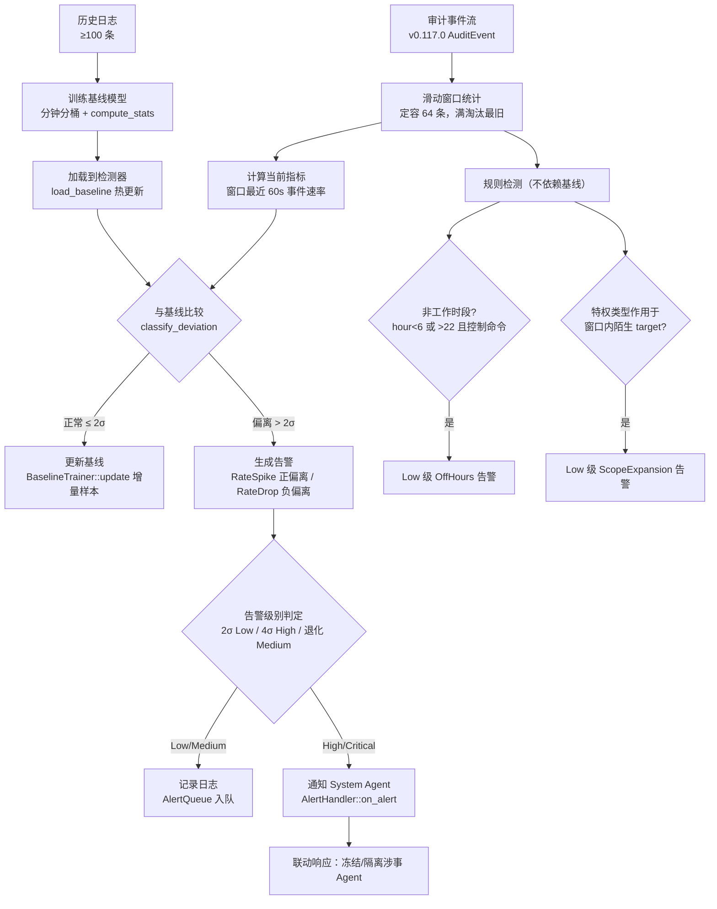

# EnerOS v0.118.0 Agent 行为审计与异常检测 设计文档

> 蓝图：`蓝图/phase2.md` §v0.118.0（P2-I 安全体系第 6 版）。
> 实现：[`crates/security/audit/`](../../crates/security/audit/src/lib.rs)（`eneros-audit`，no_std + alloc，依赖仅 eneros-crypto 与 heapless）。
> 上游：v0.117.0 审计日志与哈希链（[audit-chain-design.md](audit-chain-design.md)，检测数据源）、v0.41.0 System Agent（告警联动响应）、v0.40.0 能力模型；下游：v0.119.0 渗透测试（验证异常检测能力）。

---

## 1. 文档信息

| 项 | 值 |
|----|----|
| 版本 | v0.118.0（P2-I 安全体系第 6 版） |
| 蓝图锚点 | `蓝图/phase2.md` §v0.118.0（L10730~L11209） |
| Spec | `.trae/specs/develop-v11800-behavior-audit/spec.md` |
| 实现位置 | [`crates/security/audit/src/`](../../crates/security/audit/src/lib.rs)（扩展既有 eneros-audit crate，不新建 crate） |
| 配置模板 | [`configs/anomaly_rules.toml`](../../configs/anomaly_rules.toml)（`[threshold]`/`[alert]`/`[baseline]` 三节） |
| 测试规模 | 39 项（v0.117.0 既有 21 项零回归 + 本版新增 18 项） |
| no_std | `#![cfg_attr(not(test), no_std)]` + alloc，零 unsafe，可交叉编译 `aarch64-unknown-none` |

交付物清单：

| 类型 | 路径 | 说明 |
|------|------|------|
| 代码 | [`src/baseline.rs`](../../crates/security/audit/src/baseline.rs) | `BehaviorDim`（5 变体）/ `StatBaseline` / `BehaviorBaseline` / `AnomalyType`（6 变体）/ `AlertLevel`（5 级）/ `Alert` / `BaselineTrainer` + `BaselineTrainerImpl` / `compute_stats` |
| 代码 | [`src/alert.rs`](../../crates/security/audit/src/alert.rs) | `AlertHandler` trait / `AlertQueue`（定容 FIFO，满显式报错） |
| 代码 | [`src/anomaly.rs`](../../crates/security/audit/src/anomaly.rs) | `ThresholdConfig` / `AnomalyDetector` trait / `StatAnomalyDetector`（滑动窗口 64 + σ 分级 + 双规则） |
| 代码 | [`src/lib.rs`](../../crates/security/audit/src/lib.rs) | `AnomalyError`（5 变体）+ 3 模块声明与重导出（v0.117.0 API 零改动） |
| 测试 | src 内嵌 `#[cfg(test)]` | 14 项：BSL×4 + ALT×3 + DET×7 |
| 测试 | [`tests/behavior_audit.rs`](../../crates/security/audit/tests/behavior_audit.rs) | 4 项：INT16~INT18 + PERF19（host std 环境） |
| 配置 | [`configs/anomaly_rules.toml`](../../configs/anomaly_rules.toml) | σ 阈值 / 告警队列容量 / 基线窗口与重训说明 |
| 文档 | `docs/security/behavior-audit-design.md`（本文，D5） | 10 章节 + 1 Mermaid |

## 2. 概述

**核心**：在 v0.117.0 审计日志与哈希链（事后追溯）之上叠加「事中检测」能力——以滑动窗口统计 + σ 偏离建立 Agent 行为基线模型，实时检测频率异常、越权访问与非工作时段操作，分级告警并供联动响应扩展（蓝图 §1）。
**业务价值**：仅有防篡改日志只能事后追责，攻击造成实际损害前无法发现；本版满足等保 2.0 三级「入侵防范」要求，形成「事前认证 + 事中检测 + 事后追溯」闭环。
**Phase 定位**：P2-I 第 6 版，安全体系从「存证」升级为「检测」；为 v0.119.0 渗透测试提供异常检测验证项。
**出口关联**：异常行为检测验证通过（蓝图 §7.5）——INT16 端到端突发检出、INT17 误报率 < 5%、INT18 双告警。

数据通路：v0.117.0 哈希链审计事件流 → 基线训练（离线/定期重训）→ 实时检测（逐事件 `check`）→ 告警入队 → High/Critical 联动 System Agent（v0.41.0，集成层职责）。

## 3. 架构

### 3.1 模块结构

```
eneros-audit（crates/security/audit/）
├── events.rs   v0.117.0 审计事件（数据源，本版零改动）
├── chain.rs    v0.117.0 哈希链存证（本版零改动）
├── store.rs    v0.117.0 存储抽象（本版零改动）
├── baseline.rs v0.118.0 行为基线：维度/统计量/训练器
├── alert.rs    v0.118.0 告警分级与管理：Handler 抽象/定容队列
└── anomaly.rs  v0.118.0 实时检测：滑动窗口 + σ 分级 + 双规则
```

### 3.2 检测流水线（蓝图 §4.3 核心算法对齐）



基线未加载时 `check` 直接返回 `AnomalyError::BaselineNotTrained`（不误用空基线）；两条规则检测（OffHours/ScopeExpansion）不依赖统计基线，但仍在同一 `check` 流程内执行。

## 4. 详细设计

### 4.1 数据结构

```rust
pub enum BehaviorDim {              // 行为维度（5 类，当前仅 RequestRate 产出基线）
    RequestRate, ControlFrequency, ResourceUsage, AccessScope, ErrorRate,
}
pub struct StatBaseline { pub mean: f64, pub stddev: f64,   // 均值 / 总体标准差(÷n)
                          pub min: f64, pub max: f64,
                          pub p95: f64,                     // nearest-rank 口径
                          pub sample_count: u64 }
pub struct BehaviorBaseline { pub agent_id: u32,
                              pub baselines: HVec<(BehaviorDim, StatBaseline), 8>,
                              pub trained_at: u64,          // 训练集末事件时间戳（D1）
                              pub window_hours: u16 }       // 有效期窗口（默认 24h）
pub enum AnomalyType {              // 6 类：RateSpike/RateDrop/ScopeExpansion/
                                    //      ErrorBurst/OffHours/UnusualTarget
pub enum AlertLevel { Info = 0, Low, Medium, High, Critical = 4 }  // PartialOrd 可排序
pub struct Alert { pub id: u64,               // 检测器内自增（从 1 起）
                   pub timestamp_ms: u64,     // 触发事件时间戳（D1）
                   pub agent_id: u32,         // actor 数值解析（失败兜底 0）
                   pub anomaly: AnomalyType, pub level: AlertLevel,
                   pub detail: HString<256>,  // 中文描述 + 数值
                   pub evidence_seq: u64 }    // 指向触发事件序号（可回溯哈希链取证）
pub struct ThresholdConfig { pub sigma_low: f64,    // 2.0（Low 阈）
                             pub sigma_high: f64,   // 4.0（High 阈）
                             pub min_samples: u32,  // 100（训练门槛）
                             pub window_size: usize } // 64（窗口容量）
pub enum AnomalyError { BaselineNotTrained, InsufficientSamples { min, got },
                        DimOutOfRange, AlertQueueFull, BaselineExpired }
```

### 4.2 行为基线建模方法（蓝图 §7.4 要求）

数据源为 v0.117.0 审计事件流，训练流程（[`baseline.rs`](../../crates/security/audit/src/baseline.rs) `BaselineTrainerImpl::train`）：

1. **样本门槛**：事件数 < `min_samples`(100) → `InsufficientSamples{min, got}`，拒绝训练（样本过少时统计基线不可信，拒绝优于假基线）。
2. **分钟分桶**：`bucket = ts / 60_000`，`BTreeMap<u64, u64>` 计数每分钟事件数（桶键有序、重复桶合并），桶值序列即请求速率序列（次/分）——D2：蓝图 §4.5 硬编码 mean=10.0/stddev=3.0 占位，按蓝图同段「按分钟分桶计算频率」真实意图实现真实统计。
3. **统计计算**（`compute_stats`）：均值、**总体**标准差（除以 n，非 n-1）、min、max、p95、sample_count。p95 为 nearest-rank 口径：升序排序后取 `idx = ceil(0.95·n) - 1`（整数 `div_ceil` 实现，no_std 无 `f64::ceil`）；排序用 `partial_cmp(...).unwrap_or(Ordering::Equal)`（D4，禁 unwrap）；空切片返回全零基线。平方根为牛顿迭代（收敛阈值 1e-12，no_std 无 `f64::sqrt`；`x <= 0` 或 NaN 防御性返回 0）。
4. **基线组装**：当前产出 `RequestRate` 单维度基线（其余 4 维度预留扩展位，`baselines` 定容 8）；`trained_at` 取训练集末事件 `timestamp_ms`（D1 证据时间，no_std 无系统时钟）；`window_hours = 24` 供有效期判定（过期 → `BaselineExpired`，集成层重训）。
5. **增量更新**（`update`）：每条事件记一次 RequestRate 采样，供后续重训复用。
6. **基线漂移对策**（蓝图 §5.4 难点）：Agent 行为自然变化使旧基线失准 → 集成层定期（≤ window_hours）用最新历史日志重训并 `load_baseline` 热更新（见 `configs/anomaly_rules.toml [baseline]` 注释⑪）；冷启动新 Agent 可先加载同类默认基线模板（蓝图 §8.4）。

### 4.3 异常检测规则说明（蓝图 §7.4 要求）

[`anomaly.rs`](../../crates/security/audit/src/anomaly.rs) `StatAnomalyDetector::check` 对每条事件执行三项检查（事件先入滑动窗口：定容 64，满 `remove(0)` 淘汰最旧）：

**规则① 频率异常（基线比对）**：窗口内最近 60 秒（`(now-60s, now]`，闭区间）事件数与 `RequestRate` 基线比对，分级逻辑（`classify_deviation`，蓝图 §4.5 既定）：

| 条件 | 级别 | 异常类型 |
|------|------|---------|
| `dev > sigma_high · stddev`（默认 4σ） | High | 正偏离 RateSpike / 负偏离 RateDrop |
| `dev > sigma_low · stddev`（默认 2σ） | Low | 同上 |
| `stddev < 0.001` 且 `dev > mean·50%` | Medium | 同上（零方差退化分支） |
| 其余 | 无告警 | — |

负偏离（RateDrop）附加**冷启动抑制**（D6）：窗口时间跨度 < 60 秒时不判定骤降——冷启动窗口未满，速率天然偏低，防止把正常低速启动误报为骤降（蓝图 §8.5「冷启动期误报率高」的对策）。

**规则② 非工作时段（不依赖基线）**：事件小时（UTC，`(ts / 3_600_000) % 24`）< 6 或 > 22 且事件类型为 `ControlCommand` → Low 级 `OffHours`。电力监控场景下凌晨控制命令属高危操作特征。

**规则③ 越权访问（D3 最小规则，不依赖基线）**：蓝图未定义 ScopeExpansion 判定规则（仅 §6.5 故障注入要求可检出），最小实现为——特权事件类型（`ControlCommand`/`ConfigChange`/`KeyUse`）的 target 在当前滑动窗口**其余事件**（排除事件自身）中从未出现 → Low 级 `ScopeExpansion`。

**告警组装**（`make_alert`）：`id` 自增（从 1 起，与审计 seq 语义对齐）；`timestamp_ms` 取触发事件的 `timestamp_ms`（D1 证据时间，可精确回溯 v0.117.0 哈希链条目）；`agent_id` 取 `actor` 数值解析（`parse().unwrap_or(0)`，蓝图口径，不 panic）；`evidence_seq = event.seq`；`detail` 为中文描述 + 数值（定容 256B，超长截尾）。

### 4.4 误报控制设计

蓝图 §7.2 要求误报率 < 5%，由四层机制保障：① 2σ 低阈（正态假设下 ±2σ 覆盖 95.4% 正常波动）；② RateDrop 冷启动抑制（D6）；③ 规则②/③ 均带强约束（仅控制命令 / 仅特权类型 + 窗口内判熟）；④ 样本门槛 100 条保证基线统计可信度。INT17 以 ±1σ 边界波动数据验证告警率 0%。

## 5. 接口设计

```rust
// 基线训练（baseline.rs）
pub trait BaselineTrainer {
    fn train(&mut self, events: &[AuditEvent]) -> Result<BehaviorBaseline, AnomalyError>;
    fn update(&mut self, event: &AuditEvent);
}
impl BaselineTrainerImpl { pub fn new(agent_id: u32) -> Self; pub fn sample_count(&self) -> usize; }
pub fn compute_stats(values: &[f64]) -> StatBaseline;

// 实时检测（anomaly.rs）
pub trait AnomalyDetector {
    fn check(&mut self, event: &AuditEvent) -> Result<Vec<Alert>, AnomalyError>;
    fn check_batch(&mut self, events: &[AuditEvent]) -> Result<Vec<Alert>, AnomalyError>;
}
impl StatAnomalyDetector {
    pub fn new(cfg: ThresholdConfig) -> Self;
    pub fn load_baseline(&mut self, bl: BehaviorBaseline);   // 覆盖旧基线，热更新
    pub fn compute_rate(&self, now_ms: u64) -> f64;          // 窗口最近 60s 事件数
    pub fn find_baseline(&self, dim: BehaviorDim) -> Option<&StatBaseline>;
    pub fn classify_deviation(value: f64, bl: &StatBaseline, cfg: &ThresholdConfig)
        -> Option<(AlertLevel, f64)>;                        // 返回 (级别, 偏离倍数)
}

// 告警管理（alert.rs）
pub trait AlertHandler { fn on_alert(&mut self, alert: &Alert); }  // 联动扩展点
impl AlertQueue {
    pub fn new(capacity: usize) -> Self;
    pub fn push(&mut self, alert: Alert) -> Result<(), AnomalyError>; // 满 → AlertQueueFull
    pub fn pop_oldest(&mut self) -> Option<Alert>;             // FIFO
    pub fn len(&self) -> usize; pub fn is_empty(&self) -> bool;
    pub fn iter(&self) -> core::slice::Iter<'_, Alert>;
}
```

集成要点：检测器每 Agent 一个实例（`agent_id` 与基线绑定）；告警产生后经 `AlertHandler::on_alert` 路由——Low/Medium 记录日志，High/Critical 通知 System Agent 联动（蓝图 §4.3，集成层职责，见 `configs/anomaly_rules.toml [alert]` 注释⑨）。

## 6. 测试计划（39 项，全过）

v0.117.0 既有 21 项（src 17 + tests 4）零回归；本版新增 18 项：

| 编号 | 位置 | 断言要点 | 结果 |
|------|------|---------|------|
| BSL1 | baseline.rs | 已知序列 [2,4,4,4,5,5,7,9] 统计量与手算一致（mean=5/stddev=2/p95=9）；空切片全零 | ✅ |
| BSL2 | baseline.rs | 50 条样本训练 → `InsufficientSamples{min:100, got:50}` | ✅ |
| BSL3 | baseline.rs | 120 条（60 分×2 条/分）真实分桶训练 → RequestRate mean=2.0、sample_count=60、trained_at=末事件时间 | ✅ |
| BSL4 | baseline.rs | `update` 后增量样本计数 +1 | ✅ |
| ALT5 | alert.rs | AlertLevel 排序 Critical>High>Medium>Low>Info | ✅ |
| ALT6 | alert.rs | 队列 push+pop FIFO 顺序 | ✅ |
| ALT7 | alert.rs | 队列满 → `AlertQueueFull`，不静默丢弃 | ✅ |
| DET8 | anomaly.rs | 无基线 check/check_batch → `BaselineNotTrained` | ✅ |
| DET9 | anomaly.rs | ±1σ 分级直测无告警 + 稳态流（12/分，+1σ）不误报 | ✅ |
| DET10 | anomaly.rs | 2.5σ（正/负向）→ Low，倍数 2.5 | ✅ |
| DET11 | anomaly.rs | 4.5σ → High，倍数 4.5 | ✅ |
| DET12 | anomaly.rs | stddev≈0 退化：>均值 50% → Medium；<50% 无告警 | ✅ |
| DET13 | anomaly.rs | 突发逐级升 Low→High，`evidence_seq` 指向触发事件，id 自增 | ✅ |
| DET14 | anomaly.rs | 凌晨 3 点控制命令 → OffHours；上午 10 点不触发；冷启动无 RateDrop | ✅ |
| INT16 | tests/behavior_audit.rs | 端到端：200 条训练（mean=4/stddev=1）→ 加载 → 分钟级突发 → RateSpike 首 Low（+3σ，evidence_seq 指向第 7 条）后 High（+5σ，第 9 条），agent 一致 | ✅ |
| INT17 | tests/behavior_audit.rs | 误报率：500 条 ±1σ 波动正常流（工作时段、固定 target）→ 告警率 0/500=0.00% < 5%（蓝图 §7.2） | ✅ |
| INT18 | tests/behavior_audit.rs | 双告警：凌晨控制命令 → OffHours；陌生 target KeyUse → ScopeExpansion；两类均出现且 evidence_seq 各自指向 | ✅ |
| PERF19 | tests/behavior_audit.rs | release 打印单事件均值 + 千事件批量耗时；`ENEROS_PERF_GATE=1` 断言 <100µs / <50ms | ✅ |

GPU 规则（蓝图 §6.6）：不涉及 GPU。故障注入（蓝图 §6.5）：INT16 注入高频突发检出 RateSpike、INT18 注入越权访问检出 ScopeExpansion。回归（蓝图 §6.4）：v0.117.0 审计日志格式兼容——21 项既有测试零改动全过。

## 7. 性能

蓝图 §6.3/§7.2 指标：单事件检测 < 100µs；1000 事件批量 < 50ms；误报率 < 5%。门禁口径沿用 v0.113.0~v0.117.0 先例：debug/release 默认仅 `println!` 打印，`ENEROS_PERF_GATE=1`（`var(...).as_deref() == Ok("1")`，规避终端残留空串误激活）时启用断言，面向性能 CI / 目标硬件场景。

> **性能实测**（2026-07-21，主机 release，`opt-level=3 + lto`）：
>
> | 指标 | 实测值 | 蓝图门禁 | 余量 |
> |------|--------|---------|------|
> | 单事件 `check` 均值（预热后 1000 次） | **195ns**（总 195.7µs） | < 100µs | ~500× |
> | 1000 事件批量 `check_batch` 总耗时 | **244.7µs**（均值 244ns/事件） | < 50ms | ~200× |
> | 误报率（INT17，500 条 ±1σ 正常流） | **0/500 = 0.00%** | < 5% | 达标 |
>
> 测量路径为稳态正常流（15s 一条，恰为基线均值 4 次/分）的无告警热路径，窗口已进入淘汰稳态（含 `remove(0)` 开销）。检测主路径为窗口线性扫描（64 条）+ 常数次浮点比较，无堆分配热点（告警产生时才分配 `Vec`），故单事件稳定在亚微秒级。

**内存预算声明**（记忆 §5.6）：检测器窗口 64 条 × `AuditEvent`（约 500B）≈ 32KB；告警队列 256 条 × `Alert`（约 300B）≈ 77KB；训练期事件切片由调用方持有。合计常驻 < 1MB，远在 Agent Runtime 分区 ≤ 64MB 预算内。

## 8. 风险与注意事项

- **技术（蓝图 §8.1）**：基线漂移导致误报 → 定期重训机制（`load_baseline` 热更新 + `configs/anomaly_rules.toml [baseline]` 注释⑪，建议 ≤ 24h 周期）。
- **依赖（蓝图 §8.2）**：v0.117.0 审计日志格式变更影响基线 → 本版对 events.rs 零改动；格式演进时训练集需按新格式重放。
- **资源（蓝图 §8.3）**：滑动窗口内存占用 → 定容 64 钳制（`window_size` 调大无效、调小降内存，见 §7 内存预算）。
- **兼容（蓝图 §8.4）**：新 Agent 无基线 → `check` 显式返回 `BaselineNotTrained`（不静默放行）；集成层可提供同类默认基线模板冷启动。
- **已知坑点（蓝图 §8.5）**：① 冷启动期窗口未满，速率天然偏低——RateDrop 已由 D6 抑制，但 RateSpike 判定在窗口未满时仍生效（首分钟内高频突发可被及时检出，属期望行为）；② 小时计算为 UTC 口径（`(ts/3_600_000)%24`），集成层注入本地时间戳时需先换算 UTC，否则 OffHours 时段错位；③ `actor` 非数字字符串时 `agent_id` 兜底 0，告警归因依赖 actor 规范化（蓝图口径）；④ ScopeExpansion 以 64 条窗口为「已知范围」，窗口淘汰后旧 target 再现会重复告警（低频，可接受）。
- **告警风暴**：持续突发每分钟都越限时每条事件均告警——`AlertQueue` 定容 + `AlertQueueFull` 显式报错（不静默丢弃），集成层应去重/聚合后联动。

## 9. 实现偏差（D1~D6，相对蓝图 §4/§5/§6）

| 编号 | 偏差 | 理由 |
|------|------|------|
| **D1** | 蓝图 §4.5 `crate::current_time_ms()` → 告警 `timestamp_ms` 取触发事件的 `timestamp_ms`，`trained_at` 取训练集末事件时间戳 | no_std 无系统时钟；证据时间语义更可追溯（告警时间 == 触发事件时间，可直接按 `evidence_seq` 回溯哈希链）；对齐 v0.116.0/v0.117.0 外部时间注入先例 |
| **D2** | 蓝图 §4.5 `train()` 统计值硬编码（mean=10.0/stddev=3.0 占位）→ 真实按分钟分桶速率序列 + `compute_stats` 计算 | 蓝图同段文字明示「按分钟分桶计算频率」；蓝图 §6.1 要求统计正确性可测——硬编码无法满足 BSL1/BSL3 手算比对 |
| **D3** | 蓝图未定义 ScopeExpansion 判定规则 → 最小规则：特权事件类型（ControlCommand/ConfigChange/KeyUse）作用于窗口其余事件中从未出现的 target → Low | 蓝图仅 §6.5 故障注入要求可检出；最小规则覆盖注入场景且无非确定性，后续版本可按能力模型（v0.40.0）扩展为白名单比对 |
| **D4** | 蓝图 `sorted.sort_by(\|a,b\| a.partial_cmp(b).unwrap())` → `unwrap_or(Ordering::Equal)` | 禁 unwrap/panic 硬性规范（记忆 §4.3）；NaN 输入时退化为相等而非崩溃 |
| **D5** | 蓝图未指明文档路径 → `docs/security/behavior-audit-design.md` | 记忆 §2.3.3 文档按方向分类（docs/security/ 已有 mtls/audit-chain 先例）；crate 路径 `crates/security/audit/` 已于 v0.117.0 D1 确立 |
| **D6** | RateDrop 冷启动保护：窗口时间跨度 < 60s 时抑制负偏离骤降告警（蓝图无此逻辑） | 蓝图 §8.5 自知「冷启动期误报率高」；窗口未满时速率天然偏低，直接比对必然误报骤降——Task 3 实现口径，DET14/INT17 验证不误报 |

**实现细化（规格允许，非偏差）**：`classify_deviation` 返回 `(级别, 偏离倍数)` 供告警 detail 展示 σ 数；退化分支倍数以「均值 50%」为单位；窗口淘汰容量取 `window_size` 与定容上限 64 的较小值。

## 10. 参考资料

- 蓝图 `蓝图/phase2.md` §v0.118.0（版本目标/详细设计/测试计划/验收标准/风险）。
- 上游设计文档：[audit-chain-design.md](audit-chain-design.md)（v0.117.0 审计日志与哈希链，检测数据源 + 外部时间注入 D1 先例）、[mtls-design.md](mtls-design.md)（v0.115.0，PERF 门禁 D7 先例）。
- Spec：`.trae/specs/develop-v11800-behavior-audit/spec.md`（Requirement 与 Scenario 定义）、`tasks.md`（Task 1~5 分解）。
- 等保 2.0 三级「入侵防范」「安全审计」要求（GB/T 22239-2019）。
- 记忆文件 §4.3（no_std 合规）/ §5.6（内存预算）/ §2.3.3（文档分类）。
