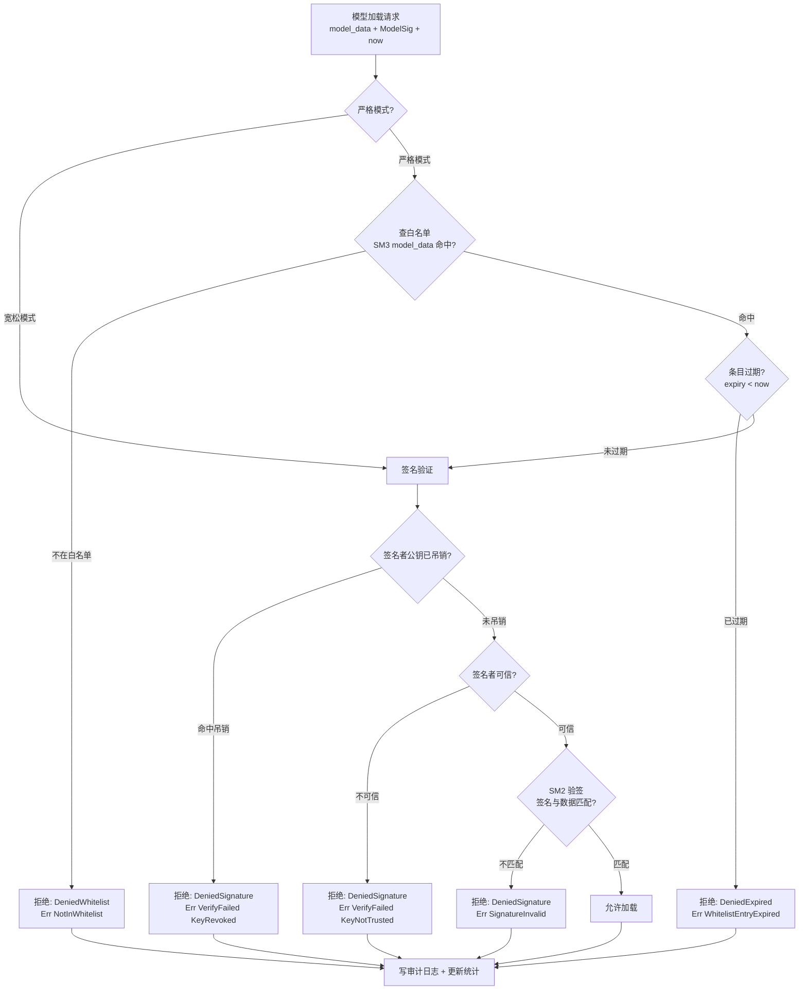

# EnerOS v0.116.0 模型签名与白名单 设计文档

> 蓝图：`蓝图/phase2.md` §v0.116.0（P2-I 安全体系第 4 版）。
> 实现：[`crates/security/model-security/`](../../crates/security/model-security/src/lib.rs)（`eneros-model-security`，no_std + alloc，唯一依赖 eneros-crypto）。
> 上游：v0.111.0 模型 OTA（模型分发通道）、v0.115.0 mTLS（签名模型传输通道）、v0.31.0 国密（SM2/SM3）；下游：v0.117.0 审计日志（模型加载审计事件来源）。

---

## 1. 版本目标

**核心**：实现模型哈希白名单 + 签名校验双重防线，未签名 / 未授权模型 100% 拒绝加载（蓝图 §1）。
**业务价值**：联邦场景下模型（LLM 权重 / Solver 参数 / Agent 策略）经 OTA 分发，缺乏来源校验则后门模型可被注入加载，直接污染推理与控制决策；本版防止后门模型注入，保障 AI 模型安全。
**Phase 定位**：P2-I 第 4 版，联邦 AI 安全基石。
**出口关联**：联邦 AI 安全——后门模型被拒验证通过（蓝图 §7.5）；v0.117.0 复用本版审计事件构建防篡改哈希链。

v0.111.0 落地模型 OTA 分发通道，v0.115.0 落地传输通道加密；本版落地「装载前最后一道闸」——模型在载入内存执行前必须同时通过白名单登记校验与 SM2 签名来源校验，二者缺一不可。

## 2. 前置依赖

- **前序**：v0.111.0 模型 OTA（场景上游）；v0.31.0 国密（eneros-crypto SM2/SM3）。
- **密码学基座**：eneros-crypto（`sm3_hash`、`sm2_sign`/`sm2_verify`、`Sm2KeyPair`/`Sm2PublicKey`/`Sm2Signature`、`CsRng`），path 依赖 `../crypto`，零源码改动（记忆 §5.5 禁重复造轮子）。
- **假设**：模型签名密钥可信（蓝图 §2）——签名私钥由密钥管理系统保管，可信/吊销公钥经产线烧录或运维通道下发（`configs/model-security.toml` 占位）；当前时间戳由集成层经 v0.12.0 RTC 注入（D3）。
- **阻塞**：无白名单则后门模型可加载（蓝图 §2）。

## 3. 交付物清单

| 类型 | 路径 | 说明 |
|------|------|------|
| 代码 | [`crates/security/model-security/src/lib.rs`](../../crates/security/model-security/src/lib.rs) | `GuardError`（5 变体 + `From<VerifyError>`）/ `VerifyError`（3 变体 + `From<CryptoError>`）/ `LoadResult`（5 变体）/ `ModelSig` / `GuardStats` |
| 代码 | [`crates/security/model-security/src/whitelist.rs`](../../crates/security/model-security/src/whitelist.rs) | `WhitelistEntry` / `ModelWhitelist`（add/remove/contains/get/len，严格/宽松模式） |
| 代码 | [`crates/security/model-security/src/signature.rs`](../../crates/security/model-security/src/signature.rs) | `ModelSignatureVerifier`（verify/add_trusted_key/revoke_key，吊销优先于可信） |
| 代码 | [`crates/security/model-security/src/model_guard.rs`](../../crates/security/model-security/src/model_guard.rs) | `ModelGuard`（check/add_to_whitelist/remove_from_whitelist/get_audit_log/stats）/ `ModelLoadAttempt` / `AUDIT_CAPACITY` |
| 测试 | src 内嵌 `#[cfg(test)]` | 15 个：WL×5 + SIG×5 + GRD×5 |
| 测试 | [`crates/security/model-security/tests/model_guard.rs`](../../crates/security/model-security/tests/model_guard.rs) | 4 个：INT16~INT18 + PERF19（host std 环境） |
| 配置 | [`configs/model-security.toml`](../../configs/model-security.toml) | `[whitelist]` / `[signature]` / `[audit]` 三节模板（占位符） |
| 文档 | `docs/security/model-security-design.md`（本文，D5） | 12 章节 + 1 Mermaid |

## 4. 详细设计

### 4.1 数据结构

```rust
pub struct WhitelistEntry { pub model_id: String,   // 模型标识（"llm-7b-int4"）
                            pub version: String,     // 模型版本（语义化版本）
                            pub hash: [u8; 32],      // SM3(model_data)，白名单键
                            pub added_at: u64,       // 登记时间（Unix 时间戳）
                            pub added_by: String,    // 登记人标识（审计可读）
                            pub expiry: u64 }        // 有效期截止（expiry < now 过期）
pub struct ModelWhitelist { pub strict_mode: bool,   // 严格/宽松模式开关
                            entries: BTreeMap<[u8; 32], WhitelistEntry> }  // D2
pub struct ModelSignatureVerifier { trusted_keys: Vec<Sm2PublicKey>,   // 去重
                                    revoked_keys: Vec<Sm2PublicKey> }  // 吊销优先
pub struct ModelGuard { whitelist: ModelWhitelist, verifier: ModelSignatureVerifier,
                        audit_log: Vec<ModelLoadAttempt>,   // 容量 1000，FIFO 覆盖
                        stats: GuardStats }
pub struct ModelLoadAttempt { pub timestamp: u64, pub model_hash: [u8; 32],
                              pub result: LoadResult, pub source: String }
pub struct ModelSig { pub signature: Sm2Signature,      // 对模型原始数据（GB/T 32918.2）
                      pub signer_pubkey: Sm2PublicKey,  // 可信/吊销比对键
                      pub signer_id: String }           // 审计可读来源标识
pub enum LoadResult { Allowed, DeniedHash, DeniedSignature, DeniedWhitelist, DeniedExpired }
pub enum GuardError { NotInWhitelist, WhitelistEntryExpired, SignatureInvalid,
                      VerifyFailed(VerifyError), InternalError }
pub enum VerifyError { KeyRevoked, KeyNotTrusted, Crypto(CryptoError) }
```

### 4.2 接口定义

```rust
impl ModelGuard {
    pub fn new(whitelist: ModelWhitelist, verifier: ModelSignatureVerifier) -> Self;
    pub fn check(&mut self, model_data: &[u8], sig: &ModelSig, now: u64) -> Result<(), GuardError>;  // D3 外部 now
    pub fn add_to_whitelist(&mut self, entry: WhitelistEntry);
    pub fn remove_from_whitelist(&mut self, hash: &[u8; 32]);
    pub fn get_audit_log(&self) -> &[ModelLoadAttempt];
    pub fn stats(&self) -> &GuardStats;
}
impl ModelSignatureVerifier {
    pub fn verify(&self, model_data: &[u8], sig: &ModelSig) -> Result<bool, VerifyError>;
    pub fn add_trusted_key(&mut self, key: Sm2PublicKey);   // 去重追加
    pub fn revoke_key(&mut self, key: &Sm2PublicKey);       // 可信移除 + 吊销去重
}
impl ModelWhitelist {
    pub fn new(strict_mode: bool) -> Self;
    pub fn add(&mut self, entry: WhitelistEntry);           // 键 = entry.hash，同哈希覆盖
    pub fn remove(&mut self, hash: &[u8; 32]);              // 不存在静默忽略
    pub fn contains(&self, hash: &[u8; 32]) -> bool;        // 事实查询，不判过期
    pub fn get(&self, hash: &[u8; 32]) -> Option<&WhitelistEntry>;
}
```

### 4.3 核心流程（蓝图 §4.3 对齐）



判定顺序固定（[`model_guard.rs`](../../crates/security/model-security/src/model_guard.rs) `check`）：① SM3 哈希（GB/T 32905）；② 严格模式白名单（未登记 → DeniedWhitelist；过期 → DeniedExpired）；③ 签名验证（吊销/不可信/密码学错误 → VerifyFailed；不匹配 → SignatureInvalid）；④ 全部通过 → Allowed。每个失败分支**先记审计再返回 Err**，错误显式传播无吞错。

### 4.4 错误处理

- 白名单为空 + 严格模式 → 全部拒绝（蓝图 §4.4，`contains` 恒 false → NotInWhitelist）。
- 签名验证失败（吊销/不可信/不匹配）→ 拒绝 + 审计记录来源 `signer_id`（安全告警数据源）。
- 审计日志满（> 1000 条）→ 循环覆盖最旧条目（`remove(0)`，FIFO 环形语义）。
- `contains` 命中后 `get` 取不到条目属内部不一致 → `InternalError`（防御性分支，正常不发生）。
- 密码学内部错误经 `From<CryptoError>` → `VerifyError::Crypto` → `GuardError::VerifyFailed` 链式映射，保留底层原因。

## 5. 技术交底

### 5.1 选型对比表（蓝图 §5.1）

| 方案 | 安全 | 灵活 | 结论 |
|------|------|------|------|
| 签名 + 白名单 | 高 | 中 | ⭐ 采用（双重防线：来源可信 + 内容登记双重确认） |
| 仅白名单 | 中 | 低 | 不可控（哈希登记无法证明来源，白名单泄露即可仿冒） |
| 仅签名 | 中 | 高 | 后门风险（签名密钥泄露即全线失守，无吊销后快速止血手段） |

### 5.2 关键技术

- SM3 哈希白名单（GB/T 32905）：模型内容指纹作登记键，同哈希重复 `add` 覆盖旧条目（版本热更新语义）。
- SM2 签名验证（GB/T 32918.2）：`sm2_verify` 对模型原始数据验签，内部已完成 Z 值拼接 + SM3 摘要（D4）。
- 密钥吊销管理：吊销优先于可信（命中吊销即拒，即使仍在可信列表），`revoke_key` 幂等去重。
- 审计日志：`ModelLoadAttempt` 五字段（timestamp/model_hash/result/source + 写入序），容量 1000 循环覆盖。
- 可观测统计：`GuardStats { checks, allowed, denied, last_result }` 随 check 更新（蓝图 §9 可观测）。

### 5.3 实现路径

1. 白名单管理（`ModelWhitelist`，WL1~WL5）→ 2. 签名验证器（`ModelSignatureVerifier`，SIG6~SIG10）→ 3. 模型守卫整合（`ModelGuard`，GRD11~GRD15）→ 4. 集成与性能（INT16~INT18 + PERF19）。
难点（蓝图 §5.4）：白名单更新机制——条目经密钥管理系统 / OTA 运维通道热加载（`configs/model-security.toml` 占位）；密钥吊销同步——吊销列表随可信列表同通道下发，吊销优先语义保证「先止血后清理」。

### 5.4 交互与国产化

- 上游：v0.111.0 模型 OTA（分发通道）、v0.115.0 mTLS（签名模型传输加密）；下游：v0.117.0 审计日志（模型加载审计事件来源，哈希链加固防篡改）。
- 国产化（蓝图 §5.6）：全程国密——SM3 哈希登记、SM2 签名验证；零 RSA/SHA/ECDSA；信创全程国密要求满足。

## 6. 测试计划（19 个）

| 编号 | 名称 | 断言要点 | 结果 |
|------|------|---------|------|
| WL1 | 增查一致 | add 后 contains/get 命中，字段读回一致 | ✅ |
| WL2 | 删除即失 | remove 后 contains=false，len 归零 | ✅ |
| WL3 | 严格空白 | 严格模式空白名单任意哈希不命中 | ✅ |
| WL4 | 过期语义 | expiry < now 判过期；expiry == now 不判（严格小于） | ✅ |
| WL5 | 宽松标志 | strict_mode 可读写切换 | ✅ |
| SIG6 | 可信验签 | 可信签名者 + 未篡改 → Ok(true) | ✅ |
| SIG7 | 篡改拒绝 | 翻转一字节 → Ok(false)（不匹配非内部错误） | ✅ |
| SIG8 | 吊销拒绝 | revoke 后 → Err(KeyRevoked) | ✅ |
| SIG9 | 不可信拒绝 | 公钥未登记 → Err(KeyNotTrusted) | ✅ |
| SIG10 | 吊销幂等 | 重复 revoke 不重复入吊销列表；add 去重 | ✅ |
| GRD11 | 合法放行 | check=Ok；审计尾条 Allowed；stats.allowed=1 | ✅ |
| GRD12 | 后门拦截 | 不可信签名者 → VerifyFailed(KeyNotTrusted)；DeniedSignature | ✅ |
| GRD13 | 未登记拒绝 | 严格模式未登记 → NotInWhitelist；DeniedWhitelist | ✅ |
| GRD14 | 过期拒绝 | expiry < now → WhitelistEntryExpired；DeniedExpired | ✅ |
| GRD15 | 审计覆盖 | 1001 次 check → len=1000，最旧被覆盖，stats.denied=1001 | ✅ |
| INT16 | 端到端放行 | 密钥生成→签名→登记→可信→check=Ok；审计 source=signer_id | ✅ |
| INT17 | 伪造签名拦截 | 攻击者私钥签名 + 公钥不可信 → KeyNotTrusted（后门 100% 拒绝） | ✅ |
| INT18 | 移除后重放拒绝 | 放行→remove→重放 → NotInWhitelist | ✅ |
| PERF19 | 单次 check 计时 | println 打印；ENEROS_PERF_GATE=1 断言 < 10ms（D6） | ✅ |

GPU 规则（蓝图 §6.6）：不涉及 GPU。故障注入（§6.5）：SIG7 数据篡改、INT17 伪造签名者注入。回归（§6.4）：INT16 已授权模型通过 + INT18 授权状态变迁回归。

> **GRD15 提速说明**：1001 次循环采用不可信签名者（白名单登记通过、公钥不入可信列表），`verify` 在可信检查处快速返回 KeyNotTrusted，不执行纯 Rust SM2 验签（debug 模式 1001 次合法验签约 17 分钟，会破坏记忆 §7.2 CI < 10 分钟约束）；审计覆盖语义与断言口径（len==1000、最旧覆盖、denied==1001）不变。

## 7. 验收标准

- **功能（§7.1）**：后门模型被拒——INT17 伪造签名者拦截通过；GRD12 不可信签名者拒绝覆盖。
- **性能量化（§7.2「验证 < 10ms」）**：D6 口径——默认仅打印耗时；`ENEROS_PERF_GATE=1`（`var(...).as_deref() == Ok("1")`，v0.114.0 口径）时启用 < 10ms 断言门禁。门禁面向目标硬件 SM2 加速 / 性能 CI 场景，实测耗时记录于版本汇报。
- **安全（§7.3）**：100% 拦截未签名 / 不可信模型——SIG7/SIG8/SIG9 + GRD12/GRD13/GRD14 + INT17/INT18 拒绝路径全覆盖。
- **文档（§7.4）**：本文档 12 章节 + 1 Mermaid。
- **出口判定（§7.5）**：后门模型被拒验证通过（INT17）+ 19 测试全过。

> **性能实测**（2026-07-21，主机 release，纯 Rust SM2 无硬件加速）：单次完整 check（SM3 哈希 + SM2 验签全链路）≈ **177.6ms**，超 10ms 目标属预期（v0.113.0 D13 / v0.115.0 D7 同先例：主机纯软 SM2 实测均超目标硬件指标）；目标硬件 SM2 加速后方可达标，`ENEROS_PERF_GATE=1` 门禁面向性能 CI / 目标硬件场景。

## 8. 风险与注意事项

- **技术（§8.1）**：白名单维护成本——条目随模型版本迭代逐条更新，由密钥管理系统 / OTA 运维通道热加载（`configs/model-security.toml [whitelist]`），同哈希 `add` 覆盖旧条目即版本升级。
- **依赖（§8.2）**：v0.111.0 模型 OTA（场景上游）；v0.31.0 eneros-crypto（path 依赖，零源码改动）。
- **资源（§8.3）**：审计日志存储——1000 条 × `ModelLoadAttempt`（约百字节/条）≈ 百 KB 级常驻内存；白名单 BTreeMap 随登记条目线性增长；均在 Agent Runtime 分区 ≤ 64MB 预算内（记忆 §5.6）。
- **兼容（§8.4）**：旧模型兼容——未登记旧模型在严格模式下被拒绝属设计语义（非缺陷）；迁移期可临时宽松模式（`strict_mode=false`）仅验签名过渡，产线必须收紧。
- **坑点（§8.5）**：① 密钥泄露——签名私钥由密钥管理系统保管绝不入仓，泄露后须 `revoke_key` 吊销 + 轮换可信列表（吊销优先语义保证立即止血）；② `expiry == now` 不判过期（严格小于），有效期语义与 PKI 证书验证先例一致；③ 宽松模式下白名单完全不参与判定（含过期检查），调试后必须恢复严格模式；④ 审计日志为内存环形缓冲，重启即失，持久化追溯归下游 v0.117.0 哈希链。
- **CsRng 固定种子**：eneros-crypto 偏差声明——`CsRng::from_seed` 仅限测试；生产接入硬件 TRNG。

## 9. 多角度要求

- **功能**：模型签名 + 白名单（`ModelWhitelist` / `ModelSignatureVerifier` / `ModelGuard` 三件套）。
- **性能**：验证 < 10ms（D6 门禁口径，见 §7）。
- **安全**：双重验证（白名单登记 + 签名来源）；吊销优先止血；篡改/伪造/重放拒绝路径全覆盖。
- **可靠**：审计追溯——每次判定（无论通过与否）写 `ModelLoadAttempt`，容量 1000 循环覆盖。
- **可维护**：白名单管理——add/remove/contains/get 运维接口 + 配置模板占位。
- **可观测**：加载审计日志 + `GuardStats`（checks/allowed/denied/last_result）。
- **可扩展**：支持多签名者（trusted_keys 列表去重维护）；`LoadResult::DeniedHash` 预留语义细分。

## 10. 实现偏差（D1~D6，相对蓝图 §3/§4/§5/§6/§7）

| 编号 | 偏差 | 理由 |
|------|------|------|
| **D1** | 蓝图 `crates/model_security/` → `crates/security/model-security/`（eneros-model-security） | 记忆 §2.3.1 强制：crate 归 `crates/<subsystem>/`；模型安全属安全体系，与 crypto/secure-boot/attestation/mtls 同属 security 子系统（v0.113.0~v0.115.0 同先例） |
| **D2** | 蓝图 §4.1 `HashMap<[u8;32], WhitelistEntry>` → `alloc::collections::BTreeMap` | no_std 下 `std::collections::HashMap` 不可用（记忆 §4.3）；`[u8; 32]` 实现 `Ord`，BTreeMap 有序键语义等价 |
| **D3** | 蓝图 §4.5 `current_time_ms()` 内部取时钟 → `check(model_data, sig, now: u64)` 外部注入 | no_std 无系统时钟（v0.32.0 PKI 证书验证 / v0.110.0 D7 / v0.114.0 D8 / v0.115.0 D8 同先例）；集成层由 v0.12.0 RTC 供给 |
| **D4** | 蓝图 §4.5 先 `sm3_hash(data)` 再对哈希验签 → `sm2_verify(model_data, sig, pk)` 直接对原始模型数据验签 | eneros-crypto `sm2_verify` 内部已完成 Z 值拼接 + SM3 摘要（GB/T 32918.2），先手工哈希再验签构成双重哈希、偏离国标语义；SM3 哈希仅作白名单查找键 |
| **D5** | 蓝图 `docs/phase2/model_security.md` → `docs/security/model-security-design.md` | 记忆 §2.3.3 强制：文档按方向分类（docs/security/ 已有 secure-boot/attestation/mtls 先例） |
| **D6** | 性能「验证 < 10ms」（§6.3/§7.2）落地为打印 + `ENEROS_PERF_GATE=1` 环境变量断言门禁 | v0.113.0 D13 / v0.115.0 D7 已确立先例：主机纯 Rust SM2 实测超目标硬件指标（实测 ≈177.6ms，见 §7），目标硬件 SM2 加速后方可达标；门禁面向性能 CI / 目标硬件场景 |

**实现细化（规格允许，非偏差）**：① `verify` 内顺序为「吊销 → 可信 → SM2 验签」（蓝图 §4.3 流程图为「验签 → 可信」）——身份检查为 O(n) 列表比对、验签为重量级密码学运算，先身份后验签避免对不可信签名者做无效验签（GRD15 提速亦依赖此语义），拒绝结果集合不变；② `LoadResult::DeniedHash` 按蓝图 §4.1 枚举保留，审计语义细分预留（当前未登记走 `DeniedWhitelist`，与蓝图 §4.3 流程图一致）；③ `add_to_whitelist`/`remove_from_whitelist` 返回 `()` 而非蓝图 `Result<(), GuardError>`——BTreeMap 插入/删除无失败分支，错误模型不虚构（记忆 §避免过度工程）。

## 11. 集成指引

### 11.1 门禁装配（集成层伪代码）

```rust
// 集成层：加载烧录/下发的白名单与可信公钥（configs/model-security.toml 占位）
let mut wl = ModelWhitelist::new(true);                 // [whitelist] strict_mode
for entry in kms.fetch_whitelist_entries() { wl.add(entry); }   // 逐条登记
let mut verifier = ModelSignatureVerifier::new();
for key in kms.fetch_trusted_keys() { verifier.add_trusted_key(key); }  // [signature]
for key in kms.fetch_revoked_keys() { verifier.revoke_key(&key); }
let mut guard = ModelGuard::new(wl, verifier);

// 模型加载闸口（v0.111.0 OTA 落盘后、载入内存执行前）
match guard.check(&model_data, &model_sig, rtc.now_secs()) {   // D3 时间注入
    Ok(()) => { /* 放行加载 */ }
    Err(e) => { /* 拒绝 + 安全告警（guard.get_audit_log() 尾条即原因） */ }
}
```

### 11.2 与下游 v0.117.0 审计日志串联

```rust
// 模型加载审计事件 → 哈希链：每次 check 后取尾条追加进防篡改审计链
if let Some(tail) = guard.get_audit_log().last() {
    audit_chain.append(tail.clone());   // v0.117.0 哈希链加固
}
```

### 11.3 集成要点

1. 私钥不出密钥管理系统：模型签名在 KMS/HSM 内完成，本 crate 仅持有公钥做验签（`configs/model-security.toml [signature]` 仅占位符）。
2. 时间注入：`now` 由 v0.12.0 RTC 供给，禁止 `std::time::SystemTime`（D3）。
3. 白名单热更新：同哈希 `add` 覆盖即版本升级；`remove` 即模型下线（下线后重放旧模型被拒，INT18 语义）。
4. 生产必须严格模式：`strict_mode=false` 仅限迁移/调试窗口，上线前核查 `configs/model-security.toml`。

## 12. 参考资料

- 蓝图 `蓝图/phase2.md` §v0.116.0（版本目标/详细设计/测试计划/验收标准/风险）。
- GB/T 32905-2016 SM3 密码杂凑算法、GB/T 32918.2-2017 SM2 数字签名算法（eneros-crypto 实现）。
- 上游设计文档：[mtls-design.md](mtls-design.md)（v0.115.0，PERF 门禁 D7 先例）、[attestation-design.md](attestation-design.md)（v0.114.0，外部 now 注入 D8 先例）、[secure-boot-design.md](secure-boot-design.md)（v0.113.0，镜像验签同族场景）。
- Spec：`.trae/specs/develop-v11600-model-security/spec.md`（D1~D5 偏差登记、19 测试规划）。
