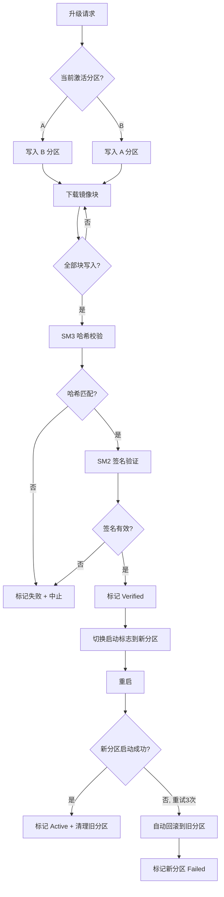

# EnerOS v0.123.0 A/B 分区升级 设计文档

> 蓝图：`蓝图/phase2.md` §v0.123.0（P2-K OTA 与 Recovery 第 1 版）。
> 实现：[`crates/security/ota-ab/`](../../crates/security/ota-ab/src/lib.rs)（`eneros-ota-ab`，no_std + alloc，依赖 eneros-crypto / eneros-storage / heapless）。
> 上游：v0.113.0 Secure Boot（镜像签名验证同链）、v0.23.0 存储驱动（`BlockDevice` 分区读写）、v0.31.0 国密算法库（SM2/SM3）；下游：v0.124.0 Agent 热更新、v0.125.0 Recovery Mode、v0.126.0 VPP 出口（远程升级能力）。

---

## 1. 版本目标

**核心**：实现 A/B 双分区镜像级 OTA 升级机制，支持 SM2/SM3 签名校验、原子切换、失败自动回滚，确保升级过程零风险（蓝图 §1）。
**业务价值**：实现"零停机"固件升级——升级失败时自动回滚到上一可用版本，保障电力场景 7×24 不间断运行。
**Phase 定位**：P2-K OTA 与 Recovery 第 1 版。
**出口关联**：为 v0.126.0 VPP 出口提供远程升级能力；「activate(B) 后新镜像反复启动失败 → boot_health_check 连超 3 次 → 自动回滚旧版本 Active」为出口判定复演路径（INT2/RBK3）。

升级路径：`prepare_upgrade` 选非激活分区置 Writing → 下载侧按 `chunk_size` 分块 `write_chunk` 读-改-写落盘（写满置 Written）→ `verify` 从存储回读镜像做 SM3 增量哈希常时比对 + SM2 根公钥验签（双过置 Verified）→ `activate` 原子切换启动标志（新分区 Active、旧分区保留 Verified 备用）→ 重启后每次上电 `boot_health_check`，连续失败超 `max_boot_attempts=3` 自动 `rollback` 回旧版本；分区表经 `save_to_device`/`load_from_device` 持久化保留块（魔数 + CRC32），断电后上电恢复。

## 2. 前置依赖

- **前序**：v0.113.0 Secure Boot 全链（升级镜像签名验证同链，设备根公钥信任来源）；v0.23.0 存储驱动（`BlockDevice` trait + `MockBlockDevice` + `crc32`，分区读写与持久化校验基座，D4/D5）；v0.31.0 国密算法库（`Sm3Hasher`/`sm3_hash` SM3 哈希、`sm2_sign`/`sm2_verify`/`Sm2PublicKey`/`Sm2Signature` SM2 签名验签、`ct_eq` 常时比较、`CsRng` 测试随机源，D2）。
- **外部依赖**：heapless 0.8（定容字符串 `String<N>`：版本号 ≤32B、下载 URL ≤128B），无其他新增依赖（记忆 §5.5 禁重复造轮子）。
- **被依赖零改动**：eneros-crypto / eneros-storage 仅只读使用公开 API，零源码改动。
- **假设**：存储空间足够容纳两个完整镜像分区（蓝图 §2 假设前提：保留块 + 双分区，见 §4.4 布局）；集成层提供单调毫秒时间戳源并以 `now_ms` 参数传入（D1）；镜像签名由签名服务端以设备根私钥离线签发，私钥永不上设备。
- **阻塞**：无 Secure Boot 则升级镜像无法验证安全性（蓝图 §2 阻塞条件）——本版本复用 v0.113.0 同链 SM2 根公钥验签规避。

## 3. 交付物清单

| 类型 | 路径 | 说明 |
|------|------|------|
| 代码 | [`crates/security/ota-ab/src/lib.rs`](../../crates/security/ota-ab/src/lib.rs) | crate 入口：`#![cfg_attr(not(test), no_std)]` + `extern crate alloc`；模块声明与重导出；D1~D5 偏差声明 |
| 代码 | [`crates/security/ota-ab/src/ab_partition.rs`](../../crates/security/ota-ab/src/ab_partition.rs) | `PartitionSlot`（A/B）/ `PartitionState`（七态）/ `Partition`（九字段）/ `AbPartitionOta<D: BlockDevice>`（D4：prepare/write_chunk 读-改-写落盘/verify SM3+SM2 双验证/activate 原子切换）+ 槽位布局常量 |
| 代码 | [`crates/security/ota-ab/src/upgrade.rs`](../../crates/security/ota-ab/src/upgrade.rs) | `OtaError`（8 变体）/ `UpgradeMeta`（八字段）/ `OtaManager` trait（蓝图 §4.2 七方法） |
| 代码 | [`crates/security/ota-ab/src/rollback.rs`](../../crates/security/ota-ab/src/rollback.rs) | `rollback`（回滚决策）+ `boot_health_check`（启动健康检查，D1）+ `PartitionTable` 定长序列化（魔数 "EOTA" + CRC32，D5）+ `save_to_device`/`load_from_device`（断电恢复，失败回退安全默认） |
| 测试 | src 内嵌 `#[cfg(test)]` | 15 个：PRT1~3 + UPG4~8 + RBK1~4 + PST5~7 |
| 测试 | [`crates/security/ota-ab/tests/ota_integration.rs`](../../crates/security/ota-ab/tests/ota_integration.rs) | 5 个：INT1（★ 完整升级流程 + 持久化 + 模拟重启）+ INT2（★ 出口判定复演）+ INT3（故障注入·写入中断）+ INT4（篡改拒绝）+ PERF5（性能基准，host std 环境） |
| 配置 | [`configs/ota.toml`](../../configs/ota.toml) | `[partition]` / `[upgrade]` / `[security]` 三节模板 + 中文注释 |
| 文档 | `docs/security/ota-ab-design.md`（本文） | 10 章节 + 1 Mermaid + 1 ASCII 分区布局图 |

## 4. 详细设计

### 4.1 数据结构

```rust
pub enum PartitionSlot { A, B }                                   // 分区标识
pub enum PartitionState {                                         // 七态状态机
    Empty, Writing, Written, Verified, Active, Failed, Rolling,   // Rolling 为瞬时中间态语义（不落盘）
}
pub struct Partition {                                            // 蓝图 §4.1 九字段
    pub slot: PartitionSlot,
    pub state: PartitionState,
    pub version: HString<32>,       // 镜像版本 ≤32B
    pub size: u64,                  // 镜像大小（字节）
    pub hash: [u8; 32],             // SM3 哈希
    pub signature: [u8; 64],        // SM2 签名（r ‖ s）
    pub boot_count: u32,            // 启动计数
    pub last_boot_ms: u64,          // 最后启动时间（D1 参数注入）
}
pub struct UpgradeMeta {                                          // 蓝图 §4.1
    pub target_version: HString<32>, pub image_size: u64,
    pub image_hash: [u8; 32], pub image_sig: [u8; 64],
    pub download_url: HString<128>,
    pub chunk_size: u32, pub total_chunks: u32, pub downloaded_chunks: u32,
}
pub struct AbPartitionOta<D: BlockDevice> {                       // D4：泛型化后端存储
    partitions: [Partition; 2], active_slot: PartitionSlot,
    boot_attempts: u32, max_boot_attempts: u32,                   // 默认 3
    root_key: Sm2PublicKey, device: D, pending: Option<UpgradeMeta>,
}
```

### 4.2 接口定义

```rust
pub trait OtaManager {                                            // 蓝图 §4.2 七方法
    fn prepare_upgrade(&mut self, meta: UpgradeMeta) -> Result<PartitionSlot, OtaError>; // 选非激活分区置 Writing + 回填元数据
    fn write_chunk(&mut self, slot: PartitionSlot, offset: u64, data: &[u8]) -> Result<(), OtaError>; // 仅 Writing；读-改-写落盘；写满置 Written
    fn verify(&mut self, slot: PartitionSlot) -> Result<bool, OtaError>;  // 回读 SM3 比对 + SM2 验签；双过置 Verified
    fn activate(&mut self, slot: PartitionSlot) -> Result<(), OtaError>;  // 仅 Verified；新 Active/旧 Verified 备用/boot_attempts 清零
    fn rollback(&mut self) -> Result<PartitionSlot, OtaError>;            // 目标须 Verified；当前 Failed/目标 Active
    fn get_active_slot(&self) -> PartitionSlot;
    fn get_partitions(&self) -> [Partition; 2];
}
impl<D: BlockDevice> AbPartitionOta<D> {
    pub fn new(device: D, root_key: Sm2PublicKey, now_ms: u64) -> Self;   // D1/D2：A Active(v0.0.0)/B Empty
    pub fn device(&self) -> &D;                                           // 持久化等只读场景借出
}
pub fn boot_health_check<D: BlockDevice>(ota: &mut AbPartitionOta<D>, now_ms: u64) -> bool; // 超 max_boot_attempts 自动回滚返回 false
pub fn save_to_device<D: BlockDevice>(ota: &mut AbPartitionOta<D>) -> Result<(), OtaError>; // D5：写保留块
pub fn load_from_device<D: BlockDevice>(ota: &mut AbPartitionOta<D>, now_ms: u64) -> Result<bool, OtaError>; // Ok(false)=回退安全默认
```

### 4.3 升级流程（蓝图 §4.3 对齐）



实现口径（INT1 复演路径）：`prepare_upgrade` 按 `active_slot` 选非激活分区（首步"当前激活分区?"分支）→ 下载侧循环 `write_chunk`（"下载镜像块/全部块写入?"循环，读-改-写整块语义落盘）→ `verify` 先 `Sm3Hasher` 增量哈希回读比对（不匹配置 Failed + HashMismatch）再 `sm2_verify` 根公钥验签（无效置 Failed + SignatureInvalid）→ `activate` 切换启动标志 → 重启后 `boot_health_check` 判定"新分区启动成功?"（否且重试 3 次 → `rollback` 自动回滚 + 新分区 Failed）。蓝图中"标记 Active + 清理旧分区"在实现中由 activate 一步完成 Active 切换，旧分区保留 Verified 作回滚备用（不立即清理，直至下一次升级被 prepare 覆写）。

### 4.4 A/B 分区布局图（验收 §7.4）

```text
块地址（LBA）        内容                                  说明
────────────────────────────────────────────────────────────────────────────
0                   ┌──────────────────────────┐
                    │ 保留块 META_BLOCK = 0     │ PartitionTable 持久化（D5）：
                    │ （分区表，定长 307B）      │ 魔数 "EOTA"(4B) + active_slot(1B)
                    │                          │ + 双分区全字段(2×151B) + CRC32(4B)
1                   ├──────────────────────────┤
                    │ 槽位 A                    │ 出厂默认 Active（v0.0.0）；
   SLOT_A_BASE = 1  │ PARTITION_BLOCKS = 2048 块 │ 升级后转 Verified 作回滚备用
                    │                          │
1 + 2048 = 2049     ├──────────────────────────┤
                    │ 槽位 B                    │ 首个 OTA 写入槽位：
   SLOT_B_BASE      │ PARTITION_BLOCKS = 2048 块 │ Writing→Written→Verified→Active
    = 2049          │                          │
1 + 2×2048 = 4097   └──────────────────────────┘
────────────────────────────────────────────────────────────────────────────
启动标志：active_slot ∈ {A, B} 存于保留块分区表（非独立寄存器），activate 后
          经 save_to_device 落盘，重启由 load_from_device 恢复（INT1 复演）。
分区容量 = PARTITION_BLOCKS × block_size：512B 块 → 1 MiB；4 KiB 块 → 8 MiB；
          8 KiB 块 → 16 MiB（集成测试 10 MiB 镜像即用 8 KiB 块口径）。
设备总占用 = 1 保留块 + 2 × 2048 块 = 4097 块。
```

### 4.5 分区表持久化格式（D5）

`PartitionTable` 定长序列化 307B 布局（`TABLE_LEN`）：

| 偏移 | 长度 | 字段 |
|------|------|------|
| 0 | 4B | 魔数 `"EOTA"` |
| 4 | 1B | active_slot（0=A，1=B） |
| 5 | 151B | 分区 A：slot 1B + state 1B + version_len 1B + version 32B + size 8B(BE) + hash 32B + signature 64B + boot_count 4B(BE) + last_boot_ms 8B(BE) |
| 156 | 151B | 分区 B（同布局） |
| 307−4 | 4B | CRC32(BE)，覆盖前 303B（eneros-storage `crc32`） |

`save_to_device` 快照双分区全字段写入保留块（块 0）；`load_from_device` 校验魔数 + CRC32，任一失败回退安全默认（A Active v0.0.0 / B Empty）并返回 `Ok(false)`——单块掉电撕裂或恶意篡改不会导致误启动（PST6/INT1 验证）。

### 4.6 错误处理

`OtaError` 八变体（蓝图 §4.4）：`NoFreeSlot` / `HashMismatch`（SM3 回读比对失败，分区置 Failed）/ `SignatureInvalid`（SM2 验签失败，分区置 Failed）/ `WriteFailed { offset }`（非 Writing 态写入或后端 I/O 失败，携带分区偏移）/ `VerifyFailed`（状态不允许验证/激活，或保留块 I/O 失败）/ `NoActiveSlot`（回滚目标非 Verified）/ `BootFailed` / `ChunkCorrupted { index }`。状态机保护：非 Writing 拒写、非 Written 拒验、非 Verified 拒激活（UPG5/UPG8/INT3）。

## 5. 技术交底

### 5.1 选型对比表（蓝图 §5.1）

| 方案 | 回滚 | 停机 | 复杂度 | 结论 |
|------|------|------|--------|------|
| A/B 分区 | 自动 | 零 | 中 | ⭐ 采用 |
| 单分区覆盖 | 无 | 有 | 低 | 风险高（写坏即变砖，电力场景不可接受） |
| 增量升级 | 有 | 低 | 高 | 校验复杂（差分链任一损坏全链失效，留作可扩展方向） |
| 容器化 | 自动 | 零 | 高 | 资源不足（RTOS 控制大区 ≤32MB，无容器运行时预算） |

### 5.2 关键技术

- **A/B 双分区**：始终保留一个可用备份——写入/验证全部发生在非激活分区，当前系统零影响（零停机）。
- **SM3 哈希 + SM2 签名双重验证**（D2）：`verify` 先从存储回读镜像经 `Sm3Hasher` 增量计算与 `image_hash` 常时比对（`ct_eq`），再经 `sm2_verify` 以设备根公钥验签；任一失败置 Failed 并拒绝激活，篡改镜像不可启动（INT4）。
- **原子切换**：`activate` 仅在 Verified 态一次性翻转 `active_slot` 与双分区状态（新 Active/旧 Verified），无中间不一致窗口；切换结果随分区表持久化保留块，重启即生效。
- **启动健康检查**：`boot_health_check` 每次上电累加 `boot_attempts`/`boot_count`，超过 `max_boot_attempts=3` 自动回滚旧版本（出口判定，INT2/RBK3）。
- **断电恢复**（D5）：分区表定长序列化 + 魔数 + CRC32 持久化保留块；写入中断的重试由状态机保证（Writing 态可直接重新 prepare，INT3）。

### 5.3 实现路径

1. 定义分区数据结构（§4.1 七态状态机 + 九字段 Partition）。
2. 实现升级流程（下载→写入→验证→激活，§4.3）。
3. 实现回滚机制（启动失败检测→切换，`rollback` + `boot_health_check`）。
4. 实现启动健康检查与分区表持久化（§4.5，D5 补蓝图未给接口的最小实现）。

### 5.4 难点

- **断电恢复一致性**：升级过程中断电需能恢复到一致状态——本版本以"状态机幂等 + 分区表 CRC 保护"交付：Writing 中断的残缺镜像停留在非激活分区（不可激活、不影响当前系统），重新 prepare 全量重传即可；分区表单块 307B 写入 + CRC32 校验，撕裂/篡改回退安全默认（详见 §8）。
- **存储空间**：两个完整镜像占用双倍空间——槽位布局固定 2048 块/分区，容量随块大小缩放（§4.4），集成层按最大镜像尺寸选型块大小/介质。
- **启动判定**：如何判断"启动成功"——本 crate 提供计数与回滚机制，判定输入由集成层结合看门狗（v0.13.0）+ 应用心跳给出（蓝图 §5.4，`configs/ota.toml` ⑨）。

### 5.5 交互与国产化

- **上游**：v0.113.0 Secure Boot（签名验证同链，根公钥信任来源）、v0.23.0 存储（`BlockDevice` 读写 + `crc32`）、v0.31.0 国密库（SM2/SM3/`ct_eq`）。
- **下游**：v0.124.0 Agent 热更新（细粒度更新复用本分区机制）、v0.125.0 Recovery Mode（回滚失败的兜底恢复）、v0.126.0 VPP 出口（远程升级能力）。
- **国产化**：SM2/SM3 国密签名验证（蓝图 §5.6），信创合规链一环。

## 6. 测试计划（20 个）

| 编号 | 名称 | 断言要点 | 结果 |
|------|------|---------|------|
| PRT1 | 初始状态 | A Active(v0.0.0)/B Empty/active_slot=A/max_boot_attempts=3/last_boot_ms 注入 | ✅ |
| PRT2 | 非激活槽位切换 | active_slot A→B 时 get_inactive_slot 随之 B→A | ✅ |
| PRT3 | prepare 回填 | 元数据字段回填 + Writing + downloaded_chunks 归零 + A 不受影响 | ✅ |
| UPG4 | 完整状态机 | Writing→Written→Verified→Active；旧分区 Verified 备用；boot_attempts 清零 | ✅ |
| UPG5 | 非 Writing 写拒绝 | Err(WriteFailed{offset})，状态不变 | ✅ |
| UPG6 | 哈希不匹配 | Err(HashMismatch) + 分区 Failed | ✅ |
| UPG7 | 签名篡改 | Err(SignatureInvalid) + 分区 Failed | ✅ |
| UPG8 | 未 Verified 激活拒绝 | Written/Empty 态 activate 均 Err(VerifyFailed) | ✅ |
| RBK1 | 回滚成功路径 | 新分区 Failed/旧分区 Active/active_slot 切换/boot_attempts 清零 | ✅ |
| RBK2 | 目标非 Verified 拒绝 | Err(NoActiveSlot)，状态不变 | ✅ |
| RBK3 | ★ 出口判定复演 | activate 后 boot_health_check 连超 3 次自动回滚：B Failed/A Active/返回 false | ✅ |
| RBK4 | 回滚计数清零 | rollback 后 boot_attempts=0 | ✅ |
| PST5 | 序列化往返 | 双分区全字段逐字段一致 | ✅ |
| PST6 | 篡改回退默认 | 篡改任一字节/魔数 → CRC 不匹配 → 安全默认 A Active | ✅ |
| PST7 | 设备持久化往返 | save → 弄脏内存态 → load 恢复逐字段一致 | ✅ |
| INT1 | ★ 完整升级流程 | 10MB 真实签名镜像 prepare→分块写→verify→activate→持久化→模拟重启 load→新分区 Active 且元数据完整 + 保留块魔数 + 首/尾块字节一致 | ✅ |
| INT2 | ★ 出口判定复演 | activate(B) 后模拟启动失败连超 3 次 → 自动回滚 B Failed/A(0.0.0) Active/active_slot=A/返回 false | ✅ |
| INT3 | 故障注入·写入中断 | 写 2/4 块停留 Writing → verify/activate 拒绝 VerifyFailed → 重新 prepare 重试成功完成升级 | ✅ |
| INT4 | 篡改拒绝 | ① 签名替换一字节 → SignatureInvalid + Failed；② 写入数据与 image_hash 不符 → HashMismatch + Failed | ✅ |
| PERF5 | 性能基准 | 10MB write_chunk(160×64KiB)+verify 端到端打印；ENEROS_PERF_GATE=1 硬断言 <30s | ✅ |

GPU 规则（记忆 user rules）：不涉及 GPU（纯分区管理与国密验签，无模型训练/推理）。故障注入（蓝图 §6.5）：INT3 写入中断 + INT4 签名/数据篡改 + PST6 分区表篡改全覆盖。回归（蓝图 §6.4）：UPG6/UPG7/INT4 复用 v0.113.0 同链 SM2 验签真实拒绝路径，兼容 Secure Boot 签名验证口径。

## 7. 验收标准

- **功能（蓝图 §7.1）**：A/B 分区可切换（UPG4/INT1：activate 原子翻转 active_slot，重启后经保留块恢复）；升级失败自动回滚（RBK3/INT2：连超 3 次启动失败自动切回旧版本 Active）。
- **性能量化（蓝图 §6.3/§7.2「10MB 镜像升级 < 30s」）**：默认仅打印耗时；`ENEROS_PERF_GATE=1`（`var(...).as_deref() == Ok("1")`，v0.113.0~v0.122.0 口径）时启用断言门禁。实测大幅优于目标（见下），主机即可达标。
- **安全（蓝图 §7.3）**：镜像签名验证通过（UPG4/INT1 正样本真实 SM2 验签放行）；篡改镜像被拒绝（UPG6/UPG7/INT4：哈希篡改 HashMismatch、签名篡改 SignatureInvalid，分区均置 Failed）；哈希比对常时（`ct_eq`）；私钥不上设备。
- **no_std（蓝图 §43.1）**：`#![cfg_attr(not(test), no_std)]` + `extern crate alloc`；非测试代码无 `std::*`/`panic!`/`todo!`/`unimplemented!`/`unwrap()`；时间戳经 `now_ms` 参数注入（D1）；`aarch64-unknown-none` 交叉编译由 Task 5 全量校验覆盖。
- **文档（蓝图 §7.4）**：本文档 10 章节 + 1 Mermaid（§4.3 升级流程）+ 1 ASCII A/B 分区布局图（§4.4：保留元数据块/槽位 A/B 基址/启动标志）。
- **出口判定（蓝图 §7.5）**：升级失败自动回滚验证通过——RBK3/INT2 复演连超 3 次启动失败自动回滚旧版本 Active（20 测试全过）。

> **性能实测**（2026-07-22，主机 x86_64，`cargo test -p eneros-ota-ab [--release]`）：
> - **release**：10MB 镜像 write_chunk(160×64KiB)+verify 端到端 ≈ **205.26ms**；
> - **debug**：同口径 ≈ **289.41ms**。
> 两口径均远优于蓝图目标（< 30s，快约 100 倍以上）；MockBlockDevice 内存后端无真实介质写延迟，目标硬件（eMMC/NVMe）受介质带宽影响仍余量充足；`ENEROS_PERF_GATE=1` 门禁保留，面向性能 CI 回归防退化。计时口径：首个 write_chunk 起至 verify 返回止（镜像生成/签名/prepare 为前置准备不计时）。

## 8. 风险与注意事项

- **技术**：断电恢复一致性（蓝图 §8.1）——分三层保证：① Writing 中断：残缺镜像停留非激活分区，状态机拒绝 verify/activate（INT3），重新 prepare 全量重传，当前 Active 分区运行零影响；② 分区表撕裂/篡改：单块 307B 写入 + 魔数 + CRC32 校验，失败回退安全默认 A Active（PST6/INT1），不会误启动坏镜像；③ activate 后断电：切换结果先于重启落盘（save_to_device），上电 load_from_device 恢复新 Active 或回滚后状态，boot_health_check 继续计数。
- **依赖**：v0.113.0 签名验证（蓝图 §8.2）——复用同链 SM2 根公钥验签（D2），根公钥错配/轮换须走 Secure Boot 密钥轮换流程（`configs/ota.toml` ⑪）；eneros-storage `BlockDevice` 读-改-写整块语义为写盘正确性前提（非对齐分块由 write_bytes 内部补齐）。
- **资源**：双倍存储空间（蓝图 §8.3）——固定 4097 块布局（保留块 + 2×2048 块），单分区容量随块大小缩放（512B→1MiB / 4KiB→8MiB / 8KiB→16MiB），集成层按最大镜像选型；写/读缓冲各 1 块 + 分块下载缓冲 64 KiB，在 Agent Runtime ≤ 64 MB 预算内（记忆 §5.6）。
- **兼容**：旧版本镜像格式兼容（蓝图 §8.4）——分区表 307B 定长布局为跨版本存证口径，魔数 "EOTA" + CRC32 双闸门，未来扩展须在保留块内追加字段并同步升级 load 兼容逻辑；镜像格式本身由 Secure Boot 版本链约束。
- **坑点**：启动健康检查误判导致频繁回滚（蓝图 §8.5）——"启动成功"判定输入由集成层看门狗 + 应用心跳综合给出（`configs/ota.toml` ⑨），max_boot_attempts=3 为蓝图默认，调小放大误判、调大延长故障发现；回滚目标必须保留 Verified 备用分区，activate 后不得立即覆写旧分区（§4.3 实现口径）。

## 9. 多角度要求

- **功能**：A/B 分区 + 签名验证 + 自动回滚（`OtaManager` 七方法 + `boot_health_check` + 分区表持久化）。
- **性能**：10MB 镜像升级 < 30s（§7 实测 release 205.26ms 大幅达标；ENEROS_PERF_GATE 门禁口径）。
- **安全**：SM2/SM3 双重验证（真实验签非 stub，D2）+ 常时比较 + 篡改拒绝 + 签名强制不可关闭（`configs/ota.toml` ⑫）。
- **可靠**：零停机 + 自动回滚（旧分区 Verified 备用）+ 断电恢复一致性三层保证（§8）+ CRC 保护分区表。
- **可维护**：分区状态可查询（`get_active_slot`/`get_partitions` 快照 + Failed 版本留痕，INT2）+ 槽位布局/持久化格式文档化（§4.4/§4.5）+ 三节配置模板。
- **可观测**：升级进度指标（`UpgradeMeta.downloaded_chunks`/`total_chunks` 进度计数 + `boot_count`/`last_boot_ms` 启动留痕），供 v0.120.0 指标支柱采集。
- **可扩展**：支持增量升级（蓝图 §9：当前镜像级全量升级为基线，差分升级可在 `write_chunk` 分块语义上叠加，见 §5.1 选型表预留）。

## 10. 实现偏差（D1~D5，相对蓝图 §3/§4）

| 编号 | 偏差 | 理由 |
|------|------|------|
| **D1** | 蓝图 `crate::current_time_ms()` 系统时钟调用 → `now_ms: u64` 参数传入（`AbPartitionOta::new` / `boot_health_check` / `load_from_device`） | no_std 无系统时钟；时间戳源由集成层 RTC（v0.12.0）提供，可测试性更强（确定性时间）；与 v0.119.0~v0.122.0 口径一致 |
| **D2** | 蓝图 `verify_hash`/`verify_signature` 返回 `true` 的 stub → 真实 SM3 增量哈希（`Sm3Hasher` 回读比对 + `ct_eq` 常时比较）+ SM2 根公钥验签（`sm2_verify`）；`AbPartitionOta::new` 相应增加 `root_key: Sm2PublicKey` 与后端存储参数 | 蓝图 §7.3 安全验收"篡改镜像被拒绝"与 spec Requirement「真实哈希/签名验证（非 stub）」硬性要求；stub 无法检出篡改（UPG6/UPG7/INT4 真实拒绝路径验证） |
| **D3** | crate 落位由蓝图 `crates/ota/` 调整为 `crates/security/ota-ab/`，包名 `eneros-ota-ab` | 记忆 §2.3.1 仓库规范强制子系统归口（禁根目录 crate）；镜像签名验证/启动回滚属启动安全范畴，与 v0.113.0 Secure Boot 同链落位 security |
| **D4** | `AbPartitionOta` 泛型化后端存储 `<D: BlockDevice>`（v0.23.0 eneros-storage）；`write_chunk` 真实写盘（读-改-写整块语义）、`verify` 真实回读；测试用 `MockBlockDevice` | 蓝图关键代码"写入存储（简化）"为伪代码；真实落盘是断电恢复（§8）与回读校验（D2）的前提；泛型化使 host 测试与目标硬件（eMMC/NVMe）复用同一状态机 |
| **D5** | 断电恢复以 `PartitionTable` 定长序列化（307B：魔数 "EOTA" + active_slot + 双分区全字段 + CRC32）持久化保留块交付，补 `save_to_device`/`load_from_device` 接口 | 蓝图 §5.4 难点仅列"需能恢复"未给接口；补最小实现使升级状态跨断电一致（PST5~7/INT1 验证：往返一致、篡改回退安全默认） |

---

> 源码索引：[`lib.rs`](../../crates/security/ota-ab/src/lib.rs) / [`ab_partition.rs`](../../crates/security/ota-ab/src/ab_partition.rs) / [`upgrade.rs`](../../crates/security/ota-ab/src/upgrade.rs) / [`rollback.rs`](../../crates/security/ota-ab/src/rollback.rs) / [集成测试](../../crates/security/ota-ab/tests/ota_integration.rs) / [配置模板](../../configs/ota.toml)
