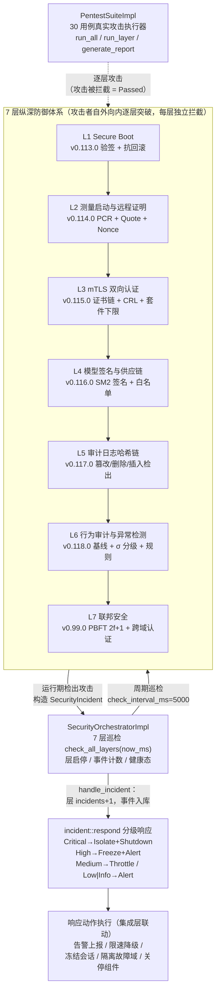
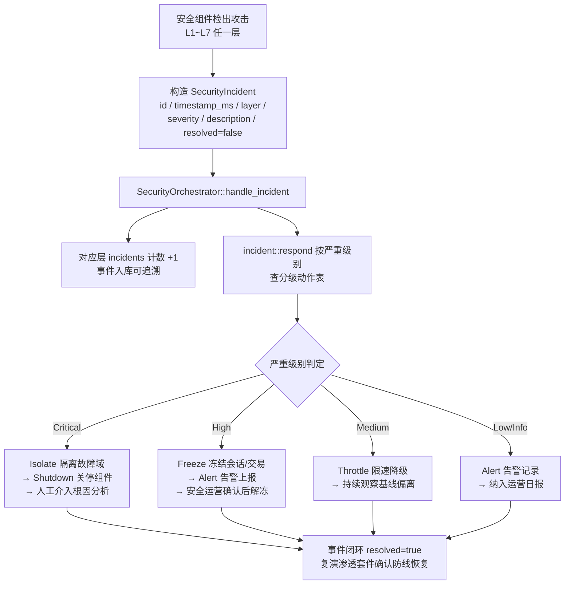

# EnerOS v0.119.0 纵深安全联调与渗透测试 设计文档

> 蓝图：`蓝图/phase2.md` §v0.119.0（P2-I 安全体系第 7 版 · 收官版）。
> 实现：[`crates/security/pentest/`](../../crates/security/pentest/src/lib.rs)（`eneros-pentest`，no_std + alloc，零 crates.io 外部依赖，全部为 workspace 内 path 依赖）。
> 上游：v0.113.0 Secure Boot / v0.114.0 远程证明 / v0.115.0 mTLS / v0.116.0 模型签名 / v0.117.0 审计哈希链 / v0.118.0 行为审计 / v0.99.0 联邦 PBFT；下游：Phase 2 出口判定（★ 渗透测试通过为必要条件）。

---

## 1. 文档信息

| 项 | 值 |
|----|----|
| 版本 | v0.119.0（P2-I 安全体系第 7 版 · 收官版） |
| 蓝图锚点 | `蓝图/phase2.md` §v0.119.0 |
| Spec | `.trae/specs/develop-v11900-pentest/spec.md` |
| 实现位置 | [`crates/security/pentest/src/`](../../crates/security/pentest/src/lib.rs)（新建 eneros-pentest crate，D1） |
| 配置模板 | [`configs/security_policy.toml`](../../configs/security_policy.toml)（`[orchestrator]`/`[response]`/`[pentest]` 三节） |
| 测试规模 | 17 项（src 内嵌 14 项 + tests 集成 3 项） |
| no_std | `#![cfg_attr(not(test), no_std)]` + alloc，零 unsafe，可交叉编译 `aarch64-unknown-none` |

交付物清单：

| 类型 | 路径 | 说明 |
|------|------|------|
| 代码 | [`src/lib.rs`](../../crates/security/pentest/src/lib.rs) | 公共类型：`PentestError`（5 变体）/ `SecurityLayer`（L1~L7）/ `LayerStatus` / `PentestCase` / `PentestSeverity` / `PentestStatus` / `SecurityIncident` / `ResponseAction`（5 动作）/ `PentestReport`（7 字段）+ 模块声明与重导出 |
| 代码 | [`src/federation.rs`](../../crates/security/pentest/src/federation.rs) | `SecurityOrchestrator` trait + `SecurityOrchestratorImpl`（7 层编排：巡检/启停/事件分发/层计数） |
| 代码 | [`src/incident.rs`](../../crates/security/pentest/src/incident.rs) | `respond(severity)` 分级响应映射（蓝图 §4.3） |
| 代码 | [`src/pentest.rs`](../../crates/security/pentest/src/pentest.rs) | `PentestSuite` trait + `PentestSuiteImpl`（1492 行，30 用例真实攻击执行器） |
| 测试 | src 内嵌 `#[cfg(test)]` | 14 项：ORC×5 + INC×3 + PT×6 |
| 测试 | [`tests/security_integration.rs`](../../crates/security/pentest/tests/security_integration.rs) | 3 项：INT15 + INT16 + PERF17（host std 环境） |
| 配置 | [`configs/security_policy.toml`](../../configs/security_policy.toml) | 7 层开关 / 巡检周期 / 分级动作映射 / 渗透通过条件 |
| 文档 | `docs/security/pentest-design.md`（本文，D5） | 12 章节 + 2 Mermaid |

## 2. 概述

**核心**：前序版本分别交付 7 层安全组件，本版将其统一编排并提供整体攻击面验证能力——`SecurityOrchestratorImpl` 管理 7 层状态巡检与安全事件分级响应联动，`PentestSuiteImpl` 以 30 项既定用例对 7 层组件执行真实攻击（篡改/伪造/重放/降级/越权/DoS/分区），断言每层防线正确拒绝（攻击被拦截 = 用例 Passed），最终生成出口判定报告（蓝图 §1/§7.4）。
**业务价值**：单层安全组件各自验证 ≠ 纵深体系有效；本版以自动化渗透套件复演攻击者视角全链路打击，证明 L1~L7 任一层被突破时仍有后续层拦截，满足等保 2.0 三级「入侵防范 + 安全审计」整体要求。
**Phase 定位**：P2-I 收官版，安全体系从「分层建设」闭环为「整体验证」。
**出口关联**：★ 渗透测试通过是 Phase 2 出口必要条件（蓝图 §7.3/§7.5）——30/30 Passed 且 0 Critical 发现 → `overall_pass=true`（INT16 复演）。

数据通路：攻击输入 → 各层组件真实公开 API → 拒绝/检出 → 用例 Passed；运行期检出 → `SecurityIncident` → `handle_incident` → 分级响应（Freeze/Isolate/...）+ 事件入库可追溯。

## 3. 架构

### 3.1 模块结构

```
eneros-pentest（crates/security/pentest/）
├── lib.rs         公共类型 + 模块声明与重导出（HString<N> 定容别名）
├── federation.rs  7 层安全编排器：heapless::Vec<LayerStatus, 7> + 事件历史 alloc::Vec
├── incident.rs    分级响应映射：severity → heapless::Vec<ResponseAction, 2>
└── pentest.rs     30 用例真实攻击执行器：cases/results + 分层攻击函数
```

### 3.2 7 层安全架构总览（蓝图 §7.4①）



编排器不复制各层检测逻辑，只统一承载「状态巡检 + 事件分发 + 计数追溯」；检测能力仍在各层组件内（单一职责，对被依赖 crate 零改动）。渗透套件离线复演攻击面，编排器在线承接运行期事件，二者共用同一套 `SecurityLayer`/`SecurityIncident`/`ResponseAction` 类型，形成「离线验证 + 在线联动」闭环。

## 4. 详细设计

### 4.1 安全编排器（[`federation.rs`](../../crates/security/pentest/src/federation.rs)）

- **存储模型**：层状态 `heapless::Vec<LayerStatus, 7>` 定容（层数恒定，无堆分配）；事件历史 `alloc::Vec<SecurityIncident>` 追加（可追溯审计要求，容量随事件增长）。
- **`new()`**：初始化 7 层（enabled=true / healthy=true / last_check_ms=0 / incidents=0），事件历史为空。
- **`check_all_layers(now_ms)`**：以传入 `now_ms` 更新各层 `last_check_ms` 并刷新健康态（enabled 层 healthy=true，disabled 层恒 false），返回全部层状态克隆列表（D3 外部时间注入）。
- **`set_enabled(layer, enabled)`**：启用/禁用单层；禁用立即置 unhealthy，用于分层维护/降级（对应配置 `[orchestrator]` 开关）。
- **`handle_incident(&incident)`**：对应层 `incidents` 饱和 +1 → 按 `incident::respond(severity)` 取首动作写入事件 `response_action` → 事件入库（可追溯）。
- **`layer_status(layer)`**：单层精确查询（未命中返回 `None`）。

### 4.2 分级响应（[`incident.rs`](../../crates/security/pentest/src/incident.rs)）

蓝图 §4.3 严重级别 → 响应动作映射，定容 `heapless::Vec<ResponseAction, 2>` 返回（最大集合 2 动作，溢出不可能）：

| 严重级别 | 响应动作集合 | 首动作（实际执行） |
|----------|--------------|--------------------|
| Critical | Isolate + Shutdown | Isolate |
| High | Freeze + Alert | Freeze |
| Medium | Throttle | Throttle |
| Low / Info | Alert | Alert |

### 4.3 30 用例真实攻击执行器（[`pentest.rs`](../../crates/security/pentest/src/pentest.rs)，D2）

- **`PentestSuiteImpl::new()`**：加载蓝图既定 30 项用例（id/name/layer/attack_vector/expected_result/severity，初始 Pending），分层计数 L1×4 / L2×3 / L3×5 / L4×4 / L5×4 / L6×5 / L7×5（跨层复合用例 25~30 归入对应目标层）。
- **执行模型**：`run_case(idx)` 状态机 Pending → Running → `execute_attack(id)` → Passed/Failed 入 `results` 流水；`run_all` 全量执行，`run_layer(layer)` 仅执行指定层。
- **真实攻击（非 stub，D2）**：每用例构造真实攻击输入调用对应组件**公开 API** 并断言拒绝——L1 篡改镜像/头部/回滚/后门 → `BootVerifier` 验签拒绝；L2 伪造 PCR/Quote 重放/事件日志篡改 → `AttestVerifier` + `SoftTpm` + `TcgEventLog` 检出；L3 MITM 篡改/自签证书/CRL 吊销/弱套件降级/侧信道 → `negotiate` + `CertManager` + `MtlsRecord` 拒绝；L4 未签名/篡改模型/泄露密钥/供应链后门 → `ModelSignatureVerifier` + `ModelWhitelist` 拒绝；L5 篡改/删除/插入/注入日志 → `ChainVerifier` 哈希链断裂检出；L6 高频/凌晨/越权/慢速/提权 → `StatAnomalyDetector` 告警检出；L7 共识伪造/身份伪造/越域/DoS/分区 → `ConsensusEngine` PBFT + 双向认证拒绝。用例 detail 记录「攻击 → 防御点 → 判定」。
- **报告（`generate_report`）**：统计 results 流水 → `PentestReport{total_cases, passed, failed, blocked, critical_findings, overall_pass, layers_covered}`；`overall_pass = failed==0 && blocked==0 && total_cases==30`（蓝图 §7.3 出口口径）。

### 4.4 no_std 与定容策略

公共类型全部定容：`HString<64>`（用例名）/ `HString<128>`（攻击向量/期望/错误原因）/ `HString<256>`（事件描述）；层状态定容 7；响应动作定容 2。仅事件历史与用例流水用 `alloc::Vec`（审计追溯语义要求可变长）。非测试代码零 `std::*`、零 `panic!`/`unwrap()`、零 unsafe，可交叉编译 `aarch64-unknown-none`。

## 5. 接口设计

```rust
// 编排器（federation.rs）
pub trait SecurityOrchestrator {
    fn check_all_layers(&mut self, now_ms: u64) -> Vec<LayerStatus>;
    fn handle_incident(&mut self, incident: &SecurityIncident);
    fn layer_status(&self, layer: SecurityLayer) -> Option<&LayerStatus>;
}
impl SecurityOrchestratorImpl {
    pub fn new() -> Self;
    pub fn set_enabled(&mut self, layer: SecurityLayer, enabled: bool);
    pub fn incident_count(&self) -> usize;
    pub fn incidents(&self) -> &[SecurityIncident];
}

// 分级响应（incident.rs）
pub fn respond(severity: PentestSeverity) -> heapless::Vec<ResponseAction, 2>;

// 渗透套件（pentest.rs）
pub trait PentestSuite {
    fn run_all(&mut self) -> Result<Vec<PentestCase>, PentestError>;
    fn run_layer(&mut self, layer: SecurityLayer) -> Result<Vec<PentestCase>, PentestError>;
    fn generate_report(&self) -> Result<PentestReport, PentestError>;
}
impl PentestSuiteImpl { pub fn new() -> Self; }
```

集成要点：集成层按 `configs/security_policy.toml [orchestrator]` 的 `check_interval_ms` 周期调用 `check_all_layers`；各层组件检出攻击后构造 `SecurityIncident` 交由 `handle_incident` 分级响应；渗透套件在发布前/CI 中执行 `run_all` + `generate_report` 复演出厂判定。

## 6. 渗透测试报告模板（蓝图 §7.4②）

`generate_report` 输出总报告：`total_cases=30 / passed=30 / failed=0 / blocked=0 / critical_findings=0 / layers_covered=7 / overall_pass=true`。30 用例结果明细（INT16 实测全部 Passed）：

| id | 名称 | 层 | 严重级 | 结果 |
|----|------|----|--------|------|
| 1 | 篡改内核镜像 | L1 | Critical | ✅ Passed |
| 2 | 篡改 Bootloader | L1 | Critical | ✅ Passed |
| 3 | 回滚旧版本镜像 | L1 | High | ✅ Passed |
| 4 | 伪造 PCR 度量值 | L2 | Critical | ✅ Passed |
| 5 | 远程证明重放 | L2 | High | ✅ Passed |
| 6 | TCG Event Log 篡改 | L2 | High | ✅ Passed |
| 7 | 中间人攻击 | L3 | Critical | ✅ Passed |
| 8 | 伪造客户端证书 | L3 | High | ✅ Passed |
| 9 | CRL 过期证书 | L3 | High | ✅ Passed |
| 10 | 降级攻击 | L3 | Medium | ✅ Passed |
| 11 | 加载未签名模型 | L4 | Critical | ✅ Passed |
| 12 | 篡改已签名模型 | L4 | Critical | ✅ Passed |
| 13 | 签名密钥泄露模拟 | L4 | High | ✅ Passed |
| 14 | 篡改审计日志 | L5 | High | ✅ Passed |
| 15 | 删除审计日志 | L5 | High | ✅ Passed |
| 16 | 插入伪造日志 | L5 | Medium | ✅ Passed |
| 17 | 高频请求攻击 | L6 | High | ✅ Passed |
| 18 | 非工作时段控制 | L6 | Medium | ✅ Passed |
| 19 | 越权访问检测 | L6 | High | ✅ Passed |
| 20 | 慢速攻击规避 | L6 | Medium | ✅ Passed |
| 21 | 共识协议攻击 | L7 | Critical | ✅ Passed |
| 22 | 联邦身份伪造 | L7 | High | ✅ Passed |
| 23 | 跨域数据窃取 | L7 | High | ✅ Passed |
| 24 | 拒绝服务攻击 | L7 | Medium | ✅ Passed |
| 25 | 持久化后门（跨层） | L1 | Critical | ✅ Passed |
| 26 | 侧信道攻击（跨层） | L3 | Medium | ✅ Passed |
| 27 | 供应链攻击（跨层） | L4 | Critical | ✅ Passed |
| 28 | 日志注入（跨层） | L5 | Low | ✅ Passed |
| 29 | 权限提升（跨层） | L6 | High | ✅ Passed |
| 30 | 联邦分区（跨层） | L7 | Medium | ✅ Passed |

**出口判定**：30/30 Passed 且 0 Critical 发现 → `overall_pass=true`（蓝图 §7.3/§7.5 ★ Phase 2 出口必要条件，INT16 复演通过）。

## 7. 安全事件响应手册（蓝图 §7.4③）

### 7.1 分级动作表（蓝图 §4.3）

| 严重级别 | 响应动作 | 处置语义 | 典型场景 |
|----------|----------|----------|----------|
| Critical | Isolate + Shutdown | 先隔离故障域防止横向扩散，再关停受影响组件 | 启动后门、镜像篡改、共识伪造 |
| High | Freeze + Alert | 先冻结相关会话/交易止损，再告警上报 | 审计篡改、越权访问、证书伪造 |
| Medium | Throttle | 限速/降级运行，观察态势 | 降级攻击、慢速攻击、DoS 洪水 |
| Low / Info | Alert | 仅告警上报记录 | 日志注入、提示性发现 |

### 7.2 处置流程



处置要点：① 首动作即实际执行动作（写入事件 `response_action` 入库）；② 事件历史 `incidents()` 全量可追溯，支撑事后审计与责任界定；③ 闭环后复演渗透套件对应层用例（`run_layer`），确认防线恢复有效。

## 8. 测试计划（17 项，全过）

src 内嵌 14 项（Task 2/3 交付）+ tests 集成 3 项（本版 Task 4）：

| 编号 | 位置 | 断言要点 | 结果 |
|------|------|---------|------|
| ORC1~ORC5 | federation.rs | 7 层初始化 / 巡检更新时间与健康 / disabled→unhealthy / 事件按层计数 / 单层精确查询 | ✅ |
| INC6~INC8 | incident.rs + federation.rs | 四级映射精确 / 事件入库可追溯（首动作入库）/ 多事件累计 | ✅ |
| PT9~PT14 | pentest.rs | 30 用例加载分层计数 / run_layer 只跑指定层 / 全通过→overall_pass / 注入必败用例→overall_pass=false 且 critical 计数 / 报告字段正确性 | ✅ |
| INT15 | tests/security_integration.rs | 7 层联调全流程：巡检 7 层 healthy → L5 真实攻击检出（篡改日志用例 Passed）→ High 事件 handle_incident（L5 计数 1、入库、respond==[Freeze,Alert]）→ Critical L1 事件（计数 1、[Isolate,Shutdown]）→ 复检 7 层计数保留 | ✅ |
| INT16 | tests/security_integration.rs | ★ 出口判定复演：run_all 30/30 Passed；报告 overall_pass=true / layers_covered=7 / critical_findings=0 / failed=0 / blocked=0 / total=30 | ✅ |
| PERF17 | tests/security_integration.rs | release 打印 check_all_layers 均值（预热后 1000 次）与 run_all 总耗时；`ENEROS_PERF_GATE=1` 断言 <5ms / <30min（蓝图 §6.2） | ✅ |

GPU 规则（蓝图 §6.6）：不涉及 GPU（纯 Rust 组件 API 调用，无模型训练/推理路径）。故障注入：INT15 注入篡改日志攻击与两档严重级事件；PT12 注入注定失败用例验证 critical 计数口径。回归：对被依赖 7 个 crate 零改动，其既有测试不受影响。

## 9. 性能

蓝图 §6.2 指标：编排器单次全层检查 < 5ms；全套渗透测试 < 30 分钟（目标硬件口径，主机实际为秒级）。门禁口径沿用 v0.113.0~v0.118.0 先例：debug/release 默认仅 `println!` 打印，`ENEROS_PERF_GATE=1`（`var(...).as_deref() == Ok("1")`，规避终端残留空串误激活）时启用断言，面向性能 CI / 目标硬件场景。

> **性能实测**（2026-07-21，主机 release，`opt-level=3 + lto`）：
>
> | 指标 | 实测值 | 蓝图门禁 | 余量 |
> |------|--------|---------|------|
> | `check_all_layers` 均值（预热 100 次后测 1000 次） | **24ns**（总 24µs） | < 5ms | ~20 万倍 |
> | `run_all` 30 用例总耗时 | **22.2s** | < 30min | ~81× |
>
> 编排器巡检主路径为 7 层定容 Vec 线性刷新 + 克隆收集，单次仅一次小堆分配，故稳定在纳秒级。run_all 耗时集中在各层组件真实密码学运算（SM2 验签/SM3 哈希/证书链构建），属用例有效性成本而非框架开销。

**内存预算声明**（记忆 §5.6）：编排器层状态 7 × `LayerStatus`（约 40B）≈ 300B 定容；事件历史随事件数增长（单条约 400B，千条 ≈ 400KB）；渗透套件 30 用例 + 流水 ≈ 60 × 500B ≈ 30KB。合计常驻 < 1MB，远在 Agent Runtime 分区 ≤ 64MB 预算内。

## 10. 风险与注意事项

- **技术**：渗透套件覆盖既定 30 用例，不能穷举全部攻击面 → 商用交付前补充第三方人工渗透（配置注释⑨双轨机制：自动化基线 + 人工增强，新发现固化为新增用例回归）。
- **依赖**：被依赖 7 crate 公开 API 演进会使攻击函数失配 → 本版对其零改动；API 变更时编译期即暴露（path 依赖强类型约束），同步修复攻击函数即可。
- **资源**：事件历史 `alloc::Vec` 无上限追加 → 集成层应定期归档/清理已闭环事件（编排器提供 `incidents()` 只读视图，归档策略由集成层实现）；30 用例密码学运算耗时 22s 级，CI 需预留执行窗口。
- **兼容**：编排器健康态为「启用即健康」口径（v0.119.0 各层无在线心跳接口），后续版本各层暴露健康探针后可扩展 `check_all_layers` 真实探测。
- **已知坑点**：① 主机不可测项（ROM 验签、TPM 硬件拒绝、ARP 欺骗链路、时序侧信道实测）以组件 API 级等价攻击输入映射（D6），目标硬件复测时需用真实固件/网络环境补充验证；② `check_all_layers` 返回克隆列表，高频调用产生小堆分配——实测 24ns 无压力，但集成层不宜在硬实时中断路径调用；③ 用例 detail/描述为定容 HString，超长静默截断（容量已按用例表留足余量）。

## 11. 实现偏差（D1~D6，相对蓝图）

| 编号 | 偏差 | 理由 |
|------|------|------|
| **D1** | crate 落位 `crates/security/pentest/`（蓝图未指明 crate 路径） | 记忆 §2.3.1 强制 crate 按子系统分组；`crates/security/` 已有 secure-boot/attestation/mtls/model-security/audit 先例，渗透测试属安全子系统 |
| **D2** | 蓝图渗透用例为描述级（可 stub 解读）→ 30 用例全部真实攻击执行：构造真实篡改/伪造/重放输入调用组件公开 API 并断言拒绝 | 蓝图 §7.5 出口判定要求「渗透测试通过」具备证据力；stub 无法证明防御生效（INT16 复演即依赖真实执行结果） |
| **D3** | `check_all_layers`/`SecurityIncident` 时间戳取系统时钟 → 外部注入 `now_ms`/`timestamp_ms` | no_std 无系统时钟；对齐 v0.113.0~v0.118.0 外部时间注入先例，测试可精确构造时序 |
| **D4** | 蓝图设想第三方渗透工具执行评估 → Rust 自动化渗透套件承载基线验证 + 配置注释⑨补充第三方人工渗透流程（基线报告 → 目标硬件人工渗透 → 新发现固化用例） | 自动化套件可复现、可 CI 化、随版本回归；第三方工具引入宿主依赖与许可证风险（记忆 §5.5 默认集成清单无对应项），人工渗透保留为商用前增强环节 |
| **D5** | 蓝图 §7.4 要求 3 份文档（架构总览/报告模板/响应手册）→ 三合一于本文（§3.2/§6/§7）；文档字符串类型 `String` → `heapless::String`（`HString<N>` 定容别名） | 三份交付物同属本版安全验证体系，单文档保证交叉引用一致性（记忆 §4.4 文档可用性）；no_std 禁 `std::string::String`，定容 heapless 对齐全项目口径 |
| **D6** | 主机不可测项映射：ROM 验签（用例 2）→ `BootVerifier` API 级篡改输入；TPM 硬件拒绝（用例 4）→ `SoftTpm` 非法操作拒绝；ARP 欺骗（用例 7）→ mTLS 握手篡改记录拒绝；时序侧信道（用例 26）→ 恒定时间实现属性验证 | 主机 CI 无真实 ROM/TPM/网络链路；等价映射保证防御点逻辑被真实触发，目标硬件复测时以真实环境补充验证（见 §10 已知坑点①） |

**实现细化（规格允许，非偏差）**：`run_case` 失败用例仍入 results 流水（报告可统计 failed）；`handle_incident` 分发以记录形式落地（首动作入库），无副作用外部调用，联动执行由集成层承接。

## 12. 参考资料

- 蓝图 `蓝图/phase2.md` §v0.119.0（版本目标/详细设计/测试计划/验收标准/风险/§7.4 三项文档交付物）。
- 上游设计文档：[behavior-audit-design.md](behavior-audit-design.md)（v0.118.0，L6 检测能力 + PERF 门禁先例）、[audit-chain-design.md](audit-chain-design.md)（v0.117.0，L5 哈希链 + 外部时间注入先例）、[mtls-design.md](mtls-design.md)（v0.115.0，L3 双向认证）。
- Spec：`.trae/specs/develop-v11900-pentest/spec.md`（Requirement 与 Scenario 定义）、`tasks.md`（Task 1~5 分解）。
- 配置模板：[`configs/security_policy.toml`](../../configs/security_policy.toml)（7 层开关/分级动作/通过条件 + 第三方人工渗透流程注释）。
- 等保 2.0 三级「入侵防范」「安全审计」要求（GB/T 22239-2019）。
- 记忆文件 §4.3（no_std 合规）/ §5.6（内存预算）/ §2.3.1（crate 分组）/ §2.3.3（文档分类）。
