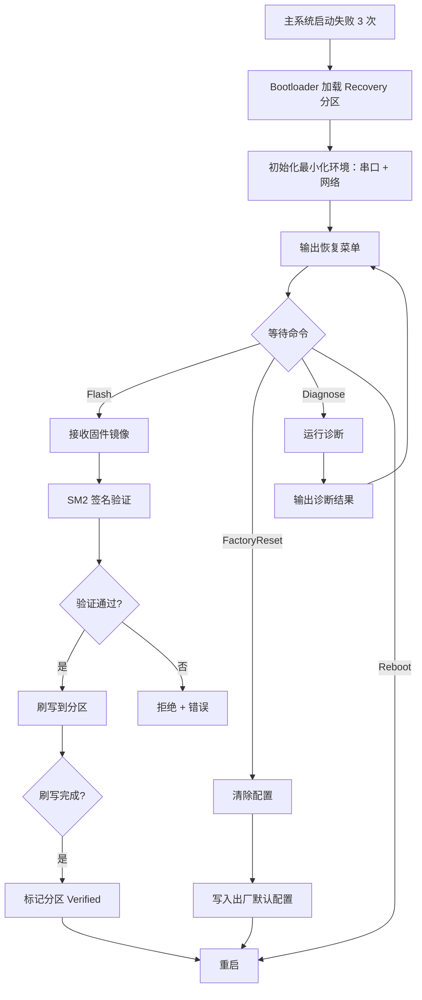

# EnerOS v0.125.0 Recovery Mode 最小化恢复内核 设计文档

> 蓝图：`蓝图/phase2.md` §v0.125.0（P2-K OTA 与 Recovery 第 3 版，v3.0 新增基础服务）。
> 实现：[`crates/security/recovery/`](../../crates/security/recovery/src/lib.rs)（`eneros-recovery`，no_std + alloc，依赖 eneros-crypto / eneros-storage / eneros-ota-ab / heapless）。
> 上游：v0.123.0 A/B 分区升级（恢复模式作为升级失败的后备，分区表真实查询同链）、v0.113.0 Secure Boot（设备根公钥信任来源）、v0.23.0 存储驱动（`BlockDevice` 刷写落盘基座）、v0.31.0 国密算法库（SM2/SM3）；下游：v0.126.0 VPP 出口（系统可恢复性保障）。

---

## 1. 版本目标

**核心**：实现最小化恢复内核（Recovery Mode），在主系统损坏无法启动时，通过串口/网络进入恢复模式，支持固件重刷（SM2 签名验证）、配置恢复出厂、系统诊断（蓝图 §1）。
**业务价值**：提供"最后一道防线"恢复能力，避免现场设备因软件故障变砖，降低运维成本。
**Phase 定位**：P2-K OTA 与 Recovery 第 3 版。
**出口关联**：为 v0.126.0 VPP 出口提供系统可恢复性保障；「B 分区 Failed 持久化 → 恢复模式 enter → diag 检出损坏 → flash 重刷固件 → reset 恢复出厂 → reboot」为出口判定复演路径（INT3）。

恢复路径：Bootloader 加载 Recovery 分区 → `enter` 置 Waiting → 集成方经串口/网络循环 `receive_chunk` 流式喂入镜像（Sm3Hasher 增量哈希随接收推进）→ `execute(Flash, [hash_hex, sig_hex, slot_base])` 一步完成 SM3 常时比对 + SM2 根公钥验签（未通过不触碰设备）+ 分块写盘（末块零填充）→ state=Complete 后 reboot 重启激活；`execute(FactoryReset)` 清除用户配置并写入出厂默认集；`execute(Diagnose)` 真实查询 ota-ab 分区表（D5）+ 探针字段（D7）输出诊断。

## 2. 前置依赖

- **前序**：v0.123.0 A/B 分区升级（恢复模式作为升级失败的后备；`PartitionTable::snapshot`/`save_to_device`/`load_from_device` 分区表真实查询与持久化同链，D5）；v0.113.0 Secure Boot（设备根公钥信任来源，验签口径一致）；v0.23.0 存储驱动（`BlockDevice` trait + `MockBlockDevice` + `crc32`，刷写落盘与备份校验基座）；v0.31.0 国密算法库（`Sm3Hasher`/`sm3_hash` SM3 哈希、`sm2_sign`/`sm2_verify`/`Sm2PublicKey`/`Sm2Signature` SM2 签名验签、`ct_eq` 常时比较、`CsRng` 测试随机源）；v0.7.0 HAL（串口/网口，集成层通道）；v0.24.0 文件系统（蓝图列为配置恢复依赖，本版本 D3 偏差为无文件系统假设，配置备份经会话内字节流缓存）。
- **外部依赖**：heapless 0.8（定容字符串 `String<128>`：错误描述/配置键值），无其他新增依赖（记忆 §5.5 禁重复造轮子）。
- **被依赖零改动**：eneros-crypto / eneros-storage / eneros-ota-ab 仅只读使用公开 API，零源码改动。
- **假设**：Bootloader 支持 Recovery 分区启动（蓝图 §2 假设前提）；串口/网络接收通道与输出通道由集成方提供（crate 不持有传输通道，D1/D8）；镜像签名由签名服务端以设备根私钥离线签发，私钥永不上设备。
- **阻塞**：无串口/网络则无法远程恢复（蓝图 §2 阻塞条件）——本 crate 以字符串返回菜单/结果，通道缺失属集成层部署约束。

## 3. 交付物清单

| 类型 | 路径 | 说明 |
|------|------|------|
| 代码 | [`crates/security/recovery/src/lib.rs`](../../crates/security/recovery/src/lib.rs) | crate 入口：`#![cfg_attr(not(test), no_std)]` + `extern crate alloc`；`RecoveryCommand`（七命令）/`RecoveryState`（六态）/`DiagResult`/`FlashProgress`/`RecoveryError`（八变体）数据模型；`parse_command`/`menu_text`；`RecoveryMode` trait（蓝图 §4.2 五方法）；`RecoveryModeImpl<D, P>` 三模块组装实现（D1~D8 偏差声明） |
| 代码 | [`crates/security/recovery/src/flash.rs`](../../crates/security/recovery/src/flash.rs) | `FlashWriter<D: BlockDevice>`：receive_chunk 流式接收（Sm3Hasher 增量，D3）/ finish_and_verify（ct_eq 哈希比对 + SM2 根公钥验签，D4）/ write_to_device（未验签拒绝；分块写末块零填充；FlashFailed{offset}）/ reset |
| 代码 | [`crates/security/recovery/src/factory_reset.rs`](../../crates/security/recovery/src/factory_reset.rs) | `FactoryReset`：heapless 定容 32 条键值集 + 出厂默认四项；clear/write_defaults/get/set（UTF-8 边界截断不 panic）；backup_configs（条目流 + CRC32 大端末尾 4B）/ restore_configs（先校验后落地，ConfigBackupFailed） |
| 代码 | [`crates/security/recovery/src/diag.rs`](../../crates/security/recovery/src/diag.rs) | `HealthProbe` trait + `DefaultProbe`（D7）；`Diagnostician`：set_partition_table（D5 真实查询 ota-ab）；健康语义 {Active,Verified,Written}→ok；boot_fail_count 饱和相加；last_error ≤128B 字符边界截断 |
| 测试 | src 内嵌 `#[cfg(test)]` | 32 个：CMD1~4 + MENU5 + FLS1~7 + RST1~6 + DIA1~5 + ASM1~9 |
| 测试 | [`crates/security/recovery/tests/recovery_integration.rs`](../../crates/security/recovery/tests/recovery_integration.rs) | 6 个：INT1（★ 损坏→恢复端到端）+ INT2（★ v0.123.0 兼容回归）+ INT3（★ 出口判定复演）+ INT4（故障注入）+ INT5（出厂恢复）+ PERF6（性能基准，host std 环境） |
| 配置 | [`configs/recovery.toml`](../../configs/recovery.toml) | `[flash]` / `[factory]` / `[diag]` 三节模板 + 中文注释 |
| 文档 | `docs/security/recovery-mode-design.md`（本文） | 10 章节 + 1 Mermaid + Recovery Mode 用户手册 + 刷写协议说明 |

## 4. 详细设计

### 4.1 数据结构

```rust
pub enum RecoveryCommand {                       // 七命令（蓝图 §4.1）
    Flash, FactoryReset, Diagnose, ListPartitions, Backup, Restore, Reboot,
}
pub enum RecoveryState {                         // 六态状态机
    Waiting, Flashing, Resetting, Diagnosing, Complete, Error,
}
pub struct DiagResult {                          // 蓝图 §4.1 七字段
    pub partition_a_ok: bool, pub partition_b_ok: bool,
    pub boot_fail_count: u32,                    // 双分区 boot_count 之和
    pub last_error: HString<128>,                // 首个非 ok 分区描述
    pub storage_ok: bool, pub network_ok: bool,  // D7 探针注入
    pub temperature: f32,
}
pub struct FlashProgress {                       // 蓝图 §4.1
    pub total_bytes: u64, pub flashed_bytes: u64,
    pub state: RecoveryState,
    pub error: Option<HString<128>>,             // 阶段:错误 描述（D1 字符串化）
}
pub enum RecoveryError {                         // 蓝图 §4.4 八变体
    FlashFailed { offset: u64 }, SignatureInvalid, StorageError, NetworkError,
    CommandUnknown, PartitionCorrupted, ConfigBackupFailed, Timeout,
}
pub struct RecoveryModeImpl<D: BlockDevice, P: HealthProbe = DefaultProbe> {
    state: RecoveryState, progress: FlashProgress,
    flash_writer: FlashWriter<D>,                // 流式接收 + 验签 + 写盘
    diagnostician: Diagnostician<P>,             // 探针 + ota-ab 分区表（D5/D7）
    factory_reset: FactoryReset,                 // 恢复出厂/备份/恢复
    last_backup: Option<Vec<u8>>,                // Backup 缓存（D3 无文件系统）
}
```

### 4.2 接口定义

```rust
pub trait RecoveryMode {                         // 蓝图 §4.2 五方法
    fn enter(&mut self) -> Result<(), RecoveryError>;            // 置 Waiting + 进度复位
    fn execute(&mut self, cmd: RecoveryCommand, args: &[&str]) -> Result<String, RecoveryError>;
    fn get_progress(&self) -> &FlashProgress;
    fn get_diag(&self) -> Result<DiagResult, RecoveryError>;
    fn exit(&mut self) -> Result<(), RecoveryError>;             // 置 Complete
}
impl<D: BlockDevice> RecoveryModeImpl<D, DefaultProbe> {
    pub fn new(device: D, root_key: Sm2PublicKey) -> Self;       // 常用构造（默认探针）
}
impl<D: BlockDevice, P: HealthProbe> RecoveryModeImpl<D, P> {
    pub fn with_probe(device: D, root_key: Sm2PublicKey, probe: P) -> Self; // 完整构造（D7）
    pub fn flash_writer_mut(&mut self) -> &mut FlashWriter<D>;   // 集成方喂镜像入口（D8）
    pub fn diagnostician_mut(&mut self) -> &mut Diagnostician<P>; // 注入分区表入口（D5）
    pub fn factory_reset_mut(&mut self) -> &mut FactoryReset;    // 配置读写入口
    pub fn state(&self) -> RecoveryState;
}
pub fn parse_command(input: &str) -> Option<(RecoveryCommand, Vec<&str>)>; // 七命令字面量解析
pub fn menu_text() -> String;                                    // D1：字符串返回，禁 println!
```

### 4.3 恢复流程（蓝图 §4.3 对齐）



实现口径（INT3 复演路径）：`enter` 置 Waiting（"初始化最小化环境"由集成方完成，菜单经 `menu_text()` 获取输出，D1）→ `execute(Diagnose)` 经 ota-ab 分区表真实查询输出诊断（"运行诊断/输出诊断结果"，D5）→ 集成方串口/网络循环 `receive_chunk` 接收镜像（"接收固件镜像"，D3/D8）→ `execute(Flash)` 先 `finish_and_verify` SM3 常时比对 + SM2 验签（"SM2 签名验证/验证通过?"，否 → 拒绝 + 错误记录 progress.error，不触碰设备）→ `write_to_device` 分块写盘（"刷写到分区"，末块零填充）→ state=Complete（"标记分区 Verified"语义由写盘完成承载，激活切换留待重启后 ota-ab `activate`）→ `execute(FactoryReset)` 清除配置 + 写入出厂默认 → `execute(Reboot)` 返回提示文本（实际重启由集成方执行）。

### 4.4 命令分派与状态迁移

| 命令 | 字面量 | 参数 | 状态迁移 | 返回文本 |
|------|--------|------|---------|---------|
| Flash | `flash` | `[hash_hex(64), sig_hex(128), slot_base(十进制)]` | Waiting→Flashing→Complete / Error | `Flash complete. Reboot to activate.` |
| FactoryReset | `reset` | 无 | →Resetting→Complete | `Factory reset complete.` |
| Diagnose | `diag` | 无 | →Diagnosing→Waiting | 七字段格式化文本（D1） |
| ListPartitions | `list` | 无 | 不变 | 真实分区表文本（D5） |
| Backup | `backup` | 无 | 不变 | `Backup complete. {n} bytes.` |
| Restore | `restore` | 无（D3：从 Backup 缓存还原） | 不变 | `Restore complete.` |
| Reboot | `reboot` | 无 | 不变 | `Rebooting...` |

参数校验先于状态迁移：Flash 参数数量不足 / hex 非法 / slot_base 非十进制均返回 `CommandUnknown` 且状态保持 Waiting（ASM2）。执行错误经 `record_error` 记录：状态机与进度置 Error，`progress.error` 写入 `"{stage}: {err:?}"`（stage ∈ verify/write，≤128B 截断，ASM9/INT4）。

### 4.5 错误处理

`RecoveryError` 八变体（蓝图 §4.4）：`FlashFailed { offset }`（写盘失败，offset 为失败块起始字节偏移）/ `SignatureInvalid`（SM3 哈希不符或 SM2 验签失败，设备零写入）/ `StorageError`（flush 失败）/ `NetworkError`（预留，集成层通道）/ `CommandUnknown`（未知命令/参数非法/无备份 Restore）/ `PartitionCorrupted`（预留）/ `ConfigBackupFailed`（备份流 CRC 不符/条目越界/超容量）/ `Timeout`（预留，超时判定由集成层执行）。安全不变量：验签未通过前禁止写盘（INT4① 设备零写入）。

## 5. 技术交底

### 5.1 选型对比表（蓝图 §5.1）

| 方案 | 恢复能力 | 资源 | 结论 |
|------|----------|------|------|
| 独立 Recovery 分区 | 强 | 中 | ⭐ 采用 |
| USB 恢复盘 | 强 | 低 | 需现场 |
| 网络启动（PXE） | 中 | 高 | 网络依赖 |
| JTAG 调试 | 极强 | 极高 | 专业设备 |

### 5.2 关键技术

- **最小化恢复内核**：仅串口、网络、存储驱动（蓝图 §5.2）；本 crate 进一步将传输通道外置集成方（D8），crate 本体零 I/O 依赖，no_std + alloc 可移植任意恢复环境。
- **SM2 签名验证**（蓝图 §5.2/§5.6 国产化）：恢复刷写的镜像也需验证——`finish_and_verify` 先 `ct_eq` 常时比对 SM3 哈希，再 `sm2_verify` 设备根公钥验签（对 SM3 哈希验签，与 v0.123.0 ab_partition.rs 同口径），任一失败不触碰设备。
- **出厂配置恢复**：清除用户配置，写入默认集（设备名/采样周期/上报周期/日志级别四项）；备份/恢复经 CRC32 保护的字节流，先校验后落地。
- **系统诊断**：分区状态、启动失败计数真实查询 ota-ab 分区表（D5）；硬件健康（存储/网络/温度）经探针注入（D7）。

### 5.3 Recovery Mode 用户手册（蓝图 §3 交付物：用户手册）

**进入条件**（蓝图 §4.3）：主系统启动失败 3 次（ota-ab `boot_health_check` 连超 `max_boot_attempts=3`）→ Bootloader 加载 Recovery 分区 → 集成方初始化串口/网络最小化环境 → 构造 `RecoveryModeImpl::new(device, root_key)` 并调用 `enter()`。

**七命令用法与输出示例**（经串口/网络逐行输入，`parse_command` 解析）：

```text
=== EnerOS Recovery Mode ===        ← menu_text() 输出（enter 后由集成方打印）
1. flash <image>  - 刷写固件
2. reset          - 恢复出厂配置
3. diag           - 系统诊断
4. list           - 列出分区
5. backup         - 备份配置
6. restore <file> - 恢复配置
7. reboot         - 重启
=============================

> diag                              ← execute(Diagnose)
partition A: ok
partition B: not ok
boot_fail_count: 4
storage: ok
network: ok
temperature: 25 C
last_error: partition B state=Failed version=0.125.0 size=65536 boot_count=4 ...

> list                              ← execute(ListPartitions)（D5 真实分区表）
A: Active version=0.0.0 boot_count=0
B: Failed version=0.125.0 boot_count=4

> flash <hash_hex> <sig_hex> 2049   ← execute(Flash)（镜像字节已流式喂入，见 §5.4）
Flash complete. Reboot to activate.

> reset                             ← execute(FactoryReset)
Factory reset complete.

> backup                            ← execute(Backup)
Backup complete. 67 bytes.

> restore                           ← execute(Restore)（D3：从 Backup 缓存还原）
Restore complete.

> reboot                            ← execute(Reboot)
Rebooting...
```

### 5.4 刷写协议说明（蓝图 §3 交付物：刷写协议）

流式分块接收 + SM3 增量哈希 + SM2 验签 + 分块写盘时序（D3/D4/D8）：

```text
集成方（串口/网络）                RecoveryModeImpl（crate）
        │                                    │
        │  enter()                           │  Waiting + 进度复位
        │───────────────────────────────────>│
        │                                    │
        │  receive_chunk(chunk[≤4KiB]) ×N    │  ① 流式分块接收：buffer 累积
        │───────────────────────────────────>│    + Sm3Hasher::update 增量哈希
        │  （configs/recovery.toml ④⑤：      │    + total_bytes 累计
        │   chunk_size=4096，上限 10MiB）     │
        │                                    │
        │  execute(Flash, [hash_hex,         │  ② SM3 常时比对：finalize 与
        │  sig_hex, slot_base])              │    expected_hash 经 ct_eq 比较
        │───────────────────────────────────>│    （不符 → SignatureInvalid，
        │                                    │     不触碰设备）
        │                                    │  ③ SM2 验签：sm2_verify(hash,
        │                                    │    sig, root_key)（无效 →
        │                                    │    SignatureInvalid，同上）
        │                                    │  ④ 分块写盘：write_block ×⌈len/
        │                                    │    block_size⌉（末块零填充；
        │                                    │    失败 → FlashFailed{offset}）
        │                                    │  ⑤ flush → Complete
        │  "Flash complete. Reboot to        │
        │<───────────────────────────────────│    activate."
        │  reboot                            │
```

时序要点：① 接收与哈希增量推进同步，任意分块边界/乱序重传（对同一镜像整体）结果一致（增量 SM3 ≡ 一次性 SM3，FLS1）；②③ 验签严格先于写盘，篡改镜像零落盘（INT4①）；④ 写盘按后端 `block_size()` 整块写入，末块不足零填充，offset 语义为失败块起始字节偏移（FLS6/INT4②）；⑤ 激活切换不在本协议内——重启后由 ota-ab `activate`/`boot_health_check` 接管（与 v0.123.0 职责边界一致）。

### 5.5 实现路径

1. 定义恢复命令与状态（蓝图 §5.3-1，§4.1 数据模型 + parse_command/menu_text）。
2. 实现固件刷写（接收→验证→写入，flash.rs）。
3. 实现出厂恢复（清除→写入默认，factory_reset.rs + CRC32 备份/恢复）。
4. 实现系统诊断（diag.rs，D5 分区表真实查询 + D7 探针注入）。
5. 串口/网络命令行交互外置集成方（D1/D8：crate 以字符串返回菜单/结果）。

### 5.6 难点

- **最小化内核大小**（蓝图 §5.4：精简到 < 1MB）——本 crate 三模块合计代码量小、零 I/O 依赖、no_std + alloc；恢复环境镜像尺寸由集成层链接时裁剪（LTO + 仅链接所需驱动），crate 本体不引入多余依赖。
- **网络驱动在恢复模式下的可用性**（蓝图 §5.4）——传输通道外置：crate 不感知网络/串口差异，接收循环由集成方按可用通道实现（D8），恢复环境仅网络可用或仅串口可用均可工作。
- **串口交互的可靠性**（蓝图 §5.4）——刷写协议以"完整镜像接收后统一验签"为口径（§5.4），传输层错误由 SM3 哈希比对兜底（任一字节错误 → 哈希不符拒绝），不依赖分块级 ACK；分块重传对同一镜像整体幂等。

### 5.7 交互与国产化

- **上游**：v0.123.0 A/B 分区升级（分区升级失败触发；分区表查询/持久化同链）、v0.7.0 HAL（串口/网口，集成层通道）、v0.113.0 Secure Boot（根公钥信任来源）、v0.23.0 存储（`BlockDevice` 落盘 + `crc32`）、v0.31.0 国密库（SM2/SM3/`ct_eq`）。
- **下游**：v0.126.0 VPP 出口（系统可恢复性保障，INT3 出口判定复演）。
- **国产化**：SM2 签名验证，算法自主（蓝图 §5.6），信创合规链一环。

## 6. 测试计划（38 个）

| 编号 | 名称 | 断言要点 | 结果 |
|------|------|---------|------|
| CMD1~4 | 命令解析 | 七命令字面量/带参/多余空白/未知与空输入 None | ✅ |
| MENU5 | 菜单文本 | 标题 + 七命令关键字齐全（D1 字符串返回） | ✅ |
| FLS1 | 分块哈希对拍 | 7 段非对齐切分增量哈希 == 一次性 SM3 | ✅ |
| FLS2 | 哈希不符 | SignatureInvalid，verified 保持 false | ✅ |
| FLS3 | 合法签名 | 根私钥签发验签通过 | ✅ |
| FLS4 | 非法签名零写入 | 非根私钥拒绝 + 写盘仍拒绝 + 设备全零 | ✅ |
| FLS5 | 回读逐字节一致 | 3 块流式喂入写盘后回读相等，末块填充为 0 | ✅ |
| FLS6 | 写失败注入 | FailAtBlockMock → FlashFailed{offset=2×512} | ✅ |
| FLS7 | reset 语义 | 清空缓冲/计数/验签标记，重收不串扰 | ✅ |
| RST1 | 清除+默认集 | 配置集等于出厂四项 | ✅ |
| RST2 | 备份恢复往返 | 备份→修改→恢复，集合逐条一致 | ✅ |
| RST3 | 备份损坏拒绝 | 数据区/CRC 区篡改 → ConfigBackupFailed | ✅ |
| RST4 | 非法流拒绝 | 过短流/key_len 越界 → ConfigBackupFailed | ✅ |
| RST5 | 截断与容量 | 超长键值截断 + 满 32 条忽略新键，不 panic | ✅ |
| RST6 | 先校验后落地 | 前半合法后半损坏 → 失败且原配置零污染 | ✅ |
| DIA1 | 默认探针无表 | 探针恒 ok + 双分区谨慎非 ok + unavailable | ✅ |
| DIA2 | 故障探针 | storage/network/temperature 三字段反映注入值 | ✅ |
| DIA3 | B Failed 查询 | A ok/B 非 ok/boot_fail_count 求和/错误含 B+Failed | ✅ |
| DIA4 | last_error 截断 | 描述 >128B 截断不 panic 且保留前缀 | ✅ |
| DIA5 | 全 ok 场景 | A Active + B Verified，last_error 为空 | ✅ |
| ASM1 | enter 复位 | Waiting + 进度清零无残留错误 | ✅ |
| ASM2 | Flash 参数校验 | 数量不足/hex 非法/slot_base 非十进制 → CommandUnknown 且状态不迁移 | ✅ |
| ASM3 | FactoryReset 命令 | 配置等于出厂集 + Complete | ✅ |
| ASM4 | Diagnose 命令 | 格式化文本含 A ok/B not ok/计数，回到 Waiting | ✅ |
| ASM5 | ListPartitions | 无表 unavailable；有表输出真实状态版本（D5） | ✅ |
| ASM6 | Backup→Restore | execute 全流程用户配置还原 | ✅ |
| ASM7 | 无备份 Restore | CommandUnknown；Reboot 提示文本 | ✅ |
| ASM8 | 刷写端到端+exit | receive+execute(Flash) Complete + 回读一致 + exit | ✅ |
| ASM9 | 验签失败记录 | state Error + progress.error 含 verify + 设备零写入 | ✅ |
| INT1 | ★ 损坏→恢复端到端 | OTA 篡改镜像置 B Failed 持久化 → 恢复会话 load 分区表 → Diagnose 检出 → receive+Flash Complete → 回读逐字节一致 | ✅ |
| INT2 | ★ v0.123.0 兼容回归 | 真实回滚分区表（boot_count=4）持久化读回 → DiagResult 逐字段一致 + ListPartitions 含真实状态版本 | ✅ |
| INT3 | ★ 出口判定复演 | 诊断→刷写→恢复出厂→重启全流程文本与状态正确 | ✅ |
| INT4 | 故障注入 | ① 非根私钥签名 → SignatureInvalid + 设备零写入；② 写失败 → FlashFailed{offset=1024} + error 含 write/FlashFailed | ✅ |
| INT5 | 出厂恢复 | set→backup→FactoryReset 等于出厂集→restore 用户配置还原 | ✅ |
| PERF6 | 性能基准 | 10MB 接收(2560×4KiB)+验签+写盘(1280×8KiB) ×3 轮打印均值；ENEROS_PERF_GATE=1 硬断言均值 <60s | ✅ |

GPU 规则（记忆 user rules）：不涉及 GPU（纯恢复流程与国密验签，无模型训练/推理，蓝图 §6.6）。故障注入（蓝图 §6.5）：INT4 签名无效拒绝 + 写盘失败错误报告 + FLS6/RST3/RST4 损坏流全覆盖。回归（蓝图 §6.4）：INT2 v0.123.0 分区状态兼容（真实分区表持久化读回逐字段一致）；INT4① 复用 Secure Boot 同链 SM2 验签真实拒绝路径。

## 7. 验收标准

- **功能（蓝图 §7.1）**：Recovery Mode 可经串口/网络进入（enter 置 Waiting + 菜单文本输出，INT3）；固件刷写、出厂恢复、诊断功能正常（INT1/INT3/INT5：刷写 Complete + 回读一致，出厂集四项还原，诊断真实分区查询）。
- **性能量化（蓝图 §6.3/§7.2「10MB 刷写 < 60s」）**：默认仅打印耗时；`ENEROS_PERF_GATE=1`（`var(...).as_deref() == Ok("1")`，v0.113.0~v0.123.0 口径）时启用均值 < 60s 断言门禁。实测大幅优于目标（见下），主机即可达标。「Recovery 启动 < 5s」属集成层启动流程指标（本 crate `new`/`enter` 为纯内存构造，耗时可忽略）。
- **安全（蓝图 §7.3）**：刷写镜像 SM2 签名验证（FLS3/INT1 正样本真实验签放行；FLS4/INT4① 非根私钥签名拒绝且设备零写入）；哈希比对常时（`ct_eq`）；私钥不上设备。
- **no_std（蓝图 §43.1）**：`#![cfg_attr(not(test), no_std)]` + `extern crate alloc`；非测试代码无 `std::*`/`panic!`/`todo!`/`unimplemented!`/`unwrap()`/`println!`（D1/D2）；`aarch64-unknown-none` 交叉编译由 Task 7 全量校验覆盖。
- **文档（蓝图 §7.4）**：本文档含 Recovery Mode 用户手册（§5.3 进入条件/七命令用法/输出示例）+ 刷写协议说明（§5.4 流式分块接收 + SM3 增量哈希 + SM2 验签 + 分块写盘时序）+ 1 Mermaid（§4.3 恢复流程）。
- **出口判定（蓝图 §7.5）**：系统损坏后可恢复验证通过——INT3 复演"诊断→刷写→恢复出厂→重启"全流程，INT1 端到端"损坏→恢复→回读一致"（38 测试全过）。

> **性能实测**（2026-07-22，主机 x86_64，`cargo test -p eneros-recovery [--release]`，PERF6 三轮均值）：
> - **release**：10MB 镜像接收(2560×4KiB)+验签+写盘(1280×8KiB) 三轮 209.74ms / 207.40ms / 206.40ms，均值 ≈ **207.85ms**；
> - **debug**：同口径三轮 427.74ms / 332.69ms / 287.16ms，均值 ≈ **349.20ms**。
> 两口径均远优于蓝图目标（均值 < 60s，快约 170 倍以上）；MockBlockDevice 内存后端无真实介质写延迟，目标硬件（eMMC/NVMe）受介质带宽影响仍余量充足；`ENEROS_PERF_GATE=1` 门禁保留，面向性能 CI 回归防退化。计时口径：首个 receive_chunk 起至 execute(Flash) 返回止（镜像生成/签名为前置准备不计时）。

## 8. 风险与注意事项

- **技术（蓝图 §8.1）**：Recovery 内核本身损坏 → 需硬件 JTAG 后备——本 crate 交付恢复逻辑，Recovery 分区镜像的签名与烧录由 Secure Boot（v0.113.0）同链保护，JTAG 兜底属硬件方案。
- **依赖（蓝图 §8.2）**：v0.7.0 HAL 驱动在恢复模式可用——串口/网络通道由集成层按恢复环境裁剪接入，crate 本体零 I/O 依赖（D8），HAL 不可用降级为仅串口交互不影响 crate 功能。
- **资源（蓝图 §8.3）**：Recovery 分区空间——crate 三模块代码量小 + 仅 4 项外部依赖（3 个内部 crate + heapless）；镜像接收缓冲 ≤ max_image_bytes=10MiB（alloc 堆，管理信息大区 ≤64MB 预算内，记忆 §5.6）。
- **兼容性（蓝图 §8.4）**：主系统版本与 Recovery 版本兼容——分区表格式复用 v0.123.0 定长 307B 布局（魔数 + CRC32），版本升级不改变布局；INT2 兼容回归锁定该口径。
- **已知坑点（蓝图 §8.5）**：恢复后配置丢失需重新配置——`execute(Backup)` 先于 `FactoryReset` 执行可保留配置（INT5 流程）；备份流仅存会话内（D3 无文件系统假设），需持久备份时由集成方导出字节流，进入恢复模式即应首先备份再操作。
- **刷写目标误选**：`slot_base` 参数由集成方传入，严禁指向当前 Active 槽位（恢复环境从该槽位运行，覆写即变砖）；`configs/recovery.toml` ⑦ 文档化该约束，建议固定写非激活槽位（2049）。

## 9. 多角度要求

- **功能（蓝图 §9）**：刷写 + 出厂恢复 + 诊断 + 配置备份——七命令全实现（ASM1~9/INT1~5）。
- **性能（蓝图 §9）**：启动 < 5s（集成层指标，crate 构造为纯内存操作），10MB < 60s（PERF6 实测均值 207.85ms release，大幅达标）。
- **安全（蓝图 §9）**：SM2 签名验证（真实验签，篡改零落盘，INT4）。
- **可靠（蓝图 §9）**：最小化内核，高可靠性——crate 零 I/O 依赖 + 状态机保护 + 错误记录可查询（progress.error）。
- **可维护（蓝图 §9）**：串口/网络双通道——传输通道外置集成方，菜单/结果字符串化（D1/D8），通道可替换。
- **可观测（蓝图 §9）**：诊断结果输出——DiagResult 七字段 + ListPartitions 真实分区表 + FlashProgress 进度/错误查询。
- **可扩展（蓝图 §9）**：支持更多恢复命令——`RecoveryCommand` 枚举 + `parse_command` 字面量表 + `execute` match 分派，新增命令三处定点扩展；`RecoveryError` 预留 NetworkError/PartitionCorrupted/Timeout 变体。

## 10. 蓝图偏差声明（D1~D8）

| 偏差 | 蓝图口径 | 实现口径 | 理由 |
|------|---------|---------|------|
| D1 | `println!` 直出菜单/诊断 | 菜单/结果以 `String` 返回（`menu_text()`/`format_diag`） | no_std 无 stdout；输出通道由集成方串口/网络决定 |
| D2 | execute 返回 `String`/`format!`（std） | `alloc::string::String` / `alloc::format!` | no_std 合规（蓝图 §43.1） |
| D3 | `receive_image(image_path)` 从文件路径读；`restore_configs(file)` | 流式 `receive_chunk` 字节接收；Restore 从会话内 Backup 缓存还原 | 恢复环境无文件系统假设；刷写目标为后端 `BlockDevice`（与 v0.123.0 同口径） |
| D4 | `verify_signature` 简化桩 | 真实 SM3 增量哈希 `ct_eq` 比对 + SM2 根公钥验签（eneros-crypto） | 蓝图 §7.3 安全验收：篡改镜像必须被拒绝；构造注入设备根公钥 |
| D5 | ListPartitions 硬编码 `"A: Active v0.124.0\nB: Failed v0.125.0"` | 真实查询 eneros-ota-ab 分区表（`PartitionTable::snapshot` 注入） | 硬编码文本无诊断价值；v0.123.0 兼容回归（INT2） |
| D6 | crate 落位 `crates/recovery/` | `crates/security/recovery/`，包名 `eneros-recovery` | 记忆 §2.3.1 强制：crate 按子系统分组（恢复属 security） |
| D7 | Diagnostician 直读硬件字段 | `storage_ok`/`network_ok`/`temperature` 经 `HealthProbe` trait 注入（默认 `DefaultProbe` 恒 ok） | 可测试 + 平台可替换；恢复环境硬件驱动由集成方接入 |
| D8 | `execute(Flash)` 内部接收镜像 | 镜像字节由集成方经 `flash_writer_mut().receive_chunk` 流式喂入；`execute(Flash, [hash_hex, sig_hex, slot_base])` 仅验签 + 写盘 | 串口/网络接收循环属集成方职责，crate 不持有传输通道（与 D1 同一边界） |
